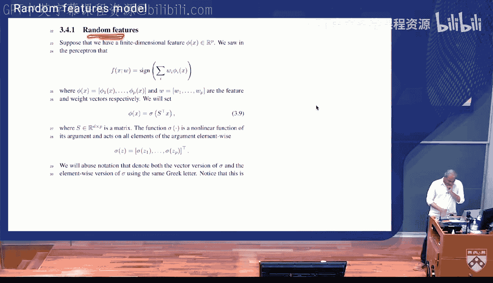
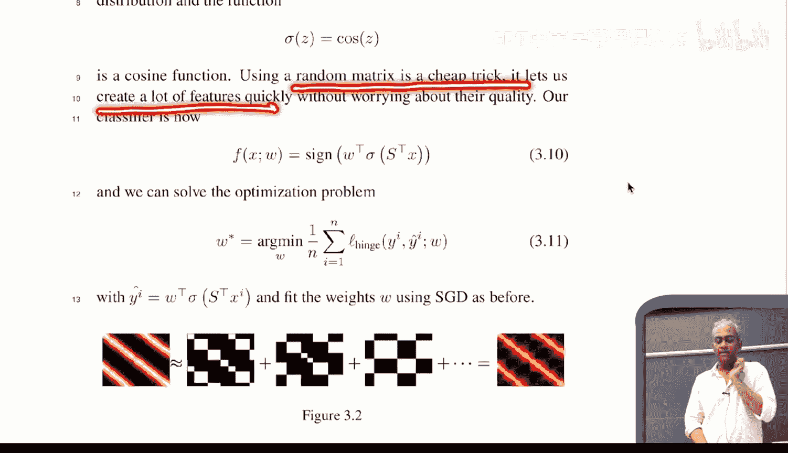
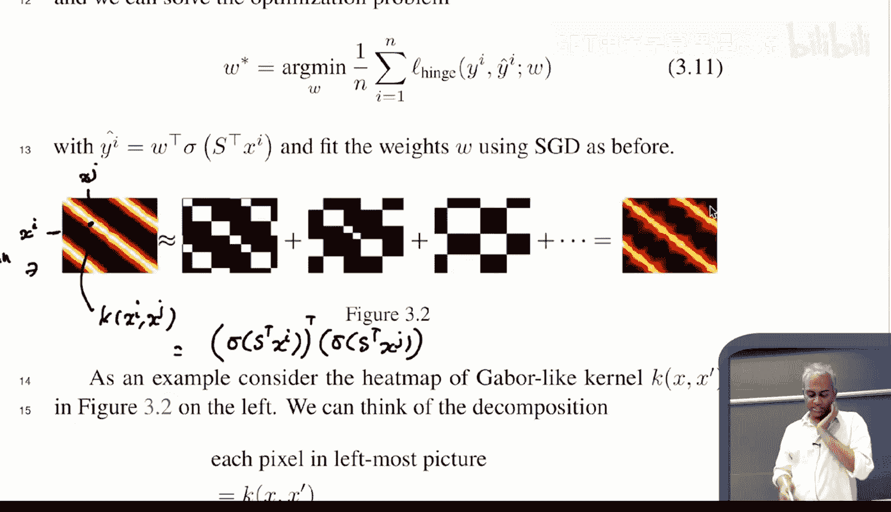
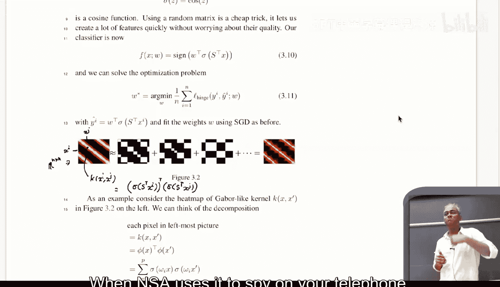
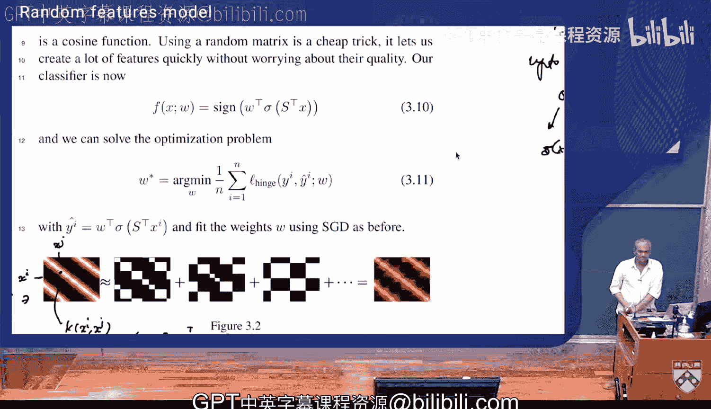

# 宾夕法尼亚大学《人工智能和机器学习基础（AI、数据科学、机器学习）AI and Machine Learning Essentials with Python》 p118 25_03_02_随机特征模型.zh_en -BV16f421Q72q_p118-

Before we learn the feature vectors， let us look at a simple case where we come up with the feature vectors in some very simple way we don't complicated functions。

And this is a very nice paper called the random features model。

 it is also the reading assignment for this particular chapter and here is how it goes so。

PhiI of x is our feature。O。Let us imagine that instead of so I have simply expanded out the w transpose phi of x as a sum。

 w I is my I weight and PI is the I coordinate of my future phi of x。

I can pick a simple set of features， which is given by some matrix S times my input x times sum function sigma。

This is just my choice。 Maybe it is a good choice。 Maybe it is a bad choice。 we don't know yet。

You could have picked any which feature， let us pick this particular one。

 some some non function sigma times S times x。We will also imagine that this function sigma of S is a matrix。

X is a vector。 S transpose x is another vector。 So we will also say that this function sigma always hits all the entries of the vector independently。

 So think of sigma as something like。Sigma of x equal to x squared。if x belongs to real numbers。

 but sigma of some vector v is v1 square v2 square so to V d square。If we belongs to。

 let's say R So sigma is just some function that takes whatever you give as as its argument and then applies to all the elements of that argument one by。

Just another way of picking one special kind of feature。呃。

Okay we are also going to use a very special matrix as I will not even create this matrix in a clever way。

 I simply fill in this matrix with random numbers。So this is a matrix， let us say。

 and every entry of this matrix you sample from a Gausian random variable and。

Call it your feature matrix。 Okay， so S is a matrix full of random entries， nothing special。

This paper showed that for shift invariant kernels。

 shift invariant kernels simply means that k of x comma x prime equals k of x minus x prime。

So the x and x prime never show up separately inside the formula for the kernel。

 they always show up as terms of x minus x prime。This is a shift in variant kernel。

Because I never see x without x prime， I always see x minus x prime kind of terms in my kernel。

Can you tell me why it is going shift invari？So if I add the same constant to both x and x prime。

 then the kernel doesn't change。So whatever kernel I compute at this location is the same as the kernel I compute at some other location。

 okay， that is the latereral meaning of shifting variance。For these kinds of kernels。

 this paper showed that you can pick a random matrix。 you can pick the nonlinear function sigma。

 just like we chose the nonlinear function to be quadratic。

 They chose the nonlinear function to be cossine of its argument Okay just another choice。

They were using cossines because then you can do some nice Fourier transform of the output to prove some things。

 but you could have chosen something else。For a shift invariant kernel。

These two choices give you essentially a nice feature vector。

 the feature vector is not too big as compared to x and it still matches the output of the kernel of these two things。

This is what the point of the paper is the paper says。

 look you can spend a lot of grief in coming up with complicated kernels but you can also choose this simple kernel that you can also represent not just as a kernel but also as a simple feature vector and that works pretty nicely for a number of problems。

It is just one particular choice。So using a random matrix for creating our features is a very cheap trick it doesn't cost essentially any computation because you did not even have to think about it in your head and it creates a lot of features so depending on the size of s you can create however many dimensional feature vector that you want。

Right。

Let us look at an example， so let us imagine that this particular entry is X and this particular entry is Xj okay so I took all my images and I am creating a matrix of size n cross n where every entry of this matrix is k of X comma xj。

And as I said， k of X comma xj is equal to sigma of s transposexi。Bance boss。

Sigma of S transpose exchange。This is the feature I apply the feature and take its inner a product with the feature for element Xj and this is the entry of this particular matrix okay so if you knew the kernel you could compute this matrix what this picture is trying to show is that this kernel。

Can be decomposed as a bunch of simple looking kernels where all these elements are similar to each other。

 all these elements are similar to each other in according to this particular kernel。

 all these elements are similar to each other all these images are similar to each other。

 it can be written down as a linear combination of a bunch of simple kernels。

Is that easy to appreciate you don't know what the kernel is in this case it is effectively the Fourier transform of this feature vector。

 but the point that the picture is making is that look this particular kernel I can write it down as a sum of a bunch of kernels that look simple。

You could have come up with the simple kernel yourself。

 but it is much easier to come up with the kernel。And if you sum them up。

 you get something that is similar to our original card。

So this is just a way to motivate the fact that this simple kernel is not so simple。

 it can be written down as a bunch of other kernels and in the paper they also showed that it works well for a few dataset sets。

So the moral of the story for us here is that。YouThere may be instances where you don't need to think too hard about the kind of features you use。

Such kernels will it will be useful for you to know。

 are very powerful for speech in speech if you want to recognize the phonemes that I'm using or recognize the words that I'm using these kernels have always worked well for the last 20 years or so before deep networks came up this is what was running on most phones or most telephones when NSA uses to sp when your telephone。

 this is kind of the stuff that they use。

These are our features now， just like before we would like to use a vector w to write down a classifier。

 w transpose spherehi of x is our classifier。Once you write down your model， minimizing the model。

 you can use your favorite surrogate loss and minimize the model using grid enddesscent or stochastic reddesscent。

So if you think about this， W is what we are fitting， we are finding the WS is what we have fixed。来。

no。The difference between deep learning and random features is that we don't fix S。

 we also optimize s itself， you can think of this objective as you can think of this as a function of only w if S is fixed。

 but if S is not fixed if I want you to find your own s， not a random s。

 then you can just as easily think of this function as a function of two variables， W and S。

Instead of W star and W star， you will also have w star and a star where you minimize this objective Okay so this is intuitively a neural network。

 simplest neural network， a tool and neural network and we'll get to this in a bit but for now imagine that understand that there is no big difference between a random features model and a neural network the neural network simply learns one extra object of the random features。

The random features model chooses a special kind of feature vector。

 the neural network also learns that particular feature vector。

