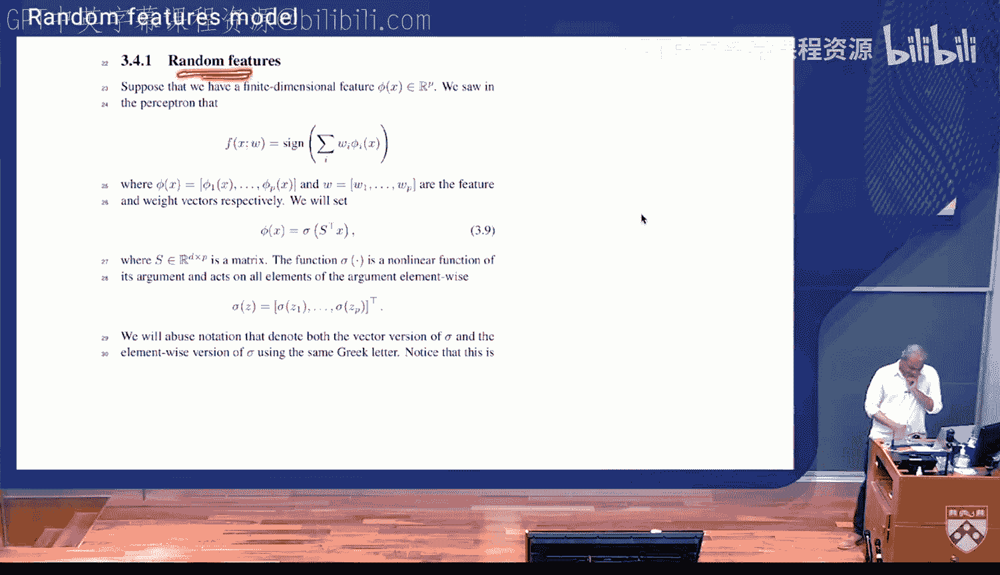
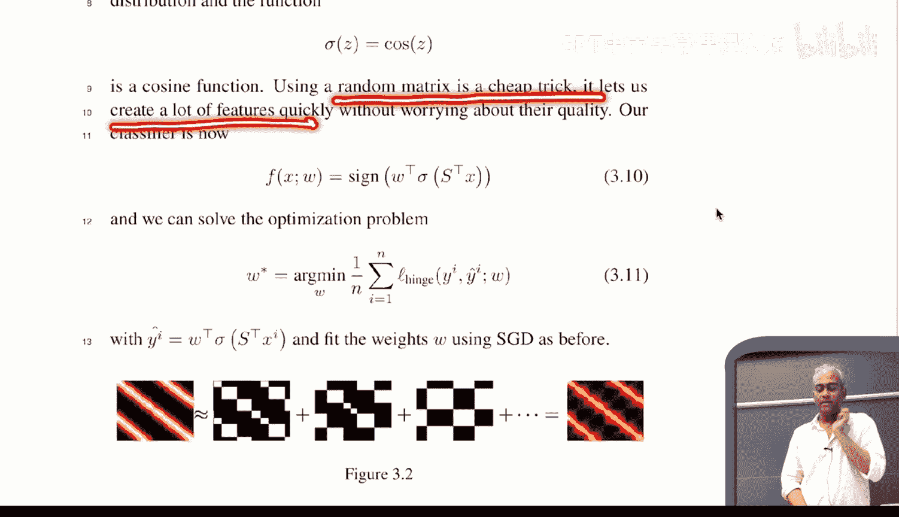
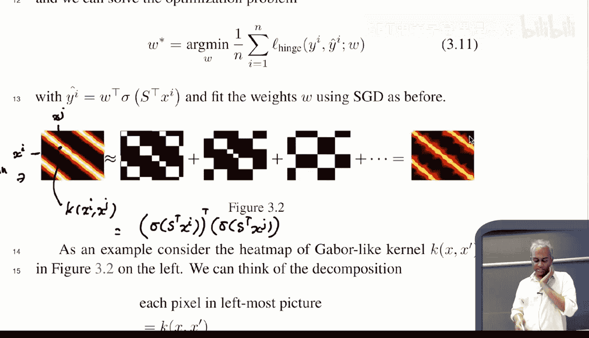
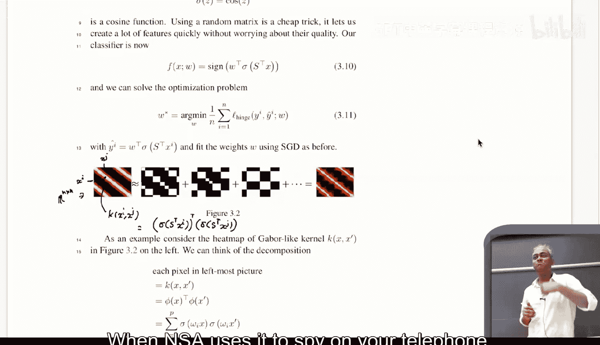
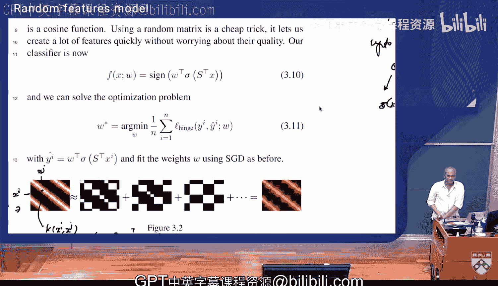

# 宾夕法尼亚大学《人工智能和机器学习基础》：25_03_02：随机特征模型 🎲

在本节课中，我们将要学习一种名为“随机特征模型”的简单而强大的方法。它提供了一种无需设计复杂函数，即可构建有效特征向量的途径。

## 概述

在深入探讨特征向量之前，我们先来看一个简单的案例。在这个案例中，我们以一种非常直接、不复杂的方式来构建特征向量。这种方法源于一篇名为“随机特征模型”的优秀论文，它也是本章的阅读材料。

## 随机特征模型的核心思想

上一节我们提到了构建特征向量的需求，本节中我们来看看随机特征模型是如何具体实现的。

假设我们的特征向量是 **Φ(x)**。我们可以将线性模型 **wᵀΦ(x)** 展开为求和形式：**∑ᵢ wᵢ Φᵢ(x)**。其中，**wᵢ** 是第 i 个权重，**Φᵢ(x)** 是特征向量 **Φ(x)** 的第 i 个分量。

我们可以选择一组简单的特征，其形式为：**Φ(x) = σ(Sx)**。这里，**S** 是一个矩阵，**x** 是输入向量，**σ** 是一个非线性函数。这只是一种选择，好坏未知。我们也可以选择其他特征，但这里我们选择这种特定形式：某个非线性函数 **σ** 作用于 **Sx**。

我们假设函数 **σ** 独立地作用于向量的每一个元素。例如，如果 **σ(x) = x²**（x 为实数），那么对于向量 **v**，**σ(v) = [v₁², v₂², ..., v_d²]ᵀ**。因此，**σ** 是一个将其操作独立应用于输入向量每个分量的函数。

这仅仅是选择特定类型特征的一种方式。

此外，我们将使用一个非常特殊的矩阵 **S**。我们甚至不会以巧妙的方式创建这个矩阵，而是简单地用随机数填充它。**S** 是一个矩阵，其每个元素都采样自高斯随机变量。我们称之为特征矩阵。因此，**S** 是一个充满随机项的矩阵，并无特殊之处。

## 为何有效：平移不变核

这篇论文指出，对于**平移不变核**，上述随机特征的选择是有效的。

平移不变核意味着核函数 **k(x, x')** 满足 **k(x, x') = k(x - x')**。也就是说，**x** 和 **x'** 在核函数公式中从不单独出现，总是以 **x - x'** 的形式出现。这就是“平移不变”的含义：如果对 **x** 和 **x'** 同时加上相同的常数，核函数值不变。

对于这类核函数，该论文表明，你可以选择一个随机矩阵 **S** 和一个非线性函数 **σ**（例如，论文中选择了余弦函数，因为可以利用傅里叶变换来证明一些性质，但你也可以选择其他函数），这样得到的特征向量不仅维度不会比 **x** 大太多，而且其内积能够近似匹配原始核函数的输出。

论文的核心观点是：与其花费大量精力设计复杂的核函数，你也可以选择这种简单的表示方式——它不仅可以用核函数表示，还可以表示为一个简单的特征向量，并且对于许多问题都效果良好。

这只是一种特定的选择。使用随机矩阵来创建特征是一种非常“廉价”的技巧，它几乎不消耗计算资源（因为你甚至不需要动脑思考），并且能生成大量特征。根据 **S** 的大小，你可以创建任意维度的特征向量。

## 直观理解与示例

让我们看一个例子。假设我们有一个包含所有图像的矩阵，我们创建一个 **n × n** 的矩阵，其中每个元素 **Kᵢⱼ = k(xᵢ, xⱼ)**。

如前所述，**k(xᵢ, xⱼ) = σ(Sᵀxᵢ)ᵀ σ(Sᵀxⱼ)**。这是对元素 **xᵢ** 应用特征函数后，与元素 **xⱼ** 的特征进行内积的结果。

下图试图说明，这个复杂的核矩阵可以被分解为多个简单核的线性组合。这些简单核使得某些图像块彼此相似。虽然你未必知道这个具体核函数是什么（实际上是该特征向量的傅里叶变换），但关键在于，这个复杂的核可以表示为一系列简单核的和。你自己也可以设计简单核，但随机特征方法让生成它们变得非常容易，而它们的组合却能近似我们原本想要的复杂核函数。

因此，这旨在说明，这种简单的随机特征方法并不“简单”，它可以表示为许多其他核的组合。论文中也展示了它在多个数据集上表现良好。

对我们而言，这里的启示是：在某些情况下，你不需要过于纠结使用何种特征。这种随机特征模型（及其对应的核函数）非常强大。例如，在深度学习兴起之前的约20年里，语音识别（如识别音素或单词）领域一直广泛应用这类方法。当时大多数手机或电话中的语音识别系统，使用的就是这类技术。

## 从随机特征到神经网络

现在，我们有了特征 **Φ(x) = σ(Sx)**。就像之前一样，我们希望使用一个权重向量 **w** 来构建分类器：**wᵀΦ(x)** 就是我们的分类器。

一旦确定了模型，为了最小化模型误差，你可以使用你喜欢的代理损失函数（如铰链损失、逻辑损失），并通过梯度下降或随机梯度下降来优化模型。

这里的关键区别在于：
*   在**随机特征模型**中，矩阵 **S** 是**固定**的（随机生成后不再改变），我们只优化权重 **w**。
*   在**神经网络**中，矩阵 **S**（相当于第一层的权重）**不是固定**的，它也会被优化。

你可以将目标函数视为仅关于 **w** 的函数（如果 **S** 固定）。但如果 **S** 不固定，需要你去寻找最优的 **S**（而非随机的 **S**），那么你可以很容易地将目标函数视为关于两个变量 **w** 和 **S** 的函数。此时，你不仅会找到最优的 **w***，还会找到最优的 **S***。

直观上，这就是一个最简单的神经网络——一个单隐藏层神经网络。目前，你可以这样理解：随机特征模型和神经网络之间没有本质的巨大差异。神经网络只是多学习了一个对象——特征变换矩阵 **S**。随机特征模型选择了一种特殊类型的特征向量，而神经网络则进一步学习了这个特征向量本身。

## 总结

本节课中，我们一起学习了随机特征模型。我们了解到，通过使用随机生成矩阵 **S** 和一个简单的非线性函数 **σ**，可以高效地构建出能够近似复杂平移不变核函数的特征映射。这种方法计算廉价且易于实现。我们还探讨了它与神经网络的联系：随机特征模型可视为一个固定了第一层权重的神经网络，而神经网络则通过同时优化所有权重（包括第一层的 **S**）来学习更优的特征表示。这为理解从传统核方法到现代深度学习之间的过渡提供了清晰的视角。