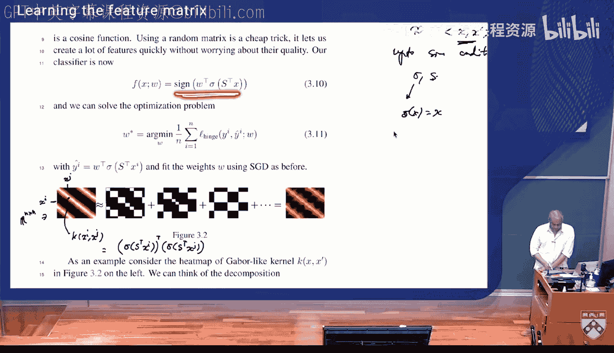
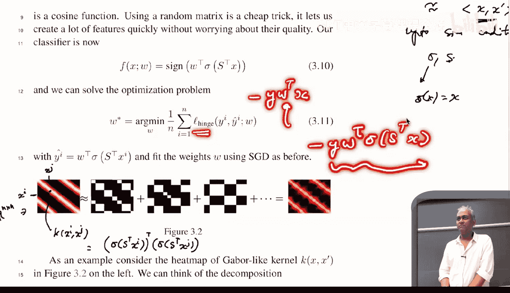
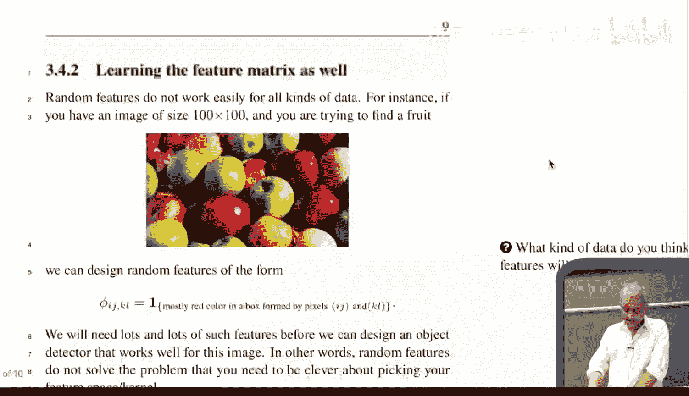
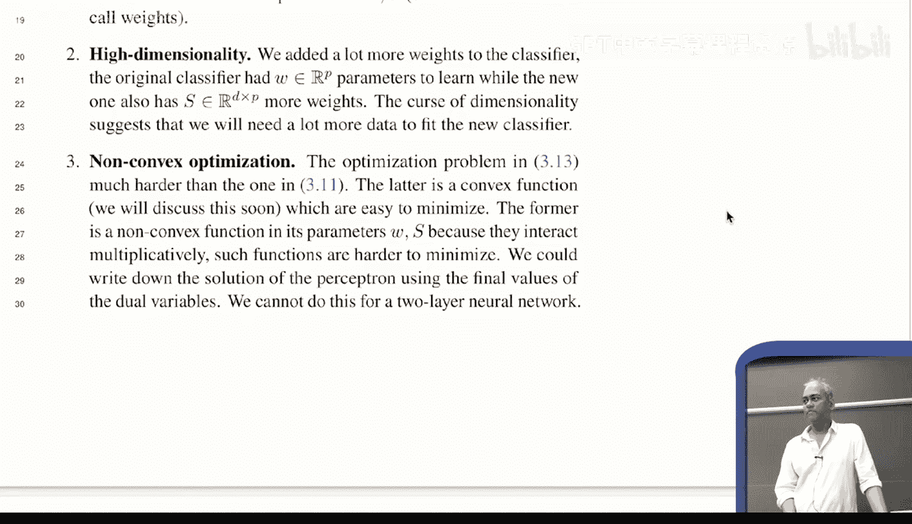
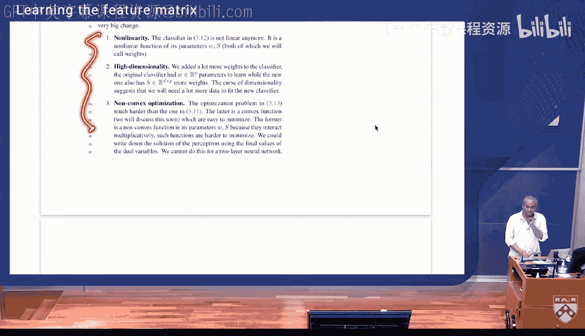

# 宾夕法尼亚大学《人工智能和机器学习基础（AI、数据科学、机器学习）AI and Machine Learning Essentials with Python》 p119 26_03_01_学习特征矩阵.zh_en -BV16f421Q72q_p119-

It may look like we did a very basic thing， but we have completely changed the problem Okay so in this problem。

This is a linear function of W。Is that easy to see for everyone？If you use the hinge loss。

You get minus y times w transpose x instead of this entire business now you get minus y times w transpose sigma of s prime x this entire business is still a linear function of w so you can take the derivative p trivial S is fixed。

If s is not fixed， then this is not a linear function of W and S。Is that obvious to everyone？

W and s multiply each other right So the derivative of w is depends on S the derivative with respect to the S depends on w。

 So this is a non nonlinear function。If you have S fixed， it is a linear function。

Just because we chose to learn S， we moved from the world of a linear function to a nonlinear function。

 and these are much， much more complicated objects than linear functions。

So we have made our life harder， weve introduced some nonlinearity that comes from sigma so it is clearly not a linear function even due to sigma but it is also now a nonlinear function because it is some function both w and sigma multiplying with each other so it is a nonlinear function not a linear function。

If you had P weights， if w was a P dimensional vector before， if you had a p dimensional features。

Then d is a sorry S is a matrix of size d cross p because we always want to do s transpose x and x is a vector of d dimensions。

 so s is a matrix of d times p entries right so the total number of parameters that we are supposed to fit now is what is p for w。

And D times P for S。 depending on the value of B， this can be much more than p。Okay。

So we made our model more complicated by choosing to learn S。As we said。

 if you have many parameters to fit for your function。

 you need more data to fit the function because of the of dimensionality。

 so now because you've chosen to learn Ns， you should procure more data to fit your model。Okay。

 so this is a high dimensional problem or at least a larger dimensional problem if you have an s that is very large。

 then it is a high dimension problem， its a nonlinear problem。

What is not so obvious to you right now is that it is also a non convex problem。

Convex functions look basically like parabolas， parabolas are nice because there is only one bottom。

 you cannot fall anywhere else but the bottom when you descend when you dograde and descend on a parabola。

Non convex functions look like this， for example。If you do gradient decent from this location。

 if you initialize your weights here and you do gradient decent from this location。

 you will get stuck here。At some largest value of the training error， if you start here。

 then you will descend to this place。So depending on where you initialize you may get different answers。

 this is what non convetx functions look like， they are more complicated than convex functions。

Convex functions， it is only a matter of how fast you get to the bottom。

 There is no mystery but whether or not you get to the bottom for a nonconvex function。

 it also matters where you come from so such problems are much more complicated than these kinds of than minimizing a parabola and so nonconvex optimization is a much more complicated B than convex optimization which is what we are doing when we fit the perceptron weve made the problem much more complicated by choosing to learn S also and as he said I can think of this as a two layer neural network。

Lair is simply a name that is given to these objects。

 that is nothing meaningful about what a layer is。S is the first set of parameters。

 W is the second set of parameters。