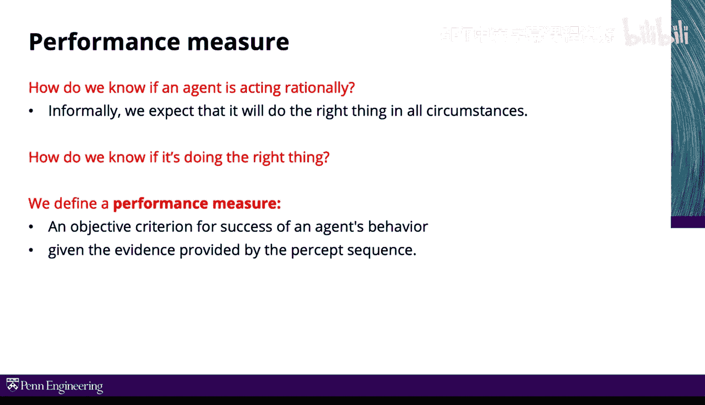
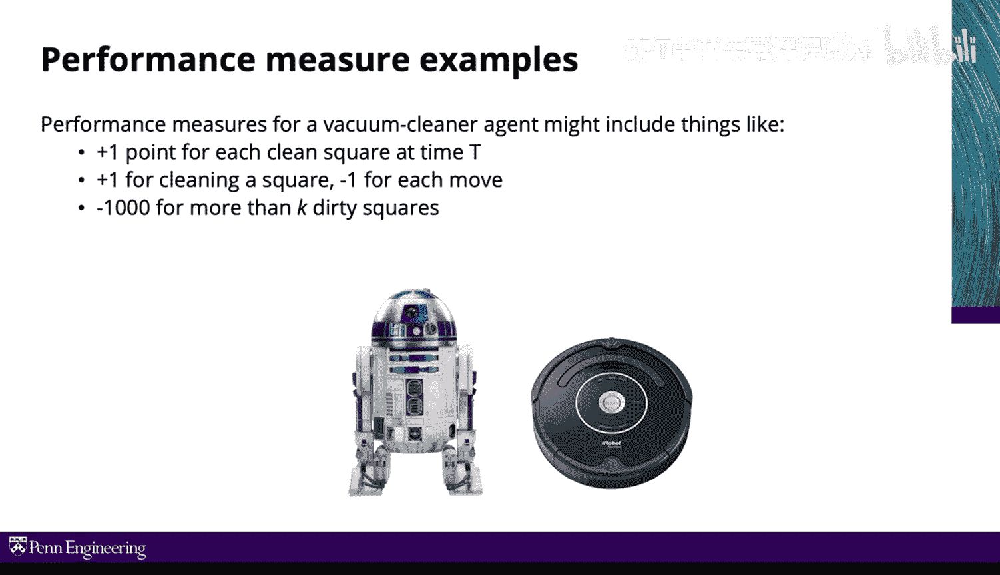
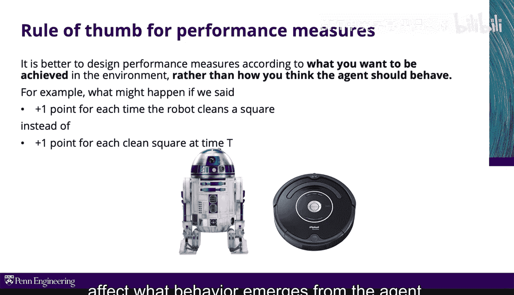
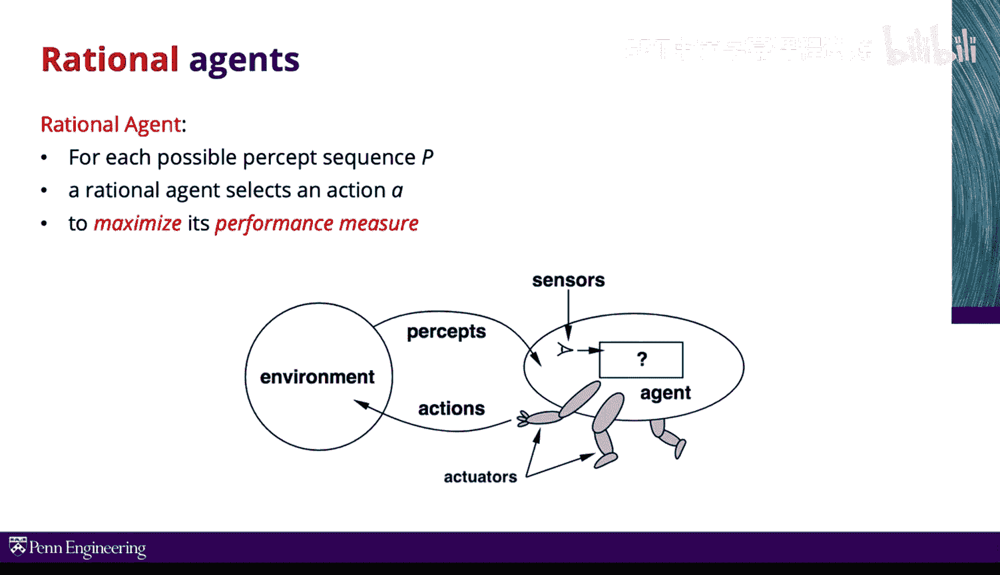
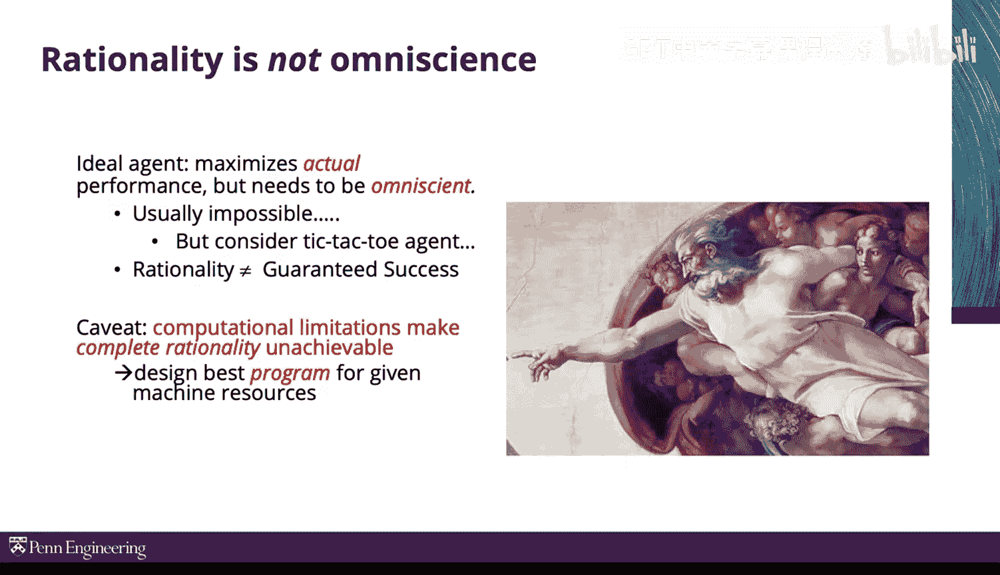
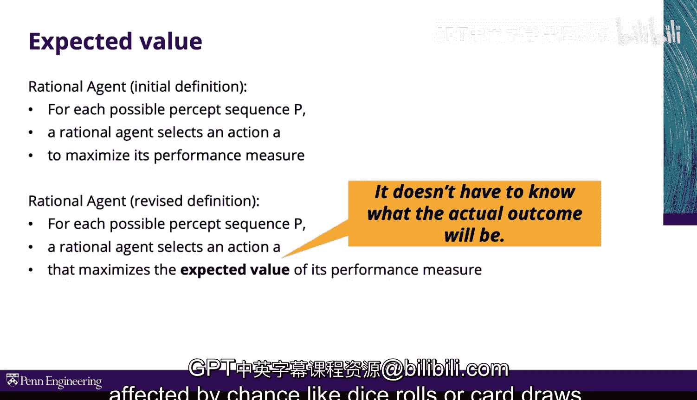

# 宾夕法尼亚大学《人工智能和机器学习基础（AI、数据科学、机器学习）AI and Machine Learning Essentials with Python》 p12 12_02_02_理性智能体-II.zh_en -BV16f421Q72q_p12-

The field of economics has its own definitions of what constitute rational behavior。

There's a theory called rational choice theory that incorporates the notion that individuals have bounded rationality。

This means that they can only make decisions based on information available to them。

 since they cannot be omniscient。Rational choice theory was developed by Herb Simon。

Here's a one sentence summary from his seminal 1953 paper called the Bevioral Model of rationalal Cho。

He says， in this paper， I propose a model for the description of rational choice by organisms that have limited computational ability。

So for us， organisms might be agents。Limited computational ability leads to the notion of bounded rationality in economics。

And the notion of limited computational ability is very relevant for artificial intelligence as well。

Herb Simon was an economist， a political scientist， and a cognitive scientist。

I think that Herb Simon is actually the only person ever to receive both the Nobel Prize in economiccons and the Turing Award。

When Alfred Nobel created the Nobel Prize in 1895， he specified that five prizes be given every year to those who。

 during the preceding year have conferred the greatest benefit to humankind。

The five different fields that Alfred Nobel selected were the fields of physics， chemistry， medicine。

 literature， and peace。At the time when the prize was created。

 computing hadn't been established as a field yet， so there's no Nobel Prize in computer science。

The equivalent thing is the Tring award， which Herbert Simon also won for his contributions to artificial intelligence。

Rational choice theory is a framework for understanding economic behavior or even broader societal behavior。

The basic idea behind rational choice theory is that the actions of an entire society or a market is the result of behaviors from individuals。

Each of those individuals is making their own decisions where they're considering a set of possible alternatives。

The basic assumption behind rational choice theory is that individuals act in a self interested way。

And they'll pick the alternative that's most desirable to them。

The idea of rational choice being a notion of picking the alternative that's most desirable still leaves us something to define。

If individuals have preferences that allow them to choose among a set of possible outcomes。

Then we need to have a way to evaluate the utility of each outcome。

Now we're going to start out with the general notion of a performance measure。

How do we know if an agent is acting rationally informally。

 we've said that it should do the right thing？Ideally， if it's rational。

 it should do the right thing in every circumstance。

How do we objectively know whether it did the right thing or not， Let's define a performance measure。

This will be some objective， measurable criterion of success that evaluates the agent's behavior。

This means that it willll give a score to an agent's choice to take a particular action based on the consequences of that action。

We can define this score to relate to what we as the designers of the system care about。

This will allow us to say， given a sequence of actions selected by the agent。

 did it choose the right action to maximize its performance measure， If so。

 we'll say it actrationally。

Here's an example of a performance measure that we could create for a robotic vacuum。

Let's say that the agent in question is our Roomba。 It has a set of sensors and a set of actuators。

 We want it to behave rationally so we could give it a performance measure for it to try to maximize。

What performance measure could we design for the roomma？

And how would it behave if it acted rationally by trying to maximize that performance measure？

We could devise a performance measure in several different ways。 For instance。

 we could say that the robot gets one point for every clean square at some point in time T when its cleaning routine terminates。

So it should try to increase the number of clean squares。Alternatively。

 we could give it one point for each time it cleans a square and penalize at one point for every move that it makes。

This would reduce the amount of unnecessary movement。

 and this would actually be a great thing to incorporate into a Roomba。

My robot vacuum tends to have a totally random way that it cleans the room。

It repeatedly vacuums the same spot many times and will often just barely miss some dirty spot that it should have cleaned。

To penalize the robot for missing too many dirty spots。

 we might add a threshold that allows us to say， if it didn't clean the room thoroughly enough。

 then it failed to do its job。We'll give it a big penalty， like minus100 points。

If the Roomba chooses a set of actions that maximize the performance measure that we've given it。

 then we'll say that it's acted rationally。If it does something crazy that results in a very low score。

 then we'll say that it hasn't acted rationally。

How do we create a good performance measure when there are many possible ones？

A good rule of thumb for for performance measure is something somewhat surprising。

It's better to design a performance measure according what you want to be achieved than how you think the agent should behave。

If you try to dictate how the agent should do its job rather than what you want accomplished。

Then this can sometimes cause strange behaviors。Think about this example。

 we previously said that we would give a point for every clean square at time T。

When the robot terminated， what if instead we gave the robot plus one for each time it cleaned a square instead of the total number of cleaned squares of the end。

This seems like a very subtle difference。We're now not saying what the outcome should be。

 but we're trying to tell the robot how we think it should behave。Well。

 it turns out that this is a case of being careful for what you wish for。

Because if the robot is trying to act rationally based on this definition。

 then itll try to maximize this new performance measure。

 One way that a robot could maximize this measure is to clean a square， then dump dirt on it。

 and then clean it again。This would be unexpected bad behavior。

 but it would still maximize the score Be of agents can be emergent based on how we define our performance measure。

 So we'll need to be careful about how we design them。Later in the course。

 when we talk about reinforcement learning， we'll talk about reward functions。

 and you'll see how changing the way that you define your reward function will affect what behavior emerges from the agent。

Now that we have a definition of a performance measure。

 and we can start to construct our definition of a rational agent。

We'll say that a rational agent is one that for every possible percept sequence P。

Selects an action A。To maximize its performance measure。Clearly。

 this will result in a more desirable sequence of actions。

Then the sequence of actions that would lead to a lower score from the performance measure。But， wait。

How can the machine know which actions will maximize its performance measure？

Like we said before， we cannot require omniscience for irrationality。 Therefore。

 we cannot require maximizing the actual performance because an agent would have to have a complete knowledge of all outcomes。

This is going to be impossible most of the time。But in some problems that we'll consider。

 like playing a simple game like T T toe， it is actually possible to fully anticipate all possible outcomes for the game so you can maximize actual performance。

One interesting caveat is that computational limitations make complete rationality unachievable for almost all problems。

 including more sophisticated games like chess or go。

We'll see later in the course that it's computationally impossible for a program to consider all possible outcomes for those games。

 Therefore， we want to revise this definition of rational agents to include the fact that computational constraints。

And uncertainty mean that machines cannot be omniscient。Therefore。

 they cannot be required to maximize actual performance。

We'll finalize our definition of rational agent。We will say that a rational agent is one that for each possible percept sequence P。

Should select an action A to maximize the expected value of its performance measure。

This change means the agent doesn't have to know what the actual outcome will be。

 This notion of maximizing the expected value is a very powerful concept that will come up again and again in this course。

In the next module， we'll study the miniax and the expectax algorithms。

Both of which maximize the expected value of outcomes in games。

The Minimax algorithm works when we're playing against a rational opponent who's also trying to maximize their own score in the game。

And the expectax algorithm works with outcomes that are affected by chance like dice rolls or card draws。

