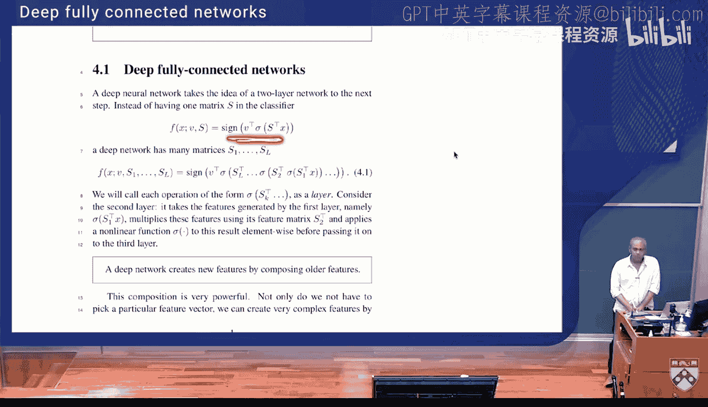
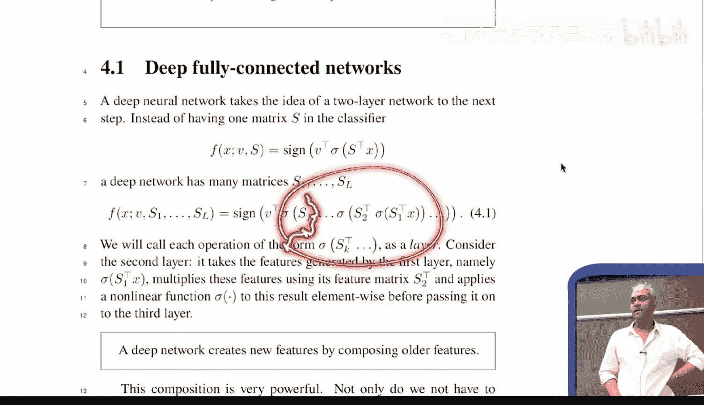

# 宾夕法尼亚大学《人工智能和机器学习基础（AI、数据科学、机器学习）AI and Machine Learning Essentials with Python》 p120 27_03_02_深度全连接网络.zh_en -BV16f421Q72q_p120-

In this chapter， I will choose to write the last flare as not W， but V。

 And you will see why just the renaming of the。Instead of having two parameters like this。

 you can have many parameters like this， you can create complicated features that are functions of other features so imagine that S1 x with sigma applied to it is one kind of feature when you apply another matrix sigma2 transpose to it and a non nonlineararity on the outside you get a more complicated feature so you create a simple feature using s transpose x you make it more complicated by multiplying it again by s2 transpose x and you can keep doing this many。

 many times。

In this case， I have written it down for all different times。

Whatever you come up with is your feature vector phi of x。As soon as you have a feature vector。

 you use a vector， a V to classify to create a linear model out on that feature vector。

So we've done nothing other than taking this two layer neural network and then writing down an L layer neural network where instead of 1 s。

 we have many s's。Okay。This is a deep neural network。

So nothing very deep about it other than just stacking up multiple layers using the same business。

Okay， so every time you see this complicated expression， there is nothing to worry about it。

 you simply replace everything that is written here by p of x and then imagine it as our same perceptron。

But the important thing to realize is that a neural network or a deep network creates new features by composing older features。

 the old features were S1 x of the first layer， the second layer takes these features and then makes them more complicated。

And this keeps on happening for a few times。At each at each instance you take the old features。

 multiply them by some matrix s， multiply them and apply some nonlinear function sigma to it to make things more complicated and then pass it off to the next layer so this entire object。

Sigma applied to s times， whatever the argument is is what people call a layerir。

They call it a layer because in your brain there is some this kind of operations that happen and people have noticed that there is a hierarchy of such operations and so each such level of the hierarchy is called a layer for us。

 it is just a mathematical expression。Cool， so this is a neural network。

 And if the problem in the previous chapter was complicated because we had two weights。

The problem in this chapter is even more complicated because there are really many， many。

 many weights right。Every S matrix gives you lots of parameters and they all add up in your network to create your weight vector。

