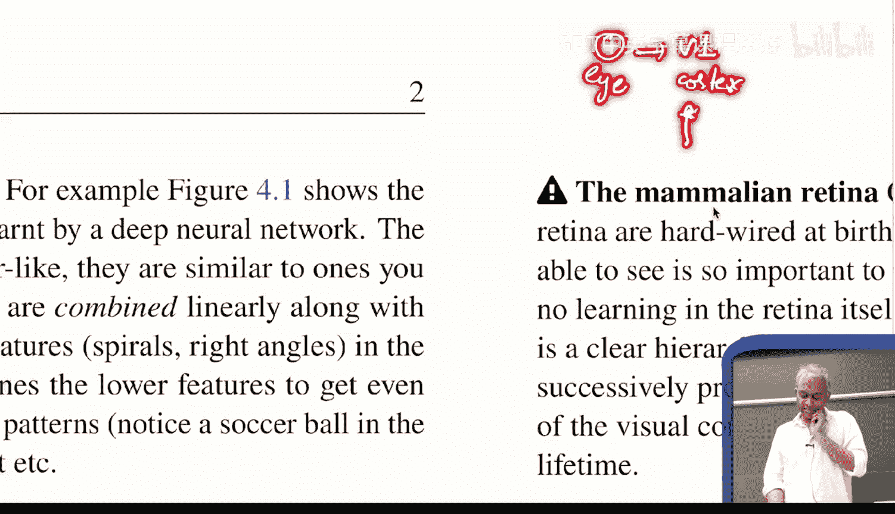
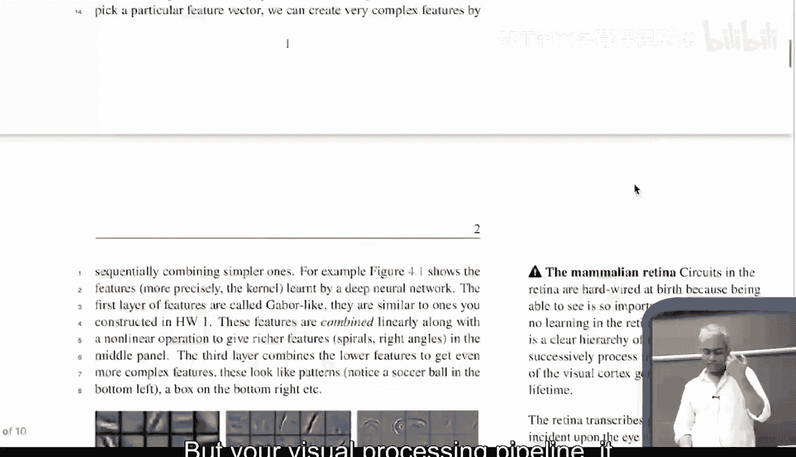
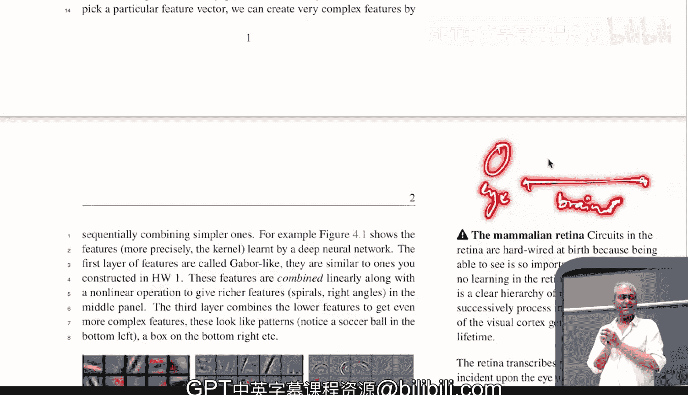

# 宾夕法尼亚大学《人工智能和机器学习基础（AI、数据科学、机器学习）AI and Machine Learning Essentials with Python》 p121 28_03_01_神经网络学习何种特征.zh_en -BV16f421Q72q_p121-

Here is how features look。So。We said that phi is this is something like s transpose x so I can take a trained neural network and we will see how to do this later。

 but I can take a trained neural network and check what kind of features are being learned after the first layer。

And turns out you see features that look like this。

 so these are edges where there is some bright stuff in the middle and then it is surrounded by two dark lines。

This is a feature that that is relevant to green color so this feature will always be have a large magnitude every time there is a region in your image that is green this is the gradient of green and pink etc so this is how the features look of a train neural network after the first one or two layers。

Now this is interesting because the way visual processing works in your eye is that there is a retina。

 retina receives the light， it processes the like in some way and then it passes it off to some kinds of neurons so if you imagine this is your eye。

 it passes it on to something called as a V1 cortex。

 it is the first hierarchy of the visual processing pipeline in your brain。

Turns out the features that people have measured， you can put some electrodes on the neurons of v1 and see when the electrode registers a high voltage depending on what kind of input you show to the eye right so if you show green input and this particular neuron registers a high voltage then you know that this neuron response to green so now like people have developed many sophisticated ways of measuring such neurons and it is known since a long time ago actually 50 years or so that the features of v1 they look very similar to this。

They they respond to edges， they respond to colors。

 they respond to simple functions of simple gradients。You know these features from your homework。

 they're Gber like features， Gber like features are that they look exactly like this at us。看。

So these are the features of the first two layers。Tip let's say the second layer of the neural network。

 As you go higher up in the layers， these features become more complicated。

 So you will see that these features are。Functions of these more fundamental features。

 the edges and the colors and everything， so if you see an edge that is horizontal as one feature。

 if you see an edge that is vertical in another feature。

 then a neuron that combines these features can learn to recognize process。

 this is how these features are coming， theyre combined in linearly with the matrix S with some non nonlinearity applied to it to make it more complicated。

And this is how those features look people have spent a lot of time like trying to look at these features and then guess what they do。

 etc ce， you can also do it so for instance this feature probably corresponds to what。

And I are a football。One of个。So it's very difficult to guess what these features really are。

 but for sure you know you will agree with me that these are more complicated than these features。😊。

Right。As you go higher up in the network， you get even more complicated features。

 so these are the eyes for instance。There is this particular picture has a lot of eyes or this might be a golf ball or something。

Because the data set that this was created from， it is called Imanet。

 and Imanet has lots and lots of dogs and lots and lots of cats。Like people like their pets。

 so they click a nice photograph of the eyes and the face of a pet。

 So this is how the kind of features that will show up in the neural network。

So all this is to convince you that the features really do get more and more complicated as you go higher up in the layers。

 inputs are real natural images and these are features of these natural images。It is。

I wanted to tell you a little bit about the features of the eye。

So it turns out a neural network learns when you train it， but your visual processing pipeline。

 it consists of your eye over here and then like a bunch of stuff that let us call it the brain。

The brain learns after you're born， but the eye doesn't really learn the eye has been created across many millennia of evolution。

 and basically you have perfect processing of the neurons in your eye as soon as you're born。

 Nothing is changed after that。There is some small things that change， for instance。

 when you go from a dark room to bright sunlight outside。

 there is some molecule called redopoxin that decreases how many molecules it is secreting so there is some small chance of adaptation that happens when you use your eyes。

 but the neurons fundamentally don't do anything different。

