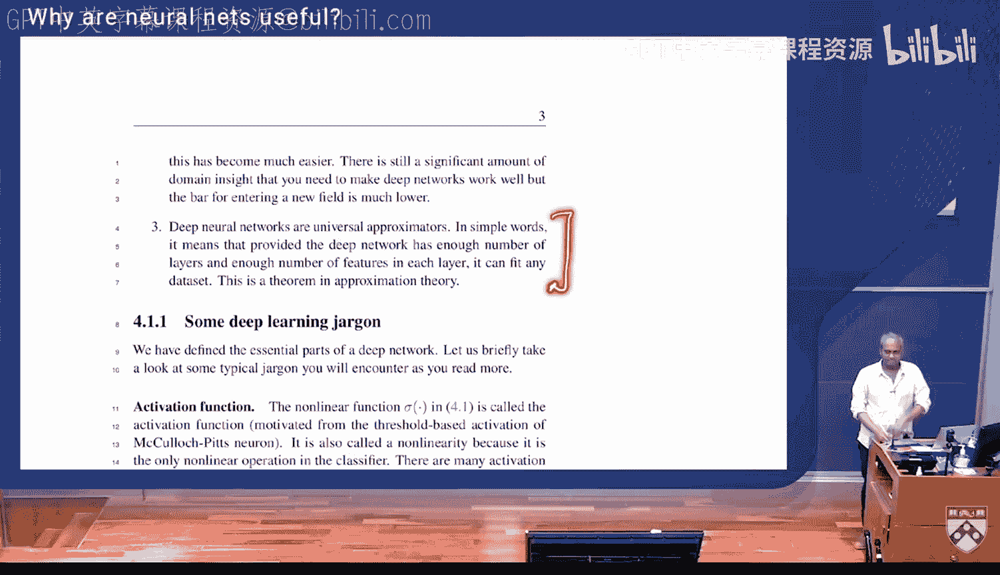
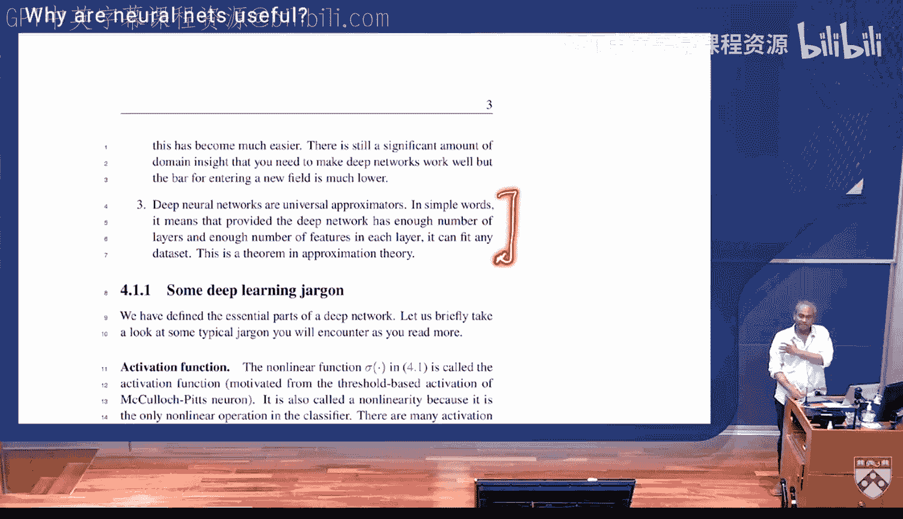
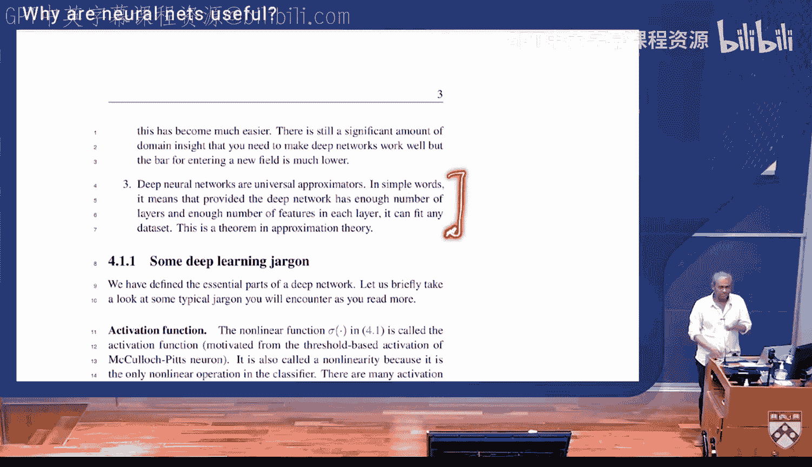
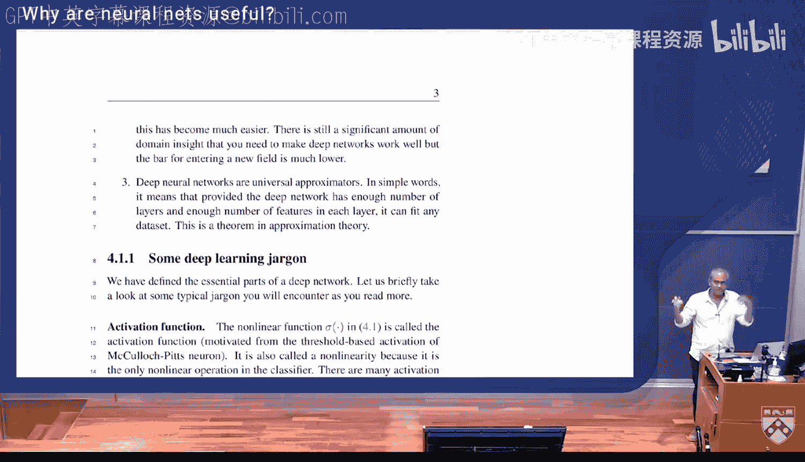
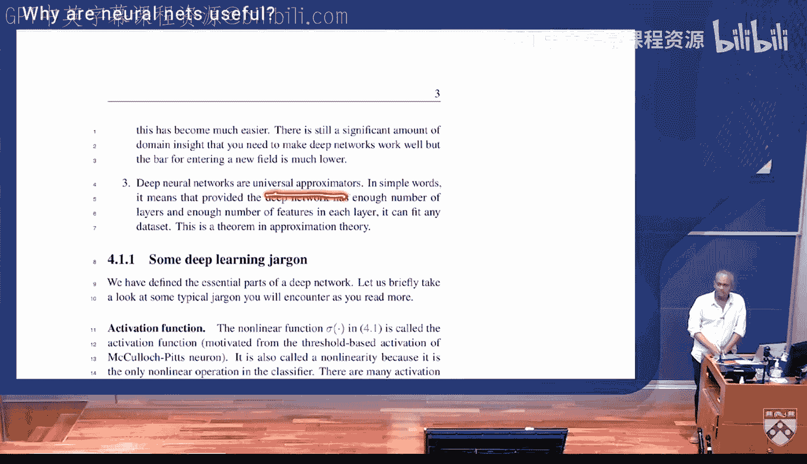
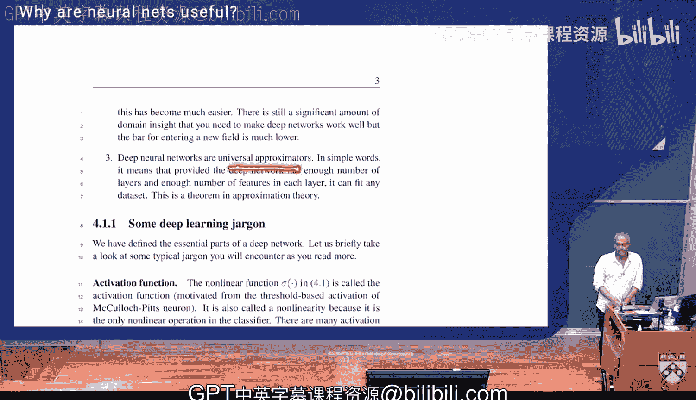

# 宾夕法尼亚大学《人工智能和机器学习基础（AI、数据科学、机器学习）AI and Machine Learning Essentials with Python》 p123 30_03_03_神经网络为何有效.zh_en -BV16f421Q72q_p123-

Cool， so after a little bit of interlude of inspiration， let us come back to neural networks。

Fitting a neural network is just calculating all these weights。Nothing changes。

 you still minimize the hinge loss if you have two classes just now in addition to taking the derivative with respect to one of the ways。

 you have to take the derivative respect to every weight。Okay， and update all of them one by one。

So a few things before we proceed to back propagation。

 not having to pick features is very powerful and this is the biggest reason why everyone is doing deep learning right now instead of doing other kinds of machine learning。

You know this， but you may not have appreciated this， but let's say when I was your age。

 let's say finishing my undergraduate at beginning my grad school。

For a vision person to be able to sit in a talk given by someone who works on text was basically impossible you have no idea of what is going on in the natural language processing community。

 a person who works on NLP if he or she sits down in a talk given by a computer vision person these are just a completely alien world。

 totally different techniques everything is different a problems are different okay。

Today this is not the case because neural networks are such nice machine learning models that basically the same concepts that you use to solve a problem with computer vision。

 you can translate some of these concepts to solve a different problem in NLP。

So they've brought together these fields in a surprisingly nice way because people don't need to cook up their own features anymore。

10 years ago in a conference or a vision paper， you would cook up your own features。

 solve a problem in an en conference， you would pick up different kinds of features and 50 years of feature engineering is essentially replaced now by simply learning those features。

It is not clear whether we learn the same features that we used to create before。In fact。

 I would argue that we don't learn the same features that we used to play before。

 otherwise we would not work any better。So we seem to learn different kinds of features。

 but it has just like completely killed this entire divide between intellectual fields。啊。

There is also a little bit of rush that is unwarranted in this sense， there are many fields。

 for instance， medical imaging where people study images of brain or images of lungs and et ceter to make some prediction and understand them。

 these fields had developed very sophisticated ways of creating features。

When people began to apply deep networks to these fields。

 they noticed that these networks do not really work well。

 even though presumably you are learning the features， so just like all the other fields。

 you should be doing better。So you will still see like remnants of this kind of thinking where people are applying neural networks to problems where the original feature is actually very good and they see performance at is much worse than the old methods。

 but because there is so much temptation to apply these things and so much hope that they will work better people still keep trying。

😊，But Marll， the story is that you don't need to pick features anymore。

 I can go to a talk given by an NLP professor， I will understand it somewhat。

Deep networks are universal approxims， and this is something that we have said many times in words will again say only in words。

 not in mathematics， any function that you want to fit to the data。

 if the network is large enough and the network has enough layers and enough width。

 you can't fit this function。

Doesn't mean that it reduces the amount of data you need to fit the function because the larger the network。

 the more the amount of data you need to fit because of the cursor dimensionality。

 but you can fit it given enough data。

So this is what it means to be universal appximator。

 any kind of complicated predictions you can have， you can make them。

