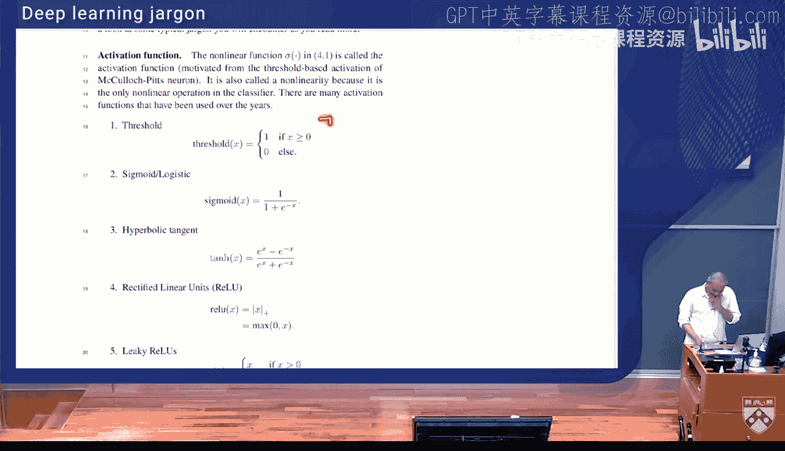
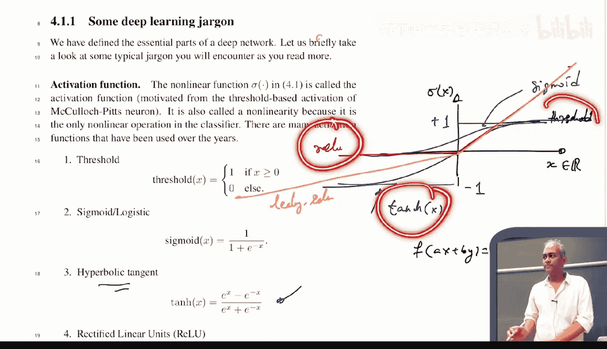
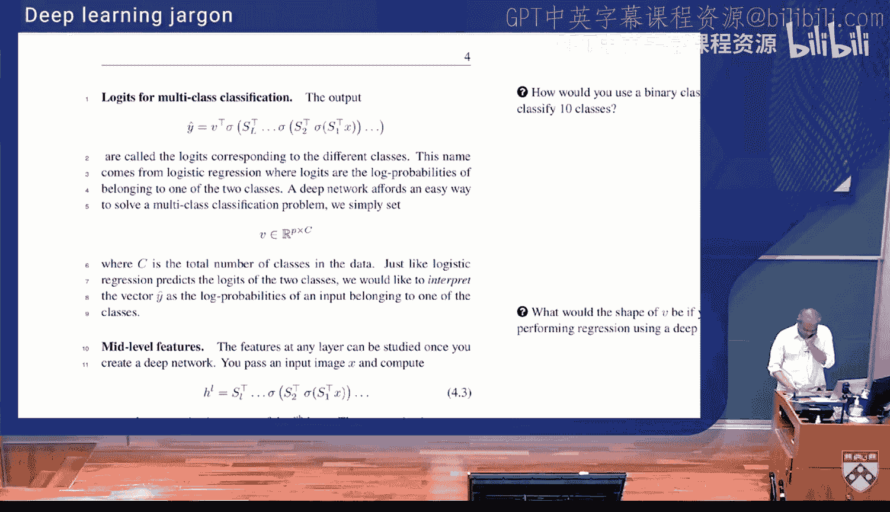
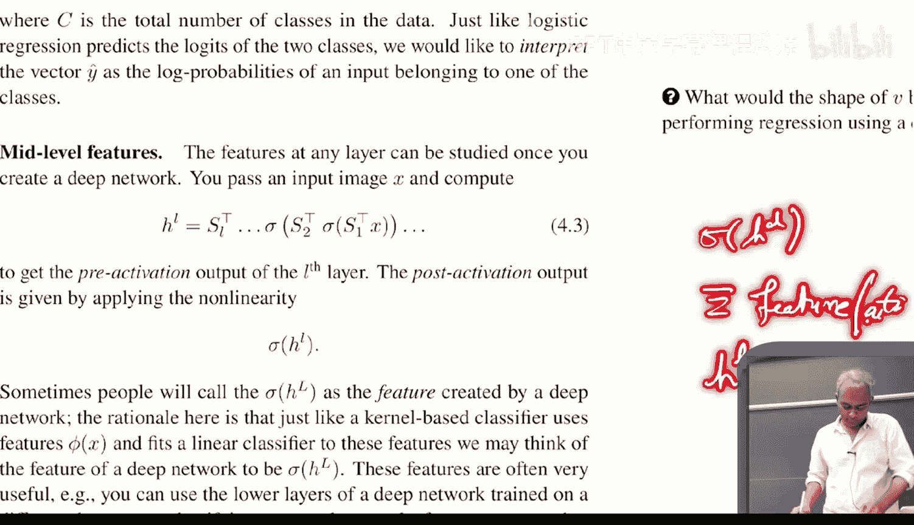
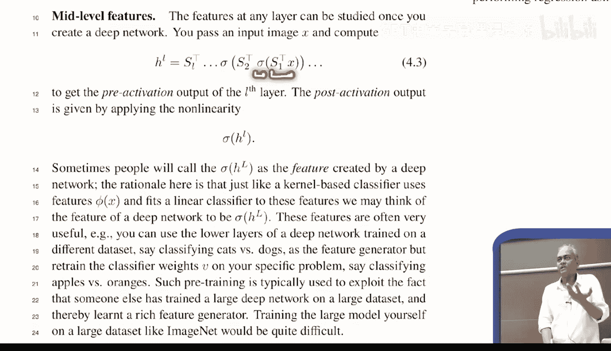
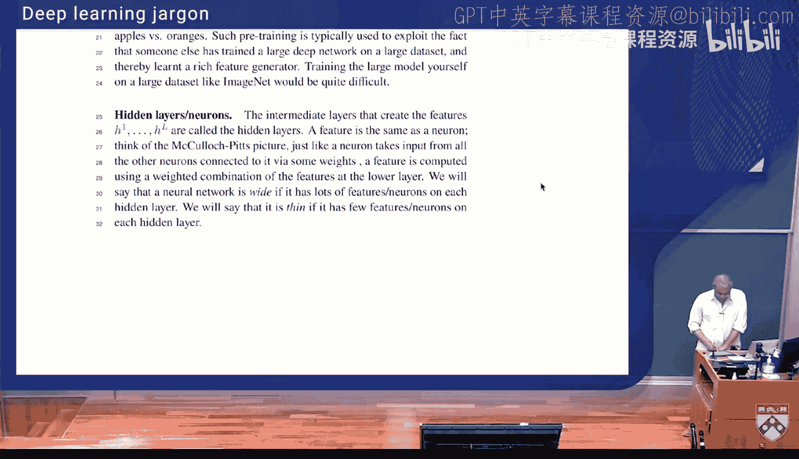
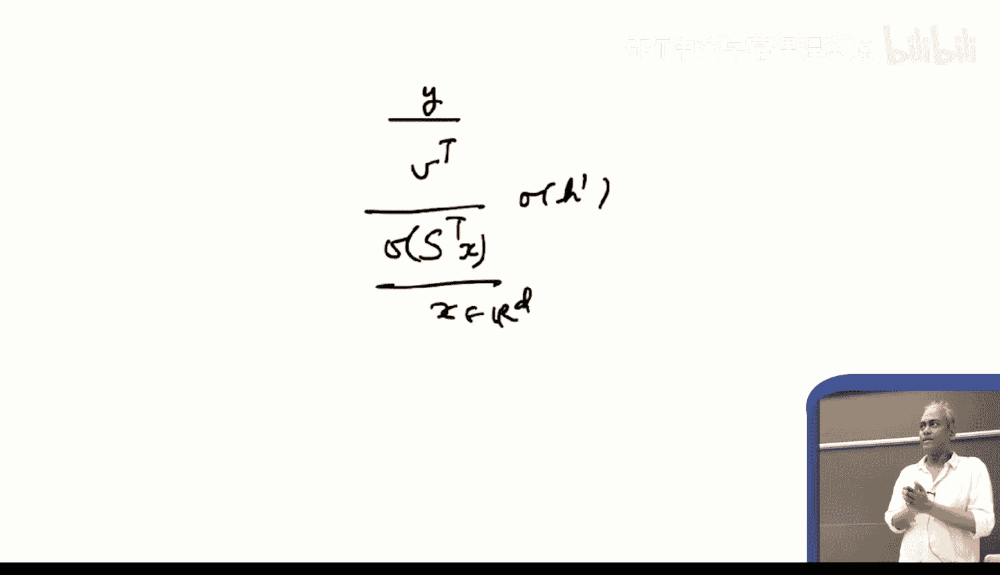
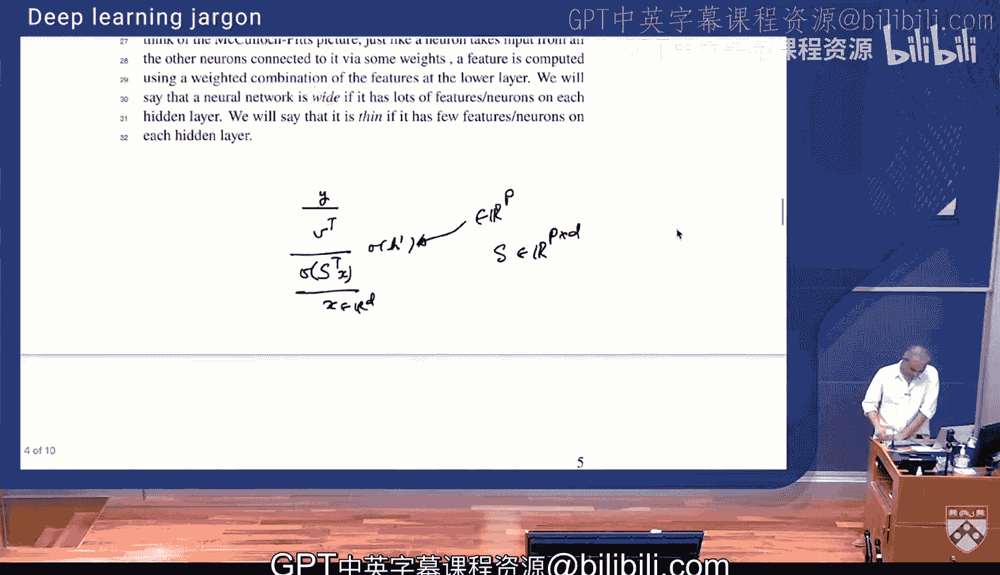

# 宾夕法尼亚大学《人工智能和机器学习基础（AI、数据科学、机器学习）AI and Machine Learning Essentials with Python》 p125 32_04_01_深度学习术语.zh_en -BV16f421Q72q_p125-

So some jargon， this is really not important。 These are just names given to objects by people to。

We reduce the bit rate of what we talk about I guess in the first lecture we saw the MacClog and pits neuron。

 it predicts a sign of its inputs， double to transpo x， and this is the sine function。

A related variant is a threshold operator so these are all replacements for the nonlinear function that is inside our network。

 you can think of it as a threshold function， it returns a1 if its argument is greater than  zero or it returns a  zero otherwise。

Let us do the same exercise we will take in x as the argument and x is a real number because we know that our nonlinearity applies to vectors the same way that it applies to real numbers。

So a threshold function is what this is one effect is positive。It is zero otherwise otherwise。

It is not a linear function。That much you should appreciate， it is a nonlinear function。

What does a linear function mean， can you define it？Yeah。

 so F of Ax plus By is a times F of x plus B times F of y for all A， B X。This is a linear function。

A sigoid or a logistic looks like this， so if x is very large and positive， what is it？1。

If x is very large and negative， what is it？-1 if x is 0， what is it？Half。

So we have a sigmoid that is this。So you see that the sigmoid is kind of a smoother version of a threshold nonlinear function。

Hyperbolic tangent is a similar function， again， like if x is very large and positive， what is it？

One， effects is very large and negative， What is it。那个等我。So this is our what is it at zero？So。

 this is。Danage of x。A rectified linear unit is a maximum of0 and x。So how does it look？

If it is larger than0， then you have simply x。 If it is less than 0， then you have。あ、強了。

So Raillu is another linear function， it is very very close a nonlinear function。

 it is very very close to a linear function because to the right of the origin it is a linear function to the left of the origin it is also a linear function just that there is this little ck in the middle。

Leaky reluus is like another thing that you might see sometimes that doesn invent color leaky reello is a function that is like the re on the right hand side and kind of like。

Areello， but with slope that is something slightly positive on the left hand side of the origin。

 it is very close to Aello。Now。These are all names given to different functions that people have used historically in place of sigma。

Some of them work better than others， some of them work worse than others。

 there are some legitimate reasons why things work better than others， and we will see soon why。

The most important thing to remember from this little section is Rav。Is a very very good replacement。

 very， very good non nonlinear to use， so unless you know something very special about your problem that tells you that you should not be using aLlu。

 you should use aL。In general， never use liu because li is pretty I。Also。

 you will never see sigmoids being used today， you will sometimes see tannage being used and you will sometimes see a being used。

Okay。

And in a bit we'll see why another nomenclature when we thought of the perceptron。

 we said that we know how to fit a binary perceptron。

 how do you fit a multiclass perceptron either by doing a one versus all or doing some pairs of classes etc and fitting many perceptrons right in a neural network you can do things in a much more elegant way。

Final vector， v。We have always thought of it as a vector。Right。

 because we have always thought of why hat or a sine function being applied to the exact exact thing to return plus one and minus ones。

But the V doesn't have to be a vector， the V can be a matrix。In that case。

 it will so let us say that V is a matrix of size。

H P cross 5。And so this entire thing is a vector of p dimensions， so v times our feature vector。

Is now a vector of five dimensions。Is that clear？Or v transpose at times of feature vector is a vector of five dimensions。

Each of these five dimensions we can interpret as cat or no cat， dog or no dog。

 elephant or no elephant， giraffe or no giraffe。So we don't have to train multiple percepts。

We can get output of five different classes in the same model。

It is conceptually not that different from training multiple perceptrons because， I mean。

 these are perceptrons whose feature vectors are shared。

You can just cord them up together in a nice way。We will see different ways of interpreting this output but remember for now that the output doesnt need to be a vector。

 it doesnt need to be one number， it can be a vector and the last layer by extension doesn't need to be a vector it can be a matrix。

Cool so another name so we have been calling the intermediate outputs as our features and we will continue to do so so well just make a distinction between s applied to whatever comes before it as edge and this is called pre activation。

It is called preactiv because it is before you apply the non nonlinearer function Sigma。Okay。

Just like we think of the macullo and pitch neuron as taking everything in its input。

 then applying some function to it and peing its output。

 this sum function is our nonlinearity and we will talk about what happens before the nonlinearity is applied as the pre activationivation and what comes after the nonlinearity as the post activationation as the feature itself。

Okay， so sigma of HL is our feature。But HL is we have just given it a name。

 it is called pre activation。Sometimes in papers you'll also see features being called activations。

 when I'm the same thing。

The reason to think about these two is that it will be useful to code a back propagation to think about them slightly differently。

 so we said how this entire object is a layer。But you can also think of s transpo x as one layer and then sigma as another layer。

Okay。This sigma is a layer， it just does not have any parameters。

 it is an operation that you perform on some input。

 so S transpose x is one operation that you apply to x this is like one layer。

Sigma is another operation ratio applied to s transversese x。

 so sigma can be thought of as another layer， so it will be useful when you think of back propagation to think of sigma as one layer and the linear operation as another layer。

That is why we kind of separate them out。Everything except the last activations are called hidden layers so sometimes you will see people saying I have a neural network with one hidden layer what they really mean is that there is x that enters here。

There is S transpose that hits it， there is a sigma that applies to it。

Then this is sigma of s transpose x as our output。And here you get a sigma of h1。

 this is our first feature learn。Let us say that you apply a V to it and then you get y as an output now。

In this entire network， this is a tool layer network because it has parameters S and V。

X is something that you plug in。So imagine this this entire network as a big box。

 you feed in x and you get to watch y as the output。

 you never get to watch what is happening inside if it is this big box。

that you are not allowed to go inside so that is why the activations or the pre activationivations are called the hidden layers so when people say I have a neural network one hidden layer what they really mean is that they have an neural two layers。

 one which is acting on the input and another one which is giving you the output。

Just names that you will see people use left right and center in the papers。

 if you don't know them it feels a little jarring， but these are just names。

We will use some names in Q21s， well say that a network is thin。

If the dimensionality of s is not very large。Just a name again。The let us give some numbers。

 So if x is in a vector in RD and S is。A matrix of p times d， then what is the dimension of h1？

It is RP， right？If P is very large。Then we'll say the network is very fat。If P is very small。

 then we say that the network is very thin。Just a way to think about stuff。Fat or white。

 depending on。

If I remember to use the right word。