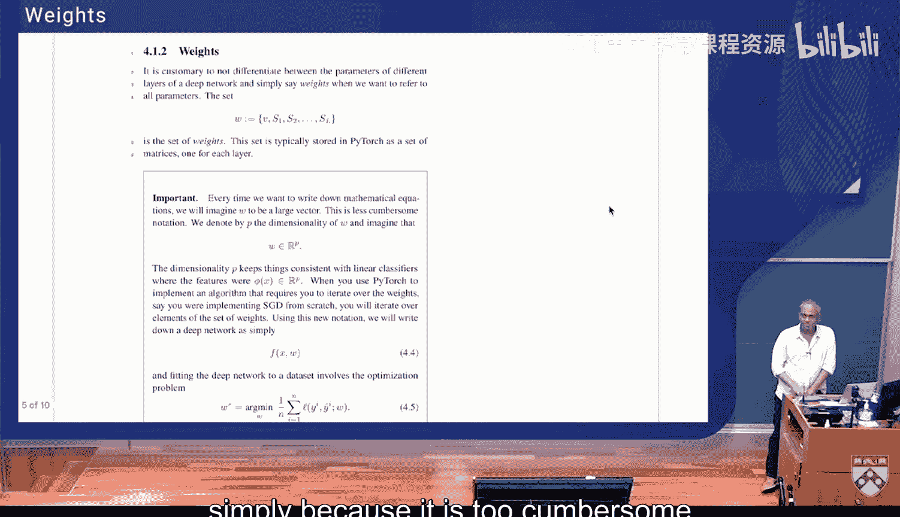
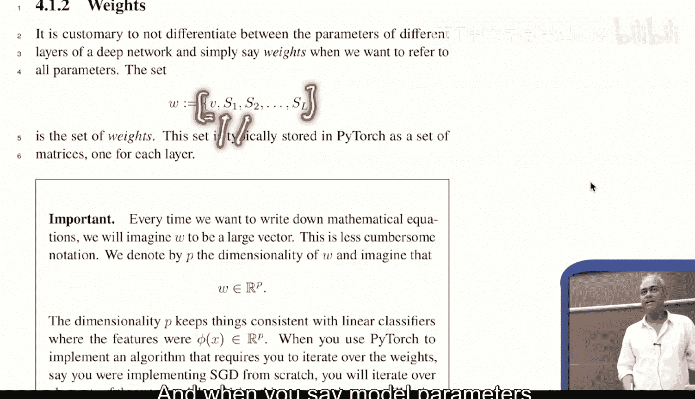
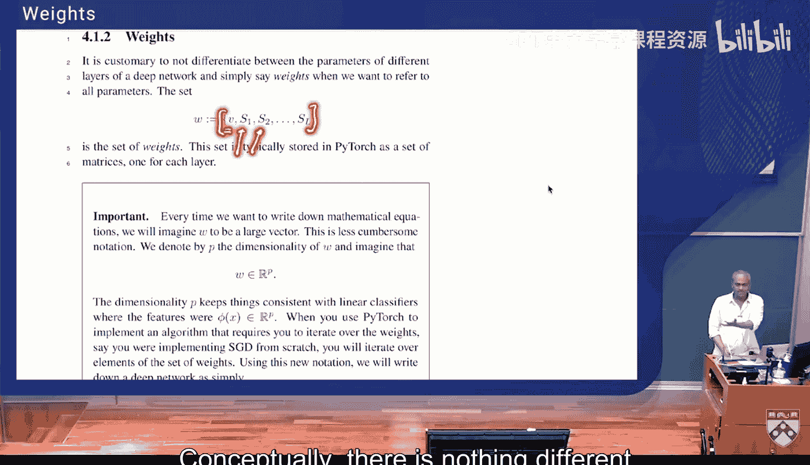

# 宾夕法尼亚大学《人工智能和机器学习基础（AI、数据科学、机器学习）AI and Machine Learning Essentials with Python》 p126 33_04_02_权重.zh_en -BV16f421Q72q_p126-

F more names will never talk about the individual parameters of the network。

Simply because it is too cumbersome to keep writing that big ugly formula we will call everything w so whenever I say w you should imagine that you take all the parameters and just concatenate them as a big vector and this is our network okay。

We will also always say that W is a P dimensional vector， imagine P is very， very large。

And then all these concatenations lies in this vector。

If you are with me so far that I can write down my neural network as simply a function of two things x is the input W are the weights。

 this is a complicated function anymore not just some linear function with a sign applied to it it is a bunch of nonlinear functions。

 many matrices inside it etc ce but I can write it down like this and this will simplify our life a lot。

This is our function again， this is our objective， you can use your favorite objective we'll talk about more in a bit。

Fitting a neural network amounts to you finding the best W。

It amounts to you finding the best V's and S1s and S2s and S3s， et cetera。

 that is implicit in this W。One thing to remember is that even if we write down our expressions in this very simple form。

 when you go to Pytoch， Pytch will maintain the different weights of the network as a big list of matrices。

So each of it will be a matrix or a vector depending on the particular layer and when you say model dot parameters you will get this big list as the output so in the second homework you will kind of learn to how to take this list and modify this list。

Conceptually there is nothing different happening， it is just how Pyth chooses to maintain its weights because we don't care about how the code looks like here while letting the expressions。

 we think of them as simply vectors。

