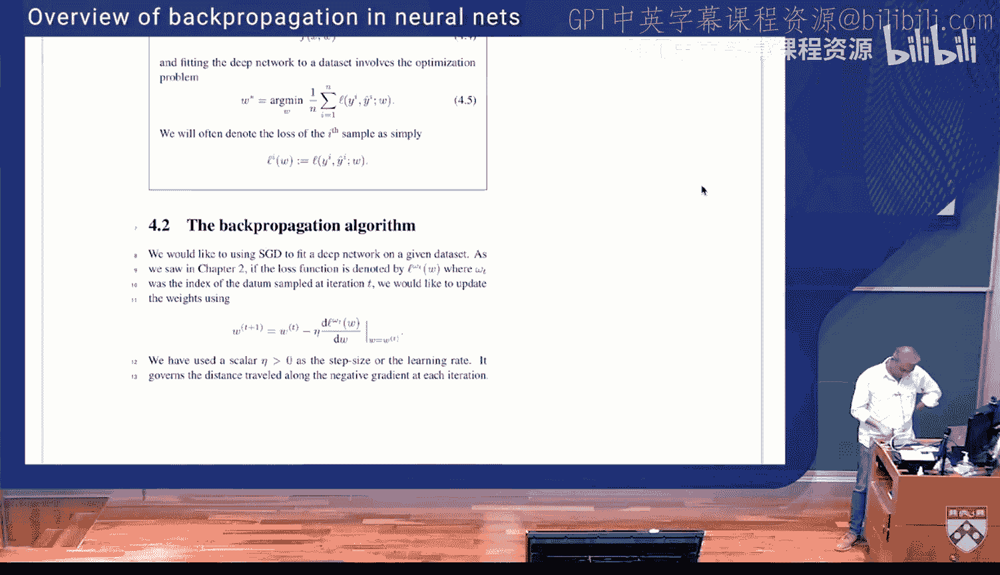
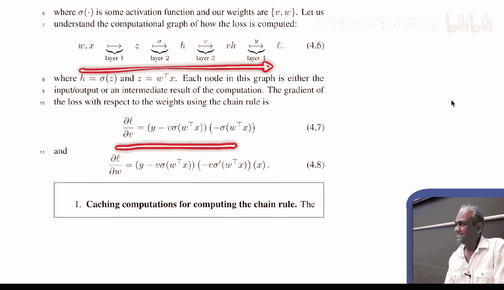
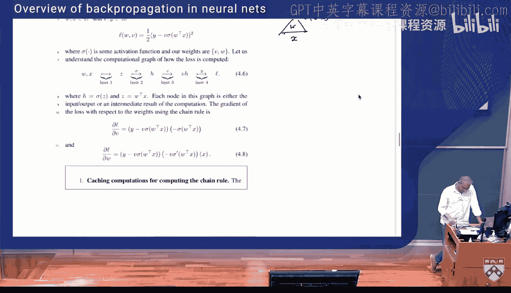
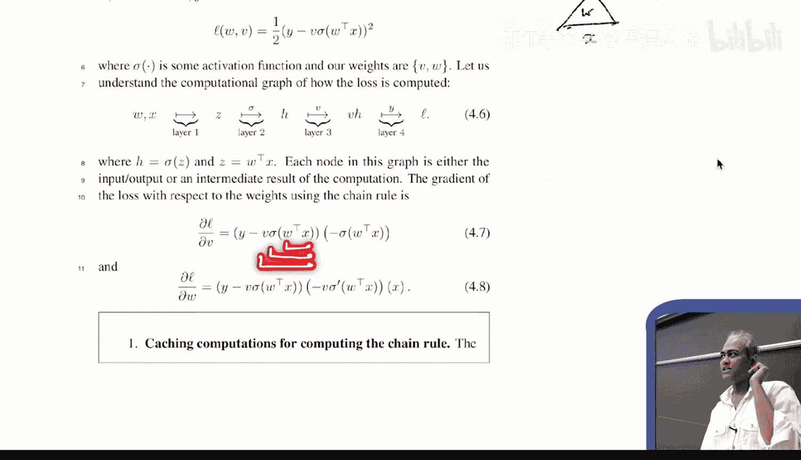
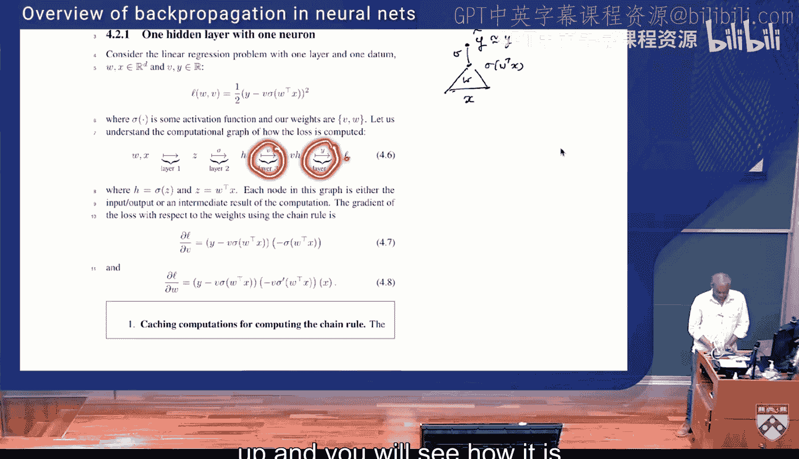

# 宾夕法尼亚大学《人工智能和机器学习基础（AI、数据科学、机器学习）AI and Machine Learning Essentials with Python》 p127 34_04_01_神经网络反向传播概述.zh_en -BV16f421Q72q_p127-

We started the previous lecture by motivating the fact that once we have an objective。

 now we would like to take the gradient of this objective to find the correct w。Okay， W。

If you are just fitting a linear function， then you would just take the derivative of this and then quote it up in your SD and you would be fine。

If you are doing this multiple layers and stuff， then taking the derivative is a little bit more cumbersome because you have to quote it up by hand for every architecture you create。

 So back propag is a very neat way to。😊。

Take the derivative in an automated way。And we are going to do this using a very simple example。

 a one dimensional neural network and one or a regression model。Just to refresh your mind。

 X is a vector in D dimensions。 let's say the image in D dimensions。

 W is another vector in D dimensions。 The hidden layer has one neuron only。 So W is not a matrix。

 W is also a vector。And then v is the weight of the second lamb。 It is a scalar。

And that gives you an output by head。We would like y to be close to the output Y hat and this is the regression error This is our loss loss is a function of W and v。

 I don't care about the dependence on x and y so I have ignored them and the name of the game is to be able to calculate quantities like DL by Dw and DL by D V right so that we can update W and V to reduce the loss X。

You see this as an expression， a computer see sees this as a computational graph。

 The computational graph takes in w and x as input it does some operation which let us just call it layer 1。

 It calculates z。 What is Z Z is w transpose x。The first little bit of computation。Using this Z。

 you apply the nonlinear nonlinear function sigma， you get an H。 So this stuff is H。

 Think of it as just writing dummy variables in your code。

 and these would be the names of the variables。 V times H is another dummy variable。

 and then the loss is y minus v times H whole square。Okay。

This is what is called the forward computation graph。

Every single operation that you can think of can be written down in its elemental form like this and。

The derivative that you wish to calculate D L by D。

 you can write it down using chain rule and as we said in the last time。

 if you look at this expression， suppose you already ran through the forward graph and you have calculated all these quantities。

 V at Z L， etcter。And these quantities are stored on your hard disk， or stored in your memory。

While calculating this derivative DL by Dv， you notice the same quantities showing up again and again。

 so this tells you that you can kind of reduce your work by not calculating them again and then using your stored values from your member this in a nutshell is back propagation how to cleverly cache the right quantities so that you don't have to do extra work during taking these chain rule derivatives。

呃。Okay， so caching computations for computing the chain rule is the purpose of back propagation。

 Now the another interesting thing to notice is that the stuff that you save Z H V times H are all the outputs of every little bit of computation that you do。

 So every step of the forward graph takes in something as an input and then create something as an output。

 you always store the output。 So in this expression， you will see w transpose x。

 you will see sigma of w transpose x。 you will see v of sigma of w transpose x。

 These are all stuff that are stored as the output of one of your little operations in the forward graph。

😊。

So forward graph is a set of steps。 The output of every step is what is being stored。

 The output of every step is also what is being used in the backward pass。

The irony here is that I'm not saying anything very deep。 It is very toological。

 What else would your story use， if not the output of the step。

output of the step is the only thing that is created。I think the joke is lost and most。But okay。

 so another thing to notice is that the。Divatives of this kind show up。

 So sigma prime is the derivative of the non nonlinear sigma with respect to its arguments。

 you will always see the derivative of the operation performed by the layer show up。

And you will see how it is connecting the derivative of the inputs and the outputs。

 And we'll see in a bit。