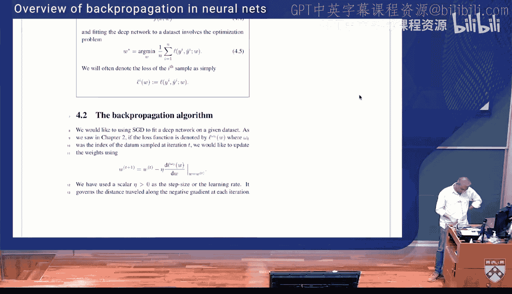
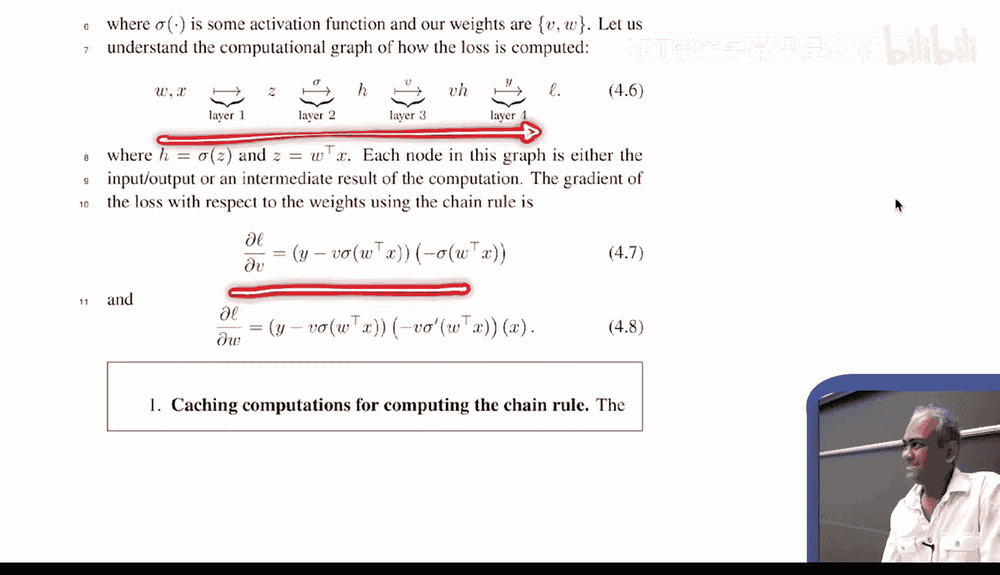
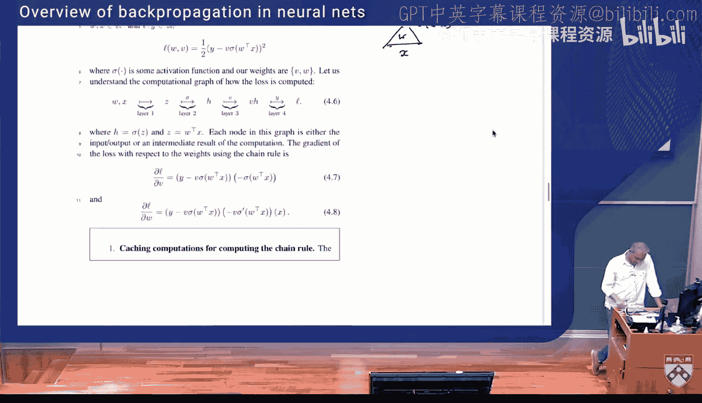
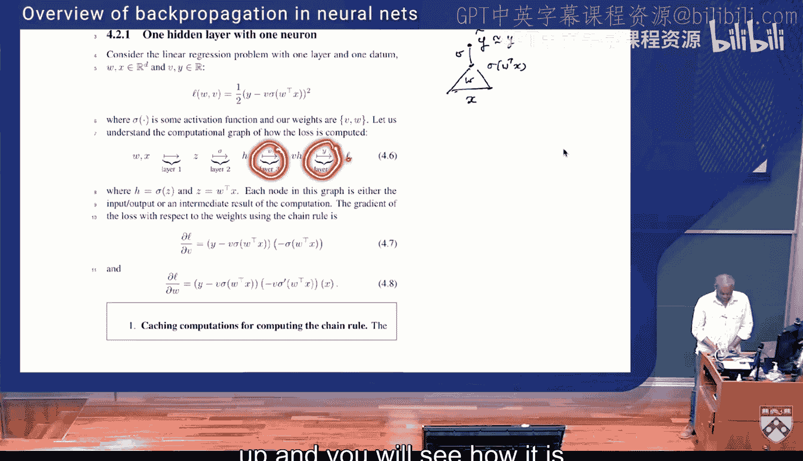

# 人工智能和机器学习基础：34_04_01：神经网络反向传播概述 🧠

在本节课中，我们将要学习神经网络中一个核心的优化算法——反向传播。我们将通过一个简单的例子，理解它如何自动、高效地计算损失函数对网络参数的梯度，从而指导参数更新。

---

上一讲我们介绍了定义目标函数（损失函数）的重要性。现在，我们希望计算这个目标函数的梯度，以找到正确的参数 **W**。

如果只是拟合一个线性函数，那么直接对损失函数求导，然后使用梯度下降法即可。

但如果处理的是包含多个层的神经网络，手动为每一种网络架构计算导数会变得非常繁琐。

因此，反向传播是一种非常巧妙的方法，它能以自动化的方式计算导数。

我们将通过一个简单的例子来演示这个过程：一个一维的回归神经网络模型。

为了帮助理解，我们先回顾一下模型结构。输入 **X** 是一个 **D** 维向量（例如一张图片）。隐藏层只有一个神经元，因此权重 **W** 也是一个 **D** 维向量。第二层的权重 **v** 是一个标量。模型的预测输出是 **Y_hat**。

我们希望预测值 **Y_hat** 接近真实值 **y**，回归误差（损失）定义如下：

**Loss = (y - Y_hat)²**

损失函数 **L** 依赖于参数 **W** 和 **v**。我们的目标是计算 **∂L/∂W** 和 **∂L/∂v**，以便更新 **W** 和 **v** 来减小损失。

---

我们可以将计算过程可视化为一个计算图。计算图以 **W** 和 **X** 作为输入，经过一系列操作得到最终输出。

以下是前向计算图的步骤：
1.  计算 **z = WᵀX**。
2.  对 **z** 应用非线性激活函数 **σ**，得到 **h = σ(z)**。
3.  计算预测值 **Y_hat = v * h**。
4.  计算损失 **L = (y - Y_hat)²**。

在代码中，**z**、**h**、**Y_hat** 这些都可以看作是中间变量。

---

反向传播的核心目的是高效地计算链式法则的导数。关键在于，当我们进行前向计算时，会生成并存储所有中间变量的值（如 **z**、**h**、**Y_hat**）。

在反向计算梯度（例如 **∂L/∂v**）时，我们会发现链式法则的展开式中反复出现这些已计算好的中间值。

因此，反向传播的本质是：**巧妙地缓存前向传播中计算出的中间结果，以便在反向应用链式法则求导时复用它们，避免重复计算。**

这听起来可能很平凡，但却是其高效性的关键。计算图每一步的输出，正是反向传播计算梯度时所需的信息。

---

另一个需要注意的现象是，在梯度计算表达式中，总会看到每个操作（层）的导数出现。

例如，激活函数 **σ** 的导数 **σ'** 会出现在链式法则中，它连接了该层输入和输出的梯度。

我们稍后会看到具体的计算过程。

---

本节课中我们一起学习了反向传播的基本概念。我们了解到，反向传播通过将神经网络表示为计算图，并缓存前向传播的中间结果，从而高效、自动化地计算损失函数对所有参数的梯度。这为使用梯度下降法优化复杂神经网络奠定了基础。