# 宾夕法尼亚大学《人工智能和机器学习基础（AI、数据科学、机器学习）AI and Machine Learning Essentials with Python》 p128 35_04_02_通过示例理解反向传播.zh_en -BV16f421Q72q_p128-

So we are going to use a very clever notation。 So this。

 this has some very beautiful roots in pure math， but let's not worry about it。

 This is this notation looks as follows。 So every time we want to write D L by D V。

 we will write it as D bar。 Okay， this is the covarient of V。😊。

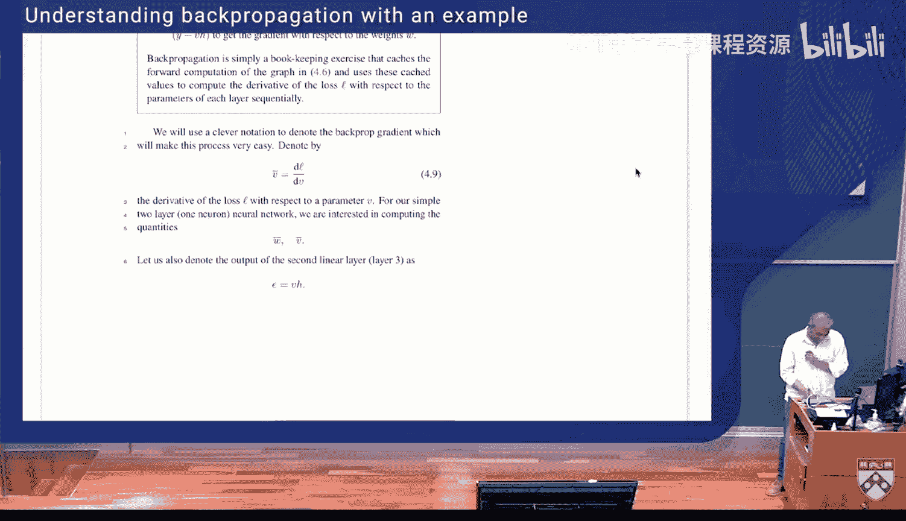

And this is just a symbol for all intention purposes。

 it will make our life ridiculously easy and you will never have to use your brain to do back propagation again。

😊，The name of the game， as we said， is to calculate D L D W， DLDV。

 which in our notation is W bar and V bar。 Okay these are the two quantities that we wish to calculate。

K。Our forward graph can be written down as these four equations W transpose x creates z sigma of z creates h V times h creates E1 y minus E ho squared。

Divd by2 creates L。 So these are all the steps of our forward graph。 And as I said。

 we should think about caching the output of each of these steps So Z H E and L。 until now。

 there is nothing very complicated happening。 And now let us do the following。DL by D L is what。1。

 because it is the derivative of the symbol with respect to the same symbol。 I can write it as L bar。

Is all very redundant at this stage， But L bar is one。 Okay， next time。 So this is。

 this is the output of the last step of my forward graph。L bar is something that I want to calculate。

 Now， what I'm going to do is try to calculate E bar， which is equal to G L by G E。Using Elba。

So let us write it down。 I would like to calculate E bar。Which is equal to D L by D E。

Which is equal to D L by Dl times Dl by D E。Okay， that is not。there is no poetry in writing this。

 It is very boring， but we can write like this。 E bar is L bar times D， L by D， E。

We know the value of L bar。 It is1。How do you calculate D L by D E。方便。

L is the output of your fourth step of forward graph。 So D L by D， E is what y minus E。us1 times -1。

It is simply the derivative of the right hand side of the fourth step with respect to E。Makes sense。

Okay， now notice something very important。 And this is really the crux of backproation that happened here。

L is the output of the fourth step。 E is one of the inputs of the fourth step。E is， of course。

 the output of the step preceding it。 right， That is what is being used as the one of the inputs on the fourth step。

I am after calculating e bar。 I am after calculating the bar version of one of the inputs on the right hand side。

 I can write it as the bar version of whatever is created as the output L bar and the derivative of how L is created from E。

😊。

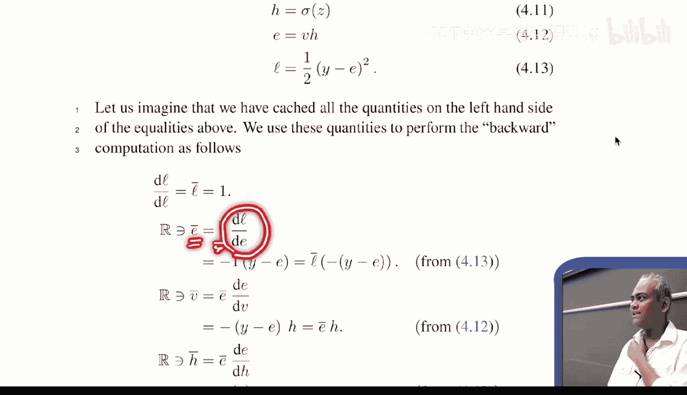

In simple words， I would like to check how sensitive the loss is to one of my inputs。

 so I first check how sensitive the loss is with respect to the output of that particular operation and then multiplied by how sensitive the output is to the input that I care about。

It is the English version of chain rule。Okay， this is a very important pattern to remember。

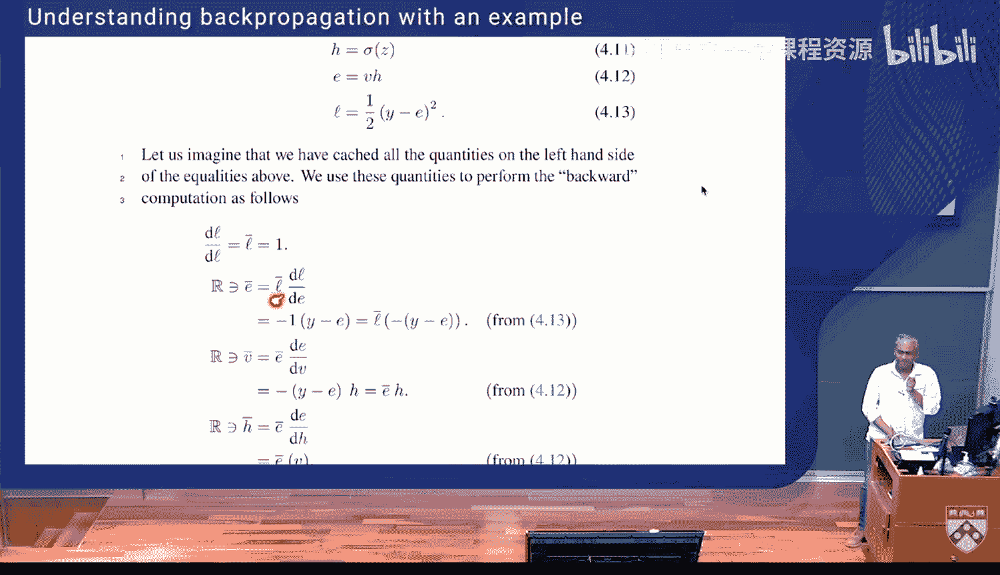

Bd versions of right hand side variables equal the bad versions of the left hand side variables times how the left hand side variable is created by the right hand side variable or the sensitivity of it。

看。Let us do a few more examples Now we have Ebar。What is Ybar。Y bar is in our notation。

 it is DL by Dy。Which is what。Which is y minus， right。I mean， you can calculate it。

 but we don't care about it because y is something that is fixed。

 We never take an update on why or something like this。

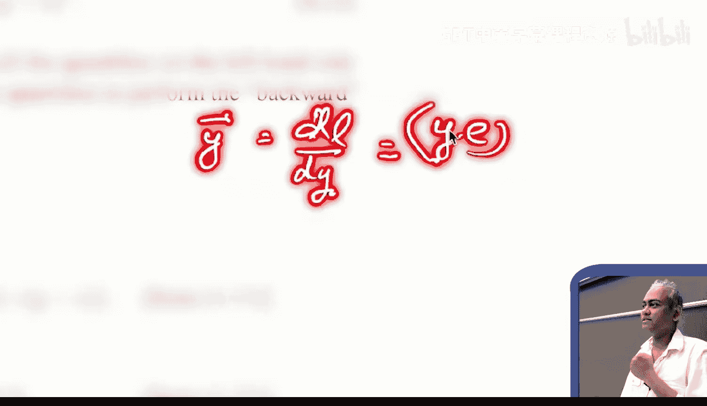

Okay， next one now we have e bar and we are going to calculate v bar and h bar So every time you have the bad version of one of the variables on the left hand side。

 you use that to calculate the bad version of the variables on the right hand side。

What is v bar v bar is the bad version of its output e bar times how is created by V D E by D V。Okay。

 this is using the chain rule again。 But if you want to be very precise or you want to be elaborate。

 you can write it down。 D L by D V is v bar， which is equal to D L by D E。

 which is E bar times D E by D V。Okay， so the this is just a very simple identity。 But the。

 the reason we gave these things name Ebar is because then we get to talk about this Jacobian very clearly。

So this is our V bar。The value of ebar we have calculated here， so we need not calculate it again。

D E by D is what。Edge right， is， is from here。 The D E by D V is simply edge。Similarly。

 what is D E by DH。Is simply me。These are all scalealrs in our simple example。

 So we don't care about transpo and stuff， but the E by D h is V。

So v bar equals e bar times the E Dv。E bar is minus y minus E or the minus-1 times y minus E。

So -1 times y minus E times h。Next one。 So we have E bar now。 we have calculated v bar。

 Now we are after h bar。 H bar and v bar are not that different from each other。

 So H bar equals E bar times D， E by D， H。How was the output E created by the input edge。

 This is the E by D edge。We know the value of e bar， which is exactly this。D E by DH is V。

 as you just said。 So it is V times is E bar。Now， you have edge bar。Now。

 you're finished with this particular step。 You have edge bar。Using this edge bar。

 you would like to calculate z bar now。So can you tell me what Zbar is。

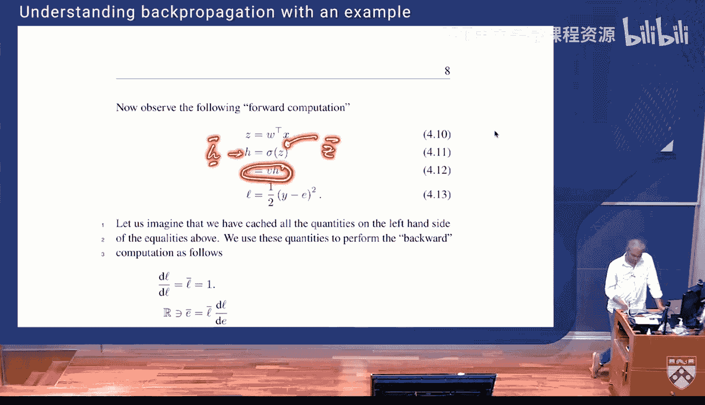

The H DV is the derivative of sigma with respect to its argument。对。So if if it is a re。

 then you will get like times it is1 if z greater than 0 or 0 else。Okay。

 so the derivative of the non nonlinearity， if you know the non nonlinearity。

 then you also know the derivative of the non nonlinearity。

 If you know the derivative of the non nonlinear， then you can write down back propag across it like this。

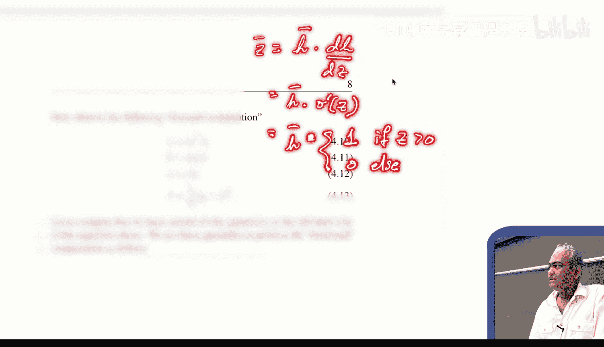

Good， so this is， as you said， Z bar is h bar times sigma prime。Now。

 we are done with the second step of the forward graph using Z bar。 You can again calculate W and X。

 Now， you have some vectors being multiplied against each other。 So you want to be careful about the。

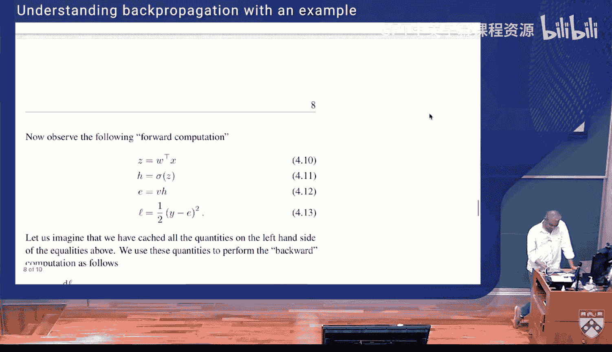

Let's write down W bar。 W bar is what Z bar times。Dy by D W。Zbar is a number。Dz by Dw is a vector。

 W is a vector。 So what is thisze bar times。X。You can also write down x bar。

 which is Z bar times dz by dx， which is equal toze bar times w。Okay。

 W and X are both vectors of the same dimensions， of course。 So this is true。呃。

Notice that we got W bar， which is what we are after。

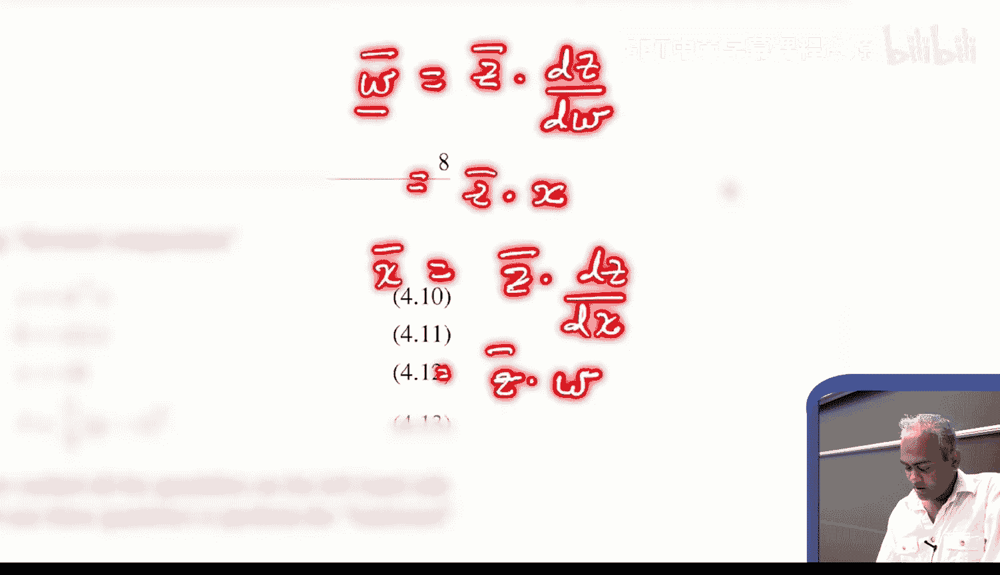

In this particular step， we also got v bar， which is what we are after。

 So by first running through the forward graph from the left to right。

You first run through this graph from the left to the right。

And you will notice that the stuff that you cacheed。

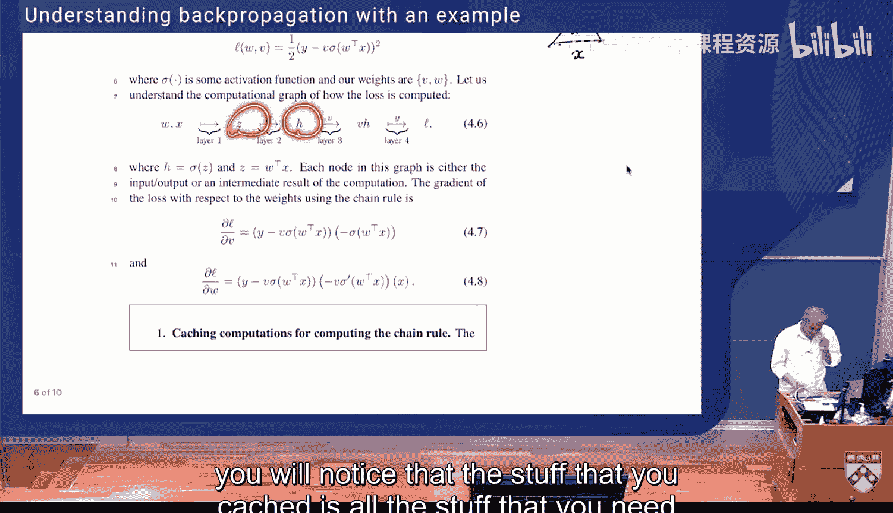

Is all the stuff that you need to use to calculate these quantities。

 So H is something that you had cast before。 So you simply plug in the value of H that you are cast multiplied by E bar E bar was created by your previous little step of the back propagation。

Forward propagation goes from the inputs to the outputs。

 back propagation goes from the outputs back to the inputs。 and at every step。

 the each step of back propagation uses the result of the back propagation from the previous step and whatever was cached by the forward step。

 forward propagation at that location。

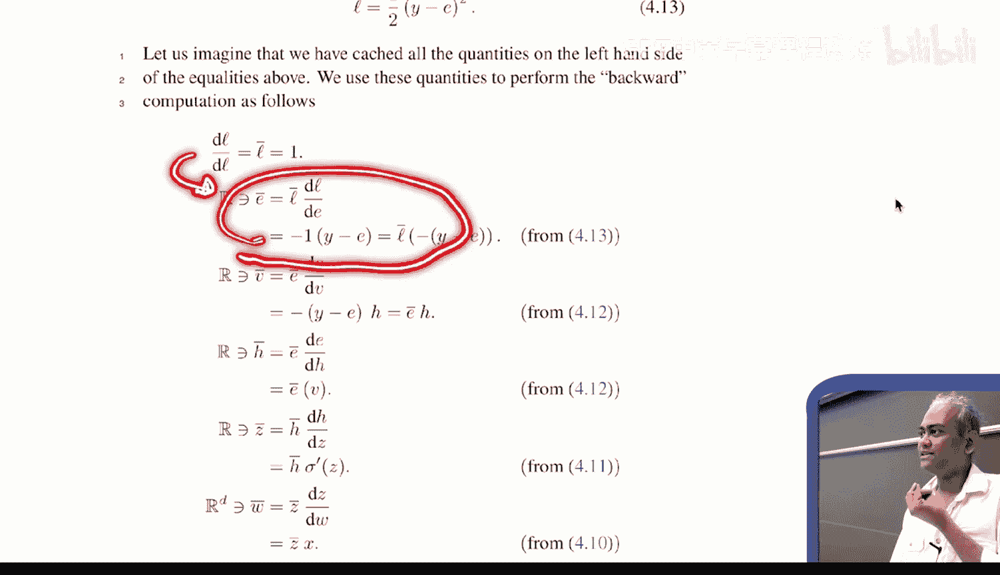

This is a very important thing to remember。 It's easy， but it is something that you should remember。

 That propagation takes the in output of the previous step。

 just like forward propagation takes the output of the previous latest step of forward propagation。😊。

But back to application also takes in one more input。

 it uses stuff that was cached there by the forward prop。Okay。

 so back propagation will work like this。

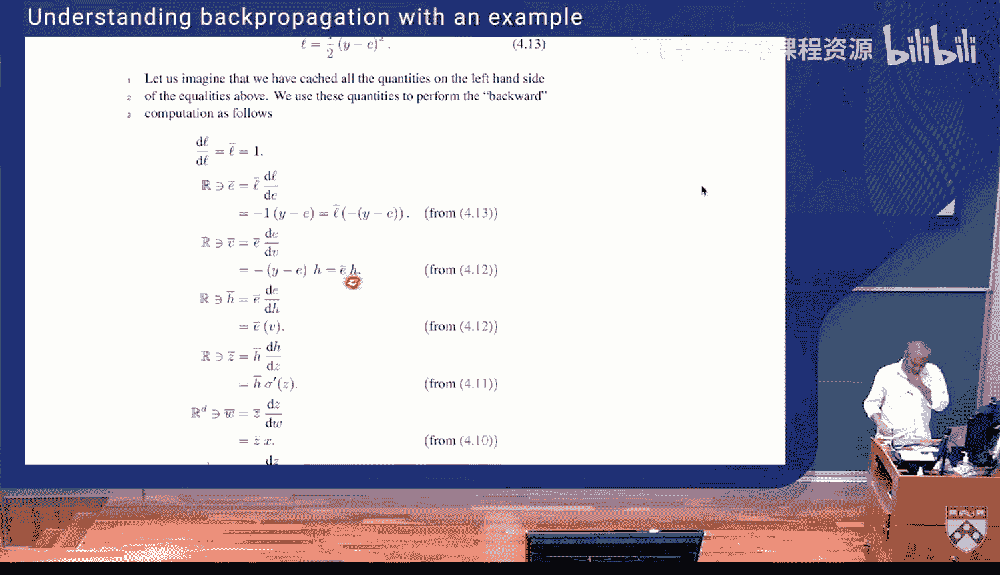