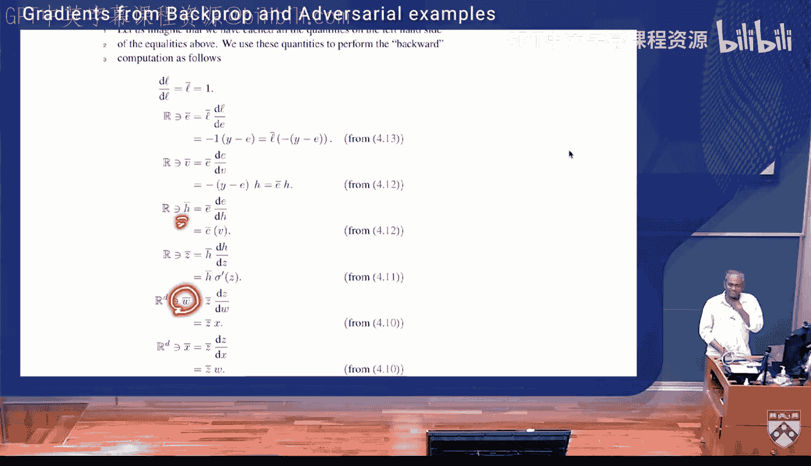
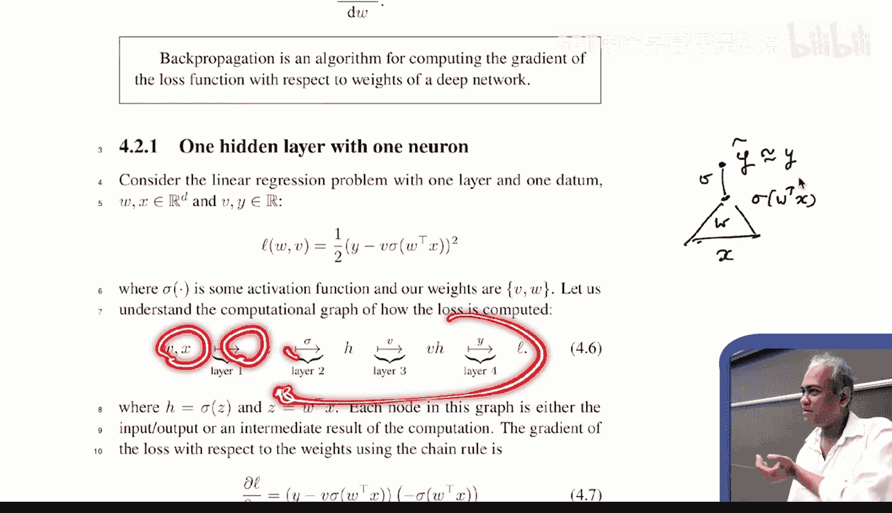
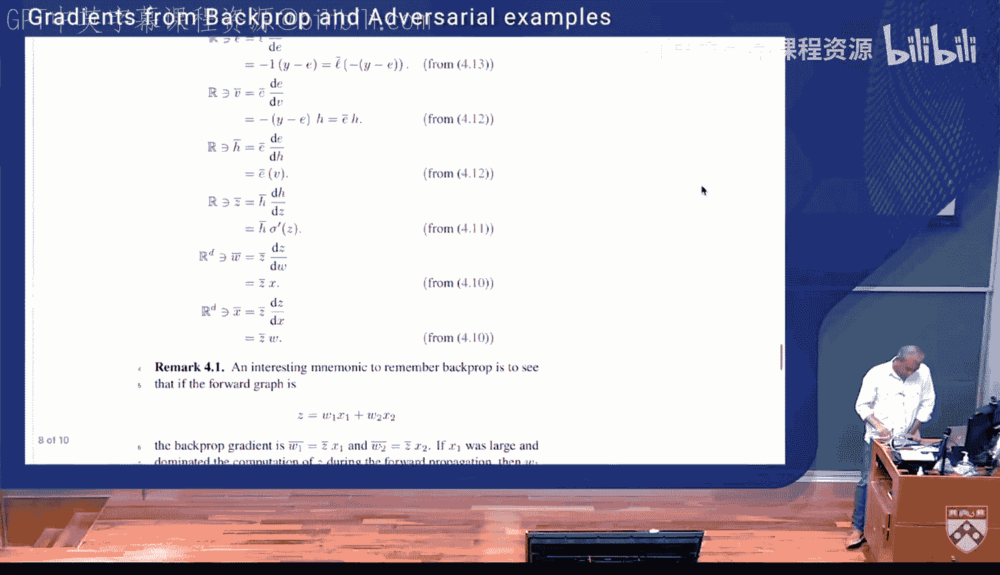
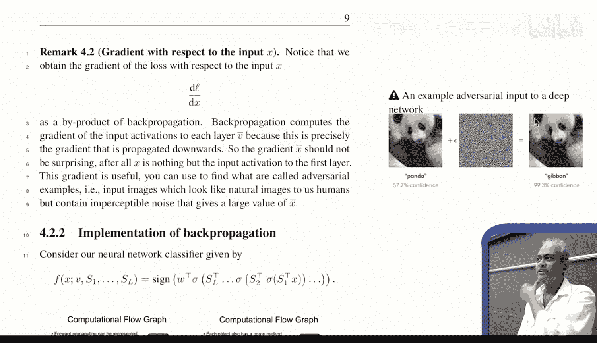
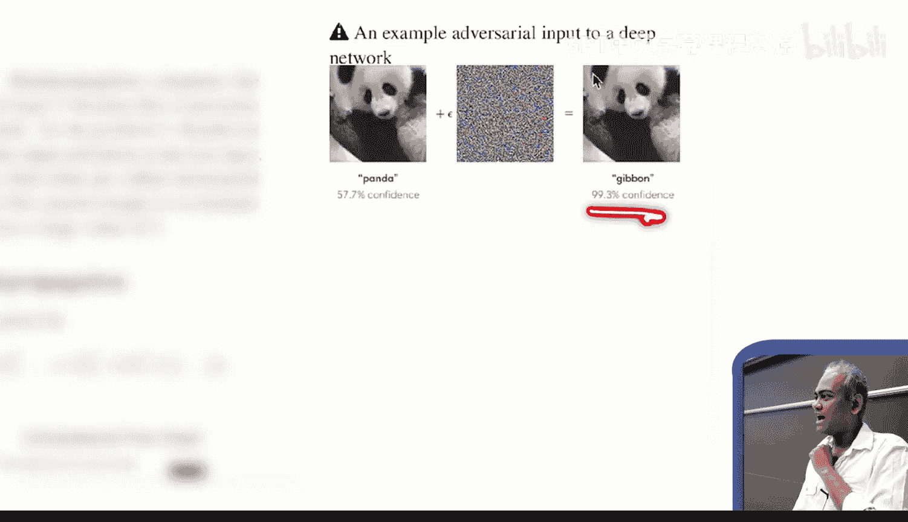

# 宾夕法尼亚大学《人工智能和机器学习基础（AI、数据科学、机器学习）AI and Machine Learning Essentials with Python》 p129 36_04_01_反向传播梯度与对抗样本.zh_en -BV16f421Q72q_p129-

At the end ofbacter， you get。The derivatives of the loss with respect to every weight in your model。

 So W and V are only the only two weights of our model。

 So you get the derivatives of every weight of your model。 What else do you get。

We only wanted the weights to take the gradient。 What else do you get。What is E bar。

 Is E bar something interesting。

H are my features of the first lab。H bar is how does the loss change with respect to features If I put up the features a little bit。

 how does the loss change， you may want to watch this sometime and see how the loss is sensitive to some of the features。

 Okay， so you get many， many quantities as extra funnelouts of Macag that you can use for debugging。

 for checking， for doing some research， etc。Can me。啊。

Can we calculate W bar without calculating H bar。We don't need H bar because we only need W bar and V bar。

 Can we calculate W bar without calculating H bar。好。😊，So this is another important thing to remember。

 just like in the forward graph to calculate this variable。

 you need to go through all the stuff that comes to the left of it。Similarly， in backward prop。

 to calculate any bar version here， you are to go through all the stuff from the right hand side。

 Okay， you cannot like a short circuit the。 I mean， you can short circuit the chain on paper。

 but you'll have to do the same amount of work to calculate it。

So one way to think about this is if you are trying to save some memory。

 then people try to like not calculate features of some layers whose features are easy to calculate No nonlinear function the nonlinear typically something that is very quick So it is application of a sigmoid or application of a relu or something So sometimes people will like not store the output of the linearity and then only store the input of the linearity and then calculate the output on the fly while coming back from background。

So it' is a stuff that people do to save memory。Okay。

 one more thing that you get from back propagation is x bar， which is a very useful quantity。

 X bar is D L D X。 How sensitive is the loss to perturbations of the input。

We don't care for it in general because we are we want to train the network。

 but you can watch this and say whether this image is being classified robustly or not。

 What happens to the loss if I change the image a tiny bit。 If the loss increases by lot。

 then my model doesn't really understand this image very well。

 it understands or the neighbor of this image very well。

So one example of this is what are called adversarial inputs to neural networks people noticed a few years ago 815 or so that you can take a trained neural network and let's say this is a network that was predicting 1000 classes。

It's an image of a panda， and so。The network is predicting that this is a panda with let's say 60% probability。

What is the probability of predicting correctly？RFor a random model， if there are 1000 classes。

 which is 01%， right， So if youre predicting a panda with 60% probability。

 then you are a pretty confident model and a pretty good model。

 right So even if it looks as bad as 60， it is much。

 much better than the base version of of a random model， which is 01%。 Okay， so this is a good model。

 it reflects a panda。 when I show it a panda。This is our X。Okay。We can use DL by Dx。

To take gradient ascent on X。 So when we train a model， we reduce。

 we move in the direction of the law in the direction with the loss reduces。

 because we want to improve the loss。But you can take the attack D L by D x and per up x in the direction that the loss increases。

 So I can do something like x prime equal to x plus some alpha times D L by D x。

 This is gradient ascent on x。😊，And what is this going to do。

This will increase the loss on that particular x So this is so this this is the this is what he is calling epsilon。

 but this is let's say D L by D X that they that you can calculate just my propagation。

 And if you do this a couple of times。 if you take a couple of steps of gradient ascent like this。

 then the image that you create doesn't change that much。

But the image changes in a way that the loss changes by a lot。So to you and I。

 this looks like a panda。 None of us would be fooled， but to the network， it looks like a given。

 and it is not as if the network is very conflicted about it being a given。

 It is 99% confident that this is a given。 a given is a kind of a bird。So clearly not a panda。

 So this is one example of how you can actually know given is a monkey。 Sorry。

Yeah。Given is a kind of monkey。呃。So， the。The perturbations to the input that you make can often be very small。

 and they can create large changes in the loss that tells you that G L by D X is quite large。

For most inputs in the network， this will be the case。

 And so there is a large field of research now that tries to study why such advers samples arise or how to fix them。

 because it is easy to take a train network and make it pretty garbage by showing it inputs that are just a tiny bit perturbed or just a tiny bit antagonistic。

 right It's like you getting a headache。 If I show you a spooscopic image。

 or if I show you some optical illusion， you don't get a good understanding of geometry。

 this is the neural network version of it。The moral of the story is that you can do this experiment in basically five lines of code just by running back location。

You get it for free D L by D X， when you run back preparation。

 you don't have to do anything special to calculate it。

