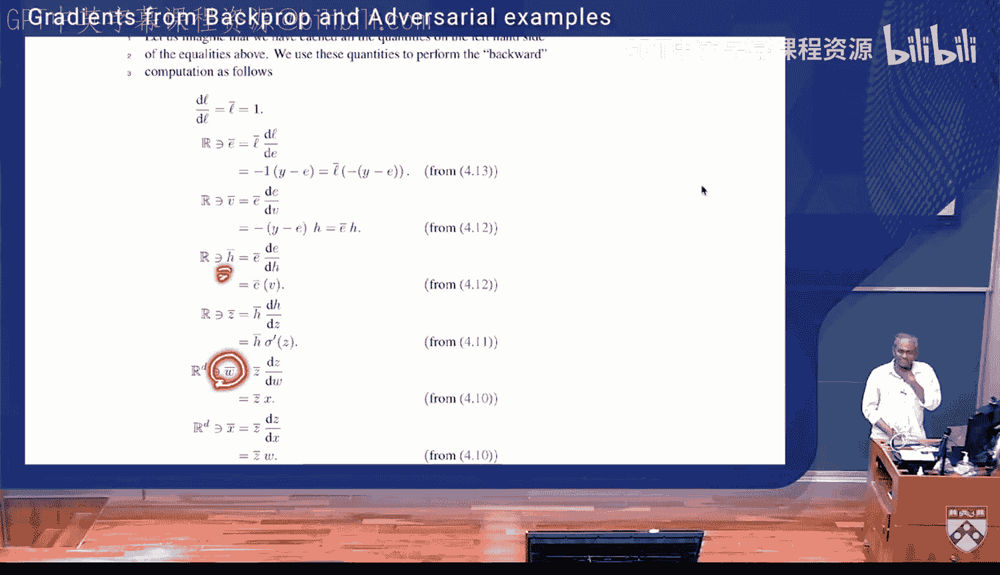
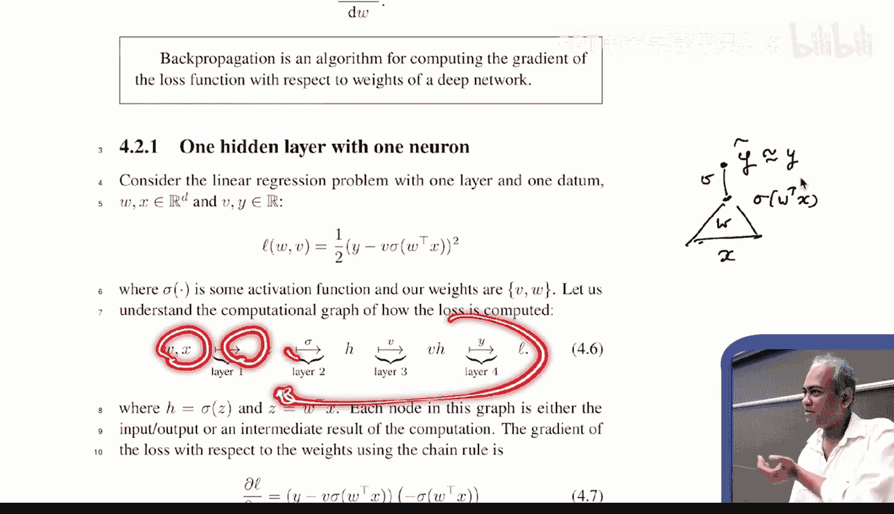
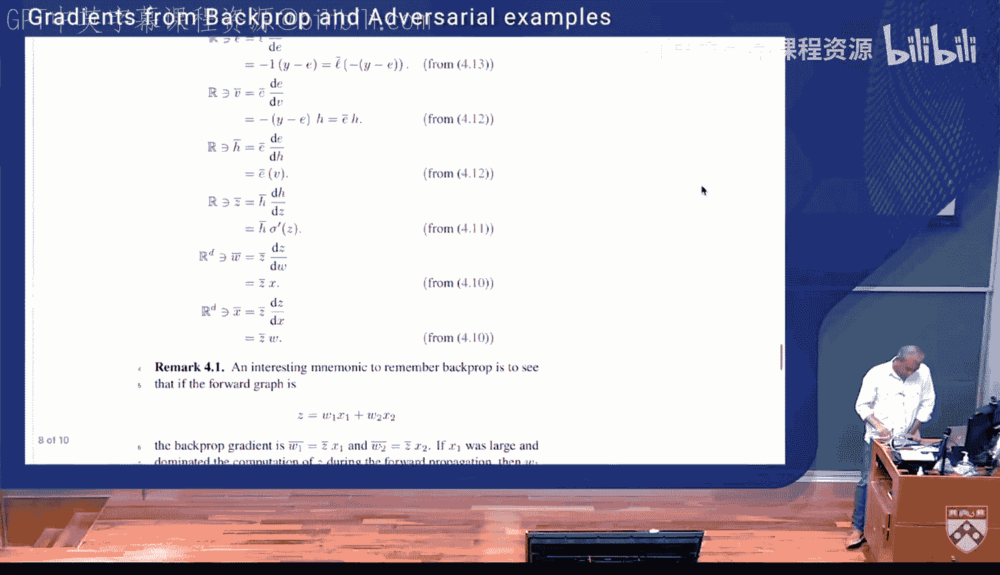
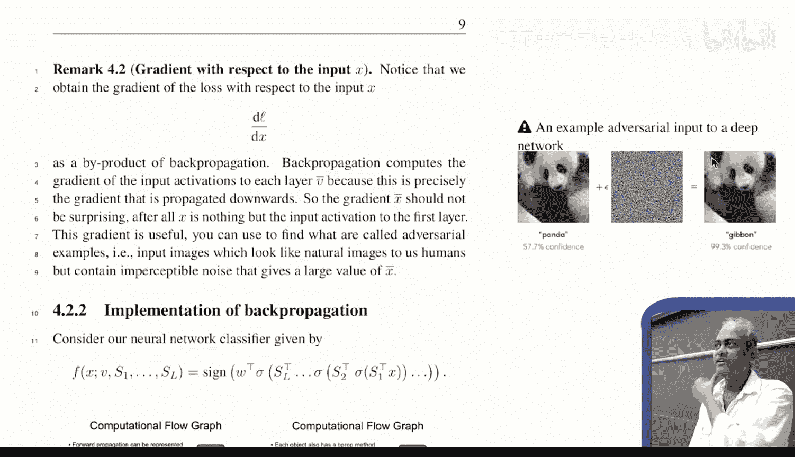
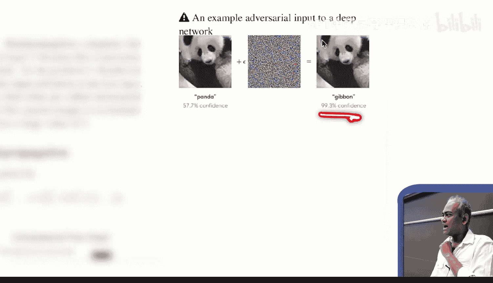

# 人工智能和机器学习基础：36_04_01：反向传播梯度与对抗样本 🔍

在本节课中，我们将要学习反向传播算法除了计算权重梯度外，还能为我们提供哪些额外的重要信息。我们将重点探讨损失函数对输入特征的梯度，并了解其在生成对抗样本这一有趣现象中的应用。

## 反向传播的额外输出 📊



上一节我们介绍了反向传播如何计算模型权重的梯度。本节中我们来看看，除了权重梯度，反向传播过程还能输出哪些有价值的信息。

反向传播过程结束时，你会得到损失函数相对于模型中每一个权重的导数。在我们的简单模型中，W 和 V 是仅有的两个权重。因此，你会得到模型中每一个权重的导数。

然而，我们不仅仅能得到权重的梯度。我们还能得到其他信息。例如，**E_bar** 是什么？它是否具有意义？


H 是我第一层的特征。**H_bar** 表示损失函数相对于这些特征的变化率。如果我稍微改变这些特征，损失会如何变化？你有时可能希望观察这个值，以了解损失对某些特征的敏感程度。

因此，作为反向传播的额外输出，你会得到许多可以用于调试、检查或进行研究的量。



## 计算依赖关系与内存优化 ⚙️

一个自然的问题是：我们能否在不计算 H_bar 的情况下计算 W_bar？因为我们只需要 W_bar 和 V_bar，似乎不需要 H_bar。

这是一个需要记住的重要概念。就像在前向计算图中，要计算某个变量，你需要经过它左侧的所有计算步骤。类似地，在反向传播中，要计算任何变量的梯度（即其 “bar” 版本），你必须经过其右侧的所有计算步骤。

你无法在计算上“短路”这个过程。我的意思是，在纸面上你可以简化链式法则，但为了计算它，你仍然需要完成相同的工作量。




一种思考方式是，如果你试图节省内存，人们可能会尝试不去计算某些层的特征，因为这些特征很容易重新计算。非线性函数（如 Sigmoid 或 ReLU 的应用）通常计算非常快速。因此，有时人们不会存储线性层的输出，而只存储其输入，然后在反向传播时动态计算输出。这是一种为了节省内存而采取的策略。

## 损失对输入的梯度：X_bar 🎯

反向传播提供的另一个非常重要的量是 **X_bar**，即损失函数对输入 X 的梯度（dL/dX）。它衡量了损失对输入微小扰动的敏感程度。




通常，在训练网络时我们并不关心这个值。但你可以观察它，并判断图像是否被模型稳健地分类。如果我稍微改变图像，损失会发生多大变化？如果损失大幅增加，那么我的模型并没有很好地理解这张图像，或者说没有很好地理解其邻近的图像。

以下是关于这个梯度的一个著名应用实例。

## 对抗样本：一个引人深思的现象 🐼➡️🐒

几年前（大约2015年），研究人员注意到一个现象：你可以拿一个训练好的神经网络（例如一个预测1000个类别的网络），并生成所谓的“对抗输入”。


假设这是一张熊猫的图片。网络预测这是一只熊猫，概率为60%。对于一个随机模型，如果有1000个类别，正确预测的概率是0.1%。因此，即使60%的概率看起来不高，它也远比随机模型的基线（0.1%）要好得多。这是一个不错的模型，当它看到熊猫时，能识别出熊猫。

这是我们的输入 X。我们可以利用 dL/dX，对 X 执行**梯度上升**。训练模型时，我们沿着损失减少的方向移动（梯度下降），以改善损失。但你可以利用 dL/dX，沿着使损失**增加**的方向扰动 X。

我可以进行如下操作：
```python
x_prime = x + alpha * dL_dx
```
这就是对 X 的梯度上升。😊

这会产生什么效果？这将增加模型在那个特定输入 X 上的损失。在相关论文中，这个扰动被称为 epsilon，但本质上它就是通过反向传播计算出的 dL/dX。

如果你这样迭代几次，执行多步梯度上升，生成的图像在视觉上变化不大，但损失却会发生巨大变化。

对你我而言，这看起来仍然像一只熊猫，我们不会被欺骗。但对网络而言，它看起来像一只长臂猿（Gibbon），并且网络对此非常确信，有99%的信心认为这是一只长臂猿（一种猴子）。这显然不是熊猫。




你对输入所做的扰动通常可以非常微小，却能引起损失的大幅变化，这告诉你 dL/dX 的值相当大。对于网络中的大多数输入，情况都是如此。

因此，现在有一个庞大的研究领域致力于研究为什么会出现这种对抗样本，以及如何修复它们。因为很容易拿一个训练好的网络，通过展示仅被微小扰动或略带对抗性的输入，就使其性能变得非常糟糕。

这就像你看到闪烁的图像或某些视觉错觉时会感到头疼，无法正确理解几何形状一样。这是神经网络的类似版本。

这个故事的核心在于，你基本上可以用五行代码通过运行反向传播来完成这个实验。当你运行反向传播时，dL/dX 是免费得到的，你不需要做任何特殊计算来获取它。

## 总结 📝

本节课中我们一起学习了：
1.  反向传播不仅输出模型权重的梯度（W_bar, V_bar），还输出中间层特征（H_bar）和输入（X_bar）的梯度。
2.  计算某个梯度（如 W_bar）依赖于其后续所有计算步骤的梯度，无法跳过。
3.  损失对输入的梯度（X_bar = dL/dX）揭示了模型对输入扰动的敏感性。
4.  通过对输入执行梯度上升（`x = x + alpha * dL_dx`），可以生成“对抗样本”——人类难以察觉但会导致模型严重误判的微小扰动图像。
5.  对抗样本的存在表明神经网络决策边界存在脆弱性，这是当前一个重要的研究领域。而探索这一切的基础工具——dL/dX，正是反向传播自动提供的。