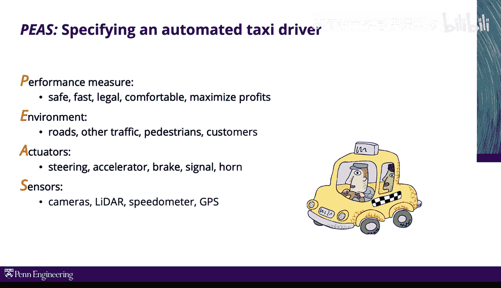
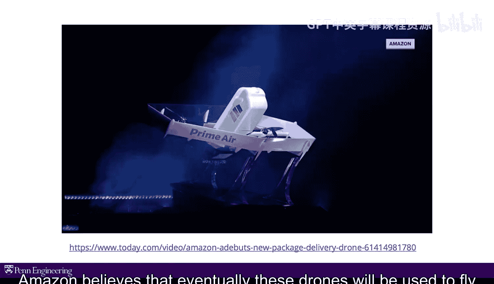
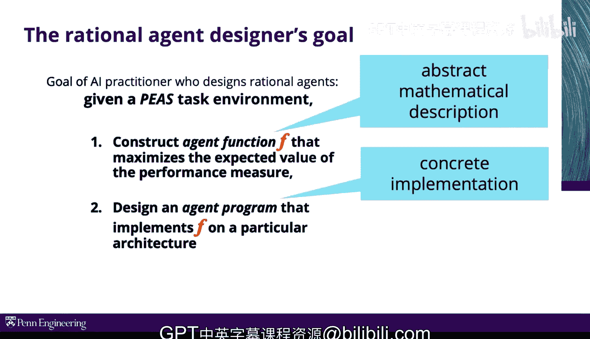

# 宾夕法尼亚大学《人工智能和机器学习基础（AI、数据科学、机器学习）AI and Machine Learning Essentials with Python》 p13 13_02_01_任务环境.zh_en -BV16f421Q72q_p13-

Now that we've defined what we mean by rational agents and performance measures。

 let's go a little further and define the different kinds of environments that our agents can operate in。

We can think of agents who act in accordance with a performance measure as being the solution to a particular problem or task。

For instance， a rational vacuum agent is the solution to the dirt cleaning problem。

 we can create a problem specification。By specifying the following elements。First。

 the performance measure for the agent。Next。The environment that the agent operates in。

Third and fourth。The sensors and actuators that the agent will use to interact with the environment。

 Russell and Norvic gives these four elements to acronym Ps。 Together。

 they specify a task environment。 Pas doesn't define the agent function or the agent program。

 but it provides for us a way to understand the problem。

 Our agent programmer function will then be the solution to this problem。

Let's take a look at an example of how to specify a task environment for an automated taxi。

 what performance measure would we like to have our taxi try to maximize。

What's the environment where the taxi will be operating。

 What are the relevant elements of that environment that it'll have to deal with。

 What kind of actuators and sensors will the automated taxi need。

We can think of a whole range of different elements that we might want to incorporate into our performance measure。

 for instance， we want to ensure that the ride that the taxi gives is safe。

 that the passenger gets there in a quick amount of time。

That the taxi itself is obeying all the traffic laws。But the ride is comfortable。

And that we maximize the profits for our company。The environment that an automated taxi operates in includes the roads and intersections。

 the other cars and traffic on those roads， pedestrians。

And the customers that we have to pick up and drop off at their destination。

The type of auators that an automated taxi would have include mechanism for steering， an accelerator。

 a break。Turn signals， a horn。And the types of sensors that it would have include things like cameras。

 a LiDar system， LiDarR is an acronym for light detection and ranging。

A speedometer and a GPS for navigating maps。Taken together。

 these are the different important elements for a task environment for trying to design an intelligent system for solving the problem of serving as an automated taxi driver。

Let's take another look at a different task environment。

 how do things change when we're shifting from one problem to a similar problem？

What would happen if we changed from a self driving taxi to this Amazon Prime air delivery drone？

 Here's a clip from an NBC show about Amazon's plan for a drone delivery service。

Amazon has been developing technology so that it can deploy a set of self piloting drones to serve as part of its delivery fleet。

 Amazon believes that eventually these drones will be used to fly packages directly to your door。

This morning Amazon is taking to the skies， unveiling the selfpiloting primary drone that the tech giant says will eventually be used to fly packages directly to your door with test deliveries。

 starting within months we're only in the beginning stages of truly understanding the potential for this technology technology to change our lives and to help us work on some of the most important and urgent problems that humanity faces Amazon says the new drone is capable of taking off vertically and tilting its body to fly horizontally the company says the drone is fully electric with a flight range of 15 miles and able to carry packages weighing up to five pounds using machine learning to avoid hitting people power lines and other obstacles on the ground。

So why don't you take a moment to think about how you would define the different element of the Ps task environment for an Amazon delivery drone？

How would its performance measure differ in this task environment？

What elements of an airborne delivery platform would the agent need to contend with。

 What sort of sensors would you need to navigate the airspace。

 What kind of auators would the drone need in order to move through the air and to successfully pick up and drop off packages。

Creating a list of considerations for the task environment for each of the Ps elements can give a good way of beginning to formulate the solutions to the problems that we'd like our rational agent to solve。

Ps can help us define the space of considerations that we need to address。

 like what kind of environment our agent will be in， what physical hardware our agent will have。

 and how we might begin to measure its success。After we've defined the task environment。

 we can start to formulate our rational agent by constructing the agent function。

This is our mathematical model。Of what actions we want the agent to do given a percept sequence。

We can then begin to write our agent program， the concrete implementation that will run on the actual hardware。

 our choice of algorithms for our agent program will depend on the kind of task environment that we're dealing with。

Next， I'll talk through a bunch of different characteristics of task environments that change the algorithms and approaches。

That we'll use to implement our agents。