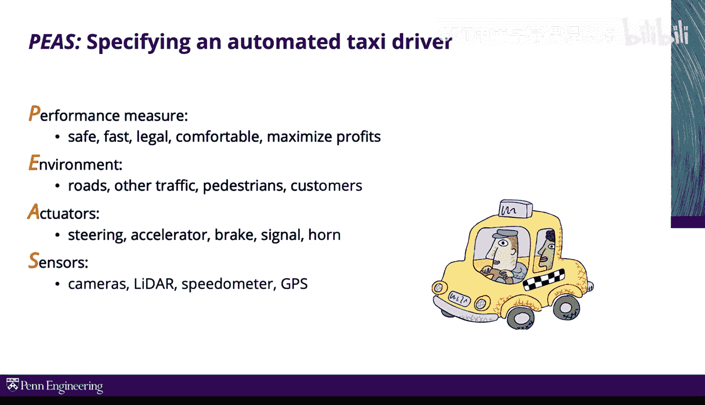
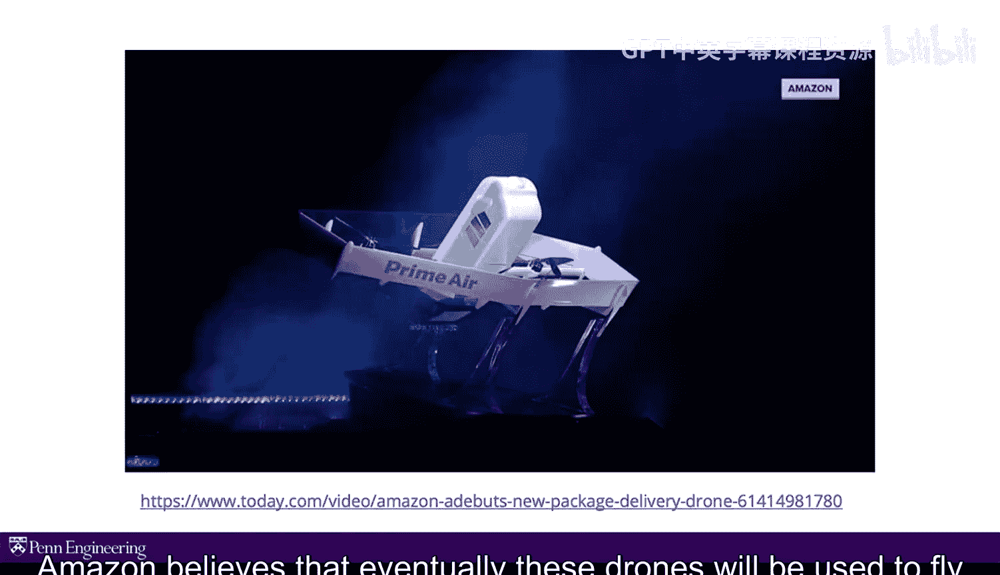
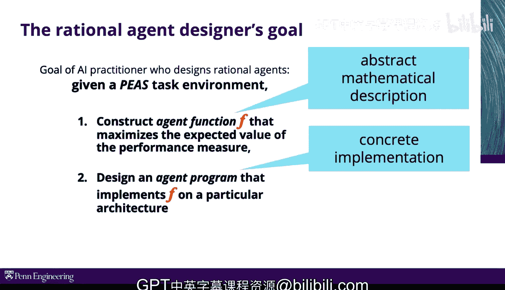

# 人工智能和机器学习基础：13：任务环境

在本节课中，我们将学习如何定义和描述智能体（Agent）所面临的任务环境。我们将通过一个名为“PEAS”的框架来系统地分析问题，并比较不同任务环境（如自动驾驶出租车与送货无人机）的异同。

上一节我们定义了理性智能体及其性能度量。本节中，我们将进一步探讨智能体可以运行的不同类型的环境。

我们可以将按照性能度量行事的智能体，视为特定问题或任务的解决方案。例如，一个理性的吸尘器智能体就是解决清洁灰尘问题的方案。我们可以通过指定以下元素来创建一个问题规范：
*   智能体的性能度量。
*   智能体运行的环境。
*   智能体将用来与环境交互的传感器。
*   智能体将用来与环境交互的执行器。

Russell和Norvig将这四个元素缩写为**PEAS**。它们共同定义了一个**任务环境**。PEAS并不定义智能体函数或智能体程序，但它为我们提供了一种理解问题的方式。我们的智能体程序/函数将是这个问题的解决方案。

## 任务环境示例：自动驾驶出租车

让我们看一个如何为自动驾驶出租车指定任务环境的例子。我们需要思考：
*   我们希望出租车最大化什么样的性能度量？
*   出租车将在什么环境中运行？
*   环境中哪些相关元素是它必须处理的？
*   自动驾驶出租车需要什么样的执行器和传感器？

以下是针对PEAS框架的详细分析：

**性能度量**
我们可以考虑将一系列不同元素纳入性能度量，例如：
*   确保出租车行驶安全。
*   乘客能在短时间内到达目的地。
*   出租车本身遵守所有交通法规。
*   行驶过程舒适。
*   最大化公司的利润。

**环境**
自动驾驶出租车运行的环境包括：
*   道路和十字路口。
*   道路上的其他车辆和交通状况。
*   行人。
*   需要接送至目的地的顾客。

**执行器**
自动驾驶出租车可能拥有的执行器类型包括：
*   转向机制。
*   油门。
*   刹车。
*   转向灯。
*   喇叭。

**传感器**
自动驾驶出租车可能拥有的传感器类型包括：
*   摄像头。
*   激光雷达系统（LiDAR，是“光探测与测距”的缩写）。
*   速度表。
*   用于地图导航的GPS。

综合来看，这些是为解决“充当自动驾驶出租车司机”这一问题而设计智能系统时，任务环境的不同重要元素。

## 任务环境对比：送货无人机

现在，让我们看看另一个不同的任务环境。当我们从一个问题转向一个类似问题时，情况会如何变化？如果我们从自动驾驶出租车转向亚马逊Prime Air送货无人机，会发生什么？

以下是一段关于亚马逊无人机送货计划的视频片段摘要：
亚马逊一直在开发技术，以便部署一组自动驾驶无人机作为其送货车队的一部分。亚马逊相信，最终这些无人机将用于将包裹直接送到客户家门口。新的无人机能够垂直起飞并倾斜机身以水平飞行。它是全电动的，飞行距离为15英里，能够运送重达5磅的包裹，并使用机器学习来避免撞到人、电线和其他地面障碍物。

请花点时间思考一下，您将如何为亚马逊送货无人机定义PEAS任务环境的不同元素？
*   在此任务环境中，它的性能度量有何不同？
*   智能体需要应对空中送货平台的哪些环境元素？
*   您需要什么样的传感器来导航空域？
*   无人机需要什么样的执行器才能在空气中移动并成功取送包裹？

## 使用PEAS框架进行问题定义

为PEAS的每个元素创建一个任务环境的考虑事项列表，可以很好地开始为我们希望理性智能体解决的问题制定解决方案。PEAS可以帮助我们定义需要考虑的事项范围，例如：
*   我们的智能体将处于何种环境。
*   我们的智能体将拥有何种物理硬件。
*   我们如何开始衡量其成功。

在定义了任务环境之后，我们就可以通过构建智能体函数来开始制定我们的理性智能体。这是我们的**数学模型**，用于描述给定感知序列时，我们希望智能体执行什么动作。

然后，我们可以开始编写**智能体程序**，即在实际硬件上运行的具体实现。我们为智能体程序选择的算法将取决于我们所处理的任务环境的类型。

本节课中，我们一起学习了如何使用PEAS框架来定义和分析智能体的任务环境。我们通过自动驾驶出租车和送货无人机两个具体案例，详细拆解了性能度量、环境、执行器和传感器这四个核心要素。理解任务环境是设计有效智能体解决方案的第一步。接下来，我将讨论任务环境的一系列不同特征，这些特征将改变我们用于实现智能体的算法和方法。