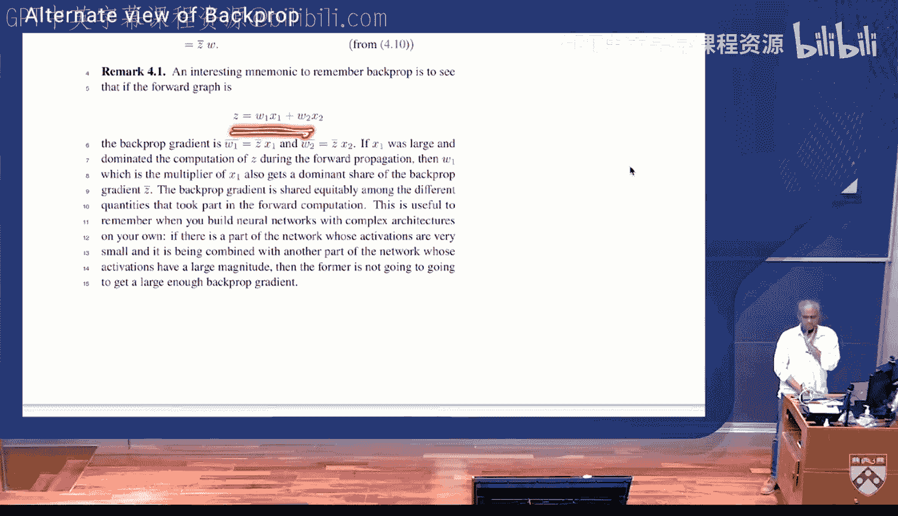
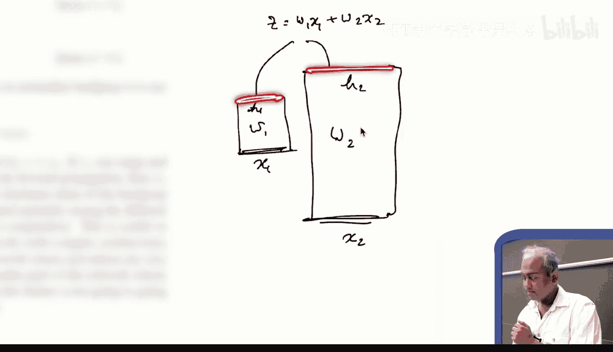

# 宾夕法尼亚大学《人工智能和机器学习基础（AI、数据科学、机器学习）AI and Machine Learning Essentials with Python》 p130 37_04_02_反向传播的替代视角.zh_en -BV16f421Q72q_p130-

One very important thing that I like to think about around back location is that think of an operation like this in the forward graph W1 times x 1 plus w2 times x 2 gives you something called z。

Now。As we know， w1 bar is what is Z bar， which is the output of this operation times D Z by D W1。

 which is x1。 so w1 bar is Z bar times x1。 W 2 bar is Z bar times x 2。

The way to remember this or the， the thing to appreciate about this is that。

The gradient that W1 gets back。Is split is the gradient of z， which is the output。

 and it is split equitably between how w1 created the output。So think of this as two terms。

 both of these terms together create the output Z。There is some gradient z bar which comes in from the upper layers of backplication and now your job is to divide this z bar in some way between w1 bar and W2 bar。

If x1 was very large。Then W1 gets a larger share of the gradient。Because w1 bar is z bar times x1。

 If x2 was very large， then W2 gets a larger share of the gradient。

 So W1 and W2 share the incoming gradient from Z in such a way that if one of them played a larger role in creating the output。

 it also gets back the larger share of the gradient。

This is a very important thing to remember when you create neural networks of your own and then sometimes you will see that let's say this is your H1。

 the weights of this network are W1 and then there is another big network here whose weights are W2 and its output is let's say H2。

This is my x1， and this is my x2。 and maybe there is a non nonlinear narrativeity in between。

 let us not worry about it。If H2 is very small as compared to H1， then this network。

 even though it is very big， will not get a large share of the gradient。

 the gradient it will get back from Z will always be quite small and so when people build very large networks。

 what can often happen is that you this is a very large networks sitting here。

 but it is getting such little gradient in to train that the weights of the network are not moving very much。

The weights of the network， how much updates you make to W2 are a function of how big the gradient it gets。

 right。If it is not working if it is not creating a high magnitude output。

 then it may not get something back in return and it will not train。

 So you have to be very careful when you combine large architectures or create new architectures of your own because you can get these kinds of inconsistencies and often when people say oh neural network deep learning is just hyperparameter tuning or deep learning requires me to train loxends of hyperparameters what theyre missing is these kind of thinking。

If you design your networks in such a way that they're well conditioned。

 if you think about how the gradient flows back and check whether the weights are being updated properly。

 then you don't really need to tune hyperpar very much。I like to say that in most of my papers。

 we use one setting of hyperpar。 That's it。For all experiments of the paper。 So if you。

 if you are cognizant of how back propag works， then you can help your life a lot and reduce all the grief that comes from fitting networks。

E on in S2 I wanted to call them the outputs of these two models。O。

And let just， let's just say that this is a linear map for now。 And so H1 is w1 times x1。

 and H2 is w 2 times x 2。