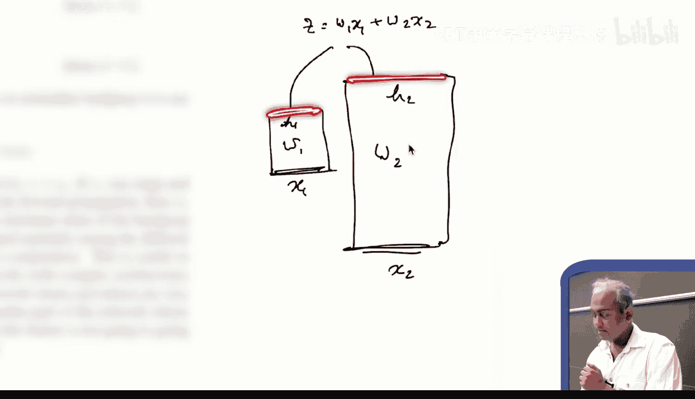

# 人工智能和机器学习基础：37_04_02：反向传播的替代视角 🔄

在本节中，我们将探讨反向传播算法的一个关键替代视角，理解梯度如何在网络的不同部分之间分配。这对于设计和调试神经网络至关重要。

---

上一节我们介绍了反向传播的基本流程，本节中我们来看看梯度分配背后的直观逻辑。

一个非常重要的思考方式是：将前向图中的操作视为一个整体。例如，一个操作 `W1 * x1 + W2 * x2` 产生输出 `z`。

我们知道，`w1_bar`（即 `w1` 的梯度）等于 `z_bar`（即 `z` 的梯度）乘以 `∂z/∂w1`，也就是 `x1`。因此，**`w1_bar = z_bar * x1`**。同理，**`w2_bar = z_bar * x2`**。

理解或记忆这一点的关键在于：`w1` 获得的梯度，是由其输出 `z` 的梯度 `z_bar` 分配的。这个分配是公平的，基于每个权重对输出的贡献大小。

可以将此视为两个项共同创造了输出 `z`。存在一个来自反向传播上层的梯度 `z_bar`，你的任务是以某种方式将这个 `z_bar` 分配给 `w1_bar` 和 `w2_bar`。

以下是梯度分配的核心规则：

*   如果 `x1` 的值非常大，那么 `w1` 将获得更大份额的梯度，因为 `w1_bar = z_bar * x1`。
*   如果 `x2` 的值非常大，那么 `w2` 将获得更大份额的梯度。

因此，`W1` 和 `W2` 以这样的方式分享来自 `Z` 的传入梯度：如果其中一个在创造输出时扮演了更重要的角色（即其输入值更大），它也会获得更大份额的梯度。

---

这个原理在构建复杂神经网络时尤为重要。设想一个场景：这是你的第一个网络 `H1`，其权重是 `W1`；然后这里有另一个大型网络 `H2`，其权重是 `W2`，输出是 `H2`。

这里，`H1` 的输出是 `x1`，`H2` 的输出是 `x2`。我们暂时忽略中间可能存在的非线性激活函数。

如果 `H2` 的输出与 `H1` 相比非常小，那么这个网络（即使它本身非常庞大）将不会获得大份额的梯度。它从 `Z` 获得的梯度将始终很小。

因此，当人们构建非常大的网络时，经常发生的情况是：一个庞大的网络坐在这里，但它获得的用于训练的梯度如此之小，以至于网络的权重几乎不更新。

网络权重的更新幅度，即你对 `W2` 所做的更新，是其获得梯度大小的函数。如果它没有产生高幅度的输出，那么它可能无法获得足够的梯度回报，从而无法有效训练。

---

所以，当你组合大型架构或创建自己的新架构时，必须非常小心，因为你可能会遇到这种不一致性。通常当人们说“神经网络/深度学习只是超参数调优”或“深度学习需要我训练大量超参数”时，他们忽略的正是这种思考。

如果你以网络“条件良好”的方式设计它们，如果你思考梯度如何回传并检查权重是否被正确更新，那么你并不真的需要过多地调优超参数。我喜欢说，在我大多数论文中，我们只使用一组超参数设置，仅此而已，用于论文中的所有实验。

因此，如果你能认识到反向传播的工作原理，你就可以极大地简化工作，并减少在拟合网络时遇到的所有麻烦。

---

本节课中我们一起学习了反向传播的梯度分配视角。我们了解到，梯度根据每个参数对前向传播输出的贡献比例进行分配。这一原理提醒我们，在设计神经网络时，需要确保网络各部分能获得足够的梯度流以进行有效训练，而不仅仅是盲目地增加网络规模或调参。理解这一点有助于构建更稳定、更高效的模型。