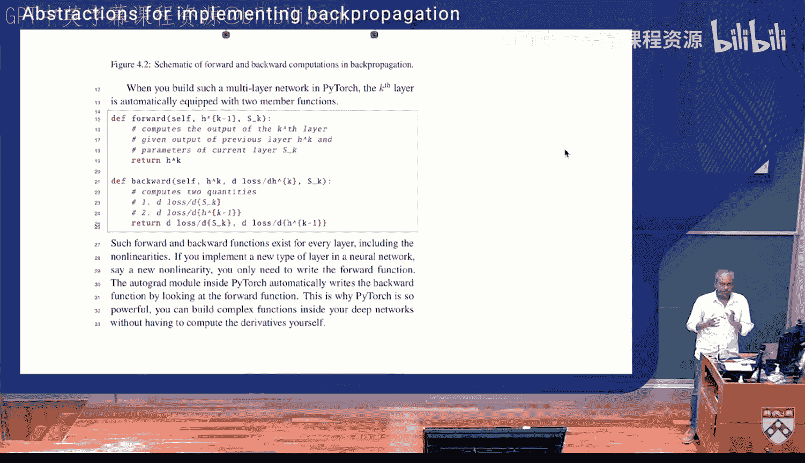
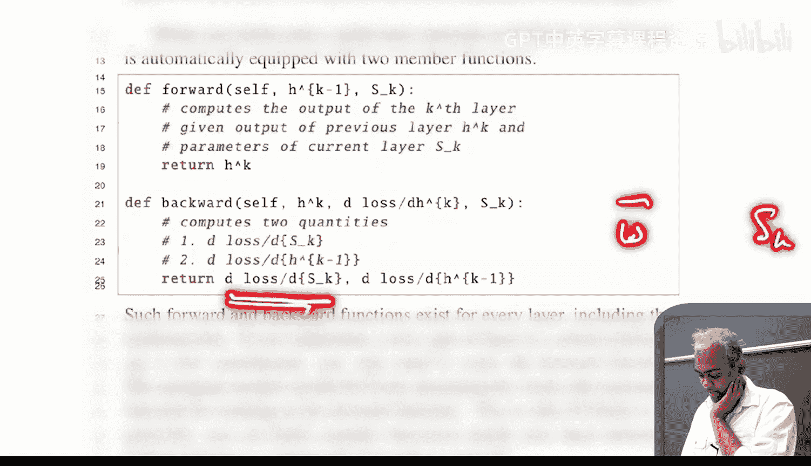
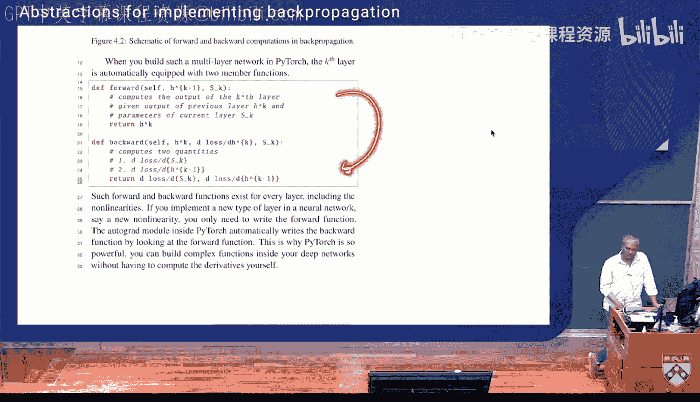
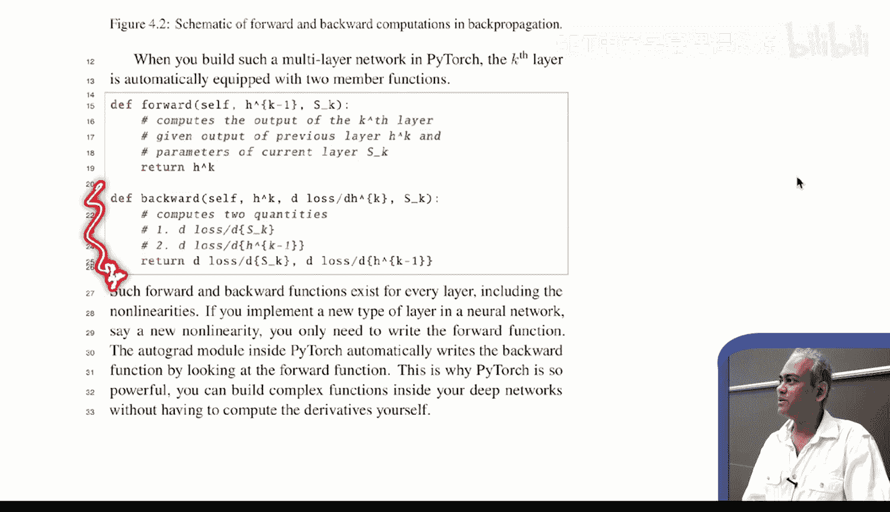
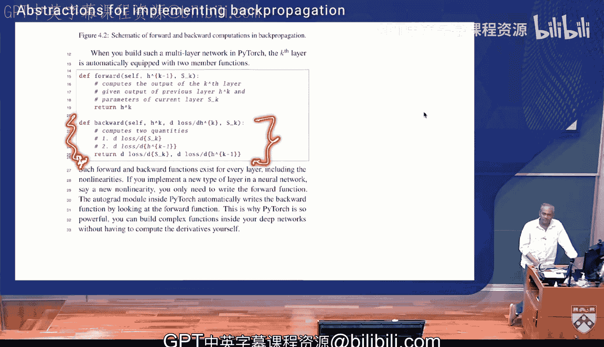

# 宾夕法尼亚大学《人工智能和机器学习基础（AI、数据科学、机器学习）AI and Machine Learning Essentials with Python》 p131 38_04_03_实现反向传播的抽象方法.zh_en -BV16f421Q72q_p131-

As we said， we have。Forwardward computational graph and a backward computational graph。 Now。

 when you create your own architecture， you don't want to do all the steps again and again。

 So one very clean abstraction to think about is that every step， every individual layer。

 whether it is a linear layer that multiplies by some weight or whether it is a layer that applies simply an on linearity to it。

It comes with a particular forward function。 A forward function is something that takes in the output of the previous layer as one argument。

 and it takes whatever the weight matrix of that particular layer as an argument， okay。

Its job is to create the output of that letter。This is one little step of our forward graph。Okay， in。

 written down in code。Every lad。You have， let us say if it is a Python class。

 then it will you can write down a forward function for that particular class like this。Get。

You can also write down a back function for that particular class because back word computation also has the same number of steps。

 It only like runs back through them in a different order。

What does the backward function take as input， it takes in D loss by DHK。

 it takes in HK bar as input， it is the bad version of its output that particular layer output right。

So this is one of the outgos。It also takes in H K， which is the output that it created during the forward pass。

 This is the cast thing。😊，And of course， it takes in the weights that it has for that particular class。

 so every layer it is a whether it is a fully encrypted layer or a non nonlinearity。

 will have two such functions， a forward function that creates the output of that layer using the weights of that layer and the inputs to that layer as two arguments and a backward function which creates which uses Hk bar。

 the out the bad version of the output of that layer as an argument。

The actual forward graph output of that layer hk as the argument and of course。

 like the parameters as the argument。What does it give you， It gives you two things。 It gives you。

W bar， which in my language here， I have called it S K bar。

 the bard version of the weights of that layer。

This is something that is very important to appreciate。

 The backward function is something that takes in the bad version of the output of that layer。

 and it returns two things。 It returns the bad version of the weights of that layer。

 and it returns the bad version of the input of that layer。😊，H K-1 bar。Okay。

To give you a slightly better visual picture。Let us say that we had one layer that does this e equal to v times h。

 So our forward forward function is easy。 It takes in v as input and H has input and returns E as the output。

 The backward function is exactly this step。It is it it is this two steps。

 It returns v bar and h bar as outputs， and it takes in as inputs E。An edge。看。

Try to write this down for a linear layer the forward and backward and you will see exactly how to plug in these things together in your homework。

 you will write two kinds of layers， a linear layer like this W trans x and a non nonlinear layer like this is sigma。

 actually a third layer， which is the loss okay。Life would be very hard if you had to write down both of these functions for every complicated operation you wanted to perform in a neural network。

Convolutions， fancy nonlinear linear narrativeities， etc cea。The biggest benefit of Pyarch is that。

You only have to write this forward function for your layer。

 If you wanted to create a new layer that is not inside Pyth。

 then you only need to write down the forward part of the function。

 and then Pyth will automatically complete the backward version。

 It will automatically write this de backward for you internally。 so you don't have to write it。Okay。

 you don't have to write the chain rule steps。 And this is the biggest reason why everyone can do deep learning so easily because they don't have to write backward functions。

If you see papers from like research papers by fancy professors in the mid 200s out of 10 pages。

 basically 8 pages will be about doing the chain rule and writing these kinds of functions。

 we can do all of them in one line now。

