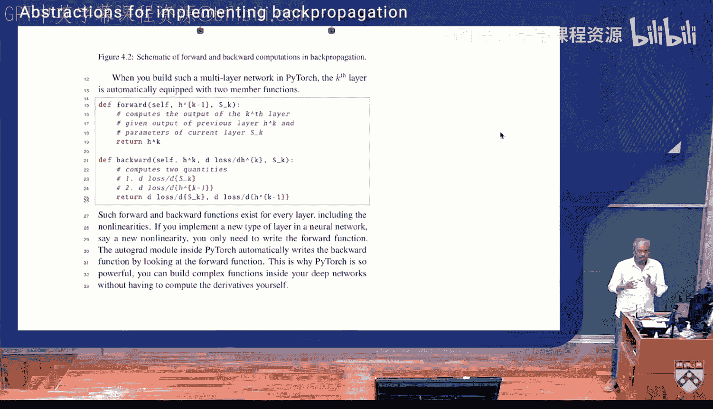
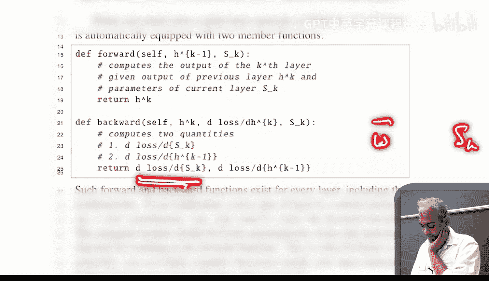
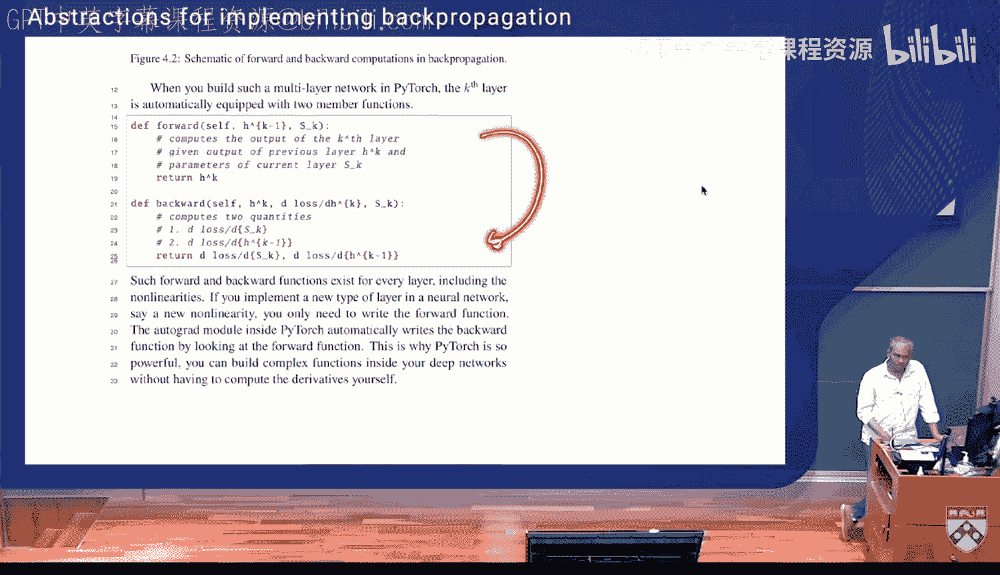
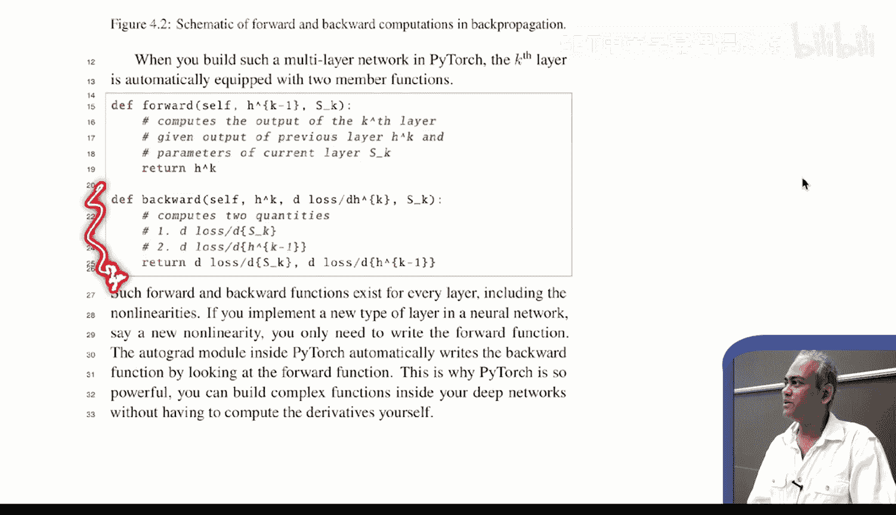
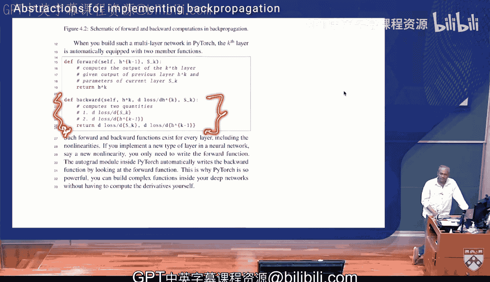

# 人工智能和机器学习基础：38：实现反向传播的抽象方法 🧠

在本节课中，我们将要学习如何通过抽象化的方法来简化神经网络中反向传播的实现。我们将理解“层”的概念，以及如何为每一层定义前向和反向计算函数，从而避免手动重复复杂的链式法则推导。



---

正如我们之前所说，神经网络包含前向计算图和反向计算图。当你创建自己的网络架构时，不希望每次都重复所有步骤。因此，一个非常清晰的抽象思路是：将每一个独立的步骤或层（无论是进行线性变换的层，还是简单地应用非线性激活函数的层）都视为一个独立的计算单元。


每一个这样的层都配备一个特定的前向函数。前向函数接收前一层的输出作为一个参数，同时接收该层特定的权重矩阵作为另一个参数。它的任务是生成该层的输出。这是我们前向计算图中的一个步骤。

在代码中，如果使用Python类来表示一个层，你可以像下面这样为该类编写一个前向函数：

```python
def forward(self, input, weights):
    # 计算该层的输出
    output = ... # 例如：output = weights @ input
    return output
```

同样，你也可以为该类编写一个反向函数，因为反向计算也包含相同数量的步骤，只是以相反的顺序运行。

反向函数接收什么作为输入呢？它接收 `d_loss_by_d_hk`（即损失对该层输出的梯度，记作 `hk_bar`）作为输入。同时，它也接收该层在前向传播中生成的输出 `hk`，以及该层拥有的权重参数。

因此，无论是全连接层还是非线性激活层，每一层都将拥有两个这样的函数：
*   一个**前向函数**，使用该层的权重和输入作为参数，生成该层的输出。
*   一个**反向函数**，使用该层输出的梯度 `hk_bar`、该层前向输出 `hk` 以及该层的参数作为参数。



那么反向函数返回什么呢？它返回两个结果：
1.  `w_bar`（或记作 `sk_bar`）：该层权重的梯度。
2.  `h_k-1_bar`：该层输入的梯度（即传递给前一层的梯度）。


理解这一点非常重要：反向函数接收该层输出的梯度，并返回该层权重的梯度以及该层输入的梯度。

为了给你一个更直观的图像，假设我们有一个层执行运算 `e = v * h`。那么：
*   前向函数很简单：接收 `v` 和 `h` 作为输入，返回 `e` 作为输出。
*   反向函数则对应反向传播中的两步计算：它接收 `e_bar`（`e` 的梯度）和 `h` 作为输入，返回 `v_bar` 和 `h_bar` 作为输出。

在你的作业中，你将尝试为线性层（如 `W^T * x`）和非线性层（如 `sigma` 激活函数）编写这样的前向和反向函数，从而理解如何将这些部分组合在一起。

如果对于神经网络中你想执行的每一个复杂操作（例如卷积、复杂的非线性激活函数等），都必须手动编写这两个函数，那将非常困难。




PyTorch 等现代深度学习框架最大的好处就在于此。如果你需要创建一个框架内没有的新层，你**只需要编写该层的前向函数**。PyTorch 会自动地、在内部为你完成反向版本的计算，自动应用链式法则。你不再需要手动编写反向函数。




回顾21世纪头十年的研究论文，大约10页纸中有8页都在讨论如何推导链式法则和编写这类反向函数。而现在，我们可以用一行代码完成所有这些工作。这极大地降低了深度学习的入门门槛，使得人人都能更容易地进行深度学习实践。

---


本节课中，我们一起学习了神经网络层的抽象概念。我们明确了每一层都应具备前向和反向计算功能，并理解了反向函数如何接收输出梯度并返回权重和输入梯度。最重要的是，我们认识到现代深度学习框架（如 PyTorch）通过自动微分机制，使我们只需定义前向计算，从而极大地简化了反向传播的实现过程。