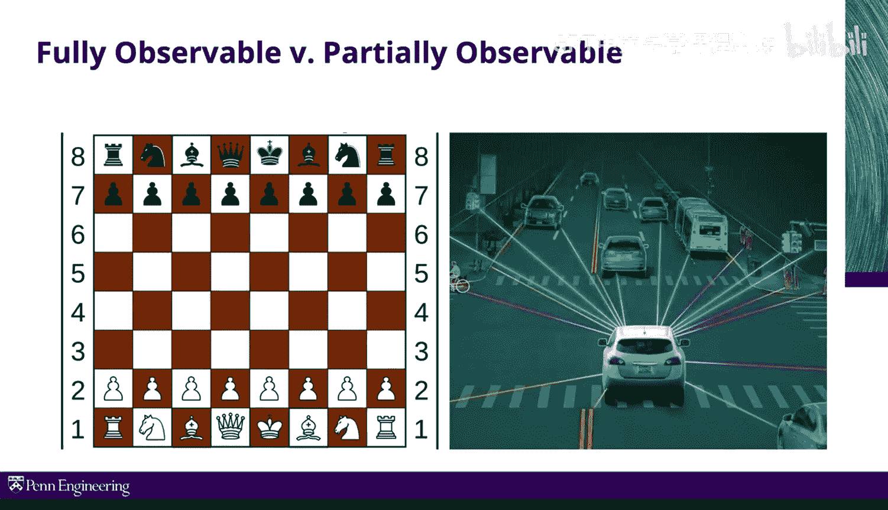
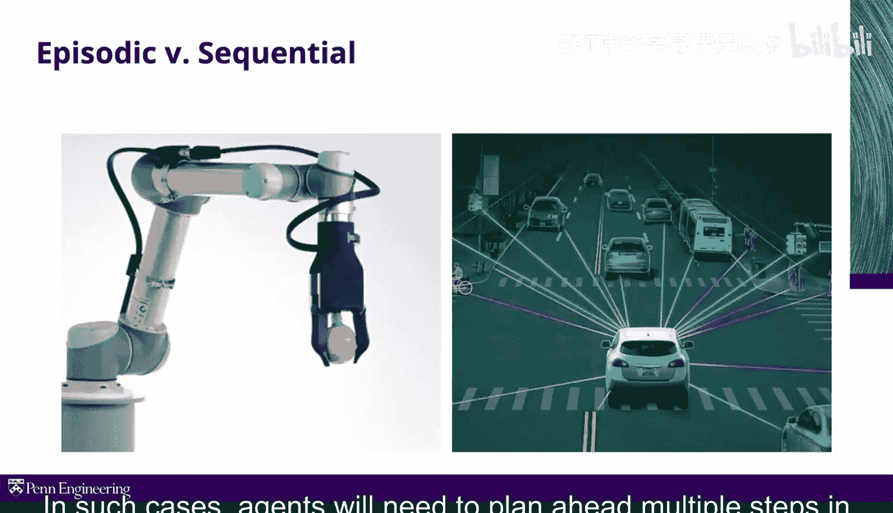
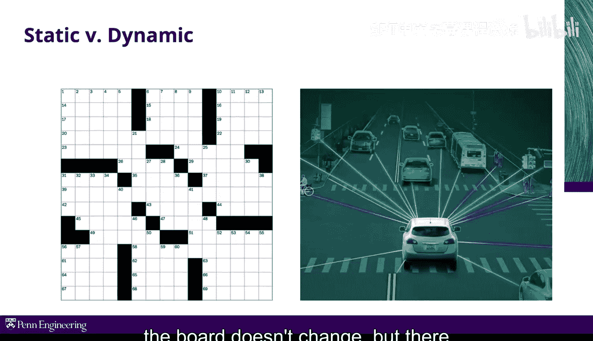
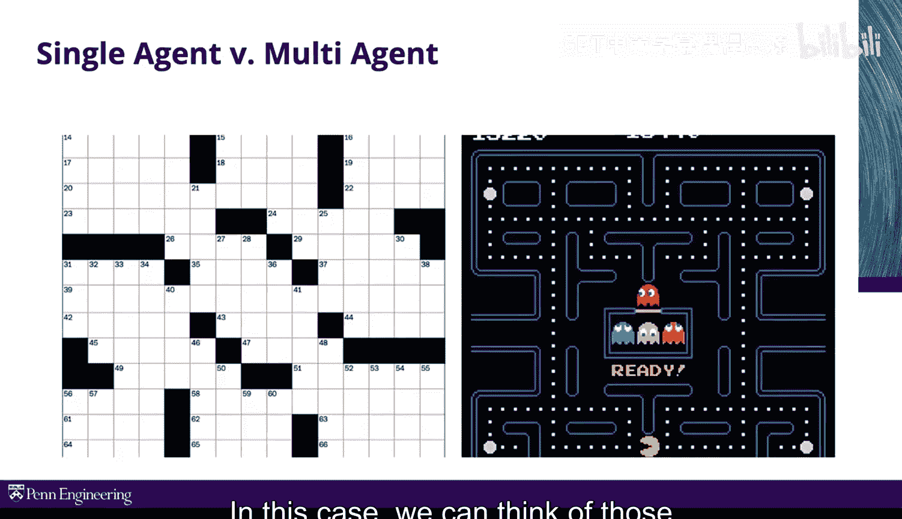
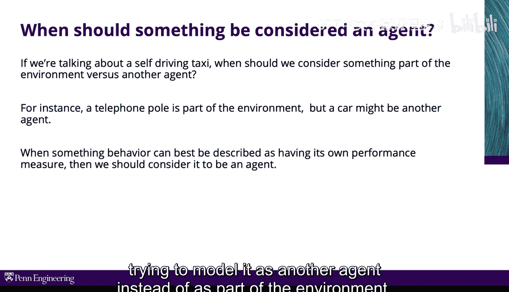
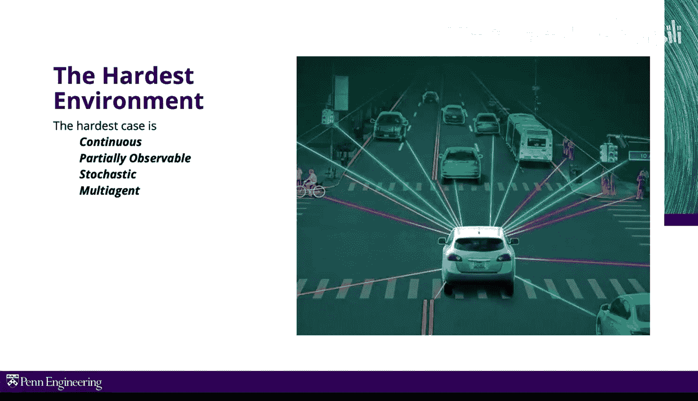
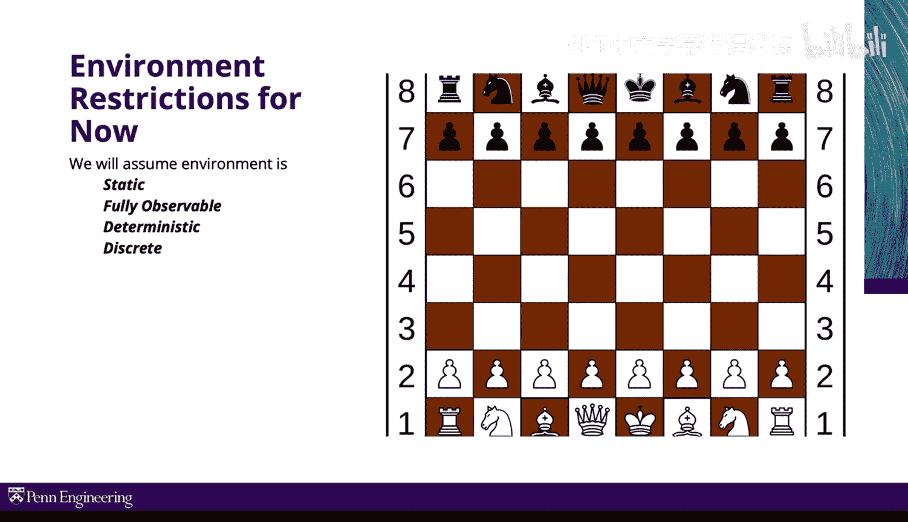

# 宾夕法尼亚大学《人工智能和机器学习基础（AI、数据科学、机器学习）AI and Machine Learning Essentials with Python》 p14 14_02_02_任务环境的属性.zh_en -BV16f421Q72q_p14-

Some task environments are fully observable。And others are only partially observable。For example。

 if we're designing an agent to play chess， it can perceive the complete state of its environment。

The chess playing AI system sees the entire chess board， and nothing is hidden from it。

 A task environment is considered fully observable if a task agent sensors can detect all of the aspects of the environment that are relevant to the agent's choice of action。

In contrast with fully observable task environments。

 many task environments are only partially observable。

 Self driving cars operate in a partially observable environment。

 They have access to only the information that they can perceive via their sensors。

 So they have access to some information about their immediate surroundings。

 but not to the entire global picture。 For example， in a self driving car or automated taxi。

Some parts of the environment may be obscured， because they're occluded。By other objects。

 for instance， pedestrians may be hidden behind other vehicles or a building may block the sensors so they can't see what's coming around the corner。

Partially observable environments can also be the results of sensors that are noisy or inaccurate。

Another example of a partially observable environment。

 though not quite as exciting as the automated taxi， is our trusty robotic vacuum。

 which functions in a partially observable environment。

 since its sensors can only detect dirt that are immediately underneath it。😊。

If it had a complete map of the room with all of the dirty locations marked and the map was updated as it was cleaned。

 then that would be a fully observable environment。

An agent function takes in a sequence of percepts and then returns in action。

One distinction that's useful to make is what happens when the agent chooses which action to take。

Is the result that you expected to happen guaranteed to happen？

In deterministic environments like chess。When an agent picks an action like moving one of its paws。

Then we know with certainty what the immediate result of that action will be。

 The pond will either move forward if the agent selects that or move diagonally to capture the opponent's piece。

Another way of thinking about deterministic environments is that after an agent selects an action。

Then the state of the environment will be completely knowable after it completes that action。

 The resulting state of the world is going to be completely determined based on the current state and the action that the agent picked。

 If that's not the case， then we refer to the environment as a non deterministic environment。

In non deterministic environments， the agent can pick connection， but then the outcome is uncertain。

There can be many possible resulting states of the environment based on the agent executing that action。

 this can arise in games of chance。A lot of the problem settings that we'll address in our artificial intelligence course are games since they are closed worlds where the environment is really well defined。

Games that involve rolling dice or drawing cards are different from chess。

 since the outcome is not deterministic。That's because there are several possible outcomes。

 Environments with non deterministic outcomes are oftentimes stochastic in nature。

 stochastic means probabilistic。If we can quantify how likely each of the possible outcomes is。

 then the environment is a stochastic environment。 A non deterterministic environment is similar。

 but we just haven't quantified the likelihood of the different possible outcomes。

Task environments can be either episodic or sequential。

 an episodic environment is one in which the agent needs to process self contained episodes。

The agent perceives the environment and then performs a single action。

 and the choice of each action is not dependent on any previous action。

 One example of this is a robot that picks out defective parts on an assembly line and then discards them。

Each time it examines a part in front of it， its decision about whether or not that part is defective is independent of all its past decisions in sequential environments。

 the current decision can affect all future actions。In this case。

 an immediate decision is going to impact the space of possible choices that will come next。

 The impact on the future makes sequential environments more challenging than episodic ones。

 In such cases， agents will need to plan ahead multiple steps in the future in order to come up with the desired outcome。

Another dimension to consider in task environments is whether the environment is static or dynamic。

If the environment remains unchanged while the agent is deliberating about what action to take。

 then it's a static environment。An example of this is like a crossword puzzle where you can think as long as you'd like before taking the action to write out a word or enter a letter。

Nothing changes until the agent finishes deciding what action to take。

This stands in contrast with dynamic environments。Where while the agent is thinking about what action to take。

 the environment is changing all around it。This makes many tasks much more challenging。

 since time is of the essence， objects around them。 For example。

 they have to apply the brake if a car or pedestrian is suddenly on their path。

 The amount of time that elapses between receiving the perceptual input and deciding that the car needs to apply its brakes is extremely relevant since the car is hurtling through space。

There can also be task environments that are somewhere in the middle between static and dynamic。

 and environment can be categorized as semi dynamic if it doesn't actually change with the passage of time。

But the agent score does change。 One example of this is playing chess with a clock。

 or the actual state of the bo doesn't change。But there is some penalty for taking too long。

Next， we have discrete versus continuous environments。

 This distinction applies to the state of the environment and to the way that time is handled。

In board games， the environment can be represented using a discrete number of distinct states In discrete environments。

 There is also a limited number of clearly defined actions。

This means there's a finite set of actions that an agent can take。In continuous environments。

 we need to think about the state representation of the environment or the way that we handle time as being continuous。

For example， if we're building an AI system to control an oil refinery。

 the temperature settings and the oil outputs would go through a continuous range of values smoothly over time。

The final property that we'll use to categorize task environments is whether a single agent is acting in the environment or whether multiple agents are there。

 Earl， we talked about deterministic versus non deterministic environments。

 There is another variation on that， where the environment is entirely deterministic。

 except for the actions of another agent。They can chess。

We can treat the other agents in a strategic way。We can think of one agent as competing with another when we have a competitive multi agent environment。

 then we'll need to design strategies for playing against the other agents。

We can assume that the other agents are also acting rationally in a game setting。

 increasing your own performance measure often decreases your opponent's performance measure A crossword puzzle is an example of a single agent environment。

Only one agent is trying to come up with a solution to the puzzle。

 Chess is an example of a multi agent environment where our agent has a single opponent。

 The classic video game Packman has multiple opponents where all of these little ghosts are trying to eat you。

Although most of the time we think of multi agent environments as competitive。

 sometimes the goals of the agents are aligned。In this case。

 we could think of those environments as being cooperative。

When should something be considered an agent。If we're talking about self driving cars。

 then why do we feel like a telephone pole should be part of the environment。

 but another car maybe should be considered an agent。

The basic rule of thumb is to think about performance measures。

 If something has its own performance measure that it is trying to optimize。

 then that's a good reason for trying to model it as another agent instead of as part of the environment。

All of these different elements of our task environment。

Will help us decide what elements we need in our solution to them。

Different parameterizations can lead to easier or harder problems to solve。

The very hardest task environment that we could think of would be one， which is continuous。

Partially observable， stochastic and multiageged， much like the self driving car example。

For now we're going to restrict ourselves to relatively simple task environments。

 we'll begin by looking at static， fully observable， deterministic。

 discrete task environments like board games like chess。As the course progresses。

 we'll look at more and more complicated task environments。

