# 宾夕法尼亚大学《人工智能和机器学习基础（AI、数据科学、机器学习）AI and Machine Learning Essentials with Python》 p15 15_02_01_Python复习-函数.zh_en -BV16f421Q72q_p15-

Let's take a look at functions in Python。Here is how you define functions in Python。

 A function definition begins with the key word， de。Then the function name， then an open per N。

 a list of arguments， a closed per end， and then a colon。 The body of the function is indented。

 You can optionally add a documentation string immediately after the function definition。

The dock string is defined by triple quotation marks。

The keyword return indicates the value to be sent back by the function。

Python uses the nu keyword when no return statement is given。The body of the function is indented。

The first line with less indentation falls outside of the function definition。 Once again。

 Python uses white space to divine blocks of code， just like with the conditional statements that we saw before。

White space defines what belongs inside the function， and where they end。Unlike Java。

 Python doesn't declare the return type or the types of the functions arguments。

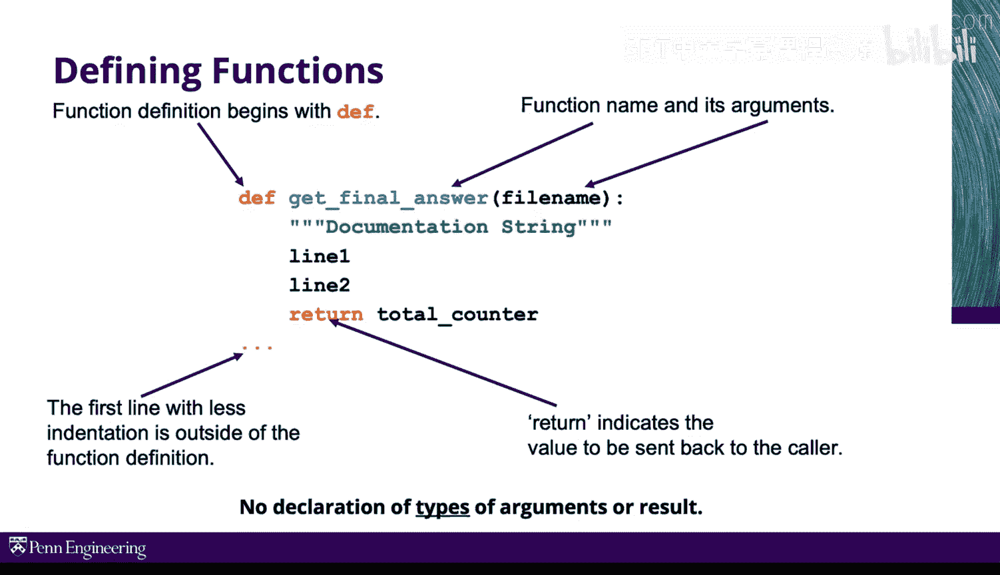

One interesting difference between Java and Python is that Python allows you to have methods with multiple return values。

In Java， the only way to return multiple values from a function is to create an object that you design specifically for that purpose。

In Python， you can easily return multiple values just by listing them all after the return statement with commas separating them。

This automatically packages the different values that you're returning in a tuple。

 So the return type of a function with multiple return values is a tuple。

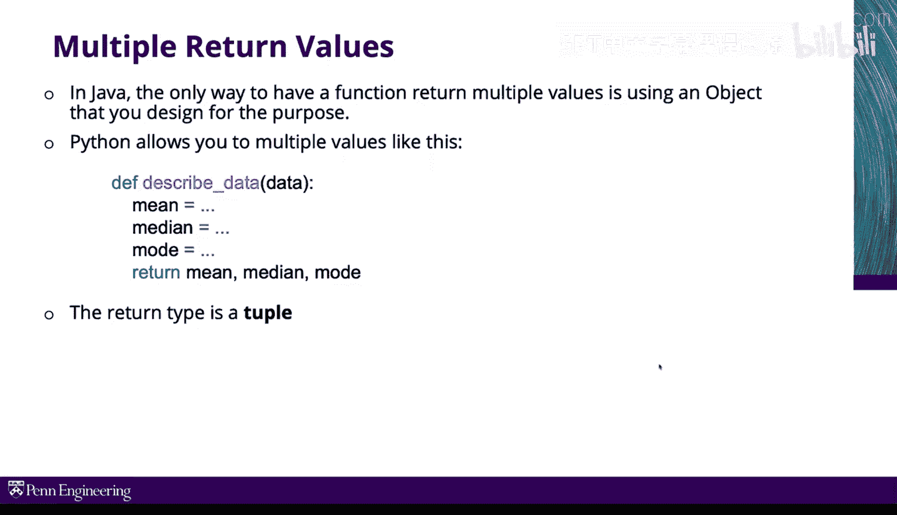

Java and Python also differ in how their function signatures are defined。 In Java。

 The method signature includes the method name and the types of its argument。

As a consequence of this signature definition， Java allows classes to have multiple methods with the same name。

The methods are distinguished based on the number and type of their arguments。 So， for instance。

 if I had a class that was in charge of adding numbers together。

 I could have multiple instances of the function ad that took different numbers of arguments or different types of arguments。

 Unlike Java， the function signature and Python is simply the name alone。Therefore。

 it's not possible to have two different functions that have the same name。

 even if they have different numbers or orders of their arguments。

Python classes do allow operator overloading。 So if it makes sense for you to compare two objects with the double equal sign or to add two of your objects together with the plus operator。

This is possible when you implement a magic method within that class。

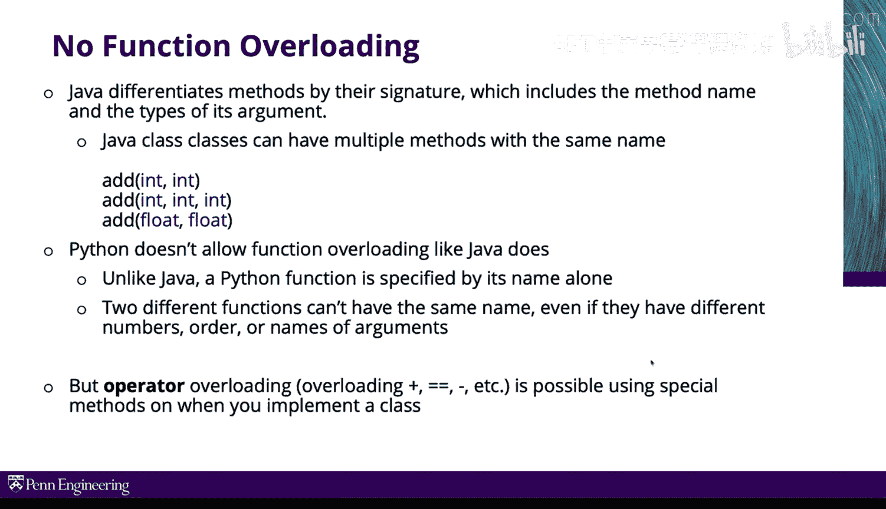

Although Python doesn't allow you to define multiple functions with the same name that take different numbers of arguments。

 it does allow the same function to take different numbers of arguments。

There are several ways that Python accomplishes this。

You can give default values for functions arguments。When you do this。

 those arguments become optional。This means that when you call the function。

 you can specify values for those arguments， which will override the default values。

Or you can leave out those arguments in which case their default values are used。

 This means that if I call my function， I can call it in several different ways。

I can pass in all the arguments， including the ones that have default values。

 or simply the ones that don't specify a default values。

Python requires that the non default arguments。Always precede the arguments with default values。

 If you don't follow this requirement in your function definitions。

 then Python will return a syntax error。

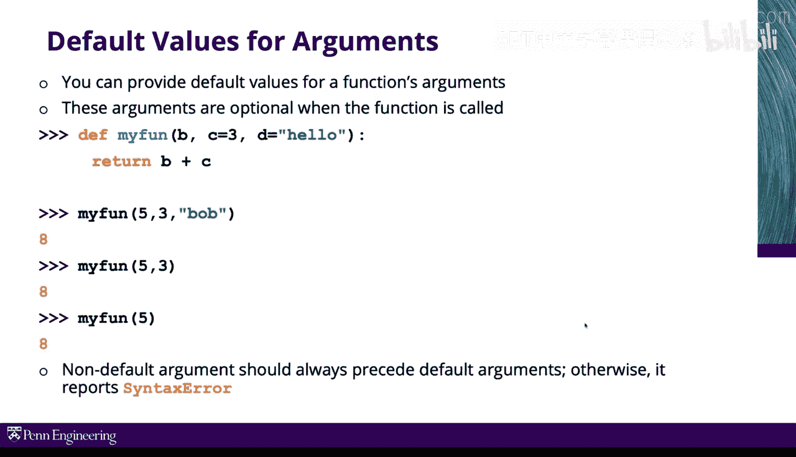

Python is also surprisingly flexible about the order in which arguments come。

Functions can be called with their arguments out of order as long as the arguments are specified in the call。

 These are called key word arguments。So， for instance， if I define a function with arguments A。

 B and C， I can actually call that function with those arguments in any order as long as I explicitly use their keyword。

 Instead of calling the function with argument order A B，C。

 I can actually call it in the reverse order with argument order， C， B， A。

 as long as I specify C equals some value， B equals some value and A equals some value。

Arguments where I do not explicitly give the keyword of the argument name are assumed to be in default order。

 Another mechanism that Python uses to provide flexibility in the number of arguments that you pass to a function is through the use of the star Args keyword。

 Args， as a pirate would say， is a way of passing a variable number of non keyword arguments into your function。

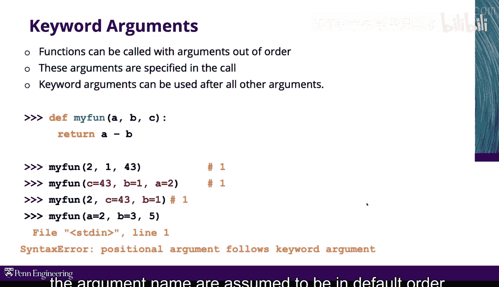

Here I have an example where you can define a function called print everything。

And then give it the star Arg's keyword。Args is a tuple of arguments that get passed into the function。

It allows you to pass in any number of arguments into this function。You can do this in two ways， one。

 you can simply add any number of arguments to the function you've defined。Or two。

 you can define a list of items。And then unpack it using the star notation before the list。

You can pass the list into the function and unpack the list at the same time。

 using the star list notation。

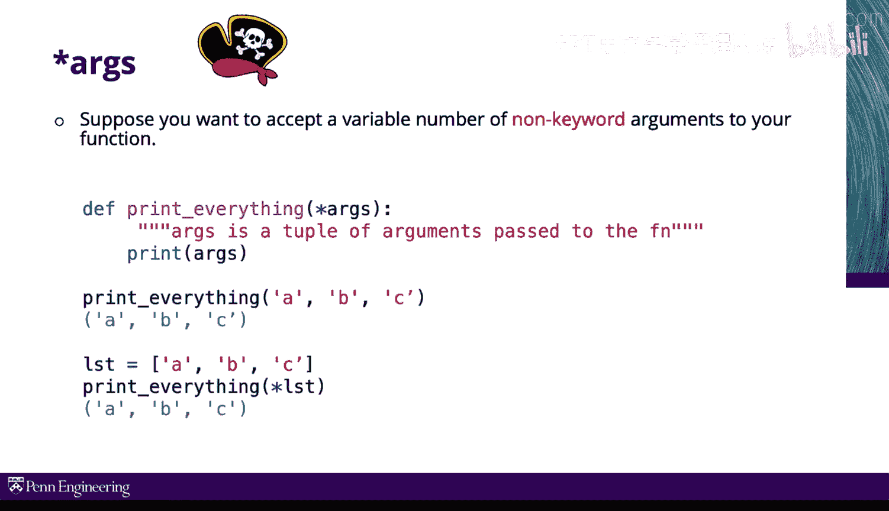

If you want to accept a variable number of keyword arguments into your function。

 use quargs in the same way that you did Args。 The notation for args and quarkrgs is a little complicated since we use star and star star。

 But once you get used to it， it becomes a very convenient way of passing in any number of arguments。

Here's an example of two different ways that you can pass key word arguments into a function that you have defined using quarks。

You can either pass keyword arguments where you've got the keyword and its value。

Or you can pass in a dictionary， Similarlyly， how you used the star notation to unpack a list that was passed into a function that used args。

You can use a double star to unpack a dictionary that you pass into a function that uses quarkgs。

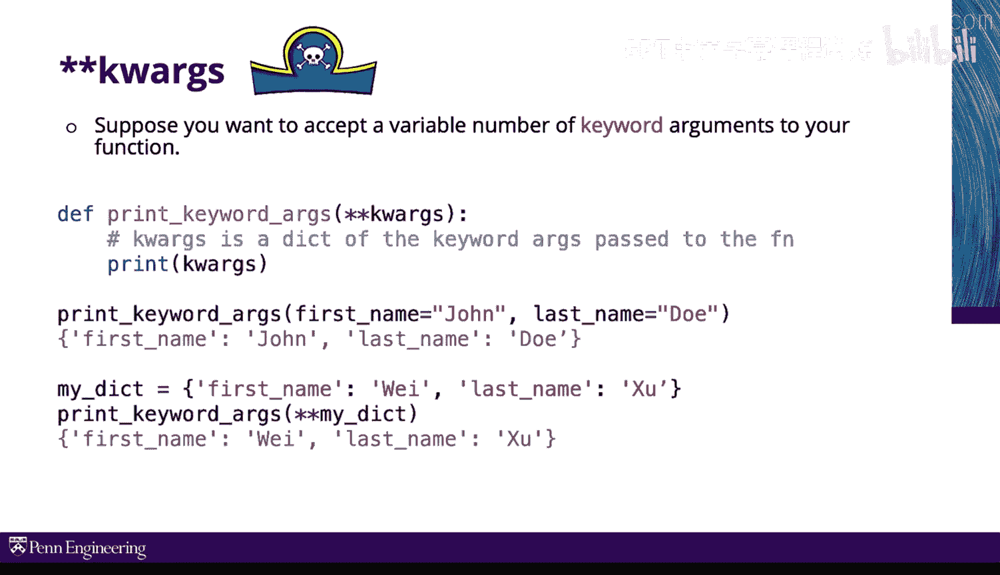

Although Python doesn't have the same ability to overload functions like Javavas。

 its flexibility in the arguments that functions can take is arguably just as useful。

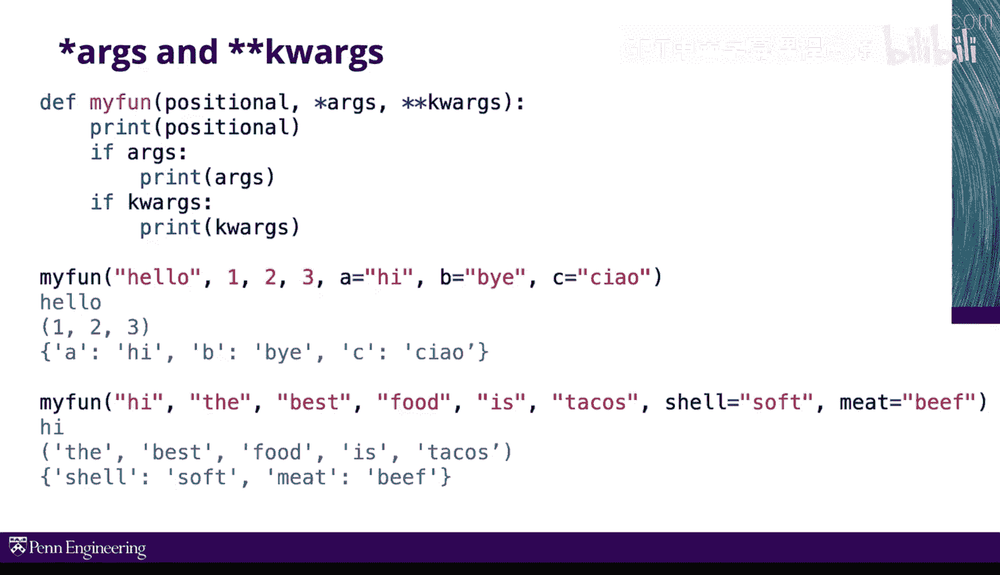

Python is rather loose in its use of variables。You can define a function and refer to a variable that isn't defined within the scope of the function。

In this case， the function sees the most current value of the variable。 So， for instance。

 in this function addd， Im referring to a variable I。

 which is not defined within the function itself， but defined somewhere else in my code。

 As I update I， the output of the function add， even as I pass in the same values， will be different。

 because I has been defined with different values at different places in my code。

 And so the function sees the most current values for I。

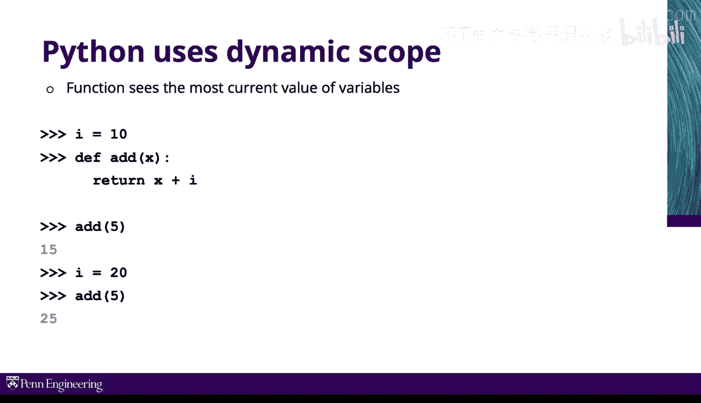

One interesting property about default arguments is that you can use them to a really nice effect in a type of program called a dynamic program。

 A dynamic program is an efficient method for coding a recursive algorithm。

Dynamic programs use a process called memorization。

Memoization is an optimization technique used to store the results of expensive function calls and returning a cached result。

 This could be used in a program for calculating Fibonacci numbers。

 where each number depends on two previous computations。

The way that we can make this program efficient is each time we compute the Fibonacci number for some number N we'll store the resulting Fibonacci number in a Python dictionary called Phbs。

Here you can see that I have a dictionary fibs as a default argument on my fib function。

I have initialized the Phbbs dictionary， to be empty。

Default parameter values are evaluated only the first time we call the function。 Therefore。

 I'm not going to create a new empty dictionary each time I call Fib。And， in fact。

 each subsequent call to Fib will increase the size of the Fibbs dictionary。

 This allows me to memorize each thing。 So I only compute a Fibonacci number for a particular value of N once。

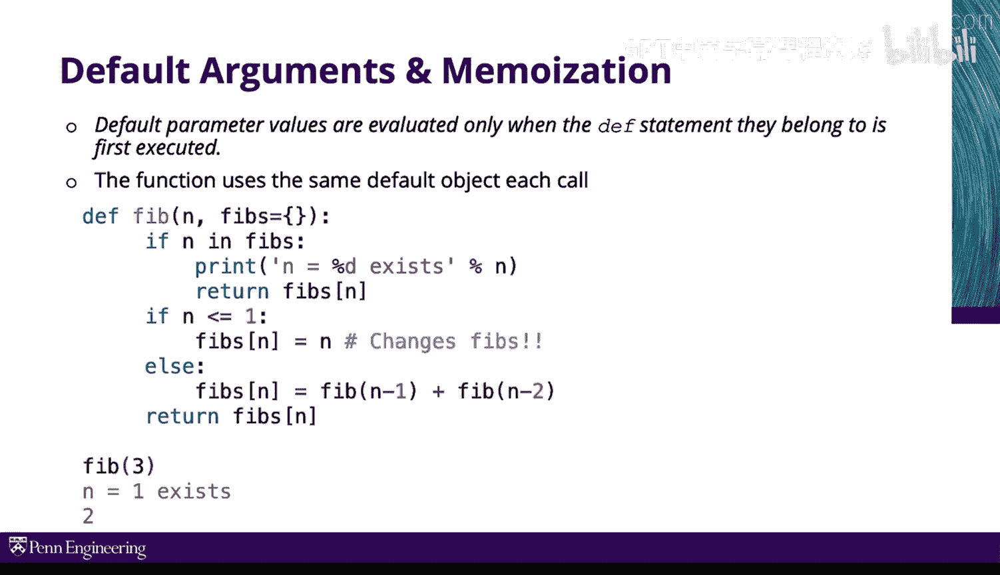

The interesting difference between Python and Java is that functions are first class objects。

What do I mean by first class objects？I mean， objects that can be dynamically created， destroyed。

 passed into a function， returned as a value and have the same rights as all other variables in the programming language。

In Python， functions are genuinely first class citizens。

 you can pass functions as arguments into other functions。 You can return functions as a value。

 You can assign functions to variables or even store them in data structures。

This allows you to do a lot of super interesting， sophisticated things。 For instance。

 I can write this compose function that'll take as arguments， a function F。

 a function G and some data X。This compose function will be a higher order function that first applies the function G to the data X。

And then applies F to the result of that。 Once I've defined this composed function。

 I can pass into it any two functions and any data that I'd like。 so， for instance。

I can apply the function sum to the data 1，2，3。And。Then for my function F。

 I can use a cast to a string。So first， I'll sum together 1，2，3 and get the integer 6。

 and then SR will cast that integer into a string。

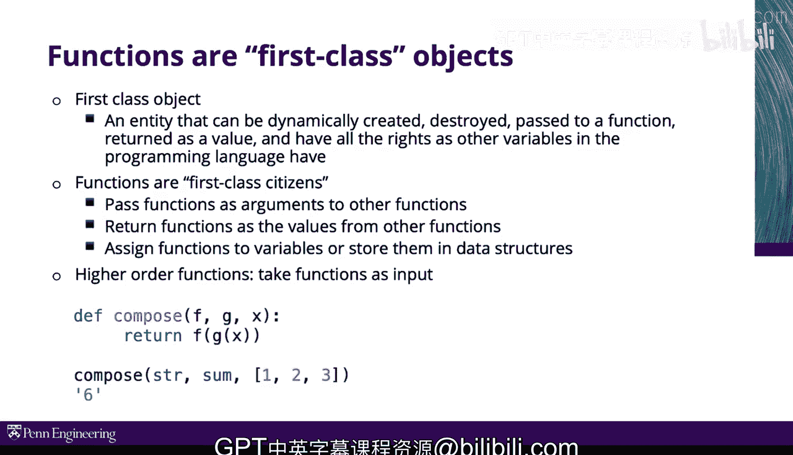