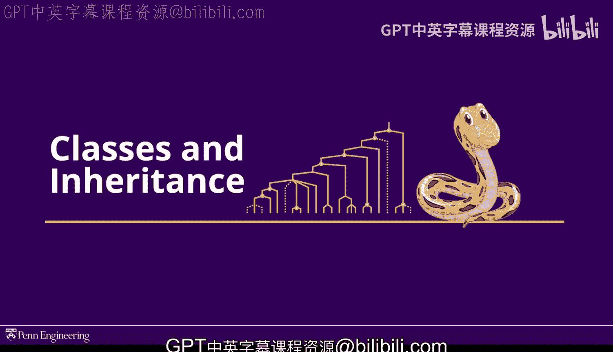
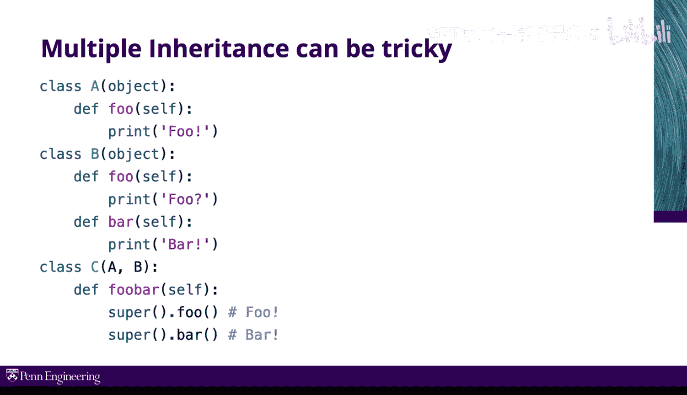
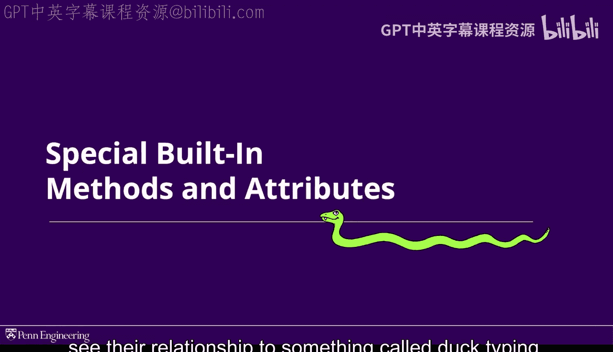
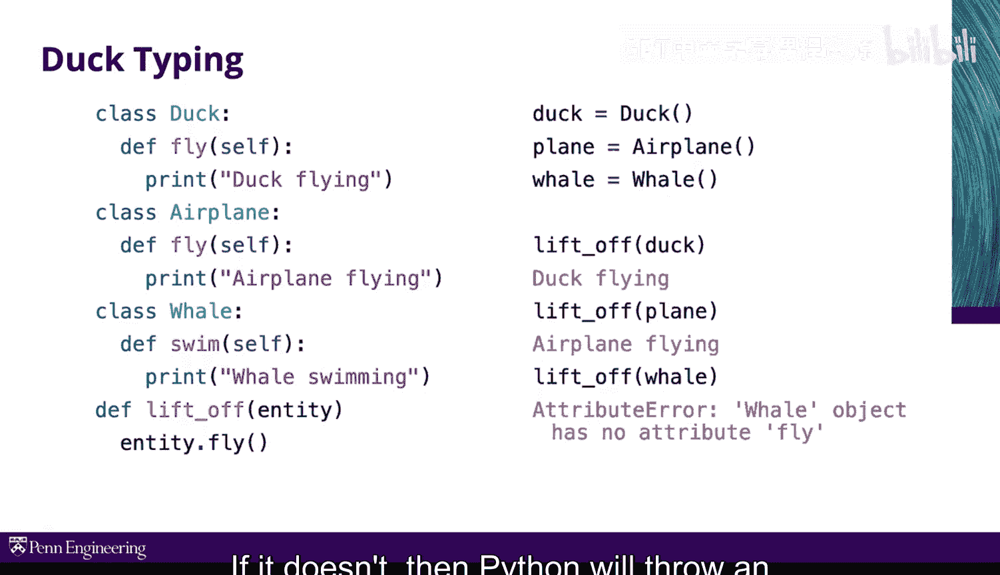
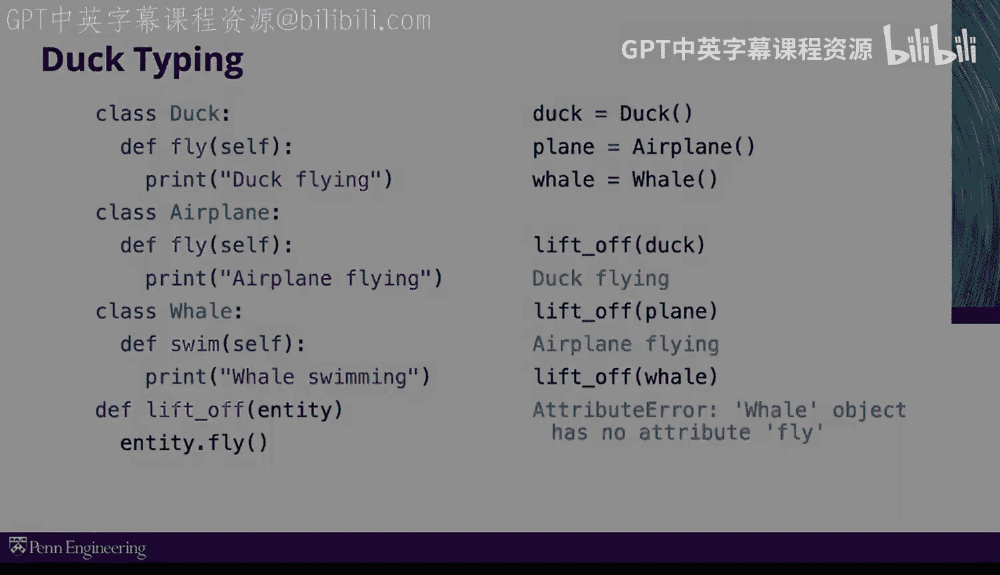

# 宾夕法尼亚大学《人工智能和机器学习基础（AI、数据科学、机器学习）AI and Machine Learning Essentials with Python》 p16 16_02_02_Python复习-类.zh_en -BV16f421Q72q_p16-

Let's take a look at how to implement classes in Python and how we can subclass those using inheritance。

Defining a class in Python is straightforward。All you need is the keyword class。

 and then the name of the class that you're creating， followed by a colon。

Just like with functions and conditionals， the body of the class definition is indented。

 And the first line that's not indented falls outside of the definition of the class。

Classes can have attributes， which are variables that apply to all instances of that class In Python。

 a constructor function has this funny name。Double underscore。Init， double underscore。

We'll see in a moment a variety of other functions that use this funny double underscore or den notation。

These are magic methods that have a special way of being called in Python。

 When you create a new instance of this class student。

 this method will be called when the object is instantiated。

 You'll notice in the definition of functions on a class。 Every method begins with the variable self。

 self represents the instance of this class。All of the function definitions for a class definition will begin with this keyword itself。

Note that the keyword self only belongs to the class definition and not when you using these methods。

 here are two different ways of calling methods for an object。

You can take the instance of the object like student1 here and call the method on it using this dot notation。

 You can directly call the function on the instance of the class that you've got。

 Another way of calling this function on this instance is to use the class name。

 dot the function name， and then pass in the instance as a variable。

You can create an extension of a class that's more specialized using a subclass。

This will allow you to use the methods and attributes of the class that you've already defined。

And to potentially override them。The new class that extends the existing class is called a sub class。

 The original class is called a parent or ancestor， or super class。

The way that you create a subclass is again straightforward， you use the keyword class。

You give your new subclass a name like AI student。You use an open perm。The name of the parent class。

 a closed parnne， and then a colon。This is the Python equivalent of what Java uses with the keyword extends。

Python also supports multiple inheritants， you can pass in a comma separated list of parent classes into your new subclass。

In order to define the constructor method for your new subclass。

 you're going to have to define an init function。Oftentimes you'll be in a situation where you'd like to initialize the parent class as well as the current class。

You can do this by explicitly calling the init method on the parent class。

It's very common in Python to see subclass have the first line of their own init method be something like parent class dot inni。

Open print self， and then all the variables needed to initialize the parent class。So， for instance。

 the Annet function for the AI student class would first call the initialization function for the student class and pass in the appropriate variables。

 including the keyword itself。When you're creating a subclass， you can override the parent' methods。

In order to redefine a method in the subclass， all you have to do is define the same method as in the parent class using the same name。

The old code from the parent class won't get executed。In some situations。

 you might want to extend the method from the parent class。

 meaning you'd like the parent classes' code to be executed in addition to executing this new redefined method。

 in order to do this， you'll explicitly call the parents version of the method in a similar way you did for the initialization functions。

 This is the only time that you'll ever explicitly pass the variable self as an argument when you're calling a method of an ancestor。

Python supports multiple inheritance。 This example shows how to define a subclass called C。

That inherits from two parent classes， A and B。This allows the subclass C to gain the methods from both of its parents。

You can see here that the sub class C defines a method fo bar that calls its parents classes fo method and its parent classes bar is unambiguous because that function only occurs on its parent class B。

But foo is ambiguous because it appears on both A and B。

If both parents have a function with the same name。Then。

Which gets called ends up being a little bit tricky。In this case。

 fo will get executed from the parent class A rather than parent class B。

This could be tricky and lead to errors in your code。 So be careful with multiple inheritance。

 Python provides several built in methods for special handling of objects that you define。

Let's take a look at these and see how they work and see their relationship to something called duck typing。

We've already seen one of the special built in methods that Python uses when we create new classes。

This is Python's constructor function。That allows a new instance of an object to be created。

By using the name of the class， an open paren and a list of arguments that are passed into this initialization function and then a closed paren。

These methods that begin with a double underscore， which is also called a du。

Are called magic methods in Python because they allow you to use specialized syntax in order to call them。

Here we see the initialization method and the specialized syntax that you use to invoke that method。

There are several other magic methods in Python。 All of them begin with double underscore。

Each of these magic methods allow a different syntax to be used to invoke the methods。

So in addition for the magic method for initializing a class， you can also do operator overloading。

You can define the magic method CP， which will allow you to compare two instances of your class using the double equals operator。

 Similarlyly， if it makes sense for you to be able to add together two instances of your class。

 you can implement the magic method add that will then allow you to invoke this method using the plus operator。

If you'd like to be able to negate a class， you can also implement the magic method Neg。

There are other built in methods that will give your class the ability to use the array access notation using the open square bracket closed square bracket notation。

In addition to magic methods， Python also has several special variables that are named similarly to the magic methods with these double underscores。

One such special variable is one D name D。That's used in conjunction with Python scripts。

Name is a built in variable， which resolves to the name of the current module。 For instance。

 it resolves to the name of the Python script。The Python interpreter sets the name variable to have the value。

 D， main， D。When a source file is being executed on the command line。

This allows us to have a Python main method， even though Python doesn't have a built in main method。

 For instance， there's no need to define a function called main。Instead。

 the Python convention for a main method is a rather odd looking syntax。

 If you've never seen it before。To find the made method for a class or to add one to your own class。

 you should add this if statement， if the special variable name equals。Maine with Tunders。

That's the signal that this is the main method and the code block within this。

 if statement will be executed when you run the script from the command line。

Magic methods allow us to do things like implement a method for length that then allows us to call the built in Python function length。

On any class that implements it。We don't need to implement a specific interface like we would need to do in Java。

This is an instance of duck typing。Duck typing is a way of establishing whether an object is suitable based on the presence of particular methods。

The name duck typing comes from this English idiom。

If it walks like a duck and quacks like a duck and swims like a duck， then it's a duck。

Here is an example of  duck typing。I'm defining several classes。

Two of which have the method fly on them。I can then define a function called lift off that applies to any type of entity that has the method fly on it。

So I can create an instance of a duck， an instance of a plane。

And apply the method left of to either of those。Note that the argument for left off is an untyped entity。

And we're trusting that that entity has the method fly， if it does。

We successfully call the method fly on that specific class。 If it doesn't。

 then Python will throw an attribute error saying that the object has no attribute fly。

