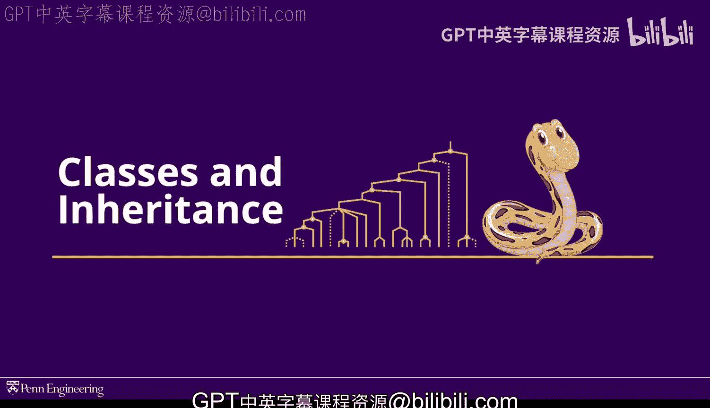
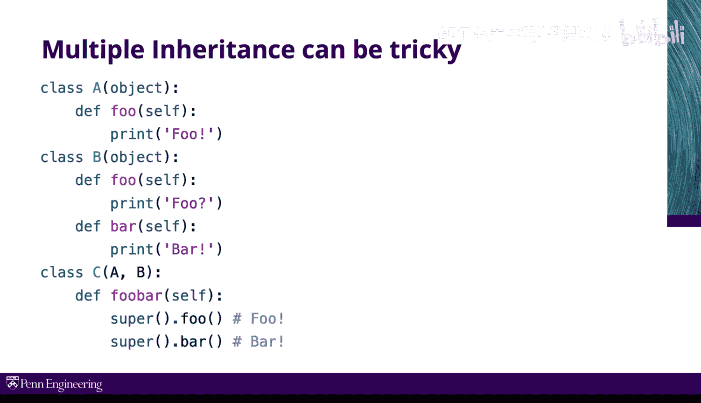
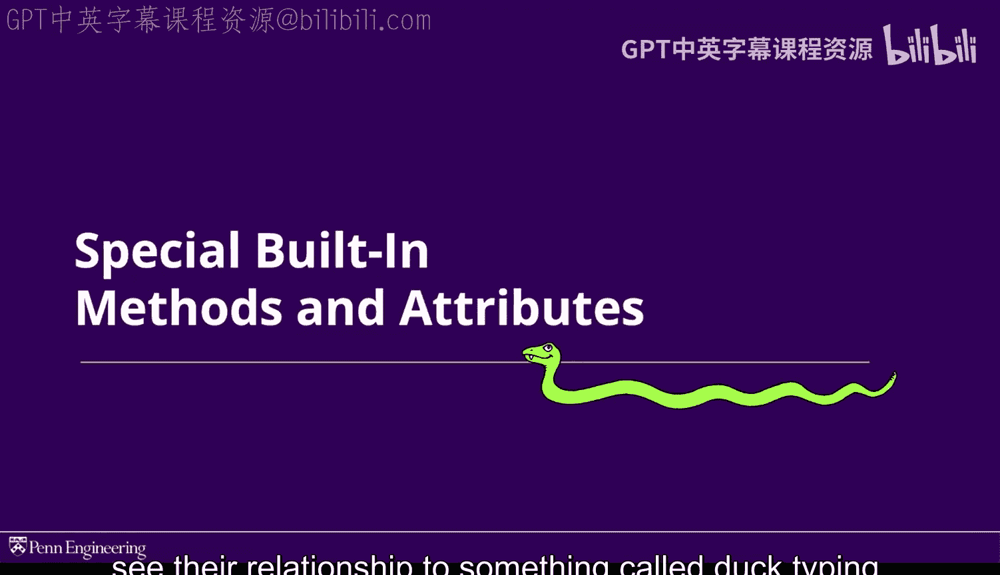
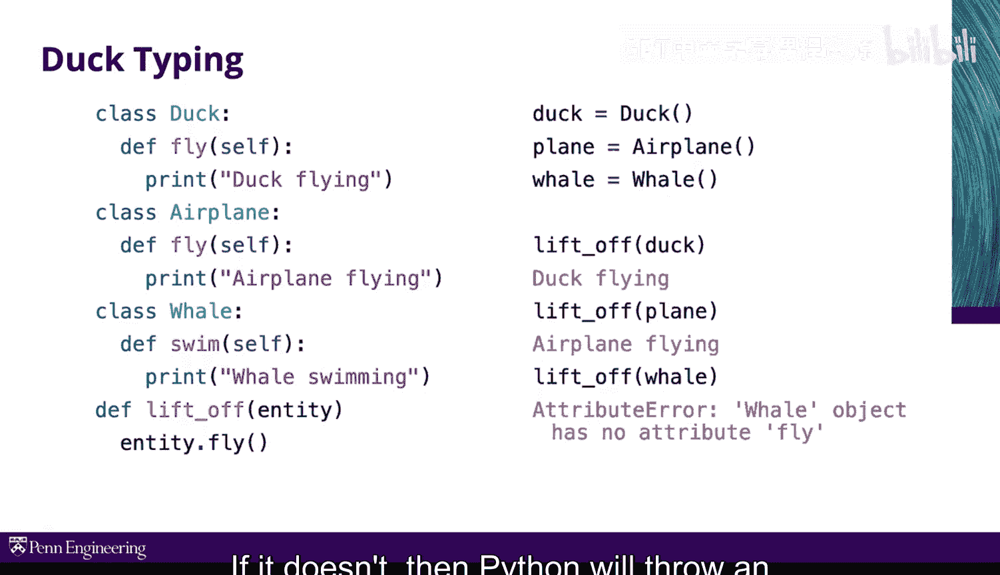
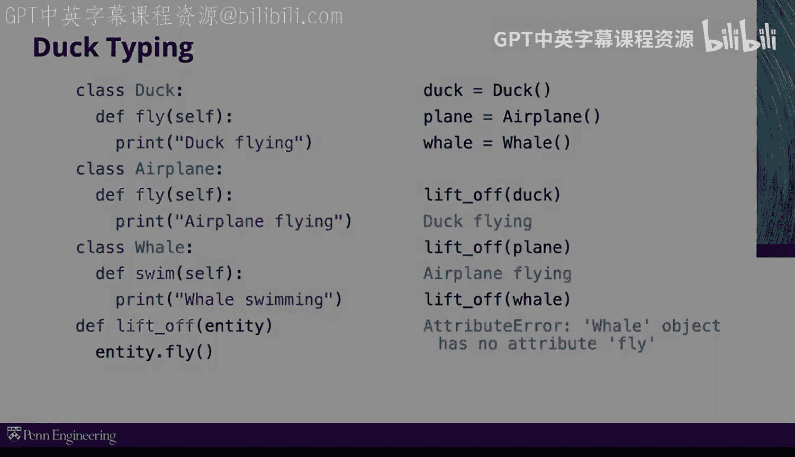

# 人工智能和机器学习基础：16：Python复习-类



在本节课中，我们将学习如何在Python中实现类，以及如何通过继承来创建子类。我们将涵盖类的基本定义、构造函数、方法调用、继承、方法重写、多重继承以及Python中的特殊“魔法”方法。

## 概述

类（Class）是面向对象编程的核心概念，它允许我们将数据（属性）和操作数据的方法（函数）捆绑在一起，创建出自定义的数据类型。通过继承，我们可以基于现有类创建更专门化的新类，实现代码的复用和扩展。

## 定义类

在Python中定义一个类非常简单。只需要使用关键字 `class`，后跟类名和一个冒号即可。与定义函数和条件语句类似，类的主体内容需要缩进。

```python
class Student:
    pass
```

类可以拥有属性，这些属性是该类所有实例共有的变量。

## 构造函数与 `self` 参数

在Python中，构造函数有一个特殊的名称：`__init__`。这是一个“魔法方法”，在创建类的新实例时会自动调用。

```python
class Student:
    def __init__(self, name, age):
        self.name = name
        self.age = age
```

你会注意到，类中定义的每个方法都以参数 `self` 开头。`self` 代表类的当前实例。这个关键字只在类定义内部使用，在外部调用方法时不需要显式传递。

## 调用方法

有两种主要方式可以调用对象的方法。

1.  **使用点号（.）表示法**：这是最常见的方式。
    ```python
    student1 = Student("Alice", 20)
    student1.introduce()
    ```

2.  **直接使用类名调用**：将实例作为参数传递给类的方法。
    ```python
    Student.introduce(student1)
    ```

## 创建子类与继承

你可以通过创建子类来扩展一个已有的类，使其更加专门化。这允许你复用父类（或超类）的方法和属性，并可以按需重写它们。

定义子类的语法同样直接：使用 `class` 关键字，后跟子类名、括号内的父类名，然后是冒号。这相当于Java中的 `extends` 关键字。

```python
class AIStudent(Student):
    pass
```

## 子类的构造函数

为了定义子类的构造函数，你需要定义自己的 `__init__` 方法。通常，你既需要初始化子类，也需要初始化父类。

你可以通过显式调用父类的 `__init__` 方法来实现这一点。在Python中，一个常见的做法是让子类 `__init__` 方法的第一行调用父类的初始化函数。

```python
class AIStudent(Student):
    def __init__(self, name, age, specialization):
        super().__init__(name, age)  # 调用父类Student的__init__方法
        self.specialization = specialization
```

## 方法重写与扩展

在子类中，你可以通过定义同名方法来重写父类的方法。此时，父类的原始代码将不会被执行。

在某些情况下，你可能希望**扩展**父类的方法，即在执行子类新代码的同时也执行父类的代码。为此，你需要像在构造函数中那样，显式调用父类的版本。

```python
class AIStudent(Student):
    def introduce(self):
        super().introduce()  # 先执行父类的introduce方法
        print(f"I am specializing in {self.specialization}.")
```

**注意**：这是你唯一需要显式将 `self` 作为参数传递给祖先类方法的情况。

## 多重继承

Python支持多重继承，即一个子类可以继承自多个父类。这允许子类获得所有父类的方法。



```python
class A:
    def foo(self):
        print("A's foo")



class B:
    def bar(self):
        print("B's bar")

class C(A, B):  # 类C继承自A和B
    pass

c = C()
c.foo()  # 输出：A's foo
c.bar()  # 输出：B's bar
```

然而，当多个父类拥有同名方法时，调用哪个方法会变得棘手。Python使用一种称为**方法解析顺序（MRO）**的算法来决定。在上例中，如果A和B都有 `foo` 方法，`C().foo()` 将调用类A的 `foo` 方法。这可能导致意外的错误，因此使用多重继承时需要谨慎。

## 魔法方法与运算符重载

我们已经见过一个特殊的“魔法”方法 `__init__`。这些以双下划线开头和结尾的方法，允许我们使用特殊的语法。

例如，通过实现 `__eq__` 方法，你可以使用 `==` 运算符来比较两个类的实例。

```python
class Student:
    def __init__(self, name):
        self.name = name

    def __eq__(self, other):
        return self.name == other.name

s1 = Student("Alice")
s2 = Student("Alice")
print(s1 == s2)  # 输出：True
```

类似地，你可以实现 `__add__` 来定义 `+` 运算符的行为，实现 `__len__` 来让内置函数 `len()` 作用于你的类。

## `__name__` 变量与主方法

`__name__` 是一个特殊的内置变量。当一个Python脚本被直接运行时，`__name__` 的值被设置为 `"__main__"`。这为我们提供了一种定义“主方法”的约定。

```python
class MyClass:
    pass

if __name__ == "__main__":
    # 当脚本被直接运行时，执行这里的代码
    obj = MyClass()
    print("Script is running directly.")
```

## 鸭子类型

Python不强制要求对象实现特定的接口（如Java那样）。相反，它采用“鸭子类型”的理念：如果一个对象有我们需要的方法，那么我们就可以使用它，而不关心它具体是什么类型。

> “如果它走起路来像鸭子，叫起来像鸭子，游起泳来像鸭子，那么它就是鸭子。”

```python
class Duck:
    def fly(self):
        print("Duck flying")

class Airplane:
    def fly(self):
        print("Airplane flying")

def lift_off(entity):
    entity.fly()  # 我们不关心entity的具体类型，只关心它是否有fly方法

duck = Duck()
plane = Airplane()

lift_off(duck)   # 输出：Duck flying
lift_off(plane)  # 输出：Airplane flying
```

如果传递给 `lift_off` 的对象没有 `fly` 方法，Python会抛出一个 `AttributeError` 异常。

## 总结





本节课我们一起学习了Python中类的核心概念。我们了解了如何定义类和构造函数，如何使用 `self` 参数，以及如何调用方法。我们深入探讨了继承机制，包括创建子类、重写和扩展方法，以及需要注意的多重继承问题。我们还介绍了Python中强大的“魔法方法”，它们允许我们自定义运算符行为，并理解了“鸭子类型”这一灵活的编程理念。掌握这些知识是使用Python进行面向对象编程和构建复杂程序的基础。