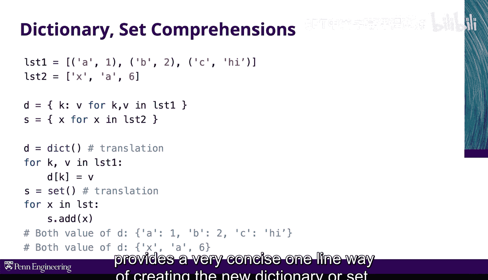
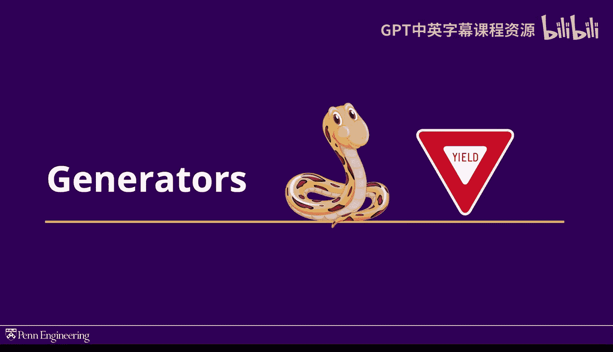
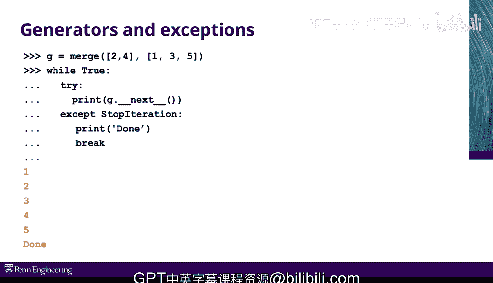

# 宾夕法尼亚大学《人工智能和机器学习基础（AI、数据科学、机器学习）AI and Machine Learning Essentials with Python》 p17 17_02_03_Python复习-for循环.zh_en -BV16f421Q72q_p17-

Let's take a look at how four loops are done in Python。

 we'll also cover a very Pythonic idea called list comprehensions。

4 loops in Python iterate over each item in a collection and then execute a block of code。

 If you've got an existing list， a for loop in Python iterates over each item in it。

If you want to iterate over a certain number of items， Python has a function called range。

 which will generate a list of numbers。 you can say for x。

 it range 5 in order to execute a block of code five times。

The item can actually be more complex than a single variable name。 It can be a tuple of items。

 So you can often iterate over pairs of things。 In fact。

 there's a built in Python method called enumerate that often comes in useful。

Enumerate generates a list of tus from items in a list where the first element in the tuple is the index of the item in the list。

 And the next element of the tuple is the item in the list。

There's a very interesting construct in Python， called list comprehensions。

That can substantially reduce the number of lines of code that you have to write in order to execute an expression on each item in a list。

Here's an example of a list comprehension。In the block above。

 I show you the normal way that we would do it using a for loop。

Let's say we'd like to take the square of each number in a list of integers。Normally。

 we would have a list of integers that we'd like to process。

We would then create an empty list of squares and iterate over every integer in our list。

 appending to the list of squares， that number squared。😊。

Python list comprehension allows us to do this in a single line of code。

We can create a new list with a list comprehension。

 The syntax of Python's list comprehensions takes a little bit of getting used to if you're coming from another programming language。

 But once you've got the hang of it， it's a super powerful tool。

 A list comprehension will create a new list。 So we create a list comprehension using the same notation that we use to initialize a list。

 We start with an open square bracket。😊，We then write an expression that we'd like to apply to every item in a list。

 for instance。X squared here。 X times X。 Then we simply write the for list。

 Then we simply write out the syntax of a normal for loop for x in nus。

Where x is the variable that will process in our expression。

The result is identical to the block of code above。Here are two more examples of list comprehensions。

 In this first example， I'm walking through each element in a list and simply doubling it。

 So my expression is element times 2。 and I apply that expression to each element in a list L I。

 As with four loops， the variables we can process in a list can also be tus。 In this second example。

 I'm cubing the second element of each tuole in a list L I。

List comprehensions also allow us to apply a filtering condition。

We can have an expression that we'd like to apply to each element in this list so long as the filter condition is met。

 so I can double each element in my list L I as long as the value of the element before doubling is greater than 4。

Python also provides methods for performing dictionary and set comprehensions。

I can create a dictionary， rather than a list。From a list of tus。

 list comprehensions create a new list with an open square bracket and a closed square bracket。

And dictionary or set comprehensions create a dictionary or a set with an open squiggly bracket and a closed squiggly bracket。

This example， I'm creating a new dictionary， mapping the first element of each tuple enlist one as the key on to the corresponding value being the second element in each tuple enlist  one。

 In the second example here， I'm creating a new set out of the items in list 2。 Once again。

 dictionary comprehensions and set comprehensions could be unrolled into a whole for loop。

But the comprehension method of doing it provides a very concise one line way of creating the new dictionary or set。

Python has another kind of iterator object called generators。

Which are automatically created by simply inserting a keyword called yield into your code。

This is a very interesting way of dynamically generating an iterator。

Without actually having to create an explicit iterator object。

Generators are complete iterator objects， including the next magic method。

But the way that we create generators is with a yield of keyword。

The yield keyword can be inserted into a function， and that will automatically return a generator object when the function is called。

 For instance， I can create a function here。 F， which has two yield statements in it。

 If I check the type of my function F， it is indeed a function。But as soon as I call the function。

 the type that gets returned is a generator object。

The generator object allows me to call four loops in the same way that I would with any iterable object。

So， for instance， if I have a four loop for I and F of 6， it'll first yield 6。

And then it'll yield 6 plus1 is 7。The way that generators work in Python is actually quite clever。

 Each time we call the next method of the generator。

The function will be run until it encounters a yield statement。

 and then it'll stop and return the value that was yieldeded next time it'll resume exactly where the function had left off。

 It'll maintain all of the state information that's relevant to the function。

 so it can start as if nothing happened。There are several benefits to using generators。First。

 they use far less code than writing a standard iterator object。Because of the cleverness of Python。

 generators maintain the local state of the function automatically。

The values are computed one at a time， meaning they're only computed as they're needed。

 This avoids storing an entire sequence in memory and therefore can be very efficient for tasks like aggregating items in one pass。

Generators are crucially important if you're processing infinite sequences。

 but they can be difficult to use if you need to inspect each individual item。

Here's an example of a function that uses generators to merge two sorted lists。

It's going to combine these lists left and right into a single list。

 an output as a stream without ever storing the entire value of the stream and memory。

We've already got lists L and R stored in memory， so we're going to keep track of four things。

The length of list L， the length of list R， our current position in L。

 which will denote with an I and our current position in list R， which will denote with a J。

 Then we'll execute some logic。 While the pointer I has not yet reached the end of list L。

Or the pointer J has not yet reached the end of L R。

The logic within the wow loop simply decides which number to return。

The number pointed to by the pointer I or the number pointed to by the pointer J。

 If the value of the item pointed to by I is less than the value of the item pointed to by J。

 then we'll yield the value pointed to by I。 And again。

 the yield statement will automatically construct an iterator for us。Similarly。

 if we return the item in list R appointed to by J， we do that with a yield statement。

Since our merge function has the keyword yield in it。

 the return value for our merge function is actually a generator。

So the return value of merge is not going to be a merged list。 It's going to be this iterator。

 like object。So we could say， while true， print the next item off our generator。 However。

 that would result in a stop iteration exception at the end， just as all iterators do。

 if we wanted to return a list from merge， then we could use our list comprehension notation。

Alternately， we could use a while loop with the generator so long as we handle the stop iteration exception at the end。

