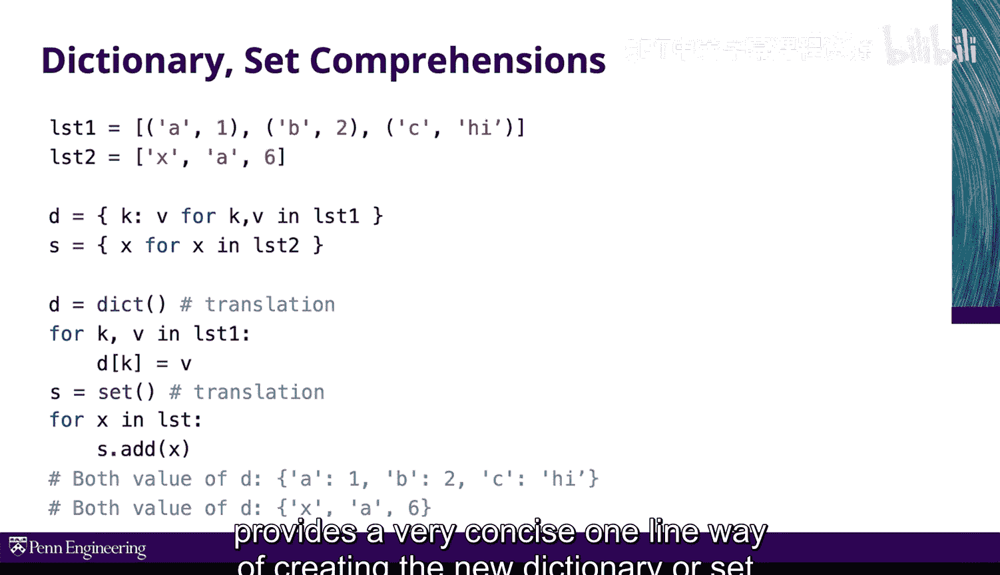
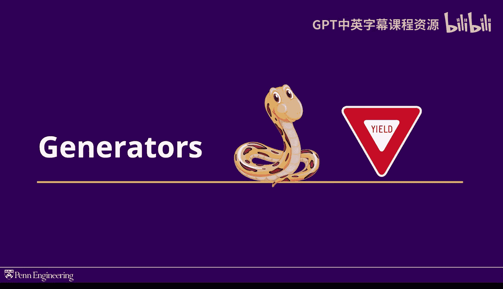
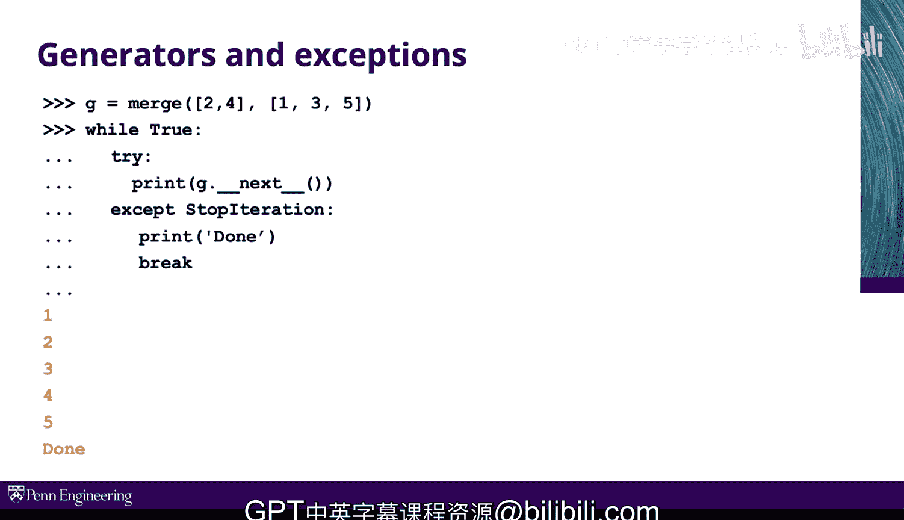

# 人工智能和机器学习基础：17：Python复习-for循环 🔄

在本节课中，我们将要学习Python编程语言中一个核心的控制流结构：`for`循环。我们将从基础的循环语法开始，逐步深入到更高级、更“Pythonic”的概念，如列表推导式和生成器。这些工具能帮助你更高效、更简洁地处理数据集合。

---

## 理解Python中的for循环

上一节我们介绍了课程概述，本节中我们来看看Python中`for`循环的基本工作原理。

`for`循环在Python中用于遍历集合中的每个项目，然后执行一段代码块。如果你有一个现有的列表，Python中的`for`循环会遍历其中的每一项。

如果你想遍历特定数量的项目，Python有一个名为`range`的函数，它可以生成一个数字列表。你可以使用`for x in range(5)`来执行一段代码五次。

循环中的项目实际上可以比单个变量名更复杂。它可以是一个元组。因此，你经常可以遍历成对的事物。事实上，Python有一个内置方法`enumerate`，它通常很有用。

`enumerate`会从列表中的项目生成一个元组列表，其中元组的第一个元素是该项目在列表中的索引，元组的第二个元素是列表中的项目本身。

---

## 列表推导式：简洁的循环工具

上一节我们介绍了基础的`for`循环，本节中我们来看看一个非常有趣的Python结构，称为列表推导式。

列表推导式可以显著减少你为了对列表中每个项目执行表达式而必须编写的代码行数。

以下是列表推导式的一个例子。在上面的代码块中，我展示了使用`for`循环的正常做法。

假设我们想对一个整数列表中的每个数字求平方。通常，我们会有一个要处理的整数列表。然后，我们会创建一个空的正方形列表，并遍历列表中的每个整数，将那个数的平方追加到正方形列表中。

Python列表推导式允许我们用一行代码完成这个任务。

我们可以用列表推导式创建一个新列表。如果你来自另一种编程语言，Python列表推导式的语法可能需要一点时间来适应。但一旦你掌握了它，它是一个非常强大的工具。

列表推导式会创建一个新列表。因此，我们使用与初始化列表相同的符号来创建列表推导式。我们以一个左方括号开始。然后，我们写出一个我们想要应用到列表中每个项目的表达式，例如这里的`x`平方，即`x * x`。接着，我们简单地写出`for`循环的语法：`for x in nums`，其中`x`是将在我们表达式中处理的变量。结果与上面的代码块完全相同。

以下是列表推导式的另外两个例子。

在第一个例子中，我遍历列表中的每个元素并简单地将其加倍。所以我的表达式是`element * 2`，我将该表达式应用到列表`li`中的每个元素。

与`for`循环一样，我们可以在列表中处理的变量也可以是元组。在第二个例子中，我对列表`li`中每个元组的第二个元素进行立方运算。

列表推导式还允许我们应用过滤条件。只要满足过滤条件，我们就可以有一个想要应用到列表中每个元素的表达式。例如，只要元素在加倍前的值大于4，我就可以将列表`li`中的每个元素加倍。

---

## 字典与集合推导式

上一节我们学习了列表推导式，本节中我们来看看Python也提供了执行字典和集合推导式的方法。

我可以创建一个字典，而不是列表。列表推导式使用左方括号和右方括号创建一个新列表。而字典或集合推导式使用左花括号和右花括号创建一个字典或集合。

在这个例子中，我正在创建一个新字典，将列表`list_one`中每个元组的第一个元素映射为键，对应的值是列表`list_one`中每个元组的第二个元素。

在第二个例子中，我正在从列表`list_two`中的项目创建一个新集合。同样，字典推导式和集合推导式可以展开成一个完整的`for`循环。但使用推导式方法提供了一种非常简洁的单行方式来创建新的字典或集合。

---

## 生成器：动态迭代器

Python有另一种称为生成器的迭代器对象，它只需在代码中插入一个名为`yield`的关键字即可自动创建。这是一种动态生成迭代器的非常有趣的方式，而无需实际创建一个显式的迭代器对象。

生成器是完整的迭代器对象，包括`__next__`魔术方法。但我们创建生成器的方式是使用`yield`关键字。

`yield`关键字可以插入到一个函数中，当该函数被调用时，它将自动返回一个生成器对象。例如，我可以在这里创建一个函数`f`，其中包含两个`yield`语句。如果我检查我的函数`f`的类型，它确实是一个函数。但一旦我调用该函数，返回的类型就是一个生成器对象。

生成器对象允许我以与任何可迭代对象相同的方式调用`for`循环。例如，如果我有一个`for i in f(6)`的循环，它将首先`yield` 6，然后`yield` 6+1 即 7。

Python中生成器的工作方式实际上非常巧妙。每次我们调用生成器的`next`方法时，函数将一直运行，直到遇到一个`yield`语句，然后它会停止并返回`yield`的值。下一次，它将从函数离开的地方完全恢复。它会维护与函数相关的所有状态信息，因此它可以像什么都没发生一样开始。

使用生成器有几个好处。首先，与编写标准的迭代器对象相比，它们使用的代码要少得多。由于Python的巧妙设计，生成器会自动维护函数的局部状态。值是一个一个计算的，这意味着它们只在需要时才被计算。这避免了将整个序列存储在内存中，因此对于像一次性聚合项目这样的任务来说非常高效。

如果你正在处理无限序列，生成器至关重要，但如果你需要检查每个单独的项目，它们可能难以使用。

---

## 生成器应用示例：合并有序列表

以下是使用生成器合并两个有序列表的函数示例。它将把列表`left`和`right`合并成一个列表，作为流输出，而无需将流的整个值存储在内存中。

我们已经将列表`L`和`R`存储在内存中，所以我们将跟踪四件事：列表`L`的长度、列表`R`的长度、我们在`L`中的当前位置（用`i`表示）以及我们在列表`R`中的当前位置（用`j`表示）。然后我们将执行一些逻辑。

当指针`i`尚未到达列表`L`的末尾，或者指针`j`尚未到达列表`R`的末尾时，`while`循环内的逻辑简单地决定返回哪个数字：指针`i`指向的数字或指针`j`指向的数字。如果`i`指向的项目值小于`j`指向的项目值，那么我们将`yield` `i`指向的值。同样，`yield`语句将自动为我们构建一个迭代器。类似地，如果我们返回列表`R`中由`j`指向的项目，我们使用`yield`语句来完成。

由于我们的`merge`函数中有关键字`yield`，`merge`函数的返回值实际上是一个生成器。所以`merge`的返回值不会是一个合并后的列表，而是一个类似迭代器的对象。

因此，我们可以说`while True`，然后从生成器中打印下一个项目。然而，就像所有迭代器一样，这最终会导致一个`StopIteration`异常。如果我们想从`merge`返回一个列表，那么我们可以使用列表推导式符号。或者，只要我们最后处理`StopIteration`异常，就可以使用带有生成器的`while`循环。

---

## 总结

本节课中我们一起学习了Python中`for`循环的核心概念及其高级应用。我们从基础的循环遍历开始，了解了如何使用`range`和`enumerate`。接着，我们深入探讨了列表推导式，这是一种编写更简洁、更高效代码的强大工具。我们还扩展到了字典和集合推导式。最后，我们介绍了生成器的概念，它通过`yield`关键字提供了一种动态、内存高效的方式来创建迭代器，并看到了一个合并有序列表的实际应用示例。掌握这些工具将极大地提升你在数据科学和机器学习项目中使用Python处理数据的能力。