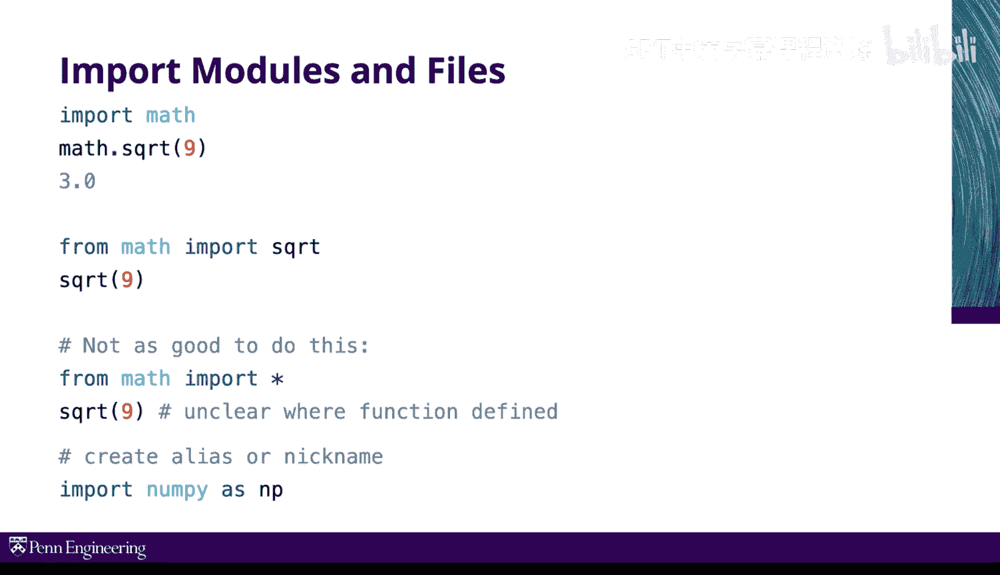
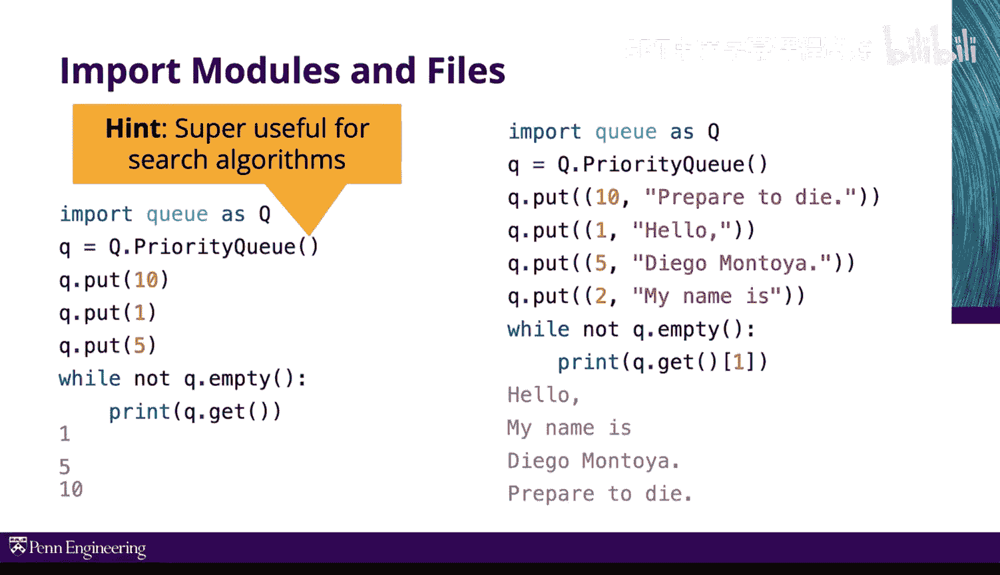
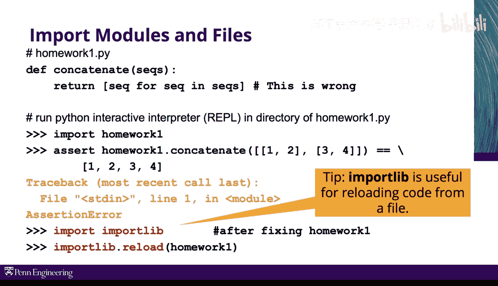
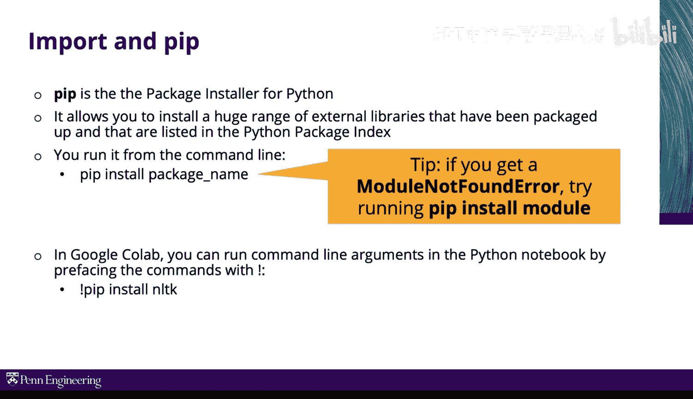

# 宾夕法尼亚大学《人工智能和机器学习基础（AI、数据科学、机器学习）AI and Machine Learning Essentials with Python》 p18 18_02_04_Python复习-导入模块.zh_en -BV16f421Q72q_p18-

One of the most powerful aspects of Python is the ability that it gives you to import external packages and files。

 This ability allows you to incorporate programs that have been developed by other people into your code。

Here are four different examples of how to use the import statement in Python to import a module in Python。

 You use the keyword import， and then the name of the module。

This then gives you access to the functions that have been implemented in that module。 For instance。

 in this first import statement， I am importing the math module。

I can then use the square root function by saying math dot square root。

If I have one specific function that I'd like to import from a module。

 there's a syntax for that as well。 I can say from math， import square root。

 That lets me call the square root function directly without referencing the package。

 math dot square root。Technically， I can import all functions from a module by saying from math importm star。

This is equivalent to saying import math without then having to use the math dot prefix。

The only thing that this import star really gains us is the convenience of not having to type out the full name of the package as a prefix。

If we want to save that typing， then a better stylistic thing to do is to use a nickname or alias for the package。

This last import statement shows how to do it。This shows how to import numpy。

 which is a numeric library for Python。I can say import Numpy as NP。

 that then allows me to prefix any function within Numpy simply by typing NP dot。

That saves me some typing。 But this time， it actually shows what package the function is defined in。

 Here's an example of that alias function。 I can say import the package Q spelled out Q， U， E。

 U E as Q the letter that then lets me import objects and functions from the Q package simply by prefixing them with the uppercase Q and a dot。

 So I can import the priority Q object from the Q package by saying Q dot priority Q。

A priority queue allows us to put a number of items onto the queue。And then deque them。

 using the gi function。The while loop shows how to do this。 While the queue is not empty。

 I will print the next item on the priority queue。 The items in the priority queue come out in ascending order。

The code on the right hand side of the screen illustrates how the priority queue can be used with tus。

Instead of just integer values， the priority Q will sort the tuples based on the first item in the tus。

Therefore， and can associate a priority with any kind of object。In this case。

 I have assigned a priority to a bunch of strings so that they print out in the order that the dialogue should happen。

In addition to importing externally developed modules。

 you can also import files that you have written， for instance。

You can write the script for your homework one assignment in whatever text editor you like to develop in。

Then you can start the Python Reple environment by typing Python at your command line。

Instead of having to copy and paste every function from your homework into the repple environment on the command line。

 you can import it。 You use the same syntax as you did for importing modules。

 You say import homework 1 and omit the dot pi at the end of the file。

 You can then run and test out your code Here， we show a assert statement where we're testing out homework one's concatenate function。

If we concatenate two lists， then they should result in this list 1，2，3，4。 In this case。

 we've implemented the concatenate function incorrectly in the homework。

If we change it and save the file， the Python Reple environment doesn't know that the file has changed。

 so we'll have to reimport it。The way that we do that is through a Python package called Im library or Im Lib for short。

It's useful for reloading code from a file。You can then reload a file using importlib do reload。

In addition to the built in Python modules， there's a huge range of third party developed software for Python。

Pip is a program that allows you to easily install externally developed Python packages。

Pip stands for the Pack installer for Python。You can use Pip to install a huge range of external libraries so long as they are listed in the Python Pack index。

To run Pip， you simply open up your terminal and type Pip install。 and then the name of the package。

If you're trying to run a Python script that someone one else has developed or that you developed on another computer。

 you may encounter a module not found error。 Oftentimes， the way of resolving this error is to run。

 Pip， install and then give it the name of the module that the module not found error reports is missing。

If you are developing or running Python code on a Jupiter notebook， for instance， in Google Coab。

You can still use the Pip command。The way that you do this is to put it in a code cell。

 prefixed with the exclamation point， prefixing a command with the exclamation point in a Python notebook will have it run on the command line for you automatically。

So if I'm trying to install this package called N L T K， I can write exclamation point， Pip。

 install N L T K， and then run that in my Python notebook。

