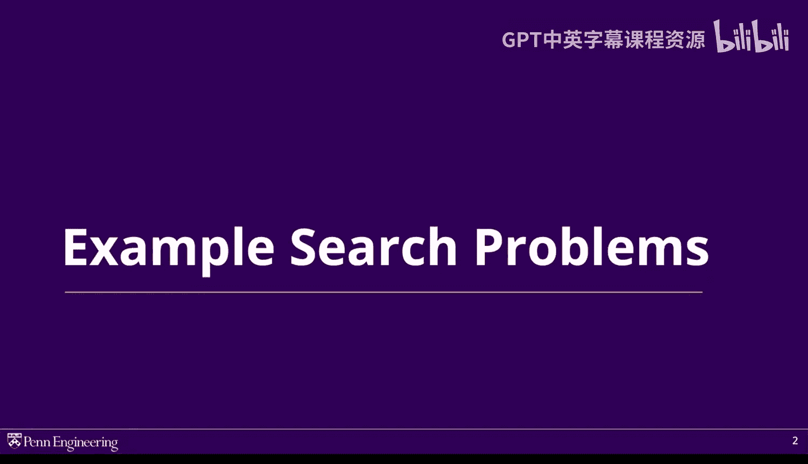
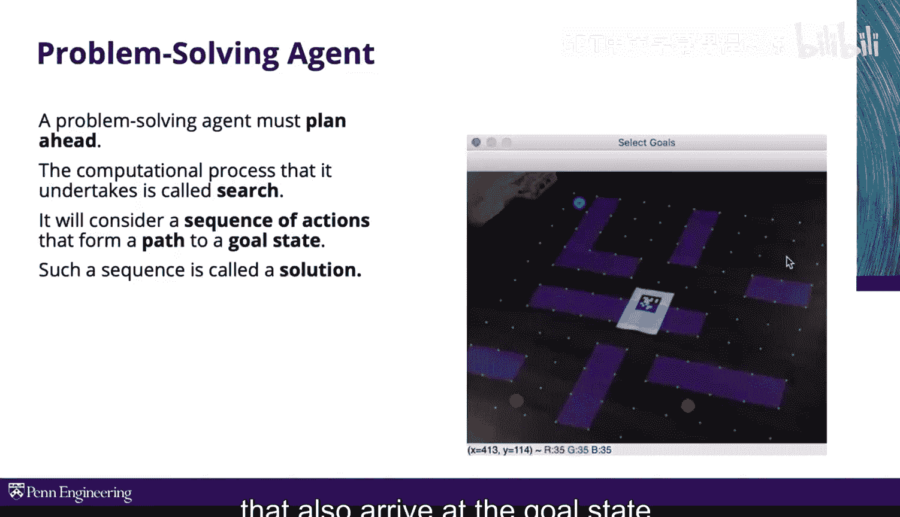
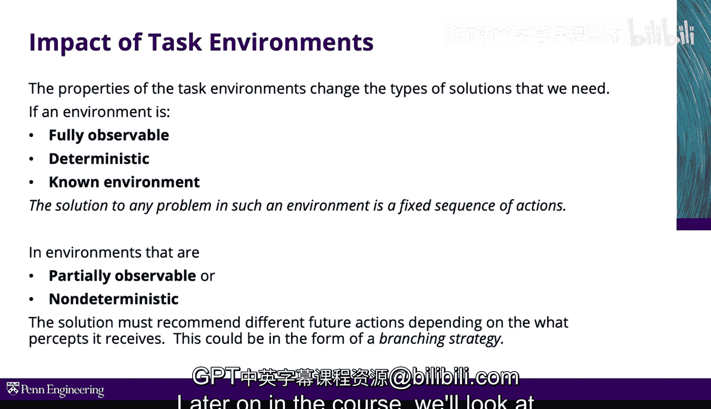

# 宾夕法尼亚大学《人工智能和机器学习基础（AI、数据科学、机器学习）AI and Machine Learning Essentials with Python》 p20 20_03_01_搜索问题-I.zh_en -BV16f421Q72q_p20-

This module will introduce a broad class of problems in artificial intelligence。

 called search problems。We can formulate many problems in computer sciences search problems。

 all of which can be solved using the same set of methods。

The problem solving methods that we'll look at in this module come from earlier research in algorithms。

 especially shortest path algorithms。We'll see how we can apply shortest path algorithms to many problems where we need to search through a space of possible sequences of actions in order to reach our desired goal。

In this module， you'll learn how to formally define a search problem and about a range of different algorithms for arriving in a solution for this general mathematical definition of search problems。

The class of search problems that we'll look at in this module is called uninformed search algorithms。

The uninformed part of the name comes from the fact that we don't use any additional information about the environment that we're exploring。

In the next module， we'll look at how we can use additional information to enhance the search algorithms。

We will look at classic algorithms like depth first search and breadth first search。

And then we'll also look at some interesting variations on them that have some nice computational complexity features。

In module 1， we defined a rational agent as an agent that could select the best action to maximize its performance measure。

 given an input percept sequence。Sometimes it isn't immediately obvious what is the best action to take。

In that case， an agent often needs to plan ahead and consider many possible sequences of actions。

This process of planning ahead and trying to formulate the best possible sequence of actions is called search。

Agents that perform search are called problem solving agents。

The simplest type of agent is a simple reflex agent。

 A simple reflex agent uses its incoming sensor data。

 which we defined as a percept and then uses only the current percept in order to decide what action to take。

The example that we have here is a simple reflex agent that uses the sensor data from an ultrasonic range finder。

It uses a very simple algorithm to decide what to do。

It drives ahead until its sensors tell it that it's about to hit a wall。If it detects a wall ahead。

 then it stops， turns to the left and checks to see if there's a wall there， too。

If there is a wall there， then it turns 180 degrees。Once there isn't a wall ahead of it。

 it drives forward。The main difference between this simple reflex agent and a more complicated agent is that this agent simply reacts to its immediate surroundings and does not plan ahead。

A problem solving agent cannot simply pick a single action based on the current percept。Instead。

 it has a goal in mind and has to plan a sequence of actions in order to reach that goal。

The process of planning a sequence of actions is called search in artificial intelligence。

We're using search here in a different sense than the common way that we use it when we talk about internet search。

Instead， the term search refers to the process of searching for a solution which consists of a sequence of action from the current state that our agent will use to find itself in some desired goal state。

In this video， I show a problem solving agent。I clicked on certain queers in the grid that I want the agent to visit。

 indicated by the red dots。 The blue dot represents the agent's starting point。

 Each of the red dots is a point that we want the robot to visit。

The problem solving agent must find a sequence of actions that will take it from the starting state to the goal states。

The solution is a path。There can be multiple paths from the start state to the goal state。

 This means that there can be multiple solutions to search problems。

We're interested in finding the optimal solution。We are going to consider what it means for a solution to be optimal。

We will have some criteria that allow us to compare solutions and tell us that this sequence of steps is better than the other sequence of steps that also arrive at the goal state。

In module1， we also discussed task environments。The different qualities of the task environment impact the nature of the solutions to search problems。

Remember that we divided environments into fully observable environments versus partially observable ones。

This reflects the difference between playing chess。

 where we see this complete state of the board at any point in time。

Versus self drivingiving cars where we can't observe the entire environment and some elements of the environment are hidden。

Ches takes place in a fully observable environment。

 and self driving cars operate in a partially observable task environment。Similarly。

 we talked about other dimensions of task environments。

 depending on whether the action that we took would have a deterministic result。

If we choose to move our night in chess， we know exactly where it will end up because the results of making a move in chess is deterministic。

In non deterministic environments， when an agent selects an action。

 the outcome may or may not be what it expects。For this module， we'll focus on fully observable。

 deterministic environments where everything is known。If we have that kind of task environment。

 then the solution to any problem that we can formulate as a search problem is going to be a fixed sequence of actions。

This means that there can be an ordered list of actions that an agent can execute to move from its initial state to its goal state。

If we get into more complex environments where we either don't have the full information available when we're computing our solution or when actions are non deterministic。

 then we need a different kind of solution。Instead of a fixed sequence of actions。

 we need to have a contingency plan Later on in the course。

 we'll look at how we can develop such a plan。

