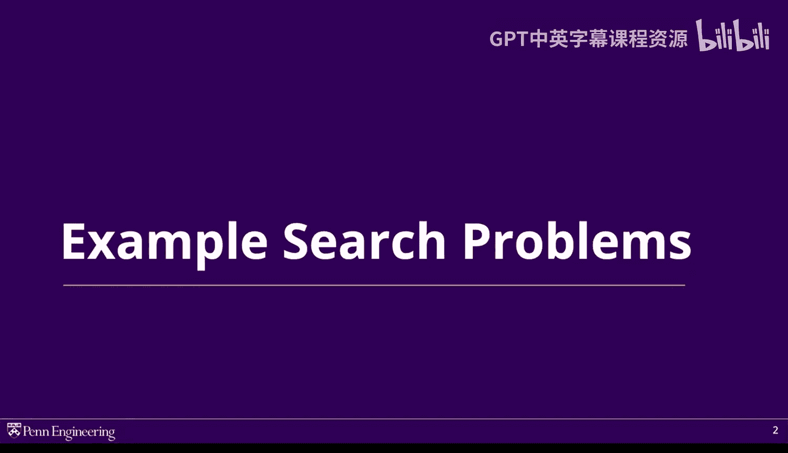
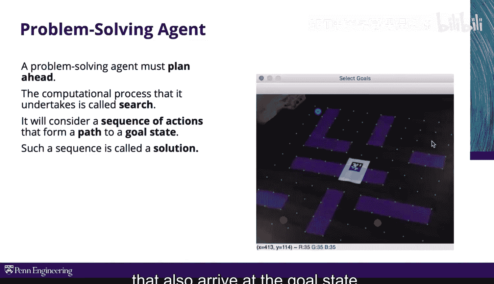
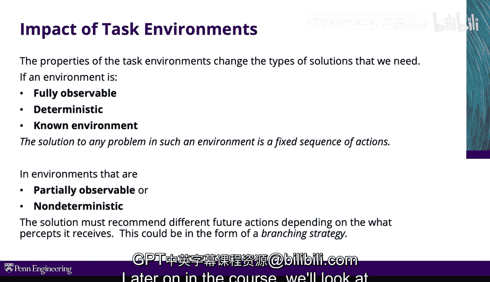

# 人工智能与机器学习基础：20：搜索问题-I

在本节课中，我们将要学习人工智能中一个广泛的问题类别：搜索问题。我们将了解如何将许多计算机科学问题形式化为搜索问题，并探索解决这类问题的通用方法。

## 概述：什么是搜索问题？🔍

本模块将介绍人工智能中一类广泛的问题，称为搜索问题。我们可以将计算机科学中的许多问题形式化为搜索问题，这些问题都可以使用同一套方法来解决。

我们将要探讨的解决问题方法源于早期的算法研究，特别是最短路径算法。我们将看到如何将最短路径算法应用于许多问题，在这些问题中，我们需要在一系列可能的行动序列中进行搜索，以达到期望的目标。

在本模块中，你将学习如何正式定义一个搜索问题，并了解一系列不同的算法，用于解决这个关于搜索问题的通用数学定义。

我们将要研究的搜索问题类别被称为**无信息搜索算法**。名称中的“无信息”部分源于这样一个事实：我们在探索环境时不使用任何额外的信息。在下一个模块中，我们将学习如何利用额外信息来增强搜索算法。

我们将研究经典的算法，如深度优先搜索和广度优先搜索。然后，我们还将探讨它们的一些有趣变体，这些变体具有一些良好的计算复杂度特性。

## 从简单反射智能体到问题求解智能体 🤖

在模块1中，我们将理性智能体定义为：给定一个输入感知序列，能够选择最佳行动以最大化其性能度量的智能体。有时，采取什么行动是最佳选择并不立即显而易见。

在这种情况下，智能体通常需要提前规划，并考虑许多可能的行动序列。这种提前规划并尝试制定最佳可能行动序列的过程就叫做**搜索**。执行搜索的智能体被称为**问题求解智能体**。

最简单的智能体类型是简单反射智能体。一个简单反射智能体使用其传入的传感器数据（我们将其定义为感知），然后仅使用当前感知来决定采取什么行动。

我们这里的例子是一个使用超声波测距仪传感器数据的简单反射智能体。它使用一个非常简单的算法来决定做什么。它向前行驶，直到传感器告诉它即将撞到墙。如果检测到前方有墙，它就停下来，向左转，并检查那里是否也有墙。如果那里也有墙，它就转180度。一旦前方没有墙，它就向前行驶。

这个简单反射智能体与更复杂的智能体之间的主要区别在于，这个智能体只是对其直接环境做出反应，而不进行提前规划。

## 搜索：寻找行动序列的路径 🧭

问题求解智能体不能简单地根据当前感知选择单一行动。相反，它心中有一个目标，并且必须规划一系列行动以达到该目标。规划一系列行动的过程在人工智能中被称为**搜索**。

我们在这里使用的“搜索”一词，与谈论互联网搜索时的常用方式含义不同。相反，这个术语指的是**寻找解决方案的过程**，该解决方案由从当前状态出发的一系列行动组成，我们的智能体将利用这些行动，使自身达到某个期望的目标状态。

在这个视频中，我展示了一个问题求解智能体。我点击了网格中的某些方格，希望智能体访问这些位置，用红点表示。蓝点代表智能体的起点。每个红点都是我们希望机器人访问的点。

问题求解智能体必须找到一个行动序列，将其从起始状态带到目标状态。解决方案就是一条**路径**。从起始状态到目标状态可能存在多条路径，这意味着搜索问题可能存在多个解决方案。

我们感兴趣的是找到**最优解**。我们将考虑一个解决方案“最优”意味着什么。我们将有一些标准，允许我们比较解决方案，并告诉我们这一系列步骤比另一系列也能到达目标状态的步骤更好。

## 任务环境对搜索的影响 🌍

在模块1中，我们还讨论了任务环境。任务环境的不同特性会影响搜索问题解决方案的性质。

请记住，我们将环境分为**完全可观察环境**与**部分可观察环境**。这反映了下国际象棋（在任何时间点我们都能看到棋盘的完整状态）与自动驾驶汽车（我们无法观察整个环境，环境的某些元素是隐藏的）之间的区别。国际象棋发生在完全可观察的环境中，而自动驾驶汽车则在部分可观察的任务环境中运行。

同样，我们讨论了任务环境的其他维度，取决于我们采取的行动是否会产生确定性的结果。如果我们选择移动国际象棋中的马，我们确切地知道它最终会落在哪里，因为在国际象棋中走一步的结果是确定性的。在非确定性环境中，当智能体选择一个行动时，结果可能与其预期相符，也可能不符。

对于本模块，我们将专注于**完全可观察、确定性的环境**，在这种环境中一切都是已知的。如果我们有那种任务环境，那么任何我们可以形式化为搜索问题的解决方案都将是一个固定的行动序列。这意味着可以存在一个有序的行动列表，智能体可以执行这些行动，从其初始状态移动到其目标状态。

如果我们进入更复杂的环境，要么在计算解决方案时没有完整信息可用，要么行动是非确定性的，那么我们就需要一种不同类型的解决方案。我们将需要一个**应急计划**，而不是一个固定的行动序列。在课程后面，我们将学习如何制定这样的计划。

## 总结 📝

本节课中我们一起学习了人工智能中搜索问题的基本概念。我们了解到，搜索是智能体为达到目标而规划一系列行动的过程。我们区分了简单反射智能体与问题求解智能体，后者需要进行搜索。我们还探讨了任务环境（如完全可观察与确定性）如何影响搜索解决方案的形式，即一个固定的行动序列路径。在接下来的课程中，我们将深入探讨具体的无信息搜索算法。