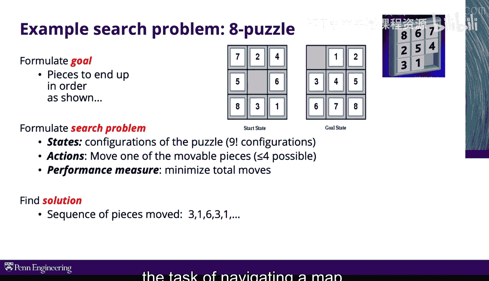
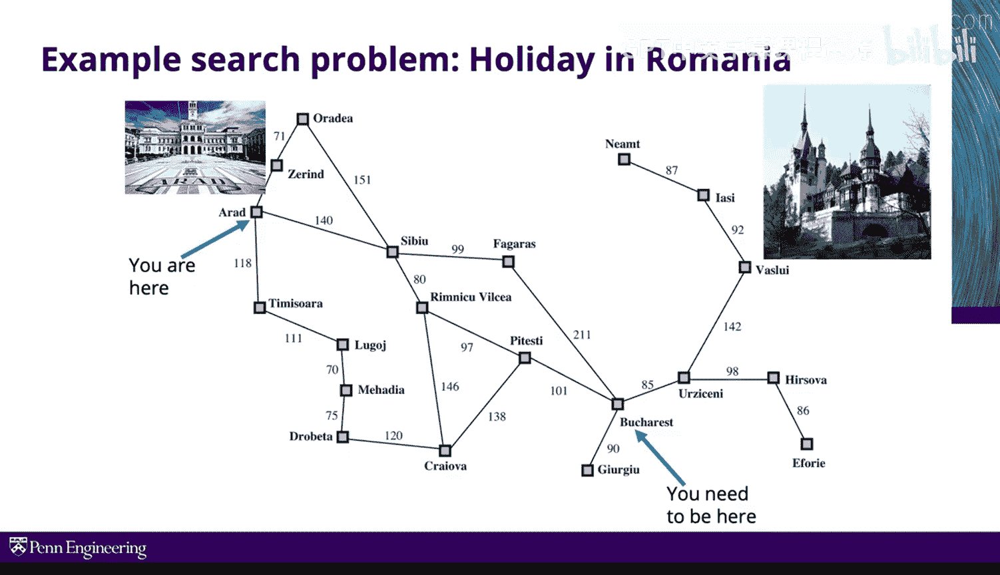
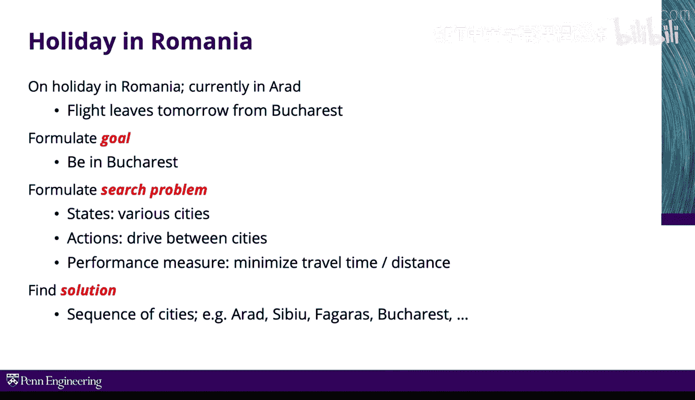

# 宾夕法尼亚大学《人工智能和机器学习基础（AI、数据科学、机器学习）AI and Machine Learning Essentials with Python》 p21 21_03_02_搜索问题-II.zh_en -BV16f421Q72q_p21-

Puzzles are an interesting challenge for artificial intelligence。

 since they're fully observable and deterministic and can be formulated as search problems。

It's useful to look at puzzles as a starting point and still allow us to very clearly define the different mathematical elements that play a role in search problems。

One running example that we'll use is a sliding tile puzzle。

This instance of the sliding tile puzzle is called the E puzzle。

It consists of a three by three grid with numbered tiles labeled1 through 8 and a blank square in the ninth position on the grid。

The challenge is to pick a series of moves to shift the tiles from their initial configuration on the goal state。

 where the tiles are arranged in increasing numeric order from 1 to 8。

One important part of formulating search problems is to define a set of possible states？

The states for this puzzle game are the set of possible configurations of the puzzle pieces。

 meaning all possible orders of the eight tiles plus the blank space。In all search problems。

 we're going to define a set of actions that are possible in one state and that will move us from one state to another state。

In this case， the actions are going to be sliding a tile。

 but it's equally good to think about swapping the blank space with an adjacent tile。

The maximum possible actions that we're going to have is for when the blank space is at the center of the grid。

 it can be moved to the left or to the right or up or down。

When the blank space is on the side or in a corner will have a smaller number of possible actions。

In Moule 1 we discussed how rational agents attempt to maximize a performance measure。

Search problems will also use the idea of a performance measure。

The purpose of the performance measure for search problems is to determine whether a solution that takes us to the goal state is better than another solution that also takes us to the goal state。

The performance measure should allow us to answer how good is this solution to the puzzle？Clearly。

 the best solution is going to involve the one with the fewest possible moves。

 because that's the one where we would beat our friends if we were solving the puzzle simultaneously。

Rather than maximizing the performance measure， we're going to minimize the cost in the eight puzzle。

 each action has a unit cost， meaning that moving left costs the same as moving right or up or down。

A solution to a search problem is going to be a sequence of actions from the start state to the goal state。

In this case， we can represent the sequence of actions by saying which tile moved at each step in time。

AP is one example of a task that we can formulate as a search problem。

A seemingly unrelated task that can also be formulated as a search problem is the task of navigating a map。

The example that we have here is taking a holiday in Romania。 The narrative is actually pretty funny。

 They talk about finding yourself in the city of Ard。

 And then you suddenly realize that you have a plane that leaves later that day from Bucharest。

How can I get from Arrod to Bucharest as quickly as possible？

This allows you to conveniently write a graph where each of the nodes in the graph is labeled with letters A to Z。

Let's talk about how to represent the map navigation task as a search problem。In this case。

 the set of possible states is going to be the set of cities on the map。

The current state will be whatever city we're currently in。

The goal state will be the city that we want to get to。 In this case， Bucharest。

The actions are going to be to drive from one city to another。

 provided that they're connected in this graph。The solution is going to be a sequence of actions that we take in order to give from our initial state of a to our final state。

 our goal state of Bucharest。 We can represent the solution as a list of cities that we travel through in the order that we travel through them。

Finally， we need to define a performance measure for the map navigation task。

We will want to minimize something like the travel time or the distance that we traveled。

Finding the solution to our holiday in Romania problem is a matter of applying an algorithm that'll find the shortest path from a rod to Bucharest。

The algorithms that we'll learn about are very similar to the algorithms that actually get used when you get directions from Google Maps。

The only thing that really makes Google Maps any more complicated than our problem is having to account for factors that can affect the duration of travel along certain segments of roads。

 which can vary based on heavy traffic or accidents。

The Eple and the map navigation seem like totally different problems。

 but both can be formulated as search problems。 As a result。

 we can apply exactly the same algorithms to solve both of them。

