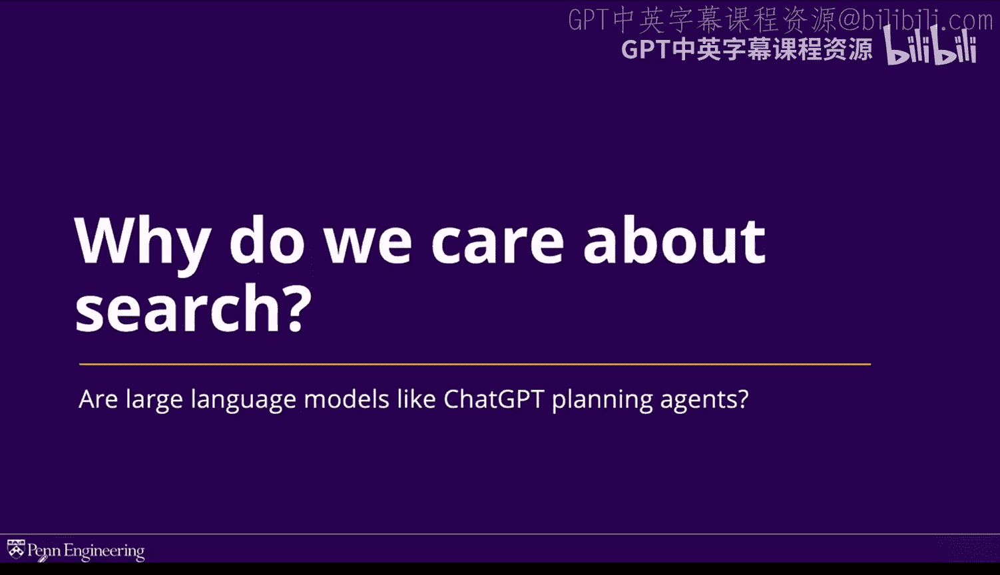

# 宾夕法尼亚大学《人工智能和机器学习基础（AI、数据科学、机器学习）AI and Machine Learning Essentials with Python》 p22 22_03_03_为何关注搜索.zh_en -BV16f421Q72q_p22-

。Let me take a brief interlude to talk about why we care about search and planning。

 because you might be asking yourself， why are we studying these map navigation problems or these tile puzzles。

And why don't we focus on things like chat GT。Chat GT and large language models are incredibly exciting topics that we'll get to in the full class towards the end。

They're my area of research and in fact， I also offer a full class on natural language processing that you can take through Penn engineering online。

I want to start by just giving you a brief introduction to how large language models work so that you can think for yourself。

 Are they planning agents， Could they come up with a shortest path that has the same guarantees that the other algorithms that will start off by studying have。

To begin， let's understand how chat GT and other large language models generate text。

We give them what's called a prompt here。 I've prompted the large language model with my favorite professor at the University of Pennsylvania is Chris Callison。

What it'll do next is try to complete that in the same way that your cell phone auto completes as your're typing。

Rather than just generating a single word like birch。

 which it will generate reliably because I have a unique two part last name。

Instead of just generating a single word like your cell phone does。

 it continues to generate an entire paragraph。It goes on to say。

 he's a professor in the Comp and Information Science Department。

 and he's the director of the Natural Language Procesing Group at the Institute for Research and Cognitive Science。

That first is a correct fact。 I am indeed a professor in the computer and Information Science department。

 but that next is an incorrect fact that's confidently stated。

 which the technical term for is a hallucination。The reason that language models produce hallucinations is due in part to the fact that the way that they're generating text is just by word associations。

In this example， I've color coded each word to show how likely the model thinks it is as it's generating。

So we can see that it has color coded birch to be very probable。

 but it's color coded accomplished to be。Improbable。

 so it says he is an incredibly accomplished professor。But if we click on accomplished。

 we can see that the language model thinks that with 1% or less， I am an accomplished professor。

It actually assigns a probability distribution over all words in the vocabulary and then samples from that probability distribution。

So roughly half the time， it would have generated that he's an incredibly knowledgeable professor or an incredibly engaging professor。

This sampling from a probability distribution means that GT and other large language models are really just generating texts purely through word associations。

 It's actually fairly remarkable that it's able to generate any factual information at all。

The reason that it's able to generate some factual information is because it's been trained on huge amounts of texts。

From the Internet during its pre training phase。 So it's seen roughly a trillion words。

 And from that， it's learned some information that results in factual sounding sentences being generated。

It's learned to associate my name and the University of Pennsylvania with my role there as a professor in the computer and Information Science department。

 It's also associated my name with my research area。

 the natural language processing research that I do。

But it's generated that I was the director of this group that doesn't exist at an institute that closed before I got to Penn。

 Even though language models frequently produce hallucinations。

 They're still useful for a wide range of things。One of the remarkable emergent capabilities of large language models is their ability to pick up on patterns within a prompt here。

 I'll show you an example of a few shop prompt。 I'm giving it four rows in a table that I've typed in。

 So I've said a professor's name， the university that they work at and the department that they belong to。

 So I've given it examples of myself， Karen Rle in our English Department。

 David Brainard in our psychology department， and Emily Falk。

 who is in our Anneenberg School of Communication。That's an initial prompt。

 and I can then ask it to complete that row for a new set of professors that I type in who belong to other universities。

Within that context of the prompt itself， it's able to perform in context learning。

It recognizes that I'm constructing this table like pattern where I have three rows。

 each has a semantics associated with it with a name， a university and a department。

And then as I prompt it with new names， it's able to complete that pattern that it's learned and produce the university and the department that those other professors belong to。

This is a really incredible capability that pre training on huge amounts of text enable these large language models to do Another really remarkable capability thats submerged in large language models is their ability to perform instruction following。

 rather than a prompt simply being the first half of a sentence or being this。😊。

Few shot example prompt， like I showed on the last slide。

 We can now give large language models instructions like write a biography for Chris Callison Birch in the first person。

 and it's able to generate text that follow those instructions that we've given to it。

So a natural question that you might ask is， could we use these capabilities to have large language models be planning agents。

 Could we ask a large language model to find the shortest path from arod to Bucharest。

So let's just try it。So here， remember that the shortest path from Arrod to Bucharest is from Arrod。

To Shibu。2。Rmq， Billcha。To Peteky。To Bucharest。So if we construct that path。

 then we have 140 kilometersm plus 80 km plus 97 km plus 101 km is。418。So this is our shortest path。

 And we can keep this in our head for a moment。 And then let's just ask G if it can generate the shortest path So we can say。

 what's the shortest path from Arrod to Bucharest。 And remarkably， it gets it right。

 It says you go from Arrod to Shibu to Rimhu Vcha to Peaceki to Bucharest。

It actually produces the correct shortest path， but for the totally wrong reason。

You'll notice in my prompt， but I haven't given it any information about the map itself。

 I haven't given it this undirected graph with the edge weights。

 The reason that it's able to produce the shortest path is because it's seen it on the internet。

 This is such a famous example that all intro to artificial intelligence course uses it。

 And it simply ended up memorizing it or associating shortest path from Arrod to Bucharest with this information。

And if we ask it a follow on question like what's the lowest path cost from them rather than generating the correct answer。

 which again is 418， it produces an incorrect path cost。 that's actually impossible，366。

And if we click on that， we can again see that it's just got a probability distribution over words。

 in this case， numbers。And that is not the correct way to generate either a shortest path or to analyze the actual path cost。

So we can see this even more vividly if we convert from the problem that it's seen through slides on the internet that's included in its training data to a super analogous problem。

Here what I've done is I've taken our map of Romania。

 and I've replaced all of the city names with the names of Star Wars planets。

All of the path costs are identical to before。 So the shortest path on this map should be the same。

 but the names of the locations are going to be different。 So instead of a rod， I now have Alderon。

From Alderon， we'll go to starkeller base。To Rlo to Nabuo to Kesel。

 because I've used the same edge weights。 So the path cost for this shortest path will again before 18。

So if I give this information to G。 So I've given as part of the prompt。

 here's a list of distances between nodes in an undirected graph。

 I reproduce that graph with all the edge weights。 I give it that complete set of nodes and the complete set of edge weights。

 And I say， what is the shortest path from Alderon to Kessel。

 It'll give me an answer that's completely wrong。And it'll give me a path cost。 That's also wrong。

I could regenerate again。 It'll give me a totally different path with a totally different answer。

 So because of the way that large language models are working。

 where they're trying to produce each next word just by sampling from a probability distribution that makes them not planning agents。

 They can't naturally find the shortest path or do some very basic things that we'd like to be able to do in artificial intelligence by themselves。

I think that there's a very promising future infusing classical AI algorithms with large language models。

 And for that reason， we're going to start out with those classical algorithms。

