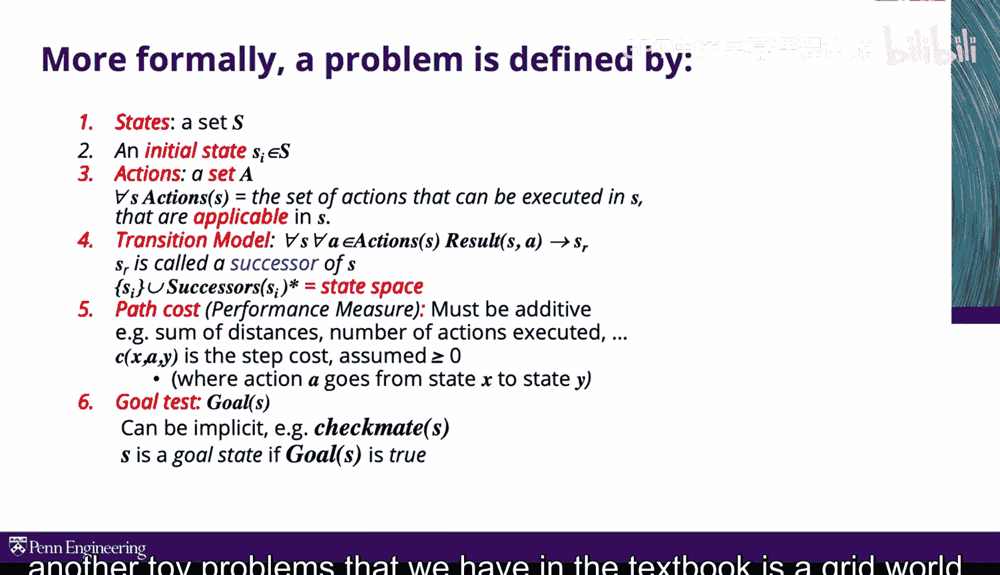
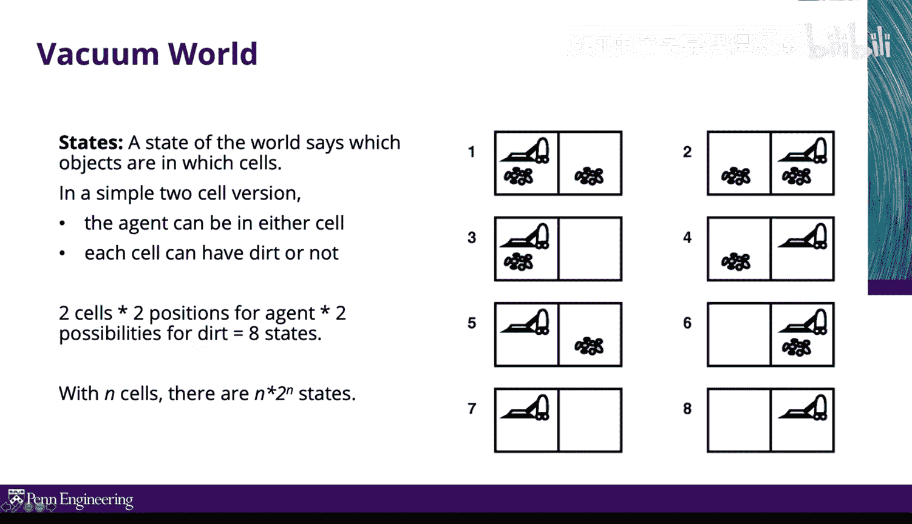
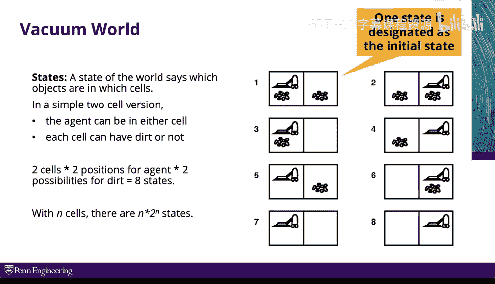
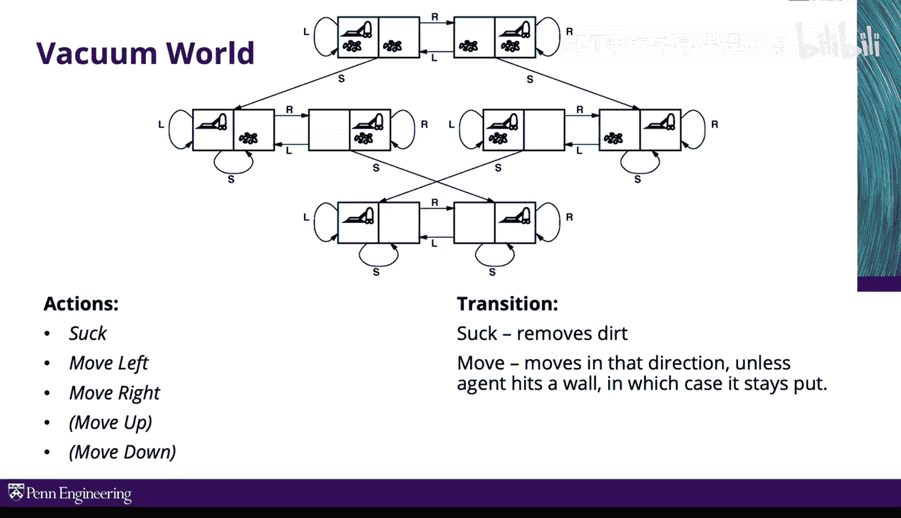
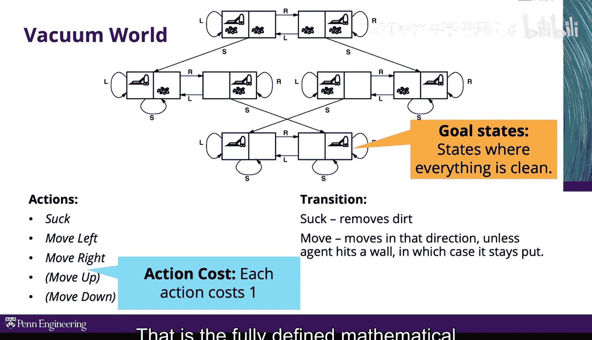
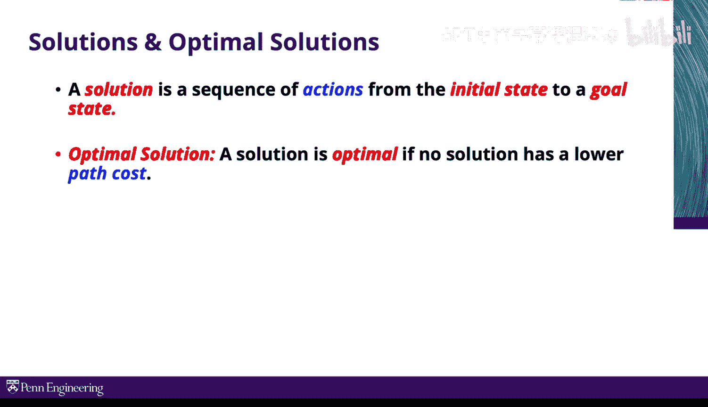

# 宾夕法尼亚大学《人工智能和机器学习基础（AI、数据科学、机器学习）AI and Machine Learning Essentials with Python》 p23 23_03_01_搜索问题建模-I.zh_en -BV16f421Q72q_p23-

When in reformly defining a search problem， what we're going to need is six things。 First。

 we're going to have a set of states。Second， we're going to designate one of those states as the initial state that we begin in。

 then we're going to define a set of possible actions that we can take from any state in our set of states。

And we're going to have a function that tells us which actions we can take from a particular state。

 given a particular state， you want to get the set of actions that are legal in that state。

Then we're going to have a transition model for all possible actions at a particular state。

 the result of applying an action from that state results in another state。

 so the transition model is literally a transition from one state to another given an action and this transition model is going to come up in our subsequent problem definitions where we lessen the restriction that the task environment is deterministic。

 so we're going to talk again about task environments that are stochastic。

 so our transition model will shift to one where we have a probabilistic definition of this transition model。

And we'll have two other things that we need， the first is a performance measure which just tells us we' a given path how much does it cost so this is going to tell us whether one path from the initial state to the goal state is better than another path typicallyy we're going to try to minimize the performance measure in order for it to work out properly the half cost has to be additive。

 meaning I can't have any negative edges where I take a certain action from a certain state and it reduces my total path cost。

That can still allow many different definitions of what a path cost is it for instance。

 can be the number of actions that we've taken， that'll be a very simple thing that we'll use for breath first search it can also be so for instance。

 as we're traveling through the map of Romania， the path cost can be the total number of miles that we travel at each step。

And then we're going to define a cost function that says from state given action A resulting in state Y。

 each that step cost is going to be greater than our equal to zero for every possible action。Finally。

 we just need a test to see whether a particular state that we're in is a goal state。

And so this can either be explicit， meaning I'm just going to check to see whether the state is in a subset that I designate as goal states for the Romanian travel problem。

 our goal is a particular state it's Bucharest， but it can also be implicit。

 our goal could be defined by a set of possible configurations， for instance。

 a chessboard if the particular state of the chessboard is in the checkme position。

 then this goal test would return true。So let's just look at it formally for another toy problems that we have in the textbook is a grid world in a grid world。

 we basically have a world that consists of an n by N grid or an n by M grid。

 but here we're going to create a toy world， the states are going to be nicely defined so it's going to be a two square grid world in this in the simple version。

 we're going to have one agent in there。

And then each cell can either be clean or dirty for this tiny toy problem of this vacuum cleaner world。

 What are the number of states that we have to account for。 So we've got two cells。

Which means two possible positions for the agent。 And we've got for each cell。

 it can be in one of two conditions， either dirty or clean。

 So that means we have two times 2 times 2 equals 8 possible states for this tiny world。 in general。

 for this vacuum world， if we have N cells， then we have。N times2 to the n possible states。

The diagram on the right shows all eight of those possible states in state number one。

 we've got the vacuum cleaner in the left hand cell in both cells being dirty in state number8。

 we've got the vacuum cleaner in the right hand cell with both cells being clean in our problem definition when we formulate this as a search problem。

 we not only have to define what our set of states are。

 but we also have to designate one as the addition we can pick arbitrarily among。

All these eight possible states and our algorithm should be able to say。

 given any of these as starting states， in addition to defining the set of possible states and designating a start state。

 we need to transition model。 What is our set of actions。

 and how do we move between these different eight possible states。 The vacuum world。

 we have the suck up the dirt action， we have an action where we can go left an action where we can go right in this particular world。

 we don't really go up or down because it's just to adjacent cells。 But in a larger world。

 then we would also have move up and move down from each state， we need to define。

What transition will happen if we apply an action in that state。

 So this is might a transition function drawn graphically in top left of this diagram。

 we have the state where both squares are dirty and the robot is in the lefthand square。

 then the arrows from this state show me what happens When I apply each of the possible transition functions。

 I could go left in which case I just stay in the same state because the robot just bumps against the wall and stays there。

I could go just move the robot from， from the left hand square to the right hand square。

 or I could apply the suck action in which case I eliminate the dirt in that square and move to this state where I've got the robot to the left hand side。

The left hand square with no dirt， and there's still dirt room。

So the number of states is still mut and the arrows just show my transition diagram。

What is the goal state and in this case we just checked to see if all squares have had their dirt removed。

 that goal state is the state where everything is clean。

And then the other thing I need to define is the action cost in this case。

 we're just going to say every action has uniform costs。

 we're just going to say every action costs one。That is the fully defined。

 like mathematical representation of this vacuum world。

Then a solution is simply a sequence of actions that takes us from the initial state to the goal state。

 There's many possible ways of moving from the initial state to a goal state。

 Some of them have a lower path costs than others， given our path cost。

 What solution is better than another。 What is the optimal solution。

 A solution is optimal if there are no other solutions that have a lower path cost than this solution。

 and that's going to be a key to evaluating the goodness of the algorithms we designed。

Are guaranteed to result in an optimal solution。

