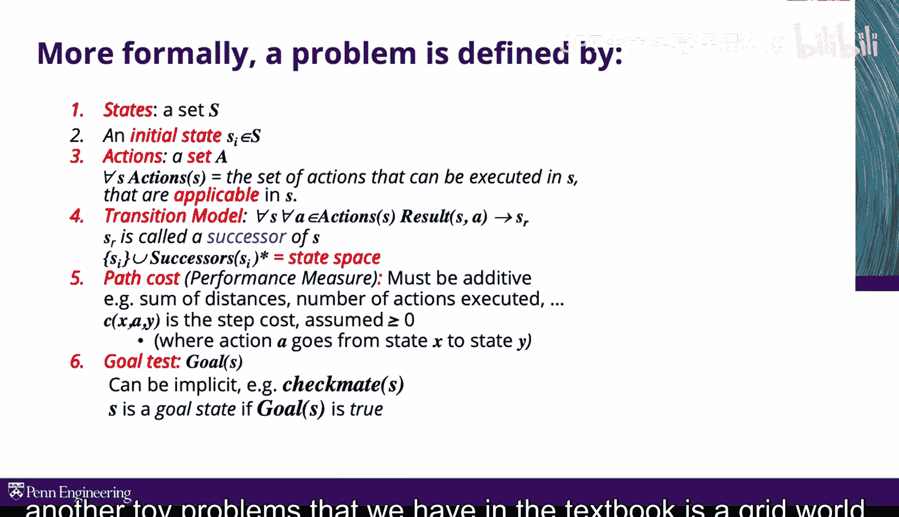
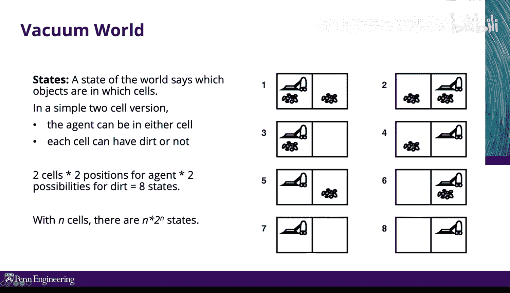
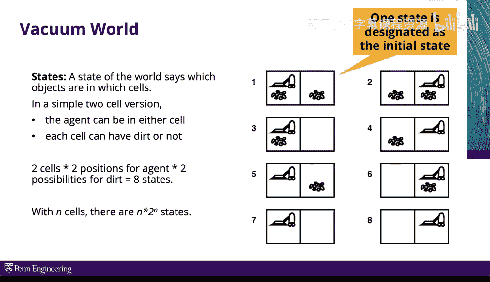
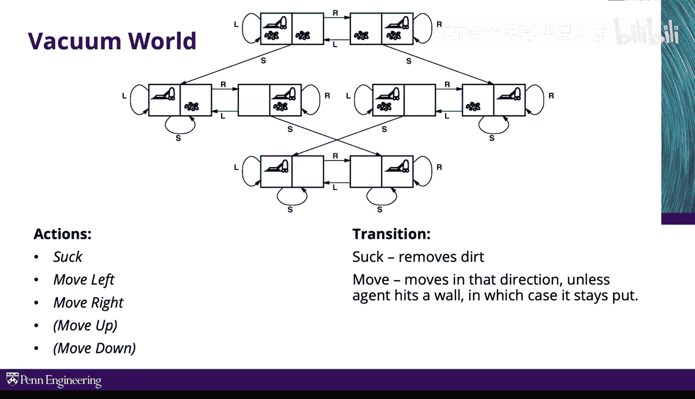
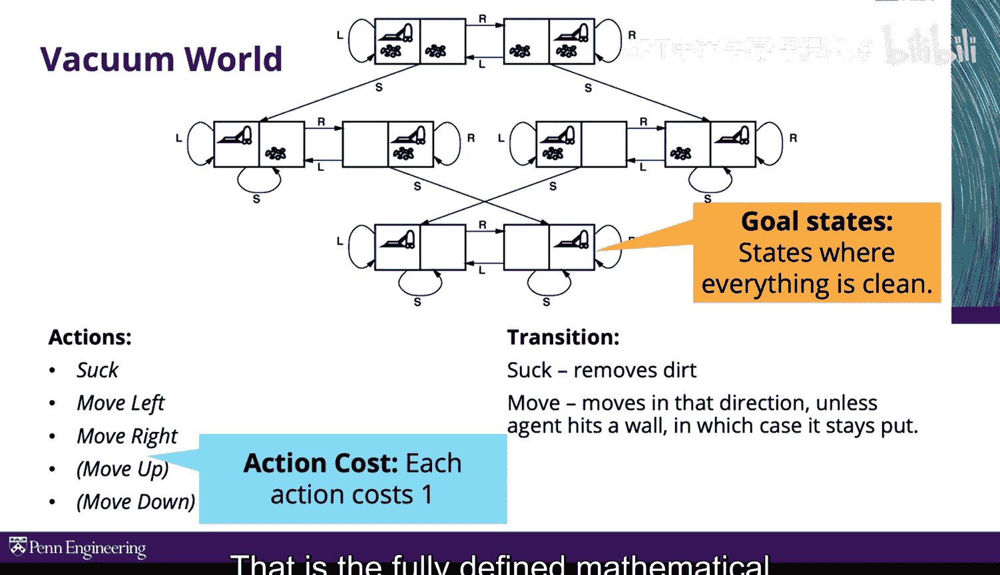
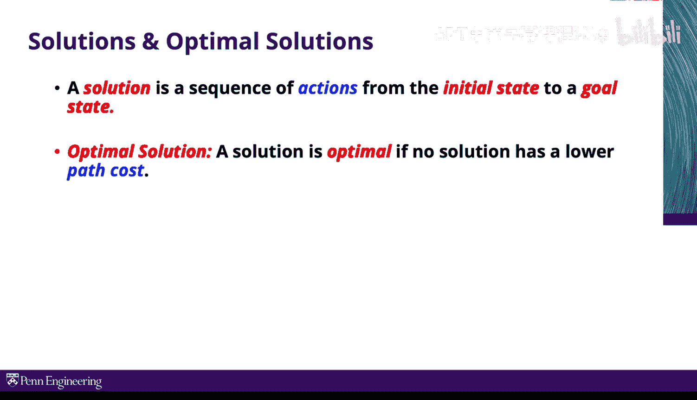

# 人工智能和机器学习基础：23：搜索问题建模-I

在本节课中，我们将学习如何形式化地定义一个搜索问题。理解搜索问题的构成要素是设计有效搜索算法的基础。

## 概述

一个搜索问题可以被系统地定义为六个核心组成部分。本节将逐一介绍这些组成部分，并通过一个“吸尘器世界”的简单例子来具体说明。

## 搜索问题的六个要素

上一节我们提到了搜索问题需要六个要素，本节中我们来看看具体是哪六个。

以下是定义一个搜索问题所需的六个组成部分：

1.  **状态集合**：所有可能情况的集合。
2.  **初始状态**：搜索开始时所处的状态。
3.  **动作集合**：从任何状态可以执行的所有可能操作的集合。
4.  **转移模型**：一个函数，描述在特定状态下执行特定动作后，会到达哪个新状态。其形式为 `RESULT(s, a) = s'`，其中 `s` 是当前状态，`a` 是执行的动作，`s'` 是结果状态。
5.  **目标测试**：一个函数，用于检查给定状态是否为目标状态。其形式为 `GOAL-TEST(s) = True/False`。
6.  **路径耗散函数**：为从初始状态到目标状态的每条路径分配一个成本值。它通常由每一步的**动作成本**累加而成。动作成本函数 `c(s, a, s')` 定义了从状态 `s` 通过动作 `a` 到达状态 `s'` 所需的成本，且必须满足 `c(s, a, s') ≥ 0`。

## 示例：吸尘器世界

为了更直观地理解这些概念，我们来看一个经典的“吸尘器世界”例子。

### 状态定义

假设我们有一个仅包含两个单元格（A和B）的世界。一个吸尘器代理位于其中一个单元格中。每个单元格可以是干净的或脏的。

那么，这个世界的总状态数是多少？代理有2个可能位置，每个单元格有2种（干净/脏）状态。因此，总状态数为：`2（代理位置） * 2（A格状态） * 2（B格状态） = 8`。

更一般地，对于一个有 `N` 个单元格的世界，总状态数为：`N * 2^N`。

下图展示了这8种可能的状态：

### 初始状态与动作

在定义搜索问题时，我们需要从这8个状态中指定一个作为**初始状态**。算法应该能够从任意指定的初始状态开始运行。

接下来，我们需要定义**动作集合**和**转移模型**。在这个世界中，可能的动作包括：
*   `Suck`：清扫当前单元格。
*   `Left`：向左移动（如果可能）。
*   `Right`：向右移动（如果可能）。

### 转移模型

转移模型定义了在特定状态下执行动作后会发生什么。下图以图形方式展示了从某个状态出发的转移：

例如，在左上角的状态（代理在左格，两格都脏）：
*   执行 `Left` 动作：撞墙，状态不变。
*   执行 `Right` 动作：代理移动到右格。
*   执行 `Suck` 动作：左格变干净，代理仍在左格，进入新状态。

### 目标测试与路径耗散

在这个问题中，**目标测试**是检查是否所有单元格都干净了。因此，目标状态是代理在任何位置，但A格和B格均为干净的状态。

对于**路径耗散**，我们通常采用简单的定义：每个动作的成本为1。因此，一条路径的总成本就是该路径中动作的数量。

## 解与最优解

基于以上完整定义，一个**解**就是一系列能将我们从初始状态带到目标状态的动作序列。

可能存在多个解。**最优解**是指没有其他解的总路径成本比它更低。评估搜索算法好坏的一个关键标准，就是看它能否保证找到最优解。

## 总结

本节课中，我们一起学习了如何形式化地定义一个搜索问题。我们明确了构成搜索问题的六个核心要素：状态集合、初始状态、动作集合、转移模型、目标测试和路径耗散函数。我们通过“吸尘器世界”这个具体例子，演示了如何应用这些要素来建模一个实际问题。理解这个框架是后续学习各类搜索算法（如广度优先搜索、A*搜索等）的重要基础。