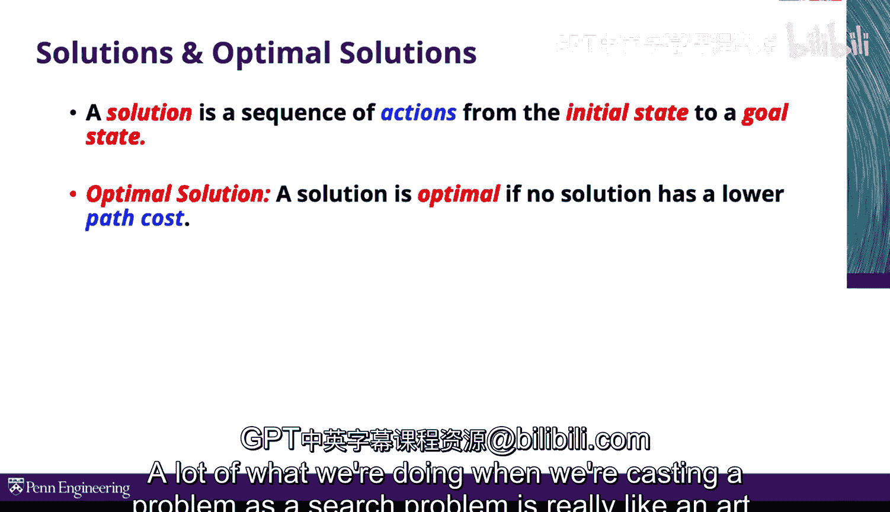
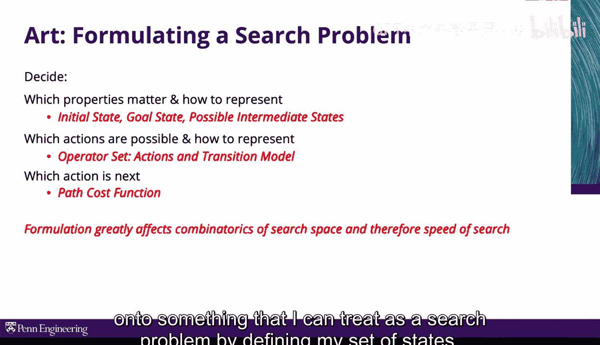
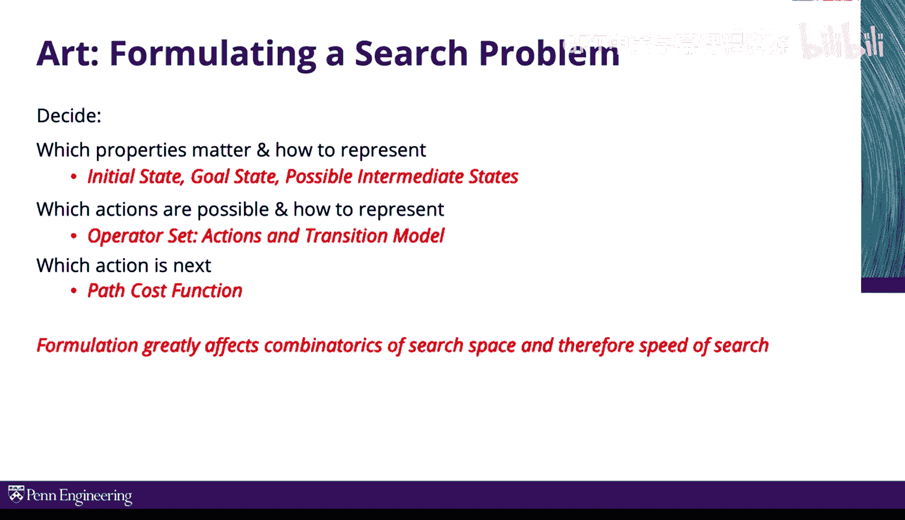
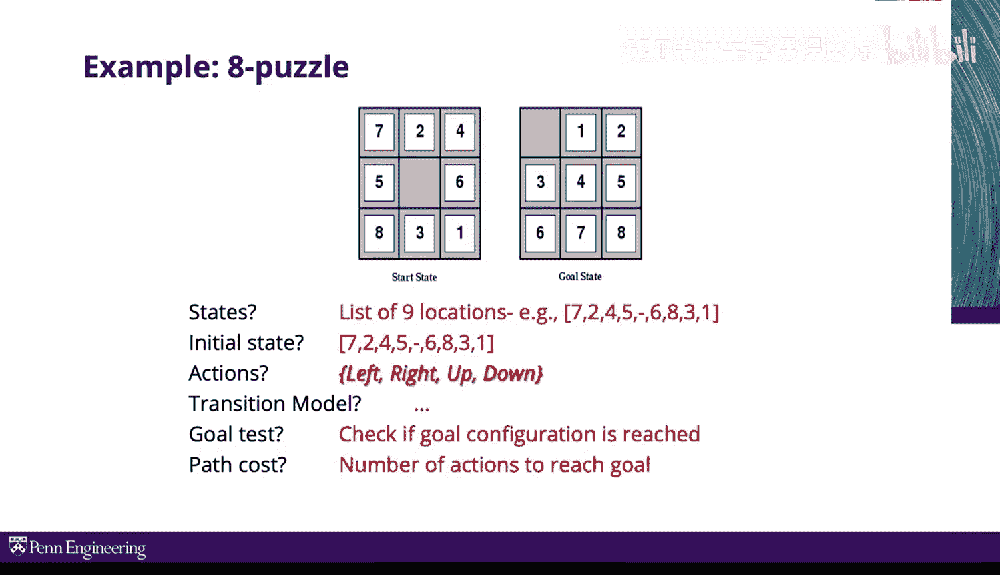
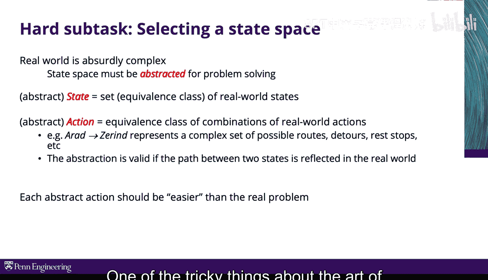
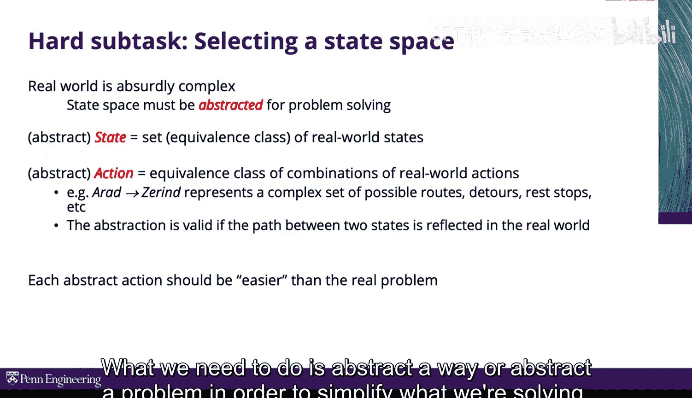
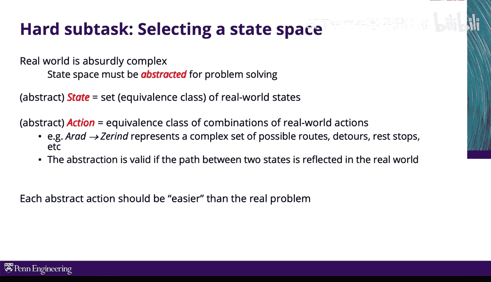
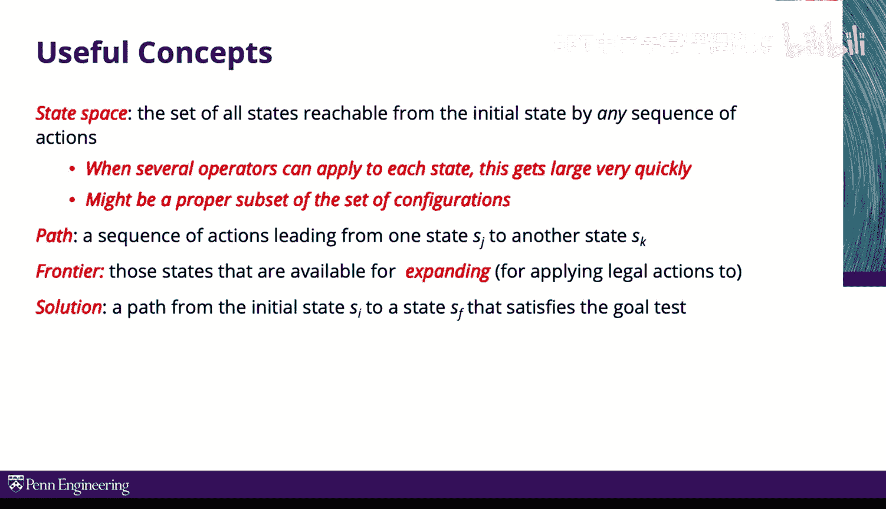

# 宾夕法尼亚大学《人工智能和机器学习基础（AI、数据科学、机器学习）AI and Machine Learning Essentials with Python》 p24 24_03_02_搜索问题建模-II.zh_en -BV16f421Q72q_p24-

A lot of what we're doing when we're casting a problem as a search problem is really like an arc。

 what we're saying is like how do I take this real world problem and then try to abstract it from the real world situation onto something that I can treat as a search problem by defining my set of states。

 my initial state my transition function， my plus options。

A lot of what we're doing here。When we're formulating something as a search problem is the process of creating a representation of the problem。

 you can think of this formal definition of a search problem as a representation and the thing that we're really doing is abstracting a way anything that's not important to how do we find a solution。

 There's lots of things in the world。That are important in。Our everyday actions。

 but which are not important for us to formulate a problem as， for instance。

 if we're trying to travel along a map and find the quickest route from one city to another。

 the way that we get there is relevant in real life， we take a taxi， we take a Uber。

 we drive ourselves， we ride or bike， we walk， etc。

But the when we abstract the problems onto a search problem that all those things essentially get collapsed into an equivalence class。

 the action is just going to be go from one location to a connected location。

The types of things that we can pick are going to depend on how complex or how simple our problem formulation is。

The number of states and the number of actions that can hugely affect the combatorics of the search。

 let's return to our example of eight puzzle， how can I represent the states in the eight puzzle？

We said。The order of all of the numbers is important how the board is arranged is important。

What we really care about is。The location of the squares on the board and then being able to nuerate all possible location。

 basically we could represent this either as a 2D array or just as a simple one dimensional array where we read off the order in order so that a start state is represented by this single array。

 7，2，4，5， blank6。83，1， that's a fine representation of the state of the board。

 and the initial state is just going to be one of these lists that actions。

We can define as the set of possible moves from the center， we could move that。Bike space up。

We can move it to the right， we can move it up or down in some particular places like in the corner or along the sides we're not going to be able to do everything。

 the transition model is going to be the thing that changes the representation after we have applied that。

We can iterate through the current state， and just say。In as sendingending order， the path cost。

 every move is just going to be equally weighted。 each action costs one。

 the total path task is going to be the number of actions that we took。

 One of the tricky things about the art of formulating a problem as a search problem。

Is that the world is really complex。 What we need to do is abstract a wing or abstract a problem in order to simplify what we're solving。

 You can think of the states and。

An equivalent class of the real- worldor states。Every action at the equivalence class of combinations of different real world actions。

 we're just going to collapse all of those different ways of getting from a rod to an adjacent city onto a single action。

 onto a single equivalence class。This notion of abstractions is great because it simplifies the real problem and makes it easier and makes it possible for us to consider it in this mathematical way。

The different concepts we've come across so far are the state space。

 the set of all possible states that are reachable from the initial state。

Given any sequence of action， this is actually where things do interesting， because in theory。

We could have an infinite search base and this would be fine。

When we have a large set of actions that are possible from each state。

 then the state space is going to get large very quickly。

 it may be that not all states are reachable from a particular configuration。

 we said the state spaces like all possible permutations of numbers。

 then it may be that in that tile game， you couldn't get any possible permutation from any given start state。

So a path is a sequence of actions。 one super useful concept is。

How we go about formulating a search problem can be represented as a search tree that's going to be we start in a root node。

 that's our initial state。 and we're going to see the branching factor has to do with how many actions we can take at each state。

There's going to be a concept that we call a frontier。

 which is going to be all the states that we have available to expand meaning。

I'm going to pick which date I want to apply an action to to result in the next state towards the solution。

And then the solution is going to be a path from that initial state。

To the final state that satisfies the goal test。

