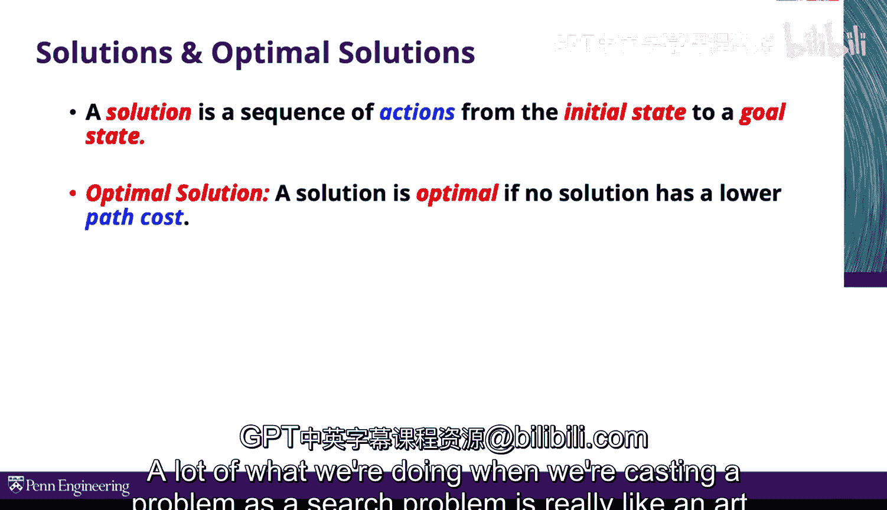
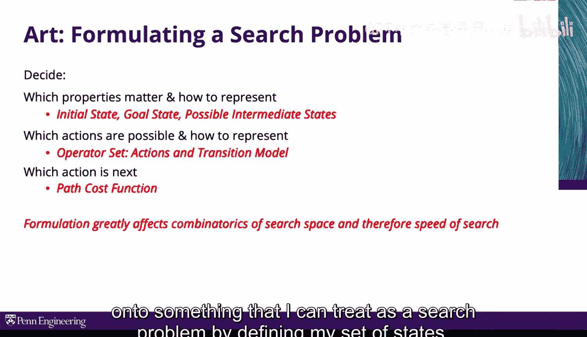
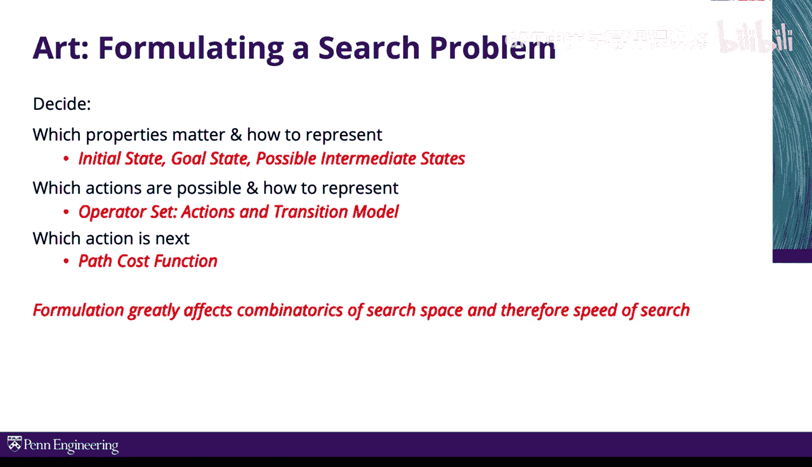
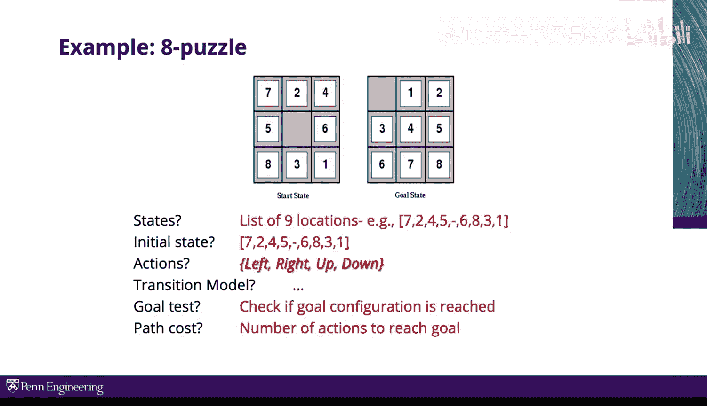
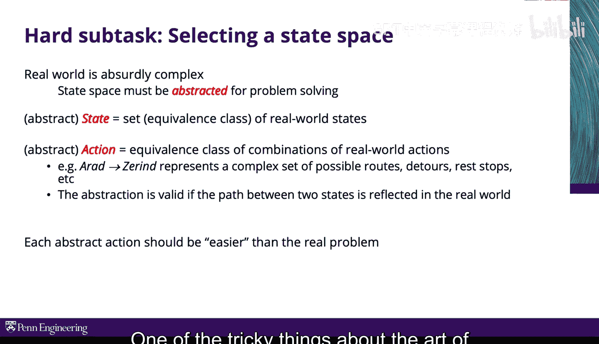
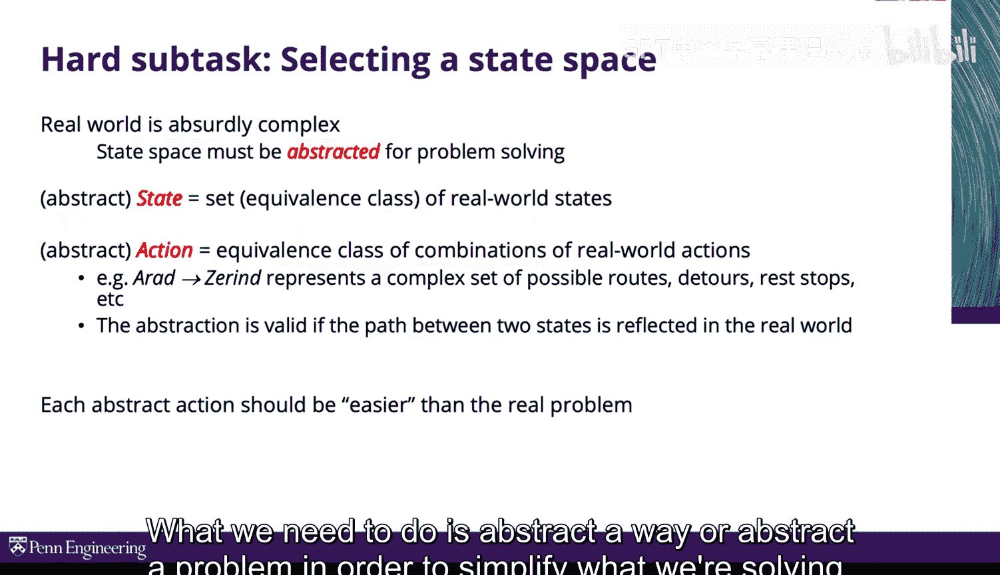
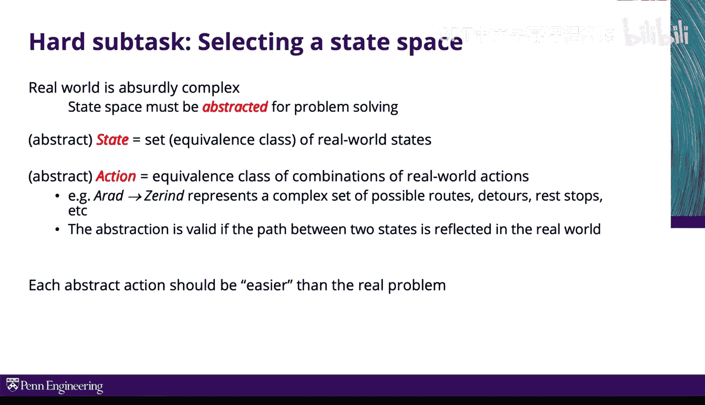
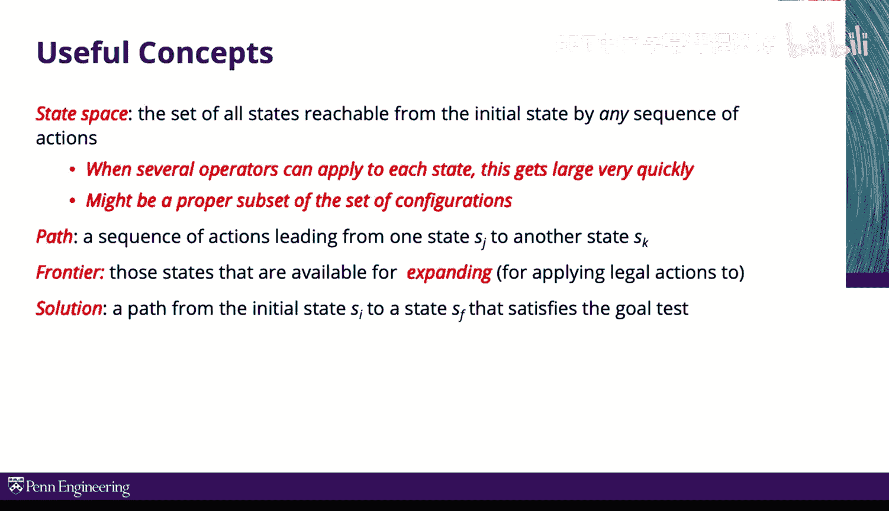

# 人工智能和机器学习基础：24：搜索问题建模-II 🧩

在本节课中，我们将学习如何将一个现实世界的问题抽象并建模为一个搜索问题。我们将深入探讨状态表示、动作定义以及抽象过程的核心概念，并通过八数码拼图等例子来具体说明。

---

## 将问题抽象为搜索问题

上一节我们介绍了搜索问题的基本组成部分。本节中我们来看看如何将现实世界的问题“映射”到这些组成部分上。这个过程本质上是一种抽象。

我们所做的是，将现实世界的问题从其具体情境中抽离出来，转化为一个可以通过定义**状态集合**、**初始状态**、**转移函数**和**目标测试**来处理的搜索问题。

## 抽象与表示

当我们把某件事表述为一个搜索问题时，大部分工作在于创建问题的**表示**。你可以将搜索问题的形式化定义本身看作一种表示。我们真正在做的是，**抽象掉所有与“如何找到解决方案”无关的东西**。

现实世界中有许多事物在我们的日常行为中很重要，但在将问题表述为搜索问题时却无关紧要。例如，如果我们试图在地图上旅行，找到从一个城市到另一个城市的最快路线。

*   在现实生活中，我们到达目的地的方式是相关的：我们乘坐出租车、网约车、自己开车、骑自行车或步行等。
*   但是，当我们将问题抽象为搜索问题时，所有这些方式本质上都被**归入一个等价类**。动作就只是“从一个位置移动到另一个相连的位置”。

我们可以选择的动作类型，将取决于我们问题表述的复杂或简单程度。**状态的数量**和**可能的动作数量**会极大地影响搜索的组合复杂性。

## 实例：八数码拼图的状态表示

让我们回到八数码拼图的例子。如何表示八数码拼图中的状态？

我们说过，所有数字的排列顺序很重要，棋盘的布局很重要。我们真正关心的是棋盘上各个方块的位置，并且能够枚举所有可能的位置。

基本上，我们可以将其表示为：
*   一个二维数组
*   或者只是一个简单的一维数组，我们按顺序读取排列。

因此，一个起始状态可以用这个一维数组表示：`[7, 2, 4, 5, 空白, 6, 8, 3, 1]`。这就是棋盘状态的一个很好的表示。

**初始状态**就是这些列表中的一个。

**动作**可以定义为从中心位置可能的移动集合。我们可以将空白格向上、向右、向左或向下移动。在某些特定位置（如角落或边缘），我们可能无法进行所有方向的移动。

**转移模型**是在我们应用动作后改变表示的东西。我们可以遍历当前状态，并按升序/降序排列。

**路径成本**：每次移动的权重相等。每个动作的成本为1。总路径成本将是我们采取的动作数量。

## 抽象的艺术与挑战

将问题表述为搜索问题的一个棘手之处在于，现实世界非常复杂。

我们需要做的是**抽象掉细节**或**抽象问题**，以简化我们要解决的问题。你可以将**状态**视为现实世界状态的等价类，将**动作**视为不同现实世界动作组合的等价类。

我们将把所有从A城市到相邻B城市的不同方式（开车、步行等）**归并为一个单一的动作**，一个单一的等价类。

这种**抽象**的概念非常棒，因为它简化了实际问题，使其更容易、更可能让我们以这种数学方式来考虑它。

## 核心概念回顾与扩展

到目前为止，我们遇到的不同概念包括：

*   **状态空间**：从初始状态出发，通过任何动作序列可以到达的所有可能状态的集合。这里事情变得有趣，因为理论上我们可以有一个无限的搜索空间，这也没问题。
*   **分支因子**：当从每个状态可能有很多动作时，状态空间会迅速变得非常大。也可能并非所有状态都能从特定配置到达。例如在拼图游戏中，你可能无法从任何给定的起始状态得到所有可能的排列。
*   **路径**：一个动作序列。
*   **搜索树**：一个非常有用的概念是，我们如何表述搜索问题可以表示为一棵搜索树。我们从根节点（初始状态）开始。分支因子与我们在每个状态可以采取多少动作有关。
*   **边界**：我们将有一个称为**边界**的概念，它包含了所有可供扩展的状态。意思是，我将选择要对哪个状态应用动作，以产生通往解决方案的下一个状态。
*   **解决方案**：解决方案将是从初始状态到满足目标测试的最终状态的一条路径。

---

本节课中我们一起学习了如何将现实问题抽象为搜索问题的关键步骤。我们理解了状态和动作的表示方法，以及通过等价类进行抽象的重要性。我们还回顾并扩展了状态空间、路径、搜索树和边界等核心概念，为后续学习具体的搜索算法打下了坚实的基础。