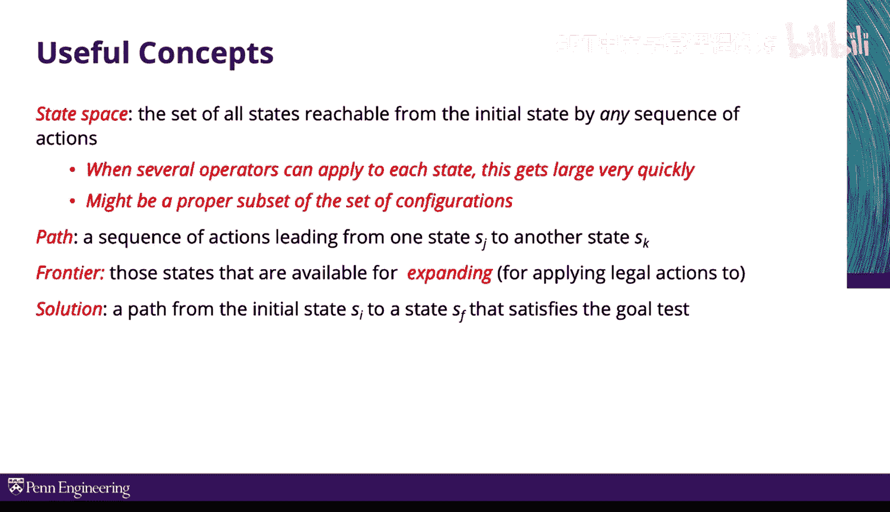
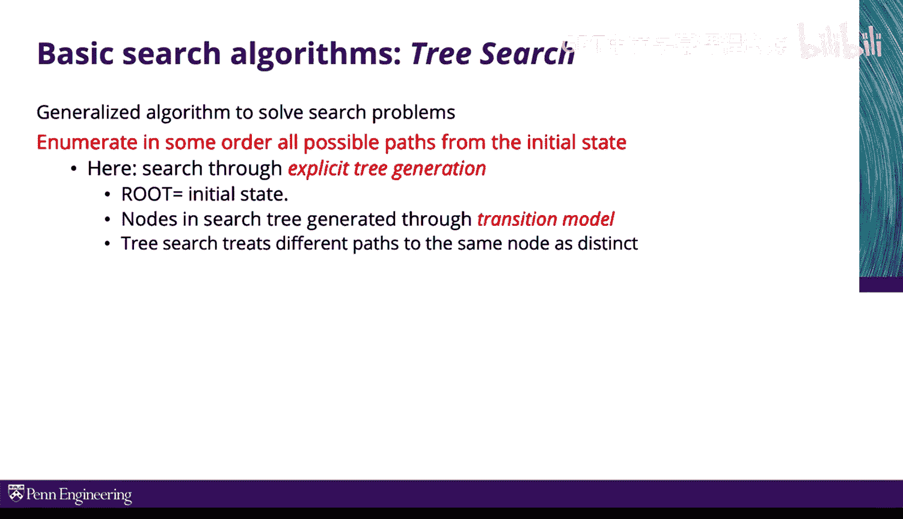
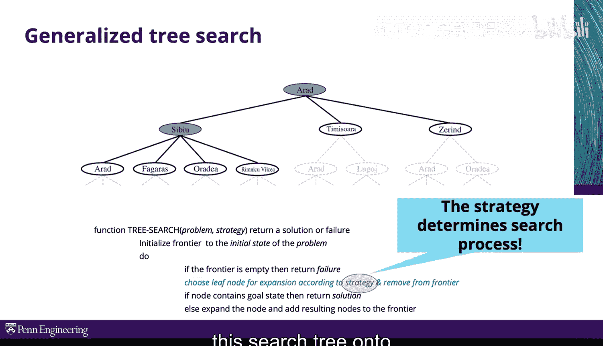
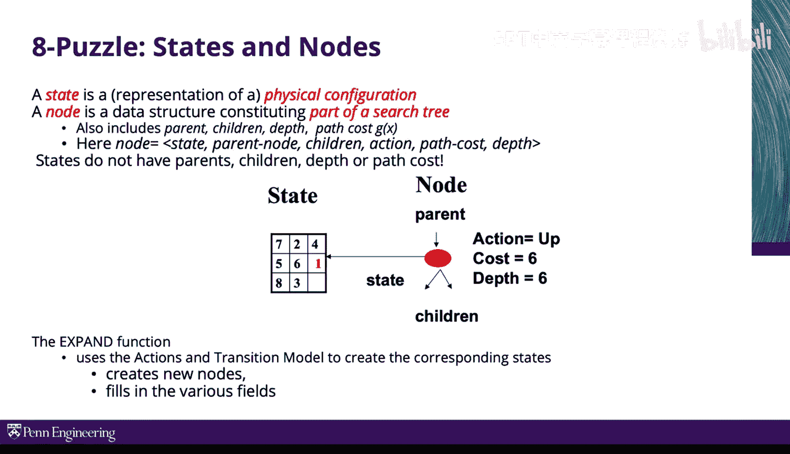
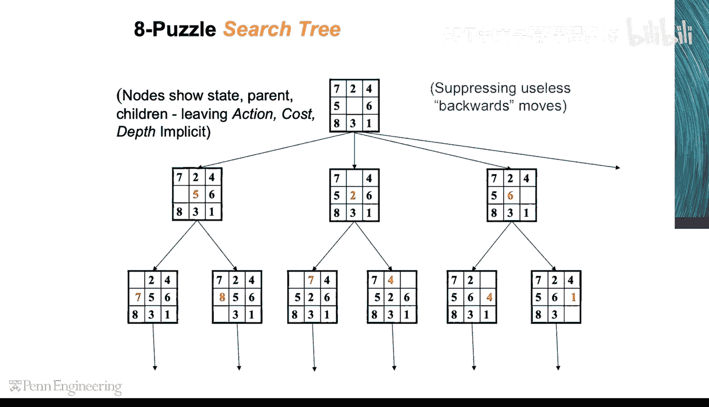
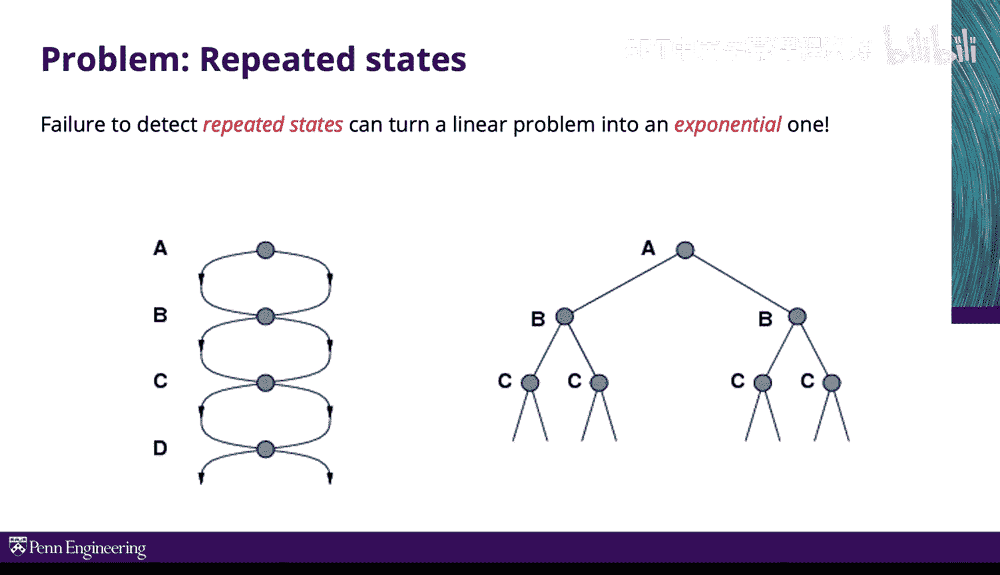
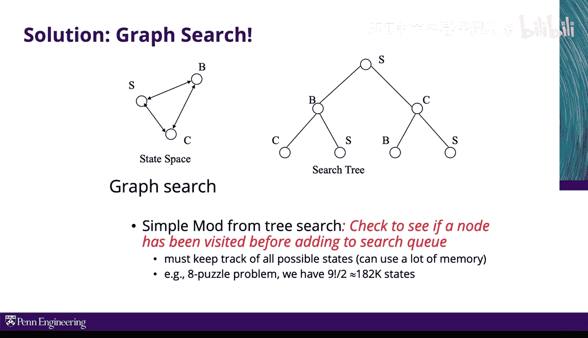
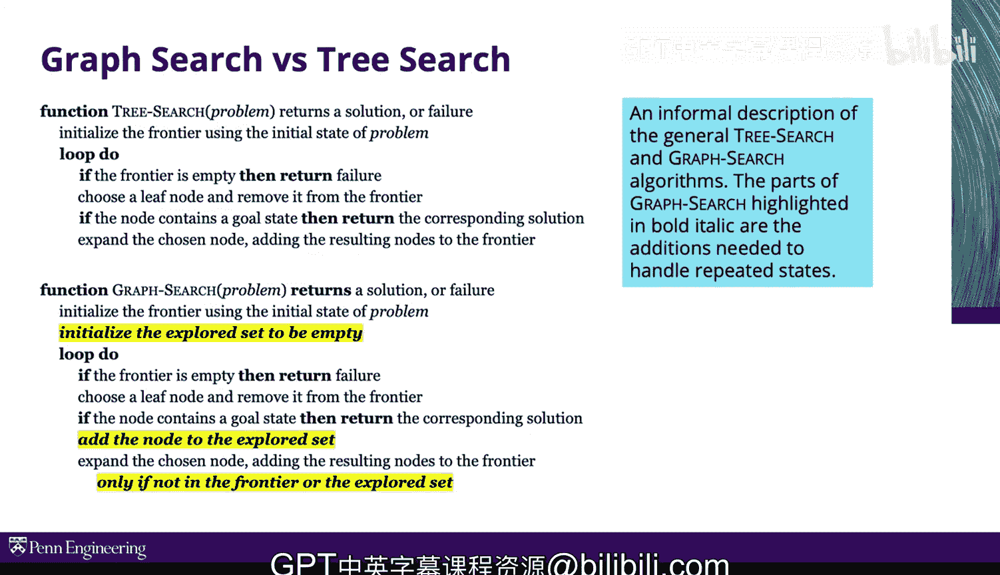

# 宾夕法尼亚大学《人工智能和机器学习基础（AI、数据科学、机器学习）AI and Machine Learning Essentials with Python》 p25 25_03_03_基本搜索算法.zh_en -BV16f421Q72q_p25-

Let's take a look at one search algorithm and one way of representing the search space where we're going to talk about search trees。

 This is going to be just a totally generalized algorithm for solving a search problem the way that we're going to do it is enumerate in a particular order。

 All of the possible paths from the initial state So we're going to start by having the initial state。

 and then this process is going to generate a tree structure。

 So our root node in our tree is going to be the initial state and the nodes in the search tree are going to be generated through our transition from that state they're good at children nodes。

The tree search treat different paths to the same node as distinct。

 This is the key difference between tree search and a graph search。

 A generalized tree search looks like the map problem。

We're in our initial state arod， that's going to be the root of the tree。

 and then we're going to generate nodes in that tree that we can reach by applying an action to that state from Arrod。

 we have connections to Shihibutti Meura。And Zend through the adjacent cities。

Initially is we're going to put a rod on our list of nodes that can be expanded our frontier。

Once we put our initial state on it， we're going to have exactly one thing that we can expand。

And generate children， it's going to say from this state。

 what actions can I apply and then what states result from that？So in our true search pseudocodes。

 start by initializing the frontier with the initial state。And， wow that frontier。Is not empty？

We're going to choose one of those nodes on the frontier。To expand using some strategy。

And we're going to remove it from the frontier。This state that we've removed from the frontier goal state。

 if so， return it， there's a solution， if not we're going to expand it and add all the resulting states back onto the frontier。

The strategy that we use to pick which element of the frontier we should return is going to result in dramatically different。

Search policies。 Let's look at a mapping from this search tree。

On to the states and transition functions at8 puzzle game in the8 puzzle game。

 state is the representation of the board。 But a node in our search tree is a data structure that contains。

Both that state， a point trip to that state， but also has things like a parent， a child。

 and probably some other variables that we want to keep track of。

 like how deep in this search tree are we or what's the path cost to this point in the tree。

So the node in our search treat is more than just a state for each node。

 we can apply a function that expands it。 that's going to use the actions that are possible from the state contained in that node。

 a transition model to then generate a corresponding set of states。

 which is going to create a new set of nodes that will be the children node for the current node。

That's going to update all the other fields as well it's going to update the depth and the tree。

 update the path cost， that sort of thing。

We can represent a puzzle gain using a search tree where we have a node at the top。

 which contains the start state。but also has pointers to all of its children。

 it has either an implicit or explicit depth， it has the total cost to reach this node， et ceter。

 from that initial start state， I can take a bunch of different actions I can take four if the blank tile is in the middle of the board at the initial state。

I can move it to the left and each of those nodes in the search tree is going to be a new state that I can apply other actions to。

And each of them will have children。One of the interesting things here is I'm suppressing backwards moves。

 I'm not showing this in the search diagram， but for instance。

 if I took this left child here from the root node， I could have a third child here。

Which was just moved back to this node。And that would actually be a child's in this search tree。

Going back to it is just going to increase the cost of my solution。

It's going to mean that I go through some redundant loops essentially。General for search problems。

 the notion of repeatedly visiting this same state is going to be a problem for us。

General problem in search。That we're going to encounter is this notion of repeating states。

 If we fail to detect repeated states， then we can turn a linear problem into an exponential one。

This is an example of a linear problem on the left， and then。

The exponential version of it on the right。If we end up following redundant path。

 then we're going to turn a tractable problem into an intractable one。

 What we'd really like to do is make sure that we avoid redundantly expanding the same states。

When we do that。We can end up augmenting this notion of a tree based search algorithm。

Just simply add an additional data structure that records all the states that we visited。

That's going to be a set。That we'll often just call the explored set。

And that's going to remember everything that we've expanded already。

 and it's going to help us convert the tree search onto a graph search。

Here's the difference in a graph search。 it's going to be a pretty simple modification of the tree search。

 or we're just adding one little addition。 and that's going to be checked to see。

If a node has been visited before， if a state has been visited before。

 then don't add it to our frontier。 Don't add it to our shoe that we're going to use to expand this。

One downside of having this auxiliary data structure that records every state that we visited is that our state space can actually be quite large for that simple eight puzzle game。

 we end up having so we're on the order of nine factorial possible states have 182。

000 possible states， if we have to record every single one of them as we visit it than the amount of memory that we use can get large when we're evaluating search algorithms we're going to evaluate them along a bunch of different criteria and we're going to analyze the asymptotic properties of them both in terms of running time like how fast do we arrive at a solution。

 but also we'll analyze the asymptotic requirements for memory as well。

Let's just explicitly contrast the pseudocode for the graph search versus the treese on the top here I have the pseudocode for the treese that we're going to initialize this frontier with the initial state of the problem and keep checking what the frontier we're going to grab an element from it according to our search strategy。

If that thing is the goal state， then we can return the path to it from the root of the tree to the current node as a solution。

If it's not， then we can expand it and add all of the child nodes to and if our frontier queue is ever empty。

 it means there is no solution， there's no way of going from the start state to a valid goal state。

That was our tree search。 Now we've got our graph search。 The main differences here are highlighted。

 We're going to still initialize the frontier using the initial state that were designated as the start state。

 Then we're going to just say now we've got an empty set。Of notes that we've explored so far。

And as we're pulling things off the frontier， again， according to the policy， as I pull it off。

 put it onto the explored。And then for each of the elements that I generate from it。

 each of the possible expansions， I'm going to check to see whether or not that expansion already exists in my explored set。

 If so， don't bother putting it on the frontier queue。We've already expanded it。

 We've already explored it。Putting it onto the frontier queue at this point would be a subop solution。

 because essentially， it would add a loop to add cost。

 There's no way that repeatedly going through that same state is going to。

Lead to the lowest cost solution， we can safely exclude it from the search tree as we get deeper in gear。

This very abstract way of formulating。Search either representing it as a tree or representing it as a graph。

