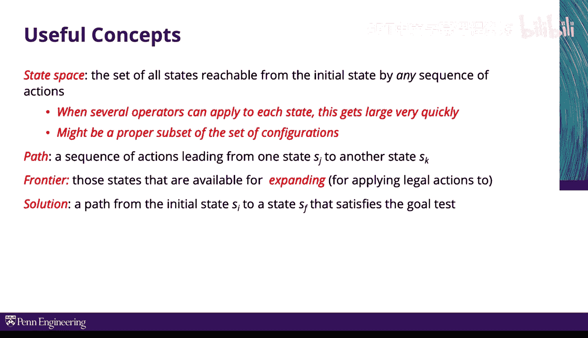
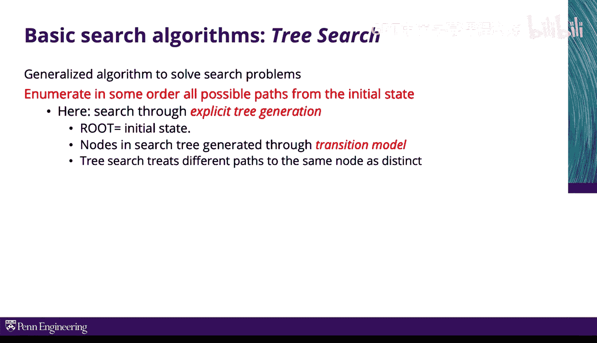
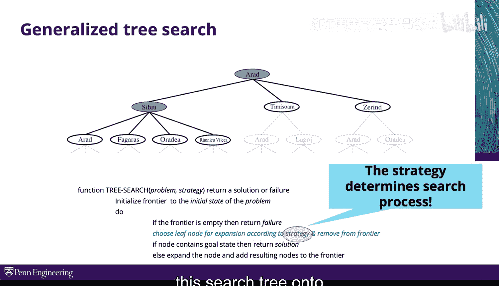
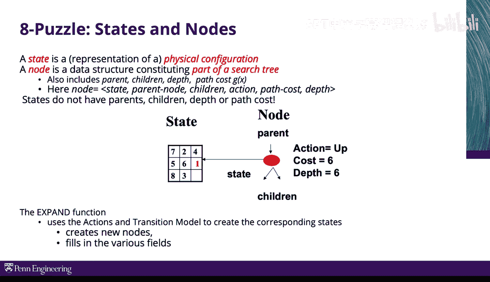
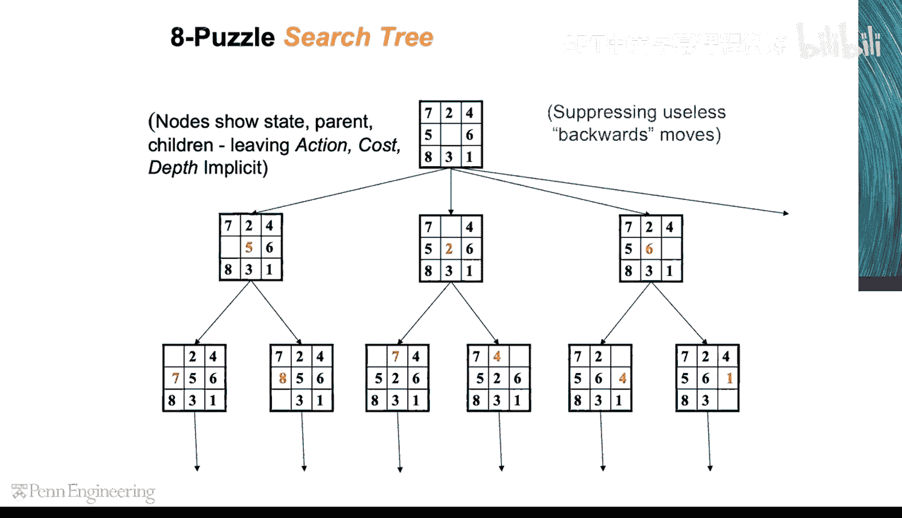
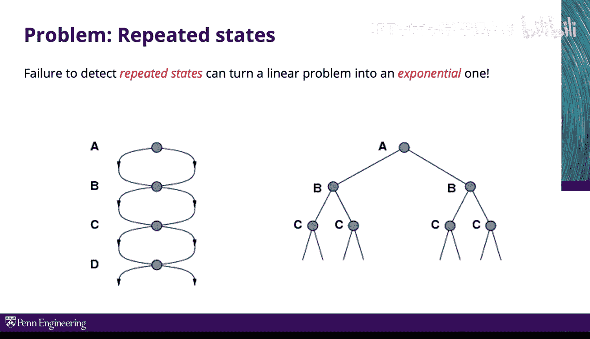
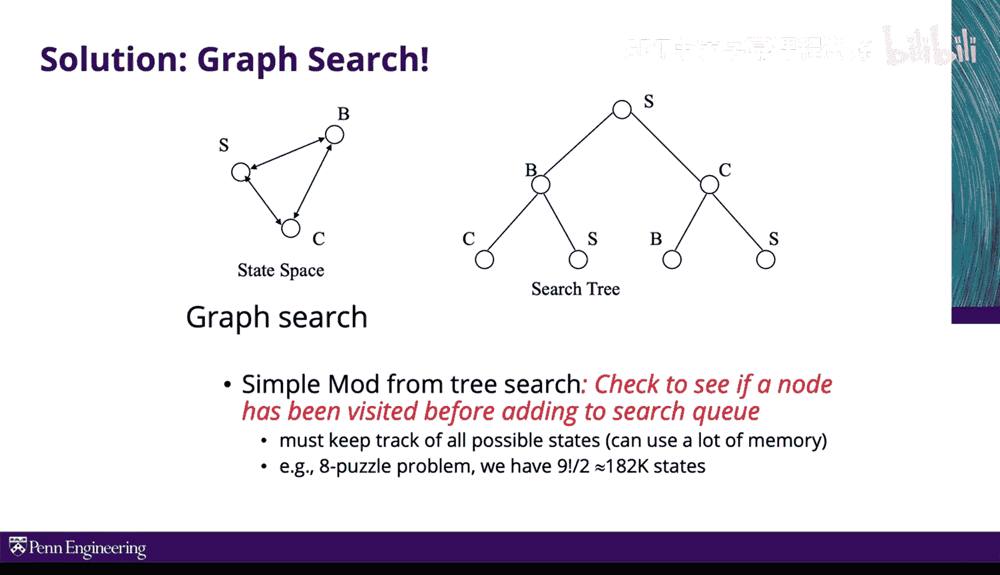
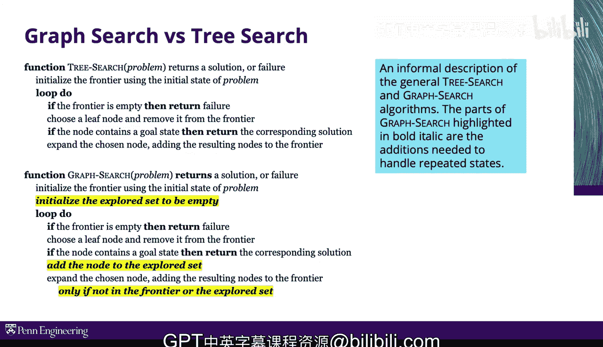

# 人工智能和机器学习基础：25：基本搜索算法 🧠

在本节课中，我们将学习搜索算法的基本概念，特别是如何通过搜索树和搜索图来表示和解决搜索问题。我们将从最通用的树搜索算法开始，然后探讨如何通过避免重复状态将其优化为图搜索。

## 搜索树表示法 🌳



上一节我们介绍了搜索问题的基本概念，本节中我们来看看如何用搜索树来表示搜索空间。



搜索树是一种表示所有可能路径的结构。树的根节点是初始状态。从该状态出发，通过应用可能的动作（或转换）来生成子节点，从而扩展树。

以下是构建搜索树的关键步骤：
1.  将初始状态作为根节点。
2.  从当前节点（状态）出发，应用所有可能的动作，生成新的状态作为其子节点。
3.  在树搜索中，即使到达的是同一个状态，不同的路径也会被视为不同的节点。

下图展示了从初始状态“Arad”出发，通过相邻城市连接生成子节点“Sibiu”、“Timisoara”和“Zerind”的搜索树片段。


## 通用树搜索算法 🔍

理解了搜索树的表示后，我们来看一个通用的树搜索算法伪代码。这个算法定义了如何系统地探索搜索空间以找到目标。



算法从一个包含初始状态的“边界”列表开始。只要边界不为空，算法就会根据某种策略选择一个节点进行扩展，检查它是否是目标状态。如果不是，则扩展该节点（即生成其所有子节点），并将这些子节点添加回边界列表。

以下是该算法的核心步骤：
1.  **初始化边界**：将初始状态放入边界列表。
2.  **循环检查**：当边界列表不为空时，执行以下操作：
    a. **选择节点**：根据特定策略从边界中选择一个节点。
    b. **移除节点**：将该节点从边界中移除。
    c. **目标测试**：检查该节点是否为目标状态。如果是，则返回该节点（即找到解）。
    d. **扩展节点**：如果不是目标，则扩展该节点，生成所有可能的后继状态（子节点）。
    e. **更新边界**：将这些新生成的子节点添加到边界列表中。
3.  **无解情况**：如果边界列表变空，则说明不存在从初始状态到目标状态的路径。

选择边界中下一个要扩展节点的策略（步骤2a）至关重要，不同的策略（如深度优先、广度优先）将导致完全不同的搜索行为。

## 搜索树中的节点数据结构 📦



上一节我们介绍了算法的流程，本节中我们来看看算法操作的具体对象——节点。在搜索树中，一个“节点”不仅仅是一个状态，它是一个包含更多信息的数据结构。

对于一个八数码游戏，状态是棋盘的布局。但搜索树中的节点是一个数据结构，它包含：
*   **状态**：当前棋盘的具体布局。
*   **父节点指针**：指向到达当前节点的上一个节点。
*   **子节点列表**：指向从当前节点可以到达的所有后续节点。
*   **深度**：从根节点到当前节点的路径长度。
*   **路径成本**：从初始状态到达当前状态所累积的代价。

下图展示了一个八数码游戏搜索树的节点结构示例。


对于每个节点，我们可以应用一个“扩展”函数。这个函数会利用该节点所包含状态的所有可能动作和转换模型，生成一组对应的新状态，从而创建一组新的子节点，并更新深度、路径成本等字段。



## 重复状态问题与图搜索 🔄

在通用搜索问题中，一个常见的问题是重复访问相同的状态。如果我们未能检测到重复状态，可能会将一个线性复杂度的问题变成指数级复杂的问题。

例如，左侧是一个线性问题，如果允许走回头路和冗余路径，搜索空间就会如右侧所示呈指数级膨胀。这会将一个可处理的问题变得难以处理。我们真正需要做的是确保避免冗余地扩展相同的状态。

为了解决这个问题，我们可以对基础的树搜索算法进行增强，引入一个额外的数据结构来记录所有已经访问过的状态。这个数据结构通常是一个集合，我们称之为“已探索集”。它帮助我们记住所有已经扩展过的节点，从而将树搜索转化为图搜索。



下图对比了无重复状态检测（树搜索，可能指数增长）和有检测（图搜索，避免冗余）的情况。


## 图搜索算法 🗺️

基于对重复状态问题的分析，我们现在来看图搜索算法。它是对树搜索的一个简单但关键的修改。

图搜索与树搜索的主要区别在于增加了一个“已探索集”。算法在从边界中选择一个节点进行扩展后，会先将该节点加入已探索集。然后，在扩展该节点生成子节点时，会检查每个子节点对应的状态是否已经存在于已探索集（或边界）中。如果已经存在，则忽略该子节点，不将其加入边界。这样可以有效避免循环和冗余路径，确保搜索不会重复访问同一状态。

以下是图搜索算法的伪代码，突出显示了与树搜索的主要差异：



```
function GRAPH-SEARCH(problem):
    frontier = {INITIAL-STATE(problem)} // 初始化边界
    explored = {} // 初始化已探索集为空

    while frontier is not empty:
        node = POP(frontier) // 根据策略从边界选择节点
        add node to explored // 将节点加入已探索集

        if GOAL-TEST(problem, STATE(node)):
            return SOLUTION(node) // 找到目标，返回解
        for child in EXPAND(node, problem): // 扩展节点
            if child.state not in explored and child.state not in frontier:
                add child to frontier // 仅当状态未被探索且不在边界中时加入
    return failure // 边界为空，无解
```

使用已探索集的一个潜在缺点是内存消耗。对于状态空间很大的问题（例如八数码游戏有约9!种状态），记录所有已访问状态可能需要大量内存。因此，在评估搜索算法时，我们不仅会分析其找到解的速度（时间复杂度），也会分析其内存需求（空间复杂度）。

下图直观对比了树搜索与图搜索的伪代码逻辑。


## 总结 📝

本节课中我们一起学习了基本搜索算法的核心思想。我们首先了解了如何使用搜索树来表示问题的所有可能路径，并学习了通用的树搜索算法框架。接着，我们认识到树搜索可能因重复状态导致效率低下，进而引入了“节点”数据结构来封装状态、路径等完整信息。为了解决重复状态问题，我们通过在算法中加入“已探索集”，将树搜索优化为图搜索，从而避免了冗余扩展，显著提升了搜索效率。最后，我们对比了树搜索和图搜索的伪代码，明确了图搜索通过状态查重来保证搜索在状态空间图上进行，而非在可能包含重复状态的树上进行。这种抽象的搜索形式化方法（无论是树还是图）是许多更高级人工智能算法的基础。



