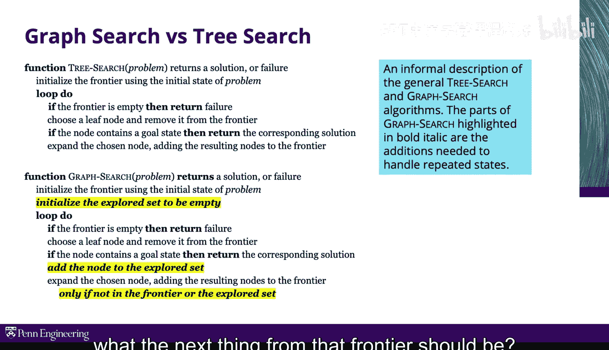
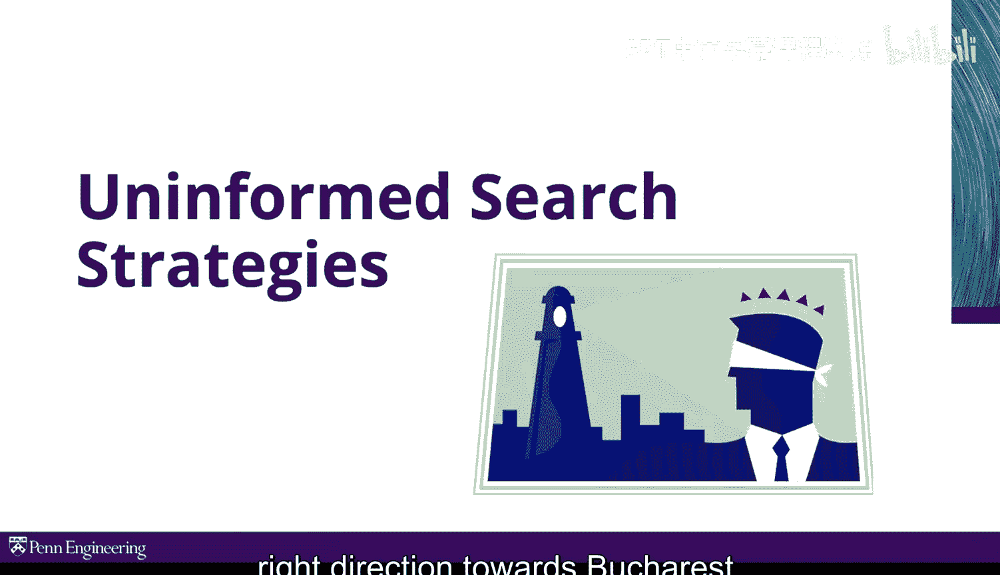
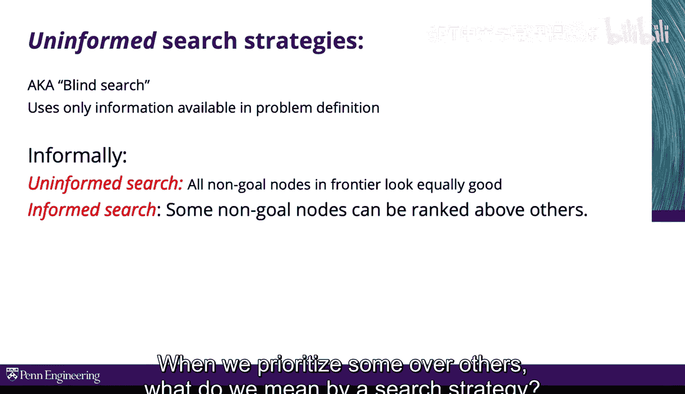
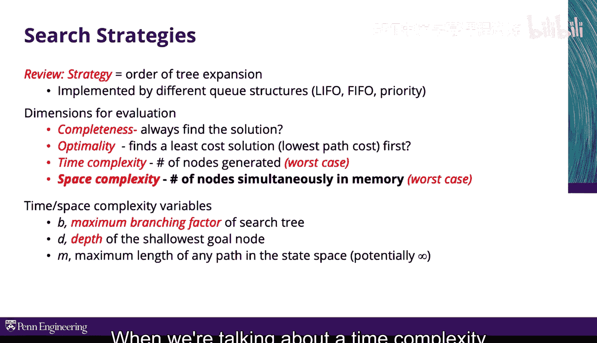
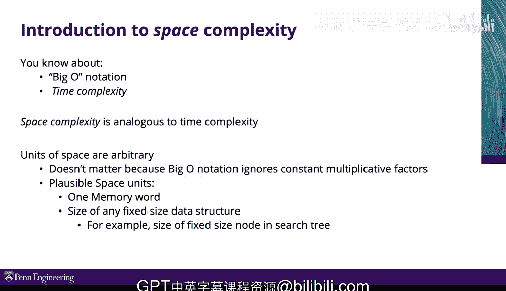

# 宾夕法尼亚大学《人工智能和机器学习基础（AI、数据科学、机器学习）AI and Machine Learning Essentials with Python》 p26 26_03_01_无信息搜索策略.zh_en -BV16f421Q72q_p26-

AndNow we can look at some actual strategy once we've got things in our frontier。

 what strategy shall we use to select what the next thing from that frontier should be expand that gets us to this set of search strategies called uninformed search strategies so the other name for uninformed search is blind search we're not going to use any information from the world in order to inform our search we're just use the problem as we find on the map of Romania。

 we're not going to even take into account whether we're headed in the approximate right direction towards Bucharest。

It's blind。 The idea of this blind search is that we're only going to use information available from the problem definition。

Informally， that means all the non goal nus on the frontier look equally good。

 we can pick any of them。On Thursday， we're going to start looking at informed search where we're going to be able to differentiate between the note the non goal nodes。

 and we're going to allow some of them to take priority。

 we're going to push them up ahead in the queue， and we're going to take heuristic information about the world into account when we prioritize some over it players。

What do we mean by a search strategy， All we mean is。

 what order do we expand the nodes that are in the frontier queue。

When we create our search algorithms， we're going to give it a different kind of cu。

 Li we're going to give it a priority queue or first in first out cu or a last in first out queue by giving the search algorithm different data structures for returning what element I should expand next on the frontier by implementing that frontier as these different kind of cues。

 I'm going to get different behavior for my search algorithm。

Depending on which strategy we give the search， we're going to have different behaviors。

 the way that we evaluate search strategies depend on a bunch of different dimensions。

 The first is complete rest that says， are we always guaranteed to find a solution if one exists。

The next is optimality。Does it always find the lowest cost solution first？If we arrive at a solution。

 are we guaranteed that solution is going to have the lowest path cost compared to any other solution。

 Then， as I mentioned before， we're also interested in the asymptotic properties of the algorithm。

 both in terms of time complexity， but also in terms of space complexity。

 the amount of memory that's required to store。The auxiliary data structures like the've visited。

And then some useful variables for analyzing asymptotic runtime are going to be B。

 which is the branching factor， this is going to be the maximum set of possible actions that I can take take from any state to get to any other state。

D is going to be the depth in my search tree of the goal node。

 the shallowest depths of the goal node。M is going to be the maximum length of the path of any path in the search phase if I have the cyclic graph。

 then the maximum depth could be insity。When we're talking about a time complexity in space complexity。

 then we're going to return to your background in data structures and algorithms。

 we're going to talk about Big O notation， you already know about running time big O in terms of time complexity and space complexity you may or may not have covered in your algorithms class。

 but it's totally analogous to time complexity。

Units of space are arbitrary。 It doesn't actually matter if we talk about kilobytes or megabytes or bytes or whatever。

And the reason for that is like big O ignores those constants。 It ignores the。Thousands of。

Millions when we're talking about number and bites。Instead。

 we're just talking about big O notation and thatll allow us to compare things in terms of the upper bounds。

When we talk about the different ways of setting the search strategy。

 I mentioned that we're going to use the a queue data structure for the frontier and the different types of cues that we select are going to result in different search strategies。

