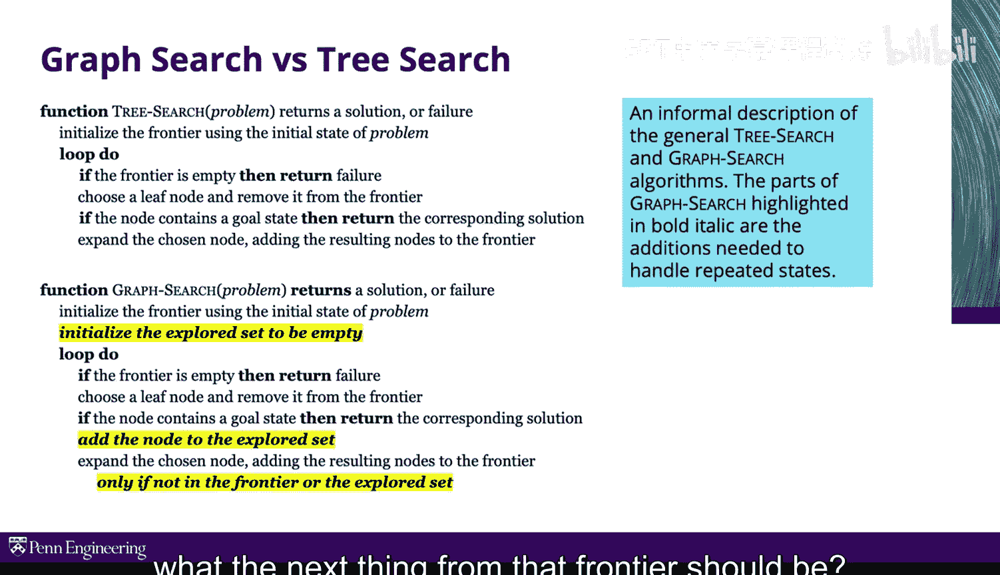
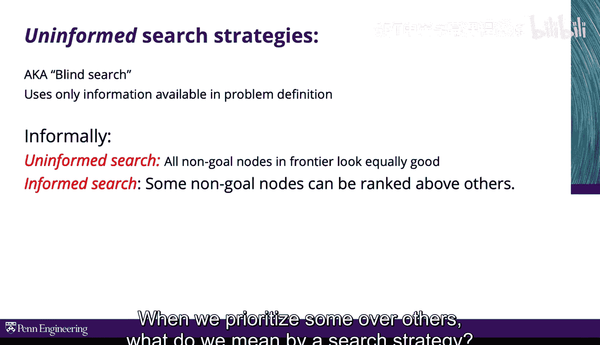
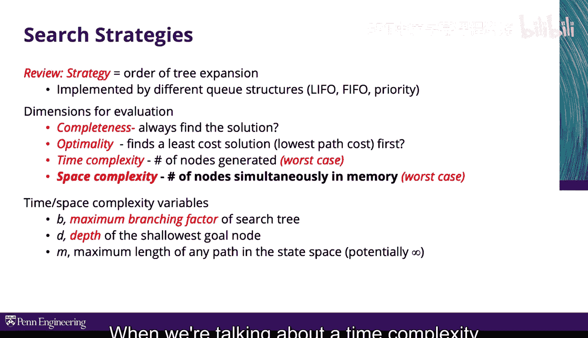
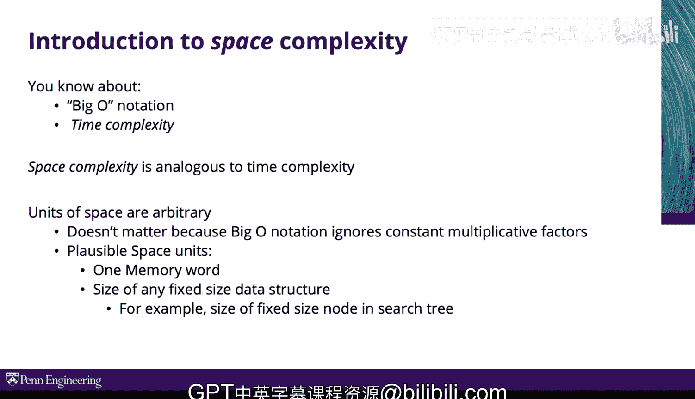

# 人工智能与机器学习基础：26：无信息搜索策略

在本节课中，我们将要学习搜索算法中的核心概念——无信息搜索策略。我们将探讨什么是无信息搜索，如何通过不同的队列数据结构实现不同的搜索策略，以及如何评估这些策略的性能。

---

上一节我们介绍了搜索问题的基本框架和边界（Frontier）的概念。本节中，我们来看看如何从边界中选择下一个要扩展的节点，即搜索策略。

一旦我们构建了边界，就可以开始研究具体的搜索策略。我们用来从边界中选择下一个扩展节点的策略，被称为**无信息搜索策略**。无信息搜索的另一个名称是**盲目搜索**。这意味着我们不会利用任何关于问题世界的额外信息来指导搜索，而仅仅依据问题本身的定义（例如罗马尼亚地图）进行搜索。我们甚至不会考虑当前节点是否大致朝向目标（布加勒斯特）的方向。

这种搜索是“盲目”的。盲目搜索的核心思想是，我们只使用问题定义中提供的信息。非正式地说，这意味着边界上所有非目标节点看起来都一样好，我们可以选择其中任何一个进行扩展。在后续课程中，我们将开始学习**有信息搜索**，届时我们将能够区分边界上的非目标节点，并允许某些节点获得更高的优先级，利用关于世界的启发式信息来指导搜索顺序。

那么，什么是搜索策略？它指的就是我们**扩展边界队列中节点的顺序**。当我们创建搜索算法时，我们会给它不同类型的队列：优先级队列、先进先出队列或后进先出队列。通过为边界实现这些不同类型的队列数据结构，算法在决定下一个扩展哪个节点时会产生不同的行为，从而得到不同的搜索算法。

根据我们赋予搜索算法的策略，它将表现出不同的行为。我们通过多个维度来评估搜索策略的性能。

以下是评估搜索策略的几个关键维度：

*   **完备性**：如果解存在，算法是否总能保证找到一个解？
*   **最优性**：算法是否总能首先找到成本最低的解？当我们找到一个解时，是否保证该解与其他任何解相比具有最低的路径成本？
*   **复杂度**：正如之前提到的，我们关注算法的渐近特性，包括**时间复杂度**和**空间复杂度**（存储已访问集合等辅助数据结构所需的内存量）。

一些用于分析算法渐近运行时间的有用变量包括：

*   **分支因子 b**：这是从任何状态可以采取的可能行动的最大数量。
*   **目标节点深度 d**：搜索树中目标节点的最浅深度。
*   **最大深度 m**：搜索空间中任何路径的最大长度。如果图是循环的，最大深度可能是无限的。

当我们讨论时间复杂度和空间复杂度时，需要回顾数据结构和算法的基础知识。我们将讨论**大O表示法**。你已经了解时间复杂度的大O表示法，空间复杂度在算法课程中可能涉及过，但它与时间复杂度的概念完全类似。

空间的单位是任意的，讨论千字节、兆字节还是字节并不重要。原因在于大O表示法会忽略这些常数因子（如千、百万）。我们只讨论大O表示法，这使我们能够在**上界**方面进行比较。

当我们讨论设置搜索策略的不同方法时，我提到我们将使用队列数据结构作为边界。我们选择的不同队列类型将导致不同的搜索策略。

---

本节课中，我们一起学习了无信息（盲目）搜索策略的基本概念。我们了解到，搜索策略本质上决定了扩展边界节点的顺序，而通过为边界实现不同类型的队列（如FIFO、LIFO、优先级队列），可以得到不同的搜索算法。我们还介绍了评估搜索策略的几个关键标准：完备性、最优性以及时间和空间复杂度，并回顾了用于复杂度分析的大O表示法和相关变量（分支因子b、目标深度d等）。下一节，我们将具体探讨几种经典的无信息搜索算法。