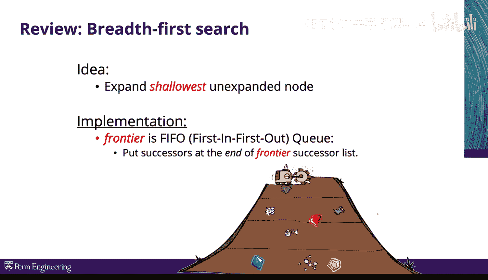
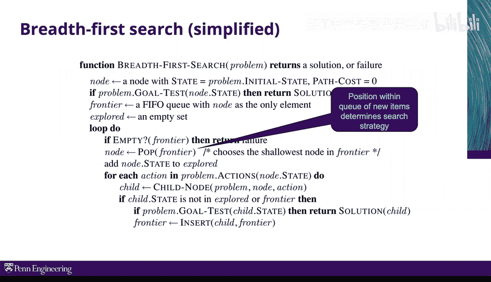
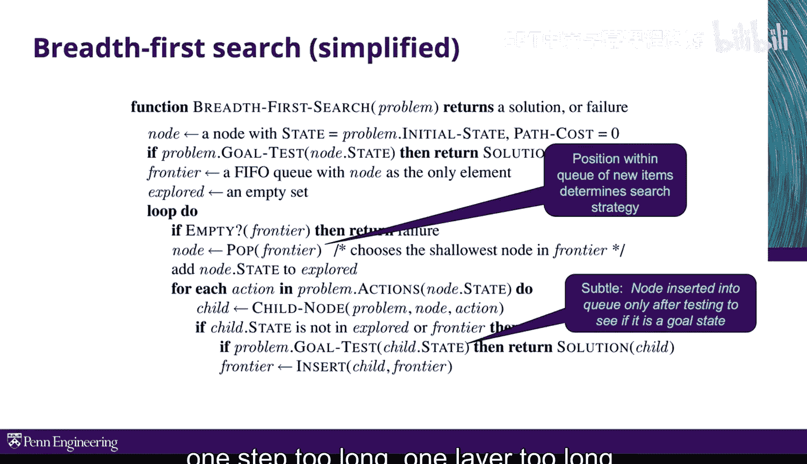
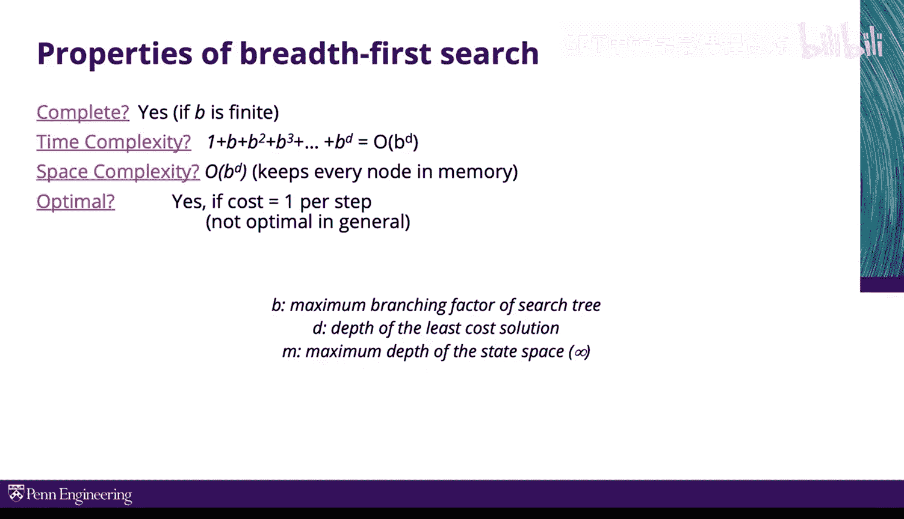
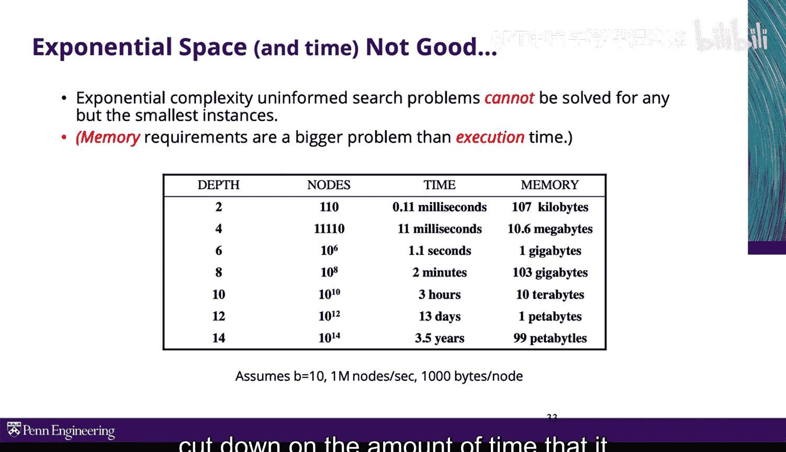
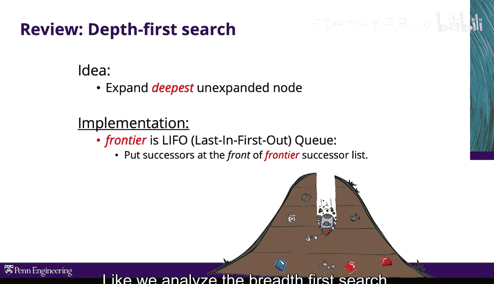
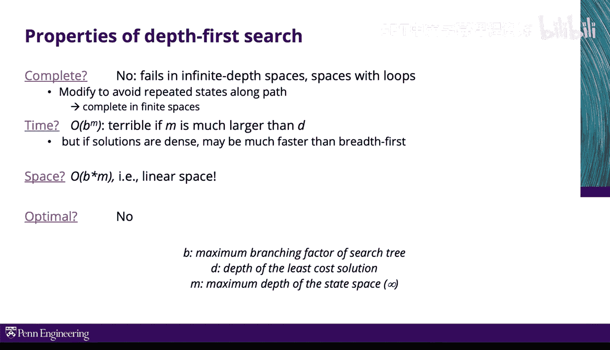
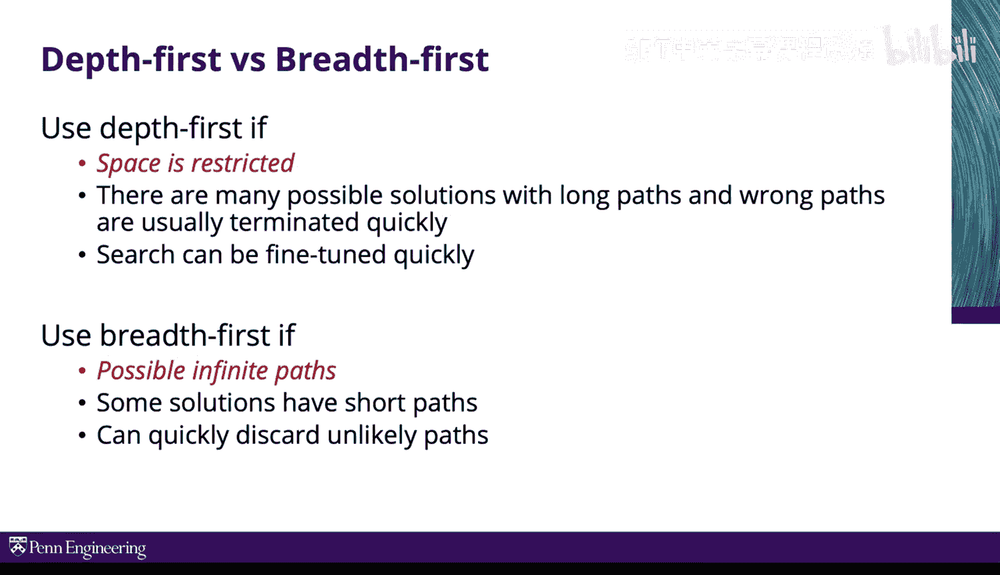
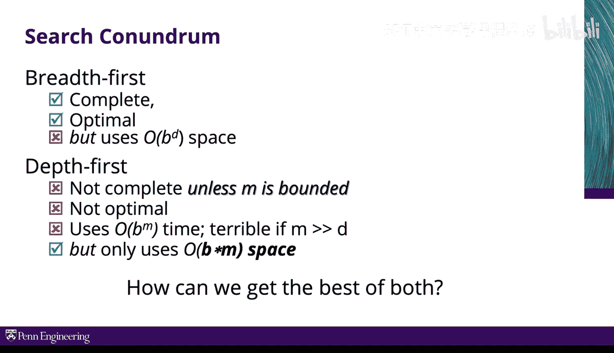

# 宾夕法尼亚大学《人工智能和机器学习基础（AI、数据科学、机器学习）AI and Machine Learning Essentials with Python》 p27 27_03_02_广度优先搜索与深度优先搜索回顾.zh_en -BV16f421Q72q_p27-

You might have encountered encountered breathth first search before。

 The idea here is we're going to expand the shallowest unexpanded nodes start at the goal state。

 gradually radiate outwards， choosing the ones that are initially closest to that start state。

In order to implement breathth first search， all we have to do is turn our frontier cu into a PO Q every time we create a successor。

 they just go at the end of the list that's all we have to do in order to implement breath first search。

Here is our pseudocode for breathth first search。The initial node is going to be the initial state。

And then check if this nodede is the goal state， then returns。This node。

 the path to this node from the root as the solution。And update our frontier as a 50q。

Iitialize our explored set as the empty set and then loop through our frontier queue。

And saying if our frontier is empty， then return the fact that there is no solution。

 there's no way of reaching a goal state from this start state。If it's not empty。

 then we're going to pop something off the Q， pick the shallowest node because we've implemented the Q as a PIO queue。

Add that node to the set tracking what we've already explored。

And for each actions that are possible from this state， create a child for it。

Check if that child is the goal state， if so， return a solution from that child。

 if not ticket it in the POQ。The position where we stick each of the expanded children determines our search。

For this BFS， the time when we check the goal state is at the time of expansion。

We're going to when the node is inserted into the queue is when we check to see whether it's goal state。

 If we don't do this， then we can run in the algorithm for one step too long， one layer too long。

That's breadth for search。 And then we can go through and analyze its properties， we can say。

Is this complete， Is it guaranteed to find a solution and the answer is yes。

If the branching factor is finite night。And we can analyze the runtime complexity of it。

 first insert the first node， the initial state。Then go through each of the possible children of the initial state and go through each of the possible children of the first layer of children and each of the possible children of the next layer。

 So that's going to be。1 plus a B squared plus B cubed because we're just branching our factor。

 depending on our layers up to the maximum depth of the shallowest goal node。

The asymptotic complexity is we're going to only pay attention to that last factor to the power of D。

Because we're recording every node that we visited in our our data structure so that we don't loop through the same thing again。

 the space complexity is going to be the same and the question is this guaranteed to return the shortest path？

To a solution， answer is yes under the condition that its every action has an equivalent cost。

 every action costs one， like in our tile game， then breadth first search is guaranteed to find the solution that's shallowest in the tree。

If that's not the case， if our cost from traveling one to another node。

 it comes like the number of miles traveled or the time， then breath of first search isn't optimal。

 it's not guaranteed to're finding the shortest path first。

The asymptotic complexity of this is actually not very good。

 we're talking about something to a power where that's the depth then。

This is a potentially take a long time to explore that exponential complexity。

 the only way that we're able to explore any search problem is if there's going to be tiny instances。

As well especially come through not just in the time complexity。

 but also in the memory requirements if the maximum depth is two that then the number of nodes that we might explore。

 assuming a branching factor of 10 is 110。The time is assumed sooner to be milliseconds。

 and the memory is going to be kilobytes。 But if we talk about a maximum depth of 10。

 then the number of nodes that we're going to explore is like 10 to the power of 10。

 it's going to take multiple hours and it's going to take 10terabtes of data assuming each node is represented with a data structure that takes 1 kilote。

 there's two lessons that we can learn from this figure。

 the memory requirements are sometimes a bigger deal， than the actual execution time。

 you might have to wait 13 days for a solution， which is a long time。

 but it's probably going to be worse that you would have to have a disk that has a petabyte of data。

 Fortunately， other types of strategies that are going to require less memory。

 Time is still going to be a major factor。 if your problem has a solution at depth 16。

 is going to take。Multiple centuries for Bth first search to find it in general。

 these kind of exponential complexity search problems can't be solved by uninformed methods。

 Starting on Thursday will talk about informed search that are going to allow us to dramatically cut down on the amount of time that it takes to find a solution in most cases。

F O Q that gives us breadth first search， another type of search that you'll have encountered is death first search。

 The idea is instead of expanding the shallowowest node， we now want to expand to the deepest node。

 we're just going to drill down as fast as we can。 instead of instead of implementing this as a 50 Q。

 we're going to implement as a life O Q a last in first out。

 that means that whenever we have a successor， it's going to go at the very front of our frontier。

Like we analyzed the breathth first search， we could analyze the depth first search。 is it complete。

No， if we have an infinite depth space， including one where we have cycles。

 then we could go down the wrong path first and end up never finding the goal。

We're going to see a variant of depth for search that is complete where we're going to modify it to iteratively deepen the time complexity is the branching factor till the power of M。

 which is the maximum depth of the the state space， which is going to be super， super bad。

 if M is larger than D。 the space is going to be much better than if breadth first search is just going to be linear again。

 unlike breadth first search， which when all the action costs were equal。

 it was therefore optimal depth for search has no such property。

 It's not an optimal algorithm and we've got a couple of different。

Algorithms that are implemented by different priority cues。

 we've got depth first search or breadth first search。

When should we use which we should use depth for search if we care about the space complexities。

 because it's just got that linear space complexity instead of exponential space complexity。

 a good practical。Problem set in T's depth first search is if there's lots of possible solutions。

With the wrong paths。 and if the wrong paths are terminated quickly。

 meaning it's not an infinite dense space。We should use Bth first search if we know that the search space is potentially infinite。

If we know that some solutions power short paths。Those are good reasons for choosing one versus the other。

 One of the funny things about these is they have different properties。

 Your Bth first search was complete and optimal， but uses this exponential amount of space。

 Dth first search wasn't even complete unless we knew that the depth was bounded。

 It not even optimal， but it uses quite a reasonable amount of space。

