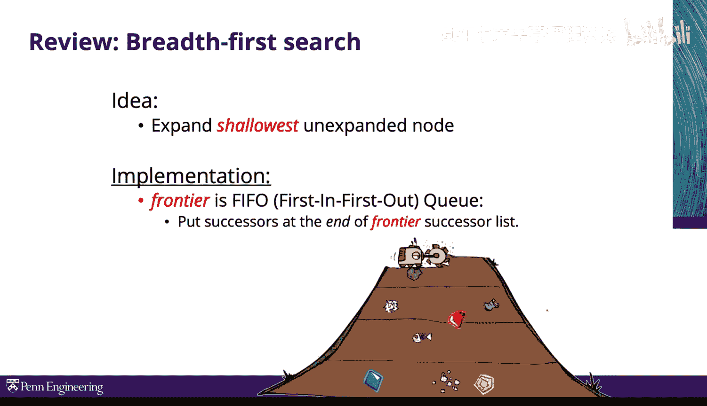
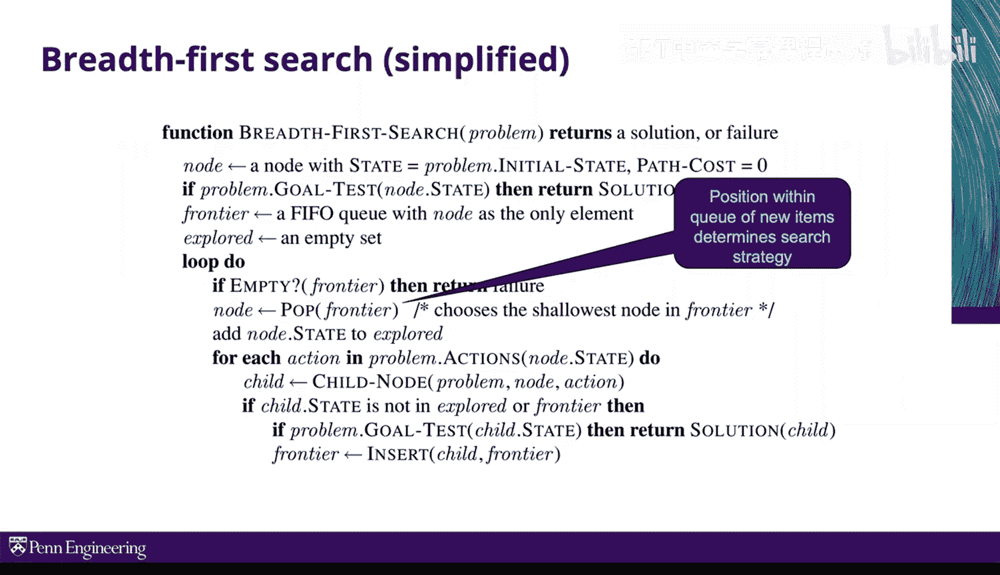
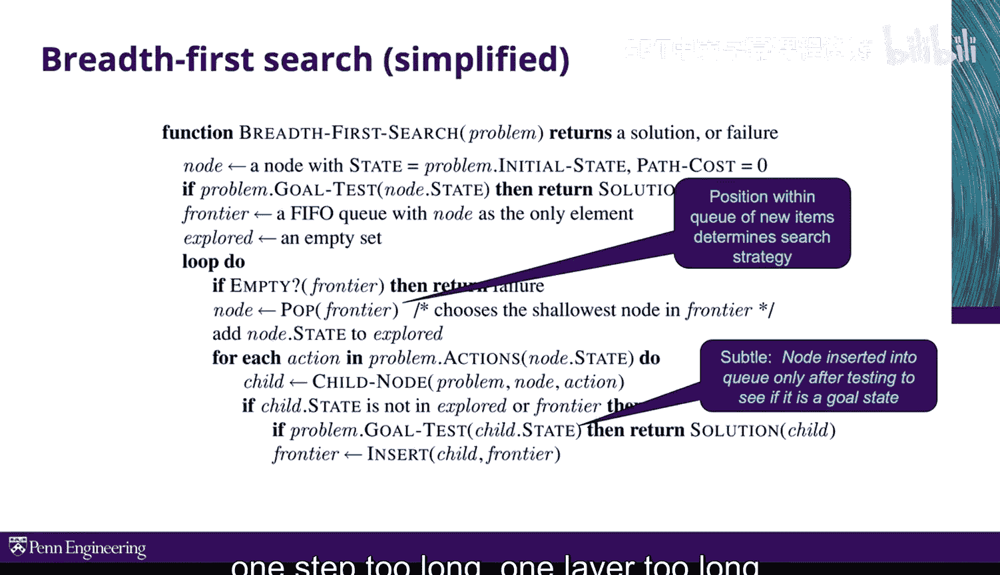
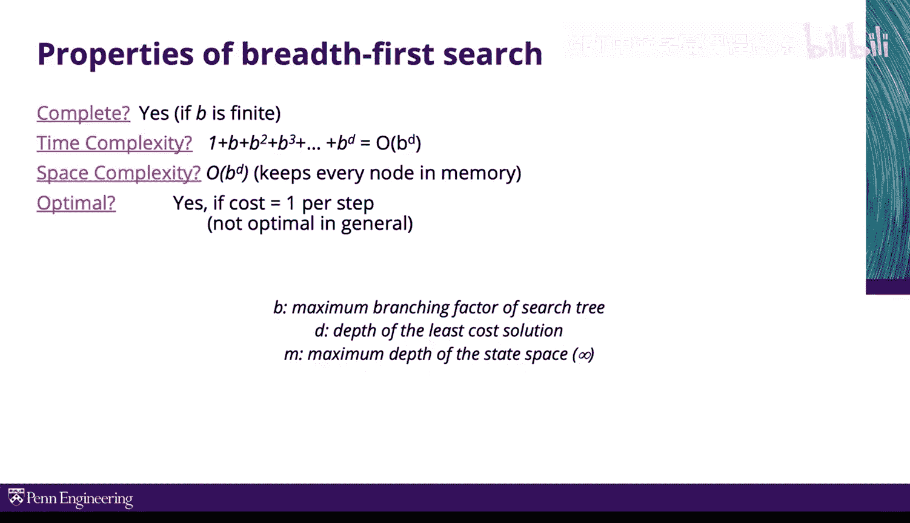
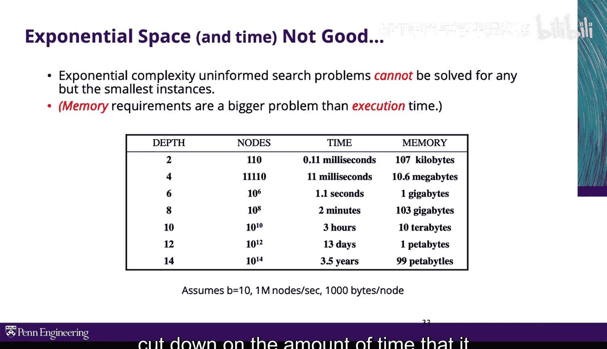
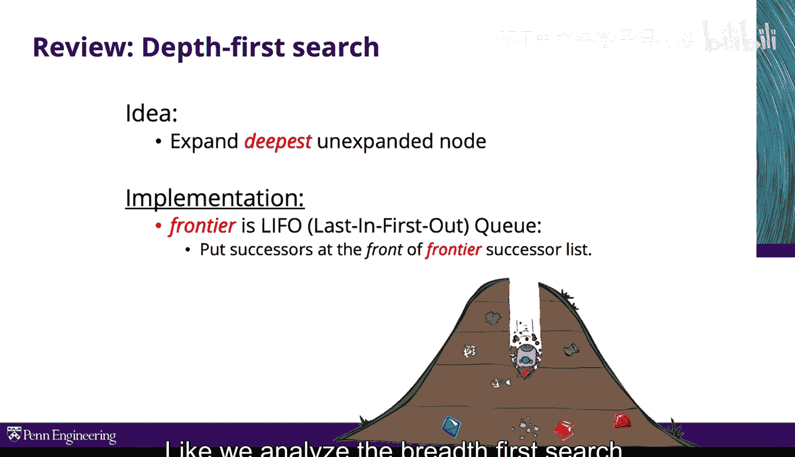
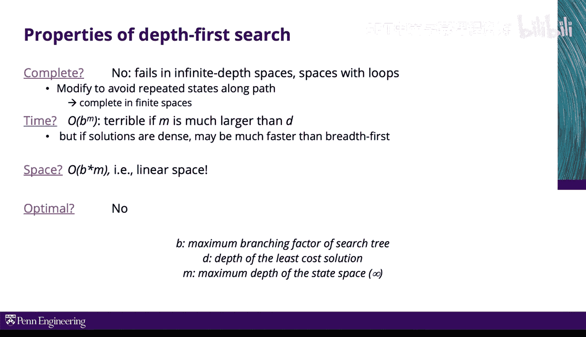
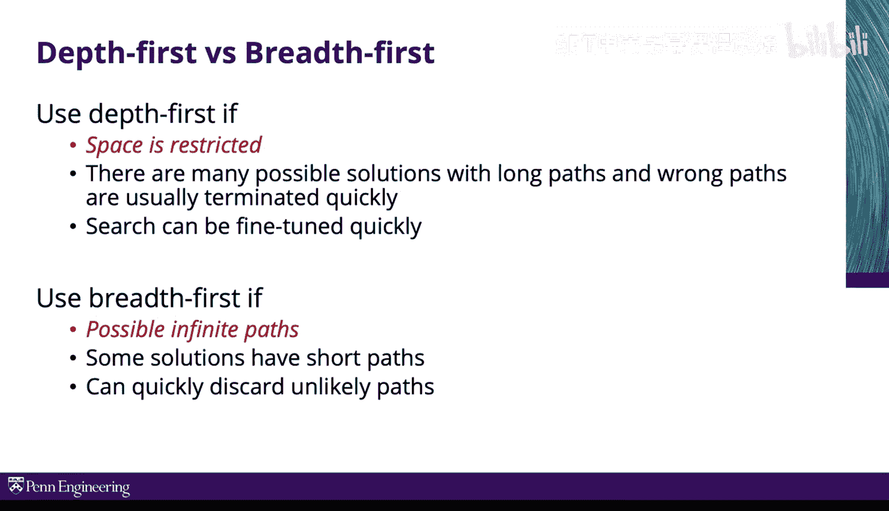
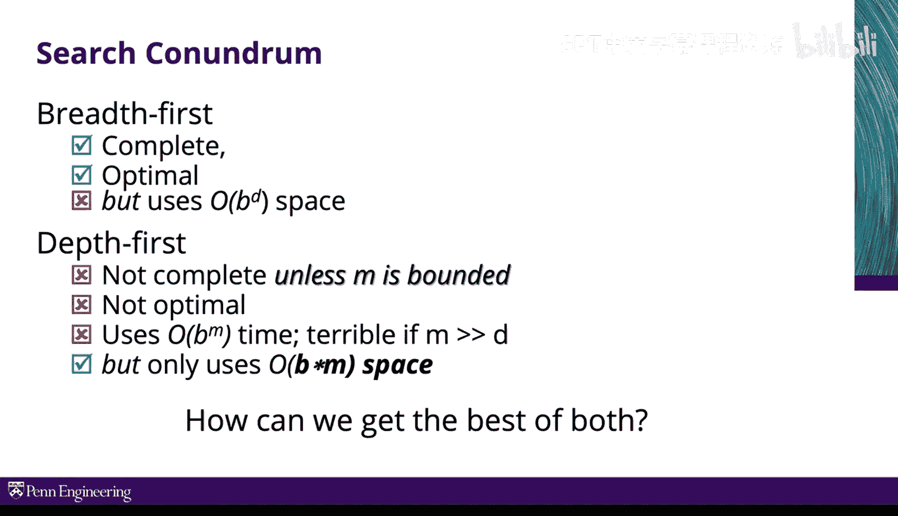

# 人工智能和机器学习基础：27：广度优先搜索与深度优先搜索回顾 🧭

在本节课中，我们将要学习两种基础的图搜索算法：广度优先搜索（BFS）和深度优先搜索（DFS）。我们将回顾它们的基本思想、实现方式、性质以及各自的适用场景。



---

## 广度优先搜索（BFS）回顾

广度优先搜索的核心思想是，从起始状态开始，逐层向外扩展，总是优先扩展最浅的、未被扩展的节点。其目标是逐步向外辐射，选择那些最初离起始状态最近的节点。

为了实现广度优先搜索，我们需要将边界队列（frontier）实现为一个先进先出队列（FIFO Queue）。每次创建一个后继节点时，只需将其放入列表的末尾。



以下是广度优先搜索的伪代码：



```python
function BFS(initialState):
    frontier = FIFO_Queue()
    frontier.enqueue(Node(state=initialState))
    explored = set()

    while frontier is not empty:
        node = frontier.dequeue()  # 弹出最浅的节点
        if node.state == goalState:
            return solution_path(node)
        explored.add(node.state)

        for action in possible_actions(node.state):
            child = Node(state=apply(action, node.state), parent=node)
            if child.state not in explored and child not in frontier:
                if child.state == goalState:
                    return solution_path(child)
                frontier.enqueue(child)
    return failure  # 无解
```

在BFS中，检查节点是否为目标状态的时机是在节点被扩展时。如果我们不这样做，算法可能会多运行一层。

接下来，我们可以分析BFS的性质：
*   **完备性**：是的。如果分支因子有限，BFS保证能找到解。
*   **时间复杂度**：在最坏情况下，需要探索的节点数约为 `O(b^d)`，其中 `b` 是分支因子，`d` 是最浅目标节点的深度。
*   **空间复杂度**：与时间复杂度相同，也是 `O(b^d)`，因为需要存储所有已访问的节点以避免重复。
*   **最优性**：在**所有行动代价相同**（例如，每个行动代价为1）的条件下，BFS保证能找到最短路径（即深度最浅）的解。如果行动代价不同，BFS则不是最优的。

BFS的渐近复杂度并不理想，因为它是指数级的。当深度 `d` 较大时，所需的时间和内存会急剧增长。

例如，假设分支因子为10：
*   当最大深度为2时，探索节点数约为110，时间在毫秒级，内存需求在千字节级。
*   当最大深度为10时，探索节点数约为10^10，可能需要数小时，并且如果每个节点用1KB的数据结构表示，则需要约10TB的内存。

从这个例子中我们可以学到两点：
1.  内存需求有时比实际执行时间更关键。
2.  这类具有指数复杂度的问题，通常无法通过无信息搜索方法有效解决。我们将在后续课程中学习能大幅减少搜索时间的**有信息搜索**方法。



---

## 深度优先搜索（DFS）回顾

上一节我们介绍了逐层扩展的广度优先搜索，本节中我们来看看另一种策略：深度优先搜索。

深度优先搜索的核心思想与BFS相反，它试图尽可能深地探索图的分支。它不是扩展最浅的节点，而是扩展最深的节点，即“一条路走到黑”。

为了实现深度优先搜索，我们需要将边界队列实现为一个后进先出队列（LIFO Queue，即栈）。这意味着每当生成一个后继节点时，它会被放到边界队列的最前面。

与BFS类似，我们可以分析DFS的性质：
*   **完备性**：**不**完备。如果搜索空间深度无限（或存在循环），DFS可能会先沿着一条错误路径无限深入，从而永远找不到目标。
*   **时间复杂度**：在最坏情况下，需要探索的节点数约为 `O(b^m)`，其中 `b` 是分支因子，`m` 是状态空间的最大深度。如果 `m` 远大于目标深度 `d`，这会非常糟糕。
*   **空间复杂度**：比BFS好得多，仅为 `O(b*m)`，是线性的。
*   **最优性**：DFS不是最优算法，它不保证找到最短路径。



---

## BFS与DFS的比较与应用场景



我们已经了解了两种由不同优先级队列实现的算法：广度优先搜索和深度优先搜索。

以下是选择使用哪种算法的一些指导原则：

**应该使用深度优先搜索的情况：**
*   当**空间复杂度**是主要限制因素时，因为DFS具有线性空间复杂度，而非指数级。
*   一个实际适用场景是：存在许多可能的解，并且错误路径能很快终止（即搜索空间深度有限）。



**应该使用广度优先搜索的情况：**
*   当搜索空间可能**深度无限**时。
*   当我们知道解可能位于较短的路径上，并且需要找到最短路径（在行动代价相同的条件下）。

这两种算法具有不同的特性，形成了一种权衡：
*   广度优先搜索是完备且最优的（在等代价条件下），但需要指数级的空间。
*   深度优先搜索甚至不是完备的（除非深度有限），也不是最优的，但它使用的空间量相对合理。

---

## 总结





本节课中我们一起学习了两种基础的图搜索策略：广度优先搜索和深度优先搜索。我们回顾了它们的工作原理、伪代码实现、各自的优缺点（完备性、最优性、时间与空间复杂度）以及典型的应用场景。理解这两种基本算法是学习更高级搜索技术的重要基础。