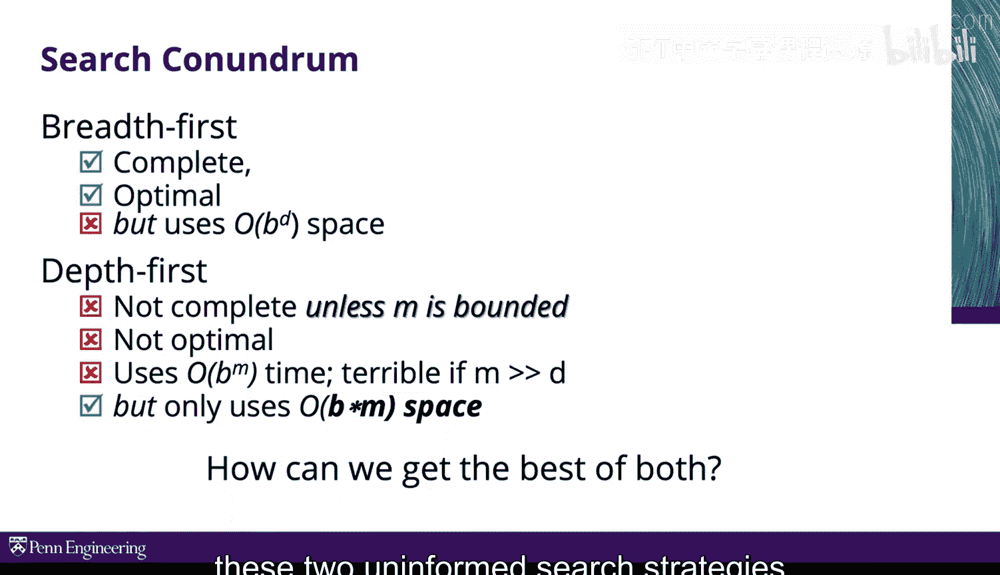
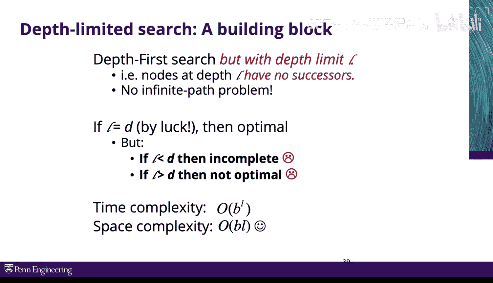
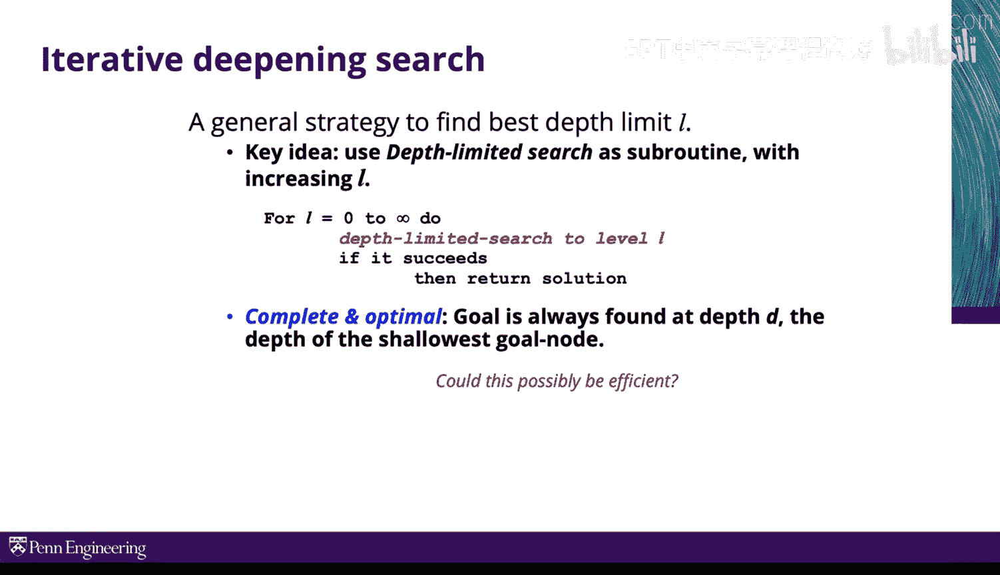
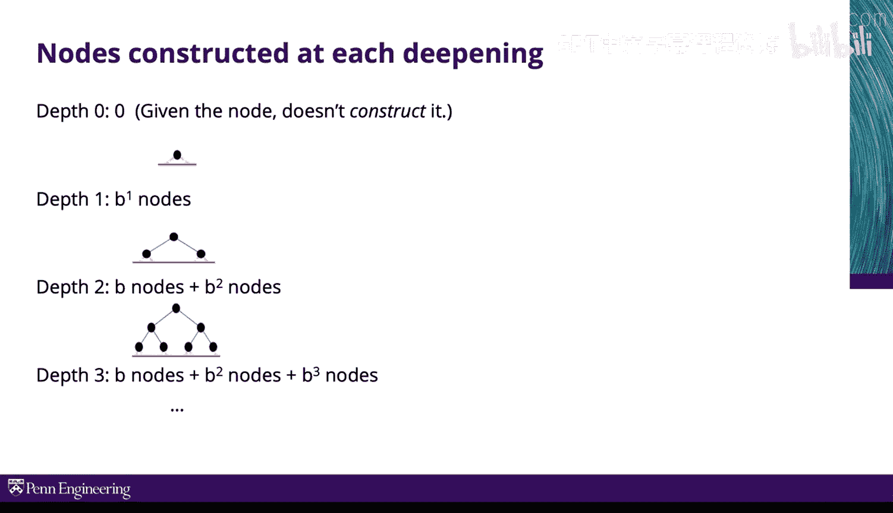
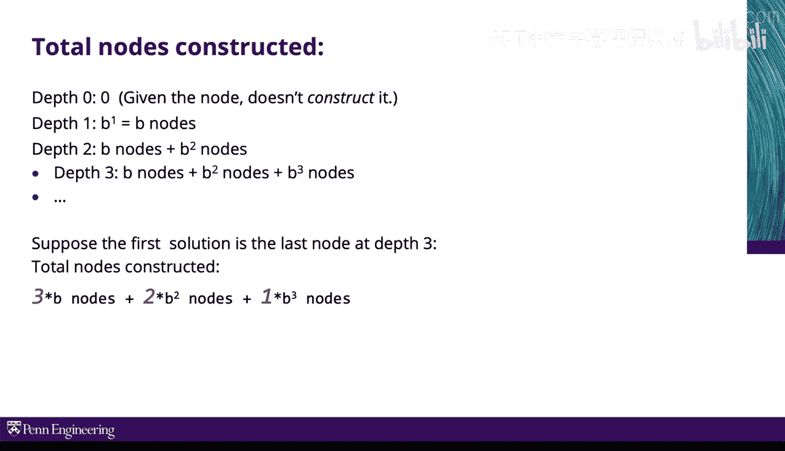
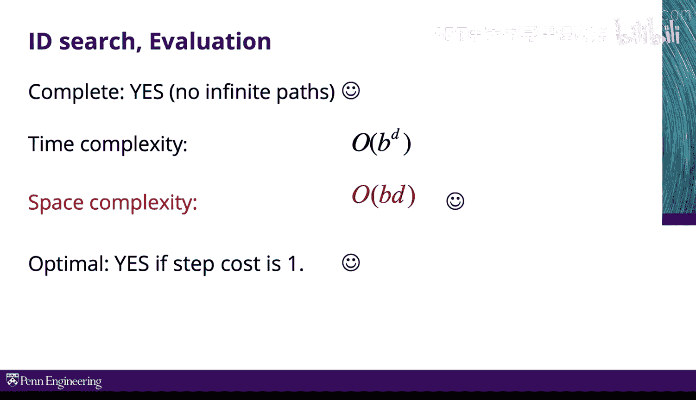
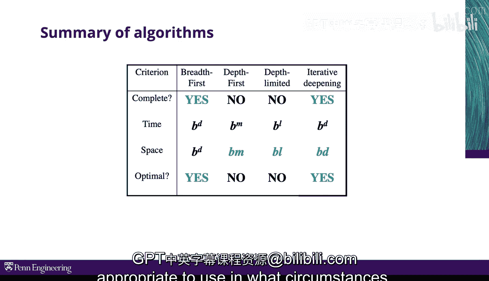

# 宾夕法尼亚大学《人工智能和机器学习基础（AI、数据科学、机器学习）AI and Machine Learning Essentials with Python》 p28 28_03_03_深度受限搜索与迭代加深搜索.zh_en -BV16f421Q72q_p28-

Is there a way that we can design an algorithm that takes the best aspects of both of these and combines them？

The first building block that we're going to use to combine these two uninformed search strategies is a depth limited search。

 apply depth for search。

But limit the depth to some number L。Once youve reach depth， L， don't expand the successors。

L is equal to the depth at which our shallowest goal node is found， the depth limited search。

 it's optimal。But if L is less than the depth of our shallowest gold no。

 this algorithm will be incomplete。 If we just stopped after depth L。We won't find a solution。

 even though one exists。And similarly， if L is greater than D。

 then we might not find the optimal solution。But it's got good space complexity。

 We're going to have the branching factor timess our limited depth as the space complexity and our time complexity is the branching factor to the power of L。

 That's going to be the basic building block of how we build a。

Uninformed search strategy that has some better properties than either depth first search or bread。

And we're going to change that just slightly。 instead of just setting L once and for all。

 let's do an iteratively deepening search。 The general strategy is going to be。

Gradually increase L， we're going to do a depth limited search at L start at 0。

 and then we're going to gradually increase our depth limit to infinity。

 do a depth limited search at level L increment。If we find a solution。Then we're going to return it。

 otherwise deepen the search by one additional layer。

The cool thing is that this results in something that's complete and optimal Earl。

 I said the depths limited search。 if I set it at 10。 and if I find a goal note at level 6。😊。

There may have existed another one at level 3 that I wouldn't have found。

Dth iterative deepening avoids that。 Exp all nodes at level 3 before I explore nodes at level 6。

 That means it's optimal。It has the same property as breadth for search in that regard。

 it's complete。

Cause I can go to infinity。It's easy we just start constructing the search tree and then cutting it off at each depth。

 we at depth 0 test to see whether the initial node is the goal state。

 we don't even bother constructing a tree， then at depth1， we have B to the power1 at depth 2。

 we have B to the power of two nodes and at depth 3。

 we have B plus B squared plus B to the power of 3。The total number of nodes that we construct are。

Just that kind of sequence。The size of the search base is going to depend on the minimum depth of a goal node。

 if our minimum depth for a goal node is three， then we're going to have three times the branching vector nodes plus two times the branching factor nodes plus one times the branching vector。

Let's look at the properties for this iterative deepening search。

 it's complete so long that there are no infinite paths。Which is great。

 The time complexity is still going to be that asymptotic one that we had for Bth first search。

 which is not so great， but the space complexity is not going to be as bad as the breadth first search instead of being asymptotic we're going to have be time deep。

And then assuming everything has equivalent cost， it's also going to have the property of being optim just This is the type of analysis that we'd like you to be able to do for these kinds of search algorithms。

 So again， these are going to be things that we'd like you to be able to reason through。

 we'd like you to be able to apply your previous experience and data structures and algorithms to come up with your own asymptotic analysis。

 what's its asymptototic time complexity， what's its asymptototic space complexity。

 all of those are great things to be able to analyze and and determine like which which algorithm is appropriate to use in what circumstance。

