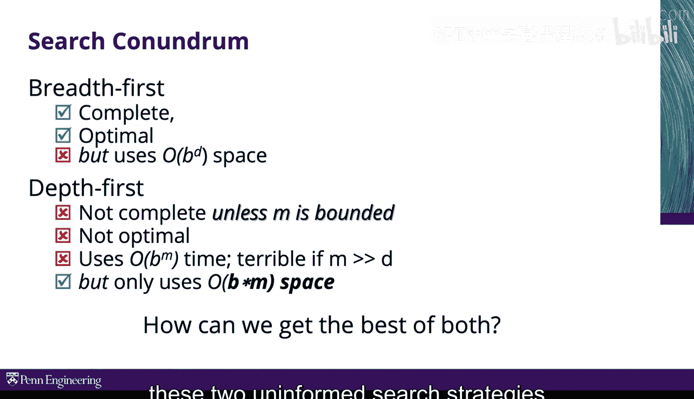
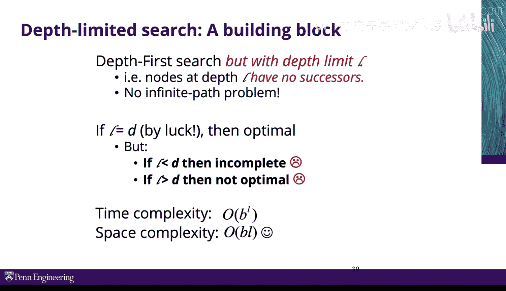
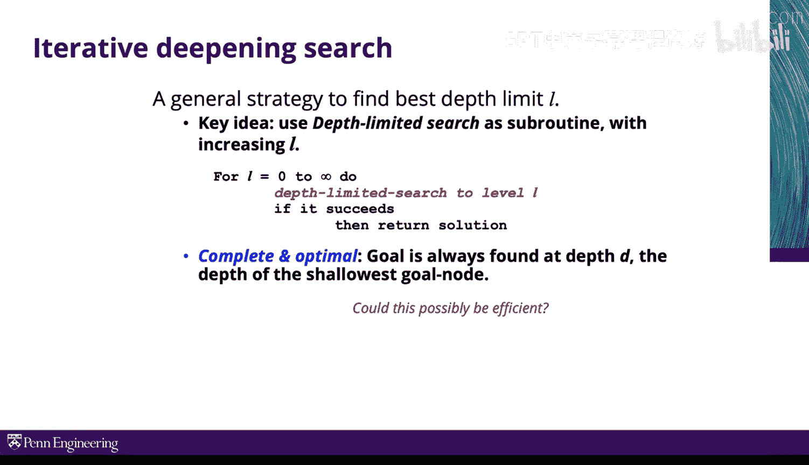
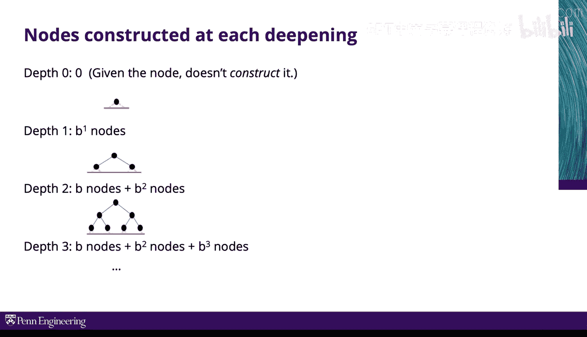
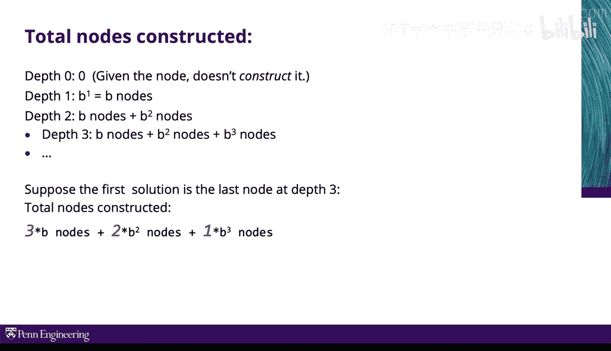
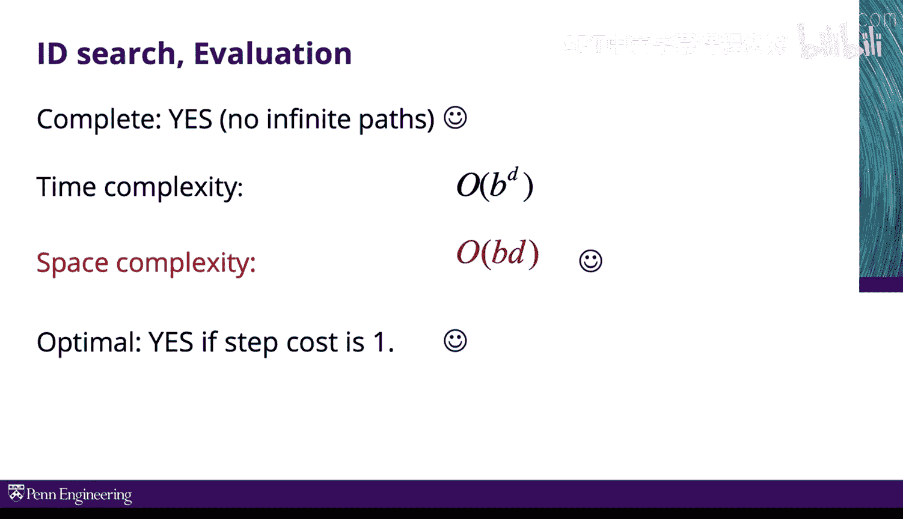
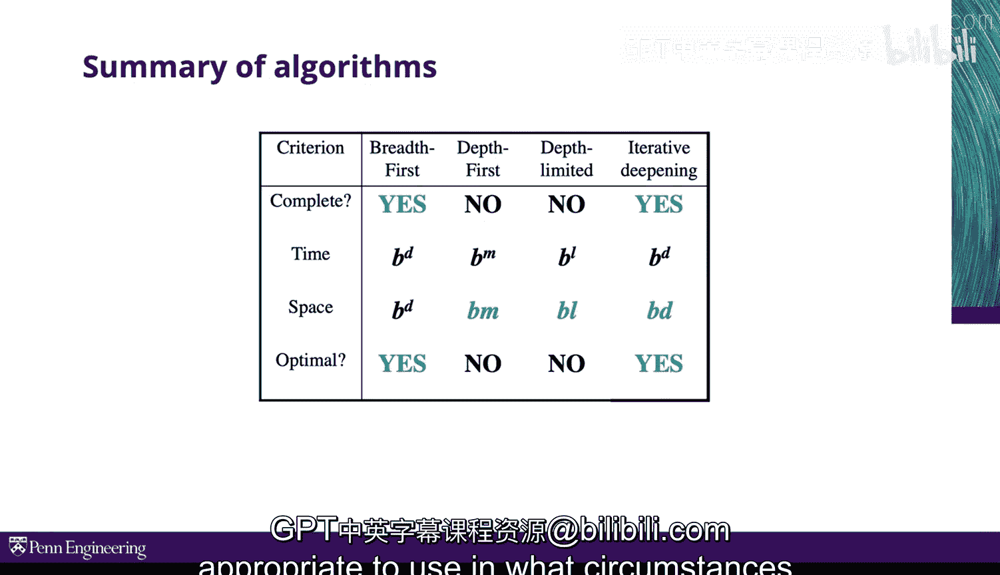

# 人工智能和机器学习基础：28：深度受限搜索与迭代加深搜索 🧠



在本节课中，我们将学习如何结合两种无信息搜索策略的优点，设计出更高效的算法。我们将重点介绍**深度受限搜索**和**迭代加深搜索**，并分析它们的性能。

## 概述

上一节我们讨论了深度优先搜索和广度优先搜索各自的优缺点。本节中，我们来看看能否设计一种算法，结合两者的优点。我们将从**深度受限搜索**开始，它是构建新算法的基础模块。

## 深度受限搜索

深度受限搜索是深度优先搜索的一种变体。其核心思想是：在搜索过程中，限制搜索的最大深度为某个数值 **L**。一旦达到深度 **L**，就不再扩展该节点的后继节点。



以下是深度受限搜索的伪代码描述：
```python
def depth_limited_search(node, problem, limit):
    if problem.is_goal(node.state):
        return solution(node)
    elif limit == 0:
        return 'cutoff'
    else:
        cutoff_occurred = False
        for child in expand(node, problem):
            result = depth_limited_search(child, problem, limit - 1)
            if result == 'cutoff':
                cutoff_occurred = True
            elif result is not None:
                return result
        if cutoff_occurred:
            return 'cutoff'
        else:
            return None
```

如果限制深度 **L** 恰好等于最浅目标节点的深度，那么深度受限搜索是**最优**的。然而，如果 **L** 小于最浅目标节点的深度，算法将变得**不完整**，因为它会在找到解之前停止。反之，如果 **L** 大于目标深度，它可能找不到最优解。

深度受限搜索的优势在于其空间复杂度较低。其空间复杂度为 **O(b × L)**，其中 **b** 是分支因子。时间复杂度为 **O(b^L)**。

## 迭代加深搜索



为了克服深度受限搜索的缺点，我们引入**迭代加深搜索**。它不是固定一个深度限制，而是逐步增加限制深度 **L**。

其基本策略如下：
1.  从深度限制 **L = 0** 开始。
2.  执行深度限制为 **L** 的深度受限搜索。
3.  如果找到解，则返回。
4.  如果未找到解，则将深度限制 **L** 增加 1，然后重复步骤 2。



这个过程可以形象地理解为：先探索深度为 0 的所有节点，然后是深度为 1 的所有节点，接着是深度为 2 的节点，依此类推，直到找到目标。

迭代加深搜索结合了深度优先搜索和广度优先搜索的优点：
*   **完整性**：只要没有无限路径，它就是完整的，因为深度限制最终会增加到无穷大。
*   **最优性**：在路径代价一致的情况下，它是最优的。因为它会先探索深度为 3 的所有节点，然后才探索深度为 4 的节点，因此找到的第一个解必然是最浅的（即最优的）。
*   **空间复杂度**：与深度受限搜索相同，为 **O(b × d)**，其中 **d** 是最浅目标节点的深度。这远优于广度优先搜索的 **O(b^d)**。
*   **时间复杂度**：虽然看起来重复探索了浅层节点，但其渐进时间复杂度与广度优先搜索相同，为 **O(b^d)**。



## 性能分析

理解如何分析这些搜索算法的性能至关重要。以下是需要掌握的分析要点：

*   **渐进时间复杂度**：算法运行时间随问题规模增长的趋势。
*   **渐进空间复杂度**：算法所需内存空间随问题规模增长的趋势。
*   **完整性**：当解存在时，算法是否保证能找到解。
*   **最优性**：算法是否保证能找到最优解（例如，路径最短或代价最低的解）。

通过分析这些属性，我们可以判断在何种情况下应该使用哪种搜索算法。

## 总结





本节课中我们一起学习了两种重要的无信息搜索策略：深度受限搜索和迭代加深搜索。深度受限搜索通过限制搜索深度来控制空间使用，但可能不完整或非最优。迭代加深搜索通过逐步增加深度限制，巧妙地结合了深度优先搜索的空间效率和广度优先搜索的完整性及最优性（在代价一致的情况下），成为一种非常实用的搜索算法。掌握这些算法的原理和性能分析，是选择合适工具解决不同搜索问题的基础。