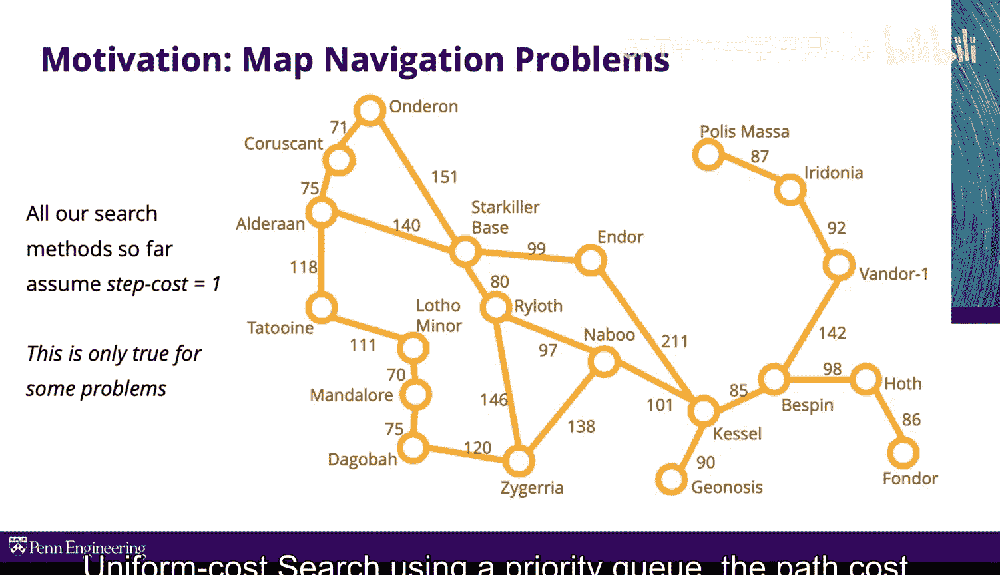
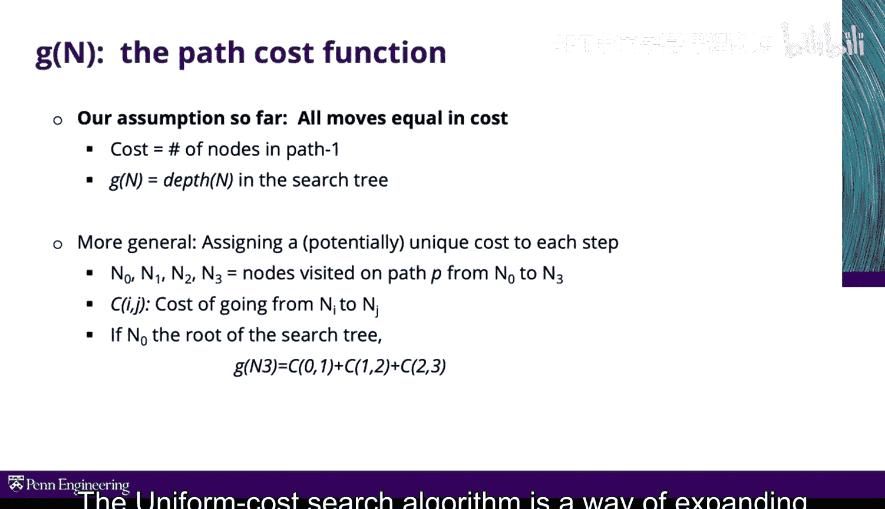
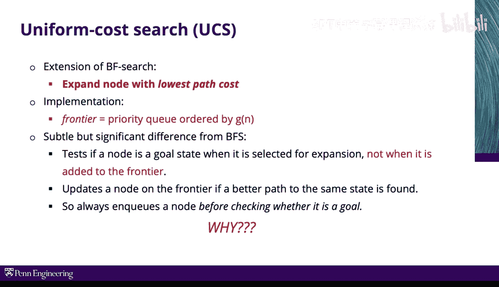
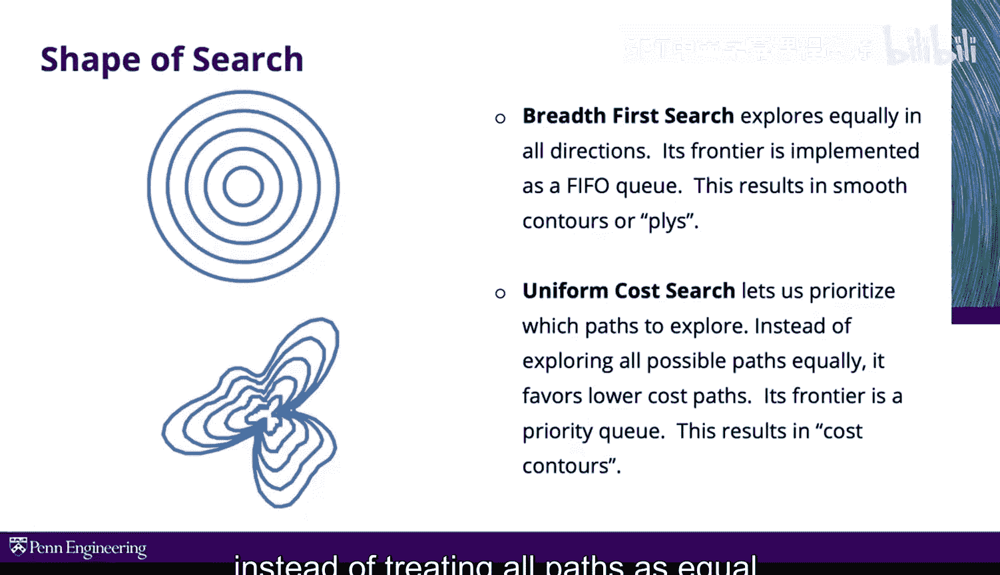
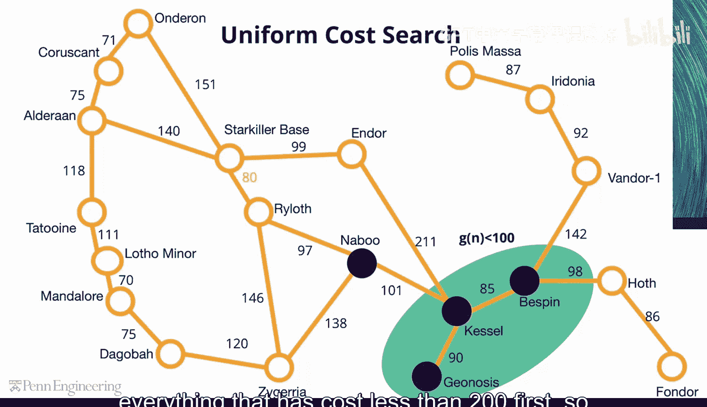
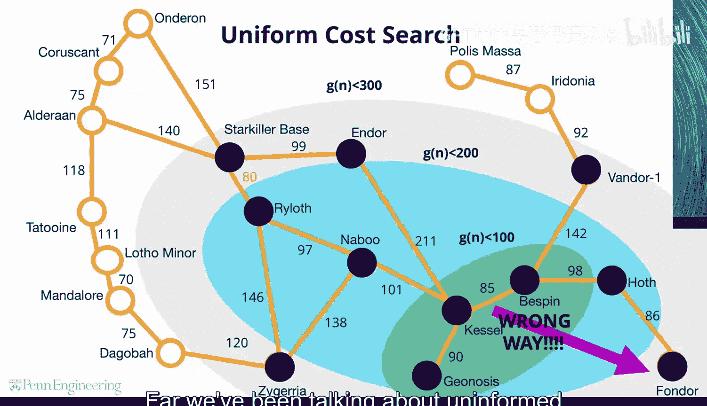

# 宾夕法尼亚大学《人工智能和机器学习基础（AI、数据科学、机器学习）AI and Machine Learning Essentials with Python》 p30 30_04_01_一致代价搜索.zh_en -BV16f421Q72q_p30-

The next uninformed search algorithm is called Uni cost search。

This actually wins my prize for the worst named algorithm or the most confusingly named algorithm。

 I hear uniform cost search。 I want to say， oh， that means the cost taking each action is uniform but that's not what it means at all。

 In fact， it means exactly the opposite of that， moving away from a unit cost like we had in breadth first search or depth first search instead what we're going to do is we're going to take into account the edge weights a uniform cost search is a search tree algorithm used for weighted graphs when we have this map of the universe and we know the distance to an adjacent planet that we're going to take that distance into account in。

Of this uniform cost search algorithm。So the motivation for this is exactly those kinds of map navigation problems instead of its step cost as going to just being all equal。

 we're going to allow a much more general algorithm so now we're going to say for problems where we care about the cost of an action and that can be either the time to travel from one place to another or the distance that we have to travel。

 those are now going to be incorporated into this algorithm。

That brings up an important concept that we use to implement uniform cost search using a priority queue the path cost throughout this we're going to talk about the path cost as a function of G of n the path cost is going to be how much does it cost to reach this particular node from the initial node on our search for depth for search and breadth first search we can just measure G of n as the number of nodes that we've expanded to get to the current one。

 but more generally we're going to say path cost is going to be the sum of transitioning from each nodes to its successor nodes in order to get here the summation of the cost of going traversing each action to get from one node to another it's a simple additive thing so that means assuming all of our costs are positive which is required for many search algorithms that this is going to be a monitor。

number as we expand the path， the G of n is also going to increase。

The uniform costt search algorithm。Is a way of expanding the search space similar to breath for search。

 But instead of taking the least deep node， we're going to expand the node with the lowest path cost instead of using。

A PIO Q in Bth first search， you're going to use a priority queue。

 Each new node that you add into your priority queue is going to have an associated cost。

 It's going to be geovada path cost to get to that node。

 and you just simply remove the one with the lowest current path cost。

There's a slightly different thing going on between BFS and UCS。The time of test。

 whether a node has reached the goal state is when it's selected for expansion in Uni Cot search。

 whereas in Bret's first search， it's going to be when you add it to the frontier。

When you're doing the breathth first search， you know you're guaranteed to have the lowest cost。

 but when you're doing uniform cost search， there can be two ways of reaching that same node。

 there can be one on the queue still that's less costly。

One of the interesting things about search is you can visualize the shape of the search This is actually where uniform cost search gets its name。

 the shape of the search is going to be drawing a map of equivalentence classes it uniformly expands the shape of the search based on the cost all nodes that are in an equivalentence class。

 meaning less than are equal to a cost of 100 are going to follow in one of these contour things in breadth for search we have this concentric search shape start in the middle at the initial state and we're going to expand outwards in this uniformly growing way。

Uniform Co Search have a different topology there's different outline at the map。

But keep all of the nodes that have similar distances together in a one ply and then all the other ones that are equivalent distance in another ply and gradually going outward。

 the inner ones in our topology here are going to be the ones with the least cost and it's going to gradually add ones with greater and greater cost and so it gives us a way of prioritizing paths to explore instead of treating all paths as equal。

 it's going to favor the lower cost。Let's just take a look at what it looks like。 So here I've drawn。

The mapping of the universe again， we're going to start in Kesel and try to get to Alderron can expand the nodes based on。

What the least cost is from Kesel， which nodede would I expand next？It's gonna be。

Best Ben and then Genus。And then， Mabu。And then as I continue to expand。

 I'll search everything that has cost less than 200 first。

 so everything within this blue ring are ones that had path costs of less than 200。

And then everything in the gray ring will be path cost less than 300 that's the order of expansion the idea of the uniform cost search is instead of expanding things that are immediately adjacent first will' expand things with least cost first。

ButWhat's wrong with us， one thing that's wrong with this is what we might know something about the shape of the galaxy。

 but we might say， why are we even considering path that go towards Fora。

 when we know that our goal lies in exactly the opposite direction。

 Why do we even bother going in this direction。😔，But that idea gives rise to our first informed search strategy okay。

 far we've been talking about uninformed search and the information that we're adding here is we know the direction that our goal lies in。

