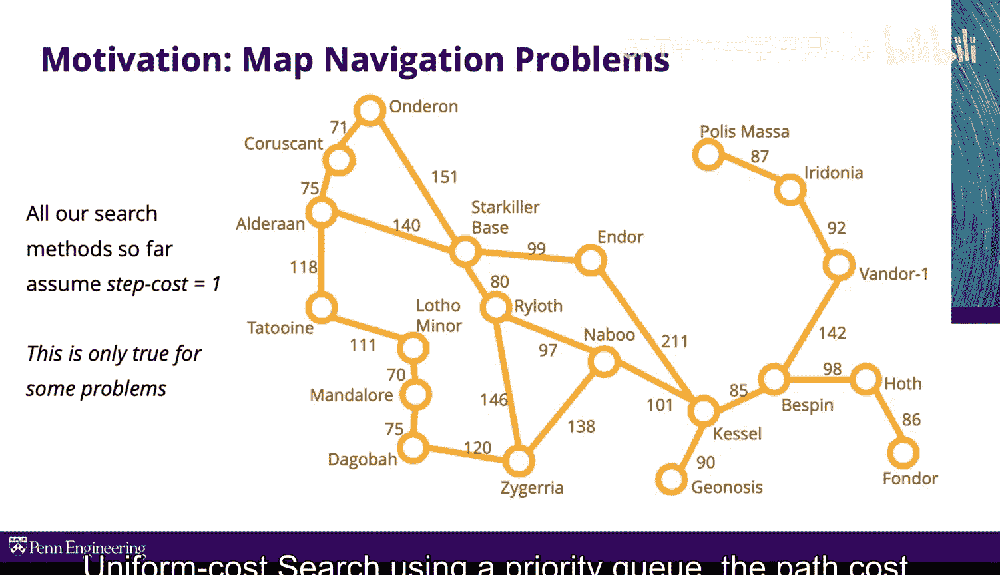
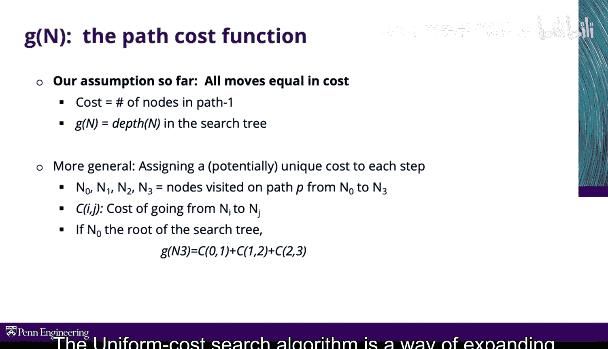
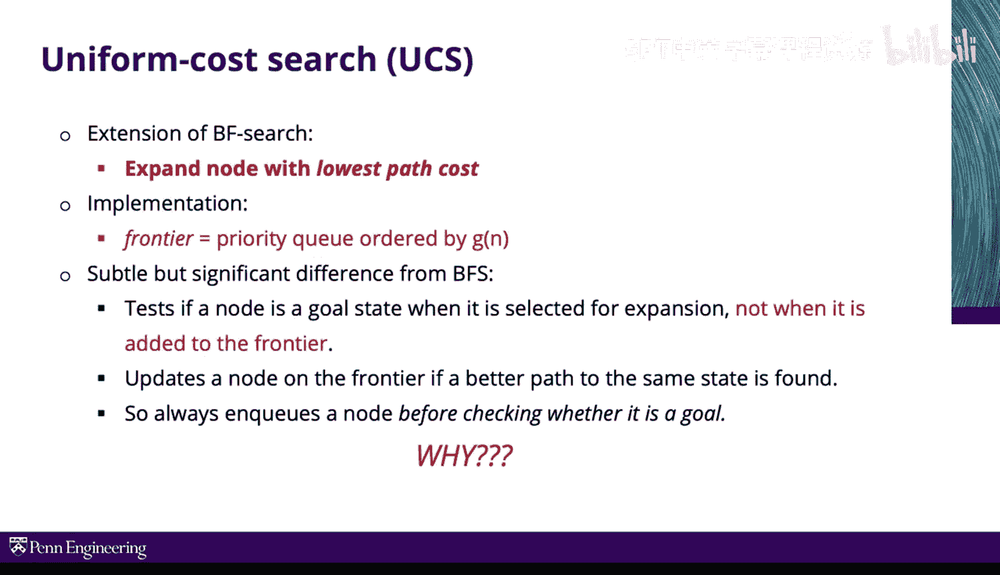
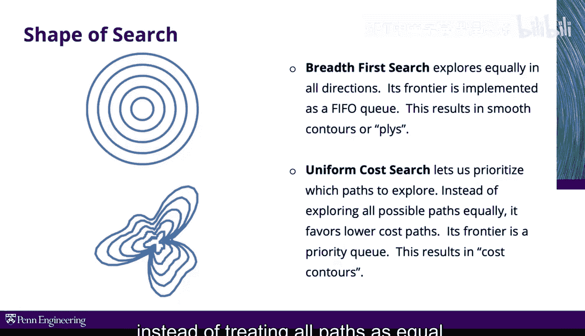
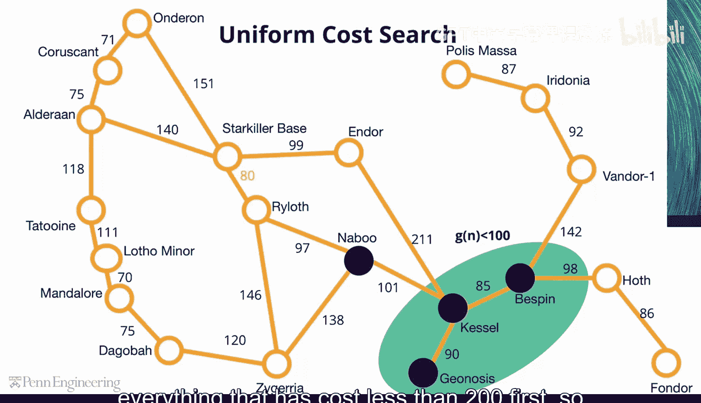
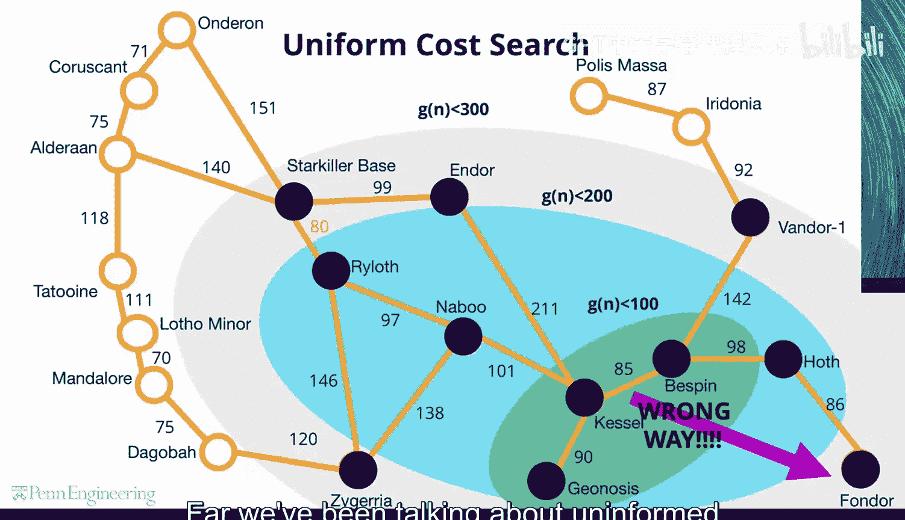

# 人工智能和机器学习基础：30：一致代价搜索 (Uniform Cost Search) 🧭

在本节课中，我们将要学习一种新的无信息搜索算法——一致代价搜索。我们将了解它如何考虑行动的成本，以及它与广度优先搜索的区别。

---

上一节我们介绍了广度优先搜索和深度优先搜索，它们都假设每一步的成本是相同的。但在现实问题中，例如星际旅行，从一个星球到另一个星球的距离或时间成本是不同的。本节中，我们来看看如何将这种成本因素纳入搜索过程。

一致代价搜索是一种用于加权图的搜索树算法。当我们有一张宇宙地图，并且知道前往相邻星球的距离时，这个算法就会将这些距离成本考虑在内。

其动机正是为了解决这类地图导航问题。我们不再假设所有步骤的成本都相等，而是允许一个更通用的算法。现在，对于关心行动成本的问题（无论是从一个地方到另一个地方的旅行时间还是距离），这些成本都将被整合到算法中。

这引出了一个重要的概念：我们使用**优先队列**来实现一致代价搜索。在整个过程中，我们将路径成本定义为函数 **g(n)**。路径成本是指从初始节点到达当前特定节点需要多少成本。对于深度优先搜索和广度优先搜索，我们可以简单地将 **g(n)** 视为为到达当前节点所扩展的节点数量。但更一般地说，路径成本将是为了到达这里，从一个节点转换到其后继节点的成本总和。它是遍历每个行动以从一个节点到另一个节点的成本之和，这是一个简单的加法过程。这意味着，假设我们所有的成本都是正数（这是许多搜索算法的要求），那么随着路径的扩展，**g(n)** 也会单调增加。

---

一致代价搜索算法是一种扩展搜索空间的方式，类似于广度优先搜索。但它不是扩展深度最浅的节点，而是扩展**路径成本最低**的节点。在广度优先搜索中，我们使用先进先出队列，而在一致代价搜索中，你将使用一个**优先队列**。你添加到优先队列中的每个新节点都会有一个相关的成本，即到达该节点的路径成本 **g(n)**，然后你只需简单地移除当前路径成本最低的那个节点。

广度优先搜索和一致代价搜索之间有一个细微的区别：**测试节点是否达到目标状态的时机**。在一致代价搜索中，是在节点被**选择进行扩展**时进行测试；而在广度优先搜索中，是在你将其**添加到边界**时进行测试。在进行广度优先搜索时，你保证拥有最低成本；但在进行一致代价搜索时，可能有多种方式到达同一个节点，队列中可能仍然存在成本更低的一条路径。

---

关于搜索的一个有趣之处在于，你可以可视化搜索的形状。这实际上是一致代价搜索得名的原因。搜索的形状将绘制出一张等价类的“地图”，它根据成本均匀地扩展搜索的形状。所有处于等价类中的节点（即成本小于或等于100的节点）将遵循这些等高线之一。在广度优先搜索中，我们有这种同心圆状的搜索形状，从中间初始状态开始，以这种均匀增长的方式向外扩展。一致代价搜索则具有不同的拓扑结构，地图上有不同的轮廓线。它将所有具有相似距离的节点保持在同一“层”中，然后将所有其他具有等效距离的节点放在另一层，并逐渐向外扩展。在我们的拓扑结构中，内部的节点将是成本最低的节点，并逐渐添加成本越来越高的节点。因此，它为我们提供了一种优先探索路径的方式，而不是将所有路径视为平等，它会优先考虑成本较低的路径。

让我们看看它是什么样子的。这里我再次绘制了宇宙地图。我们将从凯瑟尔出发，试图到达奥德朗。根据从凯瑟尔出发的最低成本来扩展节点，下一个应该扩展哪个节点？它将是贝斯本，然后是杰纳斯，接着是马布。随着我继续扩展，我将首先搜索所有成本低于200的节点，所以蓝色环内的所有节点都是路径成本低于200的节点。然后，灰色环内的所有节点将是路径成本低于300的节点，这就是扩展的顺序。一致代价搜索的理念是，不是先扩展直接相邻的节点，而是先扩展成本最低的节点。

---

但是，一致代价搜索有什么问题呢？其中一个问题是，我们可能对星系的形状有所了解，我们可能会问：当我们知道目标正好在相反方向时，为什么我们甚至要考虑前往福拉方向的路径？我们为什么要费心朝这个方向走呢？这个想法引出了我们的第一个**有信息搜索策略**。到目前为止，我们一直在讨论无信息搜索，而我们在这里添加的信息是：我们知道目标所在的方向。

---

本节课中我们一起学习了一致代价搜索算法。我们了解到，它是一种考虑行动成本的搜索方法，使用路径成本函数 **g(n)** 和优先队列来选择下一个扩展的节点。与广度优先搜索不同，它在节点被弹出队列进行扩展时才检查目标状态。我们还看到了算法如何根据成本均匀地扩展搜索空间，形成成本等高线。最后，我们指出了它的一个潜在缺点——可能探索远离目标的方向，这为引入利用额外信息（如目标方向）的启发式搜索策略做好了铺垫。