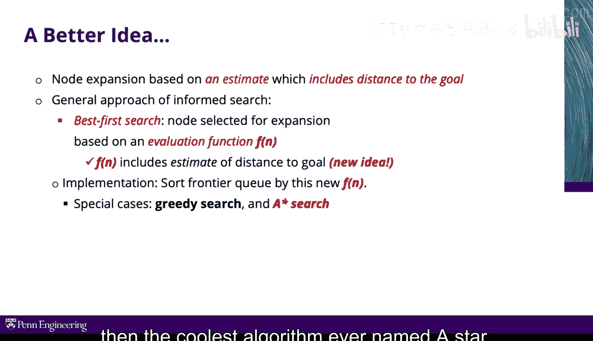
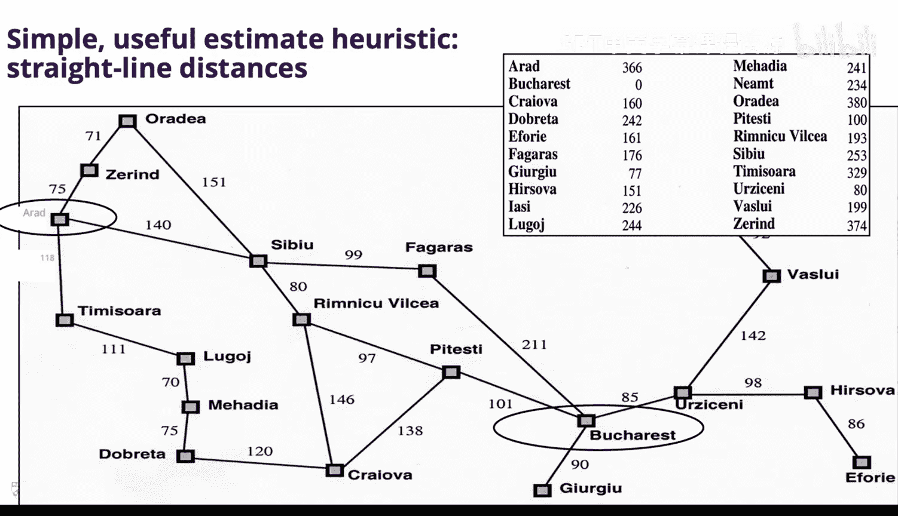
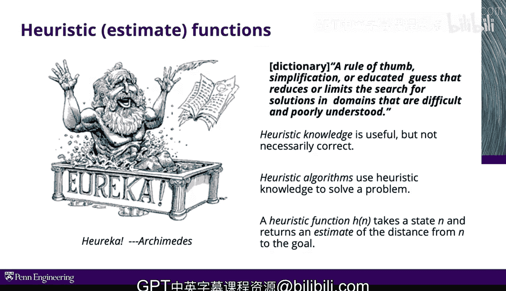

# 宾夕法尼亚大学《人工智能和机器学习基础（AI、数据科学、机器学习）AI and Machine Learning Essentials with Python》 p31 31_04_02_启发函数.zh_en -BV16f421Q72q_p31-

In our informed search strategies is also going to include an estimate which includes the distance to the goal。

We're going to look at two informed strict strategies， one called best first strategy。

 we're going to use this estimate of the distance to the goal to totally run how to explore based on an evaluation function。

The different functions describe in this section of the course are。The path cost， G of N。

 this evaluation function， F of n， and then another one H of n， which will be our heuristic function。

For best first search， S of N。Is just going to be a direct estimate of the distance to the goal。

 It's going to be the surest that we use。We're going to look at greedy search and then the coolest algorithm ever named A star。

 What are we going to use as our information， we're going to have a table of distances I this going to give us the exact distances The answer here is no because that is what we would have to compute using a search algorithm instead this is going to give us a heuristic distance This is going to be an approximation of how far we might have to travel here。

 we're going to use an approximation called straight line distance we're just going to say what's the straight line distance ignoring any intermediate points between each of these things arod to Bucharest the straight line distance is 366 kilometers importantly。

Is the skin？Underest of the true distance that we would have to travel along roads to get to a rod。

 the way that this number is calculated called straight line distance in English。

 there's this funny idiom as the crow flies， meaning if I didn't have to take streets to get to the university。

 I could just fly over。Maybe for this class， it should be as the droneone flies。

 if I could just fly there rather than taking streets， that's the straight line distance。

 So if you just headed exactly in that direction to get to Bucharest。

 that's the straight line distance。 So that's what you see in this chart。

 This is going to be an underest of the true cost for traveling along a path。

 This is going be a good reasonable guess at what the lower bound on the true path cost will be the straight line distance is what's called a heuristic estimate。

 Heuristic。

Comes from the Greek word Kiureka and it means that it's a rule of thumb or a simplification or an educated guess The reason that it's useful is that simplification is going to reduce the space for possible solutions and Christ you don't know the story the cartoon here shows Archimedes in the bathtub。

 the idea was he was tasked by the king of creep to measure。The volume of the king's crown。

 The king wanted to know how much gold is in my crown。

To solve that you don't want to actually melt the crown down and measure the cubic volume of the gold contained in the crown because that would destroy the crown It's a complex shape。

 it's really hard to estimate geometrically what the volume of gold in that neatly shaped crown is the story is that Archimedes was thinking about this problem so deeply that he let his bath fill all the way to the edge and when he got into the bath he saw the water。

Flowing over the edge realized like the volume of my body displaces an equivalent volume of water。

 the rule of thumb， the heuristic that they would use would be to just place the king's crown in a volume of water and measures the displacement and that could tell them what the cubic volume of gold was as he jumped into the bath or as he realized this he yell Eureka found it and ran down the streets totally naked。

 That's the story Anyway， This idea of having a heuristic。

 a rule of thumb that is going to be a good estimate， but not necessarily a correct one。

A heuristic algorithm is something that takes reasonable approximations into account in order to find a solution more quickly。

 a heuristic function designate with H of N， and that's going to take any given state in the state graph。

It's going to return an estimate。Of the distance from that state to the goal。

The key here is an estimate， we don't know the true distance to the goal or we don't have to precompute the true distance to the goal if someone gives us heuristic estimates。

 then that will allow us to take a shortcut instead of having to compute everything as to completion in a search problem。

