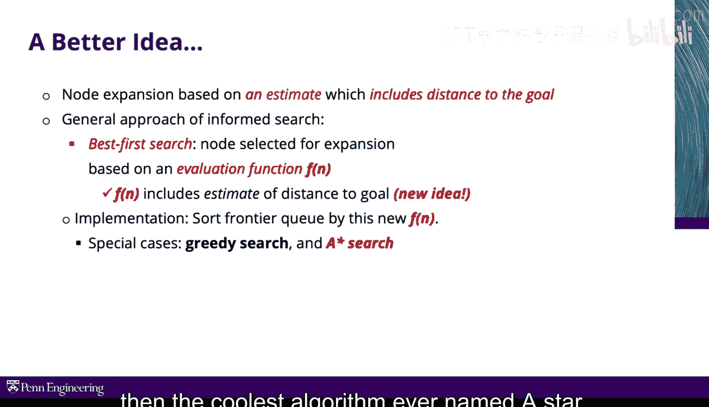
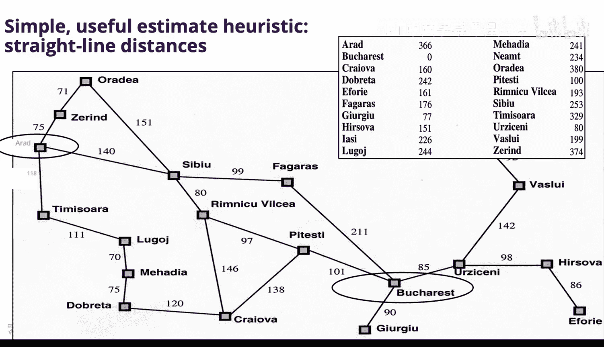
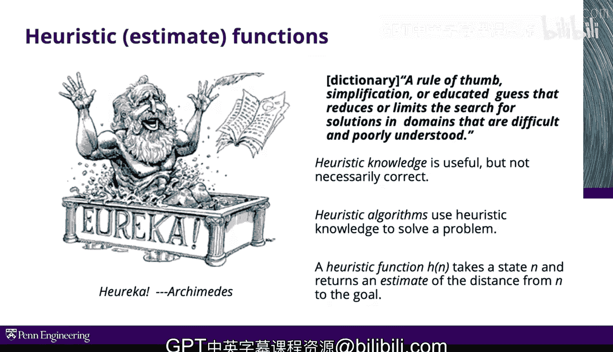

# 人工智能和机器学习基础：31：启发函数 🧠

在本节课中，我们将要学习启发式搜索策略。与无信息搜索不同，启发式搜索会利用一个估计值，这个估计值包含了当前状态到目标状态的距离信息。我们将探讨两种启发式搜索策略：最佳优先搜索和A*搜索，并理解启发函数的核心作用。

上一节我们介绍了无信息搜索，本节中我们来看看如何利用额外信息来更高效地搜索。

## 启发式搜索与评估函数

在启发式搜索策略中，除了路径本身，我们还会包含一个对到目标距离的估计值。我们将研究两种启发式搜索策略，其中一种称为最佳优先搜索策略。我们将利用这个到目标的距离估计值，完全基于一个评估函数来决定如何探索。

本课程这部分将描述几个不同的函数：

*   **路径成本函数**：`G(n)`。它表示从起始节点到当前节点 `n` 的实际累积成本。
*   **评估函数**：`F(n)`。它用于评估节点 `n` 的优先级。
*   **启发函数**：`H(n)`。这将是我们使用的启发函数，它估计从节点 `n` 到目标节点的成本。

对于最佳优先搜索，其评估函数 `F(n)` 将直接采用对到目标距离的估计值 `H(n)`。这个估计值将是我们使用的核心信息。

接下来，我们将看看贪心搜索，以及有史以来最酷的算法之一——A*搜索。

## 启发信息：直线距离

我们将使用什么作为我们的启发信息呢？我们会使用一个距离表。这个表会给我们精确的距离吗？答案是否定的，因为如果我们需要精确距离，就必须通过搜索算法来计算。相反，这个表提供给我们的是一个启发式距离。

这是一个近似值，表示我们可能需要行进多远。在这里，我们将使用一种称为**直线距离**的近似方法。我们只需计算两点之间的直线距离，忽略中间的任何路径。例如，从Arad到Bucharest的直线距离是366公里。

关键点在于，这个距离**低估**了沿着道路实际到达目标所需的真实距离。这种计算距离的方式在英语中被称为“直线距离”，有一个有趣的习语叫“as the crow flies”（乌鸦飞行的路线），意思是如果我不需要走街道去大学，我可以直接飞过去。也许对于这门课，应该叫“as the drone flies”（无人机飞行的路线）。如果我能直接飞过去，而不是走街道，那就是直线距离。所以，如果你直接朝那个方向前往Bucharest，那就是直线距离。这就是你在图表中看到的。

这将是对沿着路径行进真实成本的一个低估。这是一个合理的猜测，可以作为真实路径成本的下界。直线距离被称为**启发式估计**。

## 启发式的含义与起源

“启发式”一词来源于希腊语“Eureka”，意思是经验法则、简化或是有根据的猜测。

它之所以有用，是因为这种简化将减少可能解决方案的搜索空间。你可能知道这个故事：漫画中展示了阿基米德在浴缸里。故事是这样的，克里特国王交给他一个任务，测量国王王冠的体积。国王想知道：“我的王冠里有多少黄金？”

要解决这个问题，你并不想真的熔化王冠来测量其中黄金的体积，因为那样会毁掉王冠。王冠形状复杂，很难从几何上精确估算黄金的体积。故事说，阿基米德非常深入地思考这个问题，以至于让浴缸的水满到边缘。当他进入浴缸时，看到水溢出来，意识到：“我身体的体积排开了等体积的水。”他们可以使用的经验法则（启发式方法）就是将国王的王冠放入水中，测量排水量，这就能告诉他们黄金的体积。当他跳进浴缸或意识到这一点时，他大喊“Eureka！”（我找到了！）然后赤身裸体地跑上街头。这就是那个故事。

总之，**启发式**就是一个经验法则，它是一个很好的估计，但不一定是绝对正确的。启发式算法会考虑合理的近似值，以便更快地找到解决方案。

## 启发函数 H(n)

一个启发函数用 `H(n)` 表示，它接受状态图中的任何给定状态 `n`，并返回一个从该状态到目标状态距离的**估计值**。

这里的**关键**在于这是一个“估计值”。我们不知道到目标的真实距离，或者我们不需要预先计算到目标的真实距离。如果有人给我们启发式估计值，那么这将允许我们走捷径，而不必在搜索问题中计算所有可能的路径直到完成。

---

本节课中我们一起学习了启发式搜索的核心概念。我们了解到启发函数 `H(n)` 是对从当前节点到目标节点成本的估计，它通常设计为真实成本的下界（如直线距离）。我们探讨了启发式的含义，它源于“Eureka”，代表一种简化问题、加速求解的经验法则。最后，我们明确了启发函数的作用：通过提供有根据的猜测来引导搜索方向，避免穷举，从而更高效地找到解决方案。