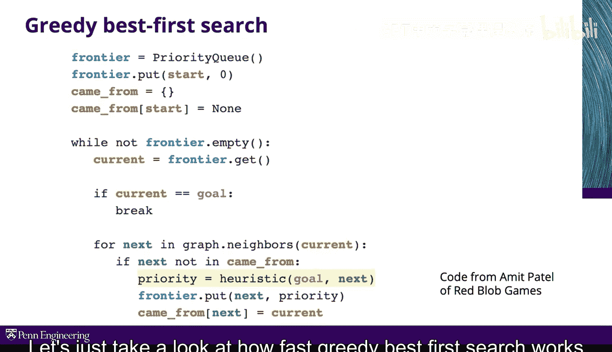
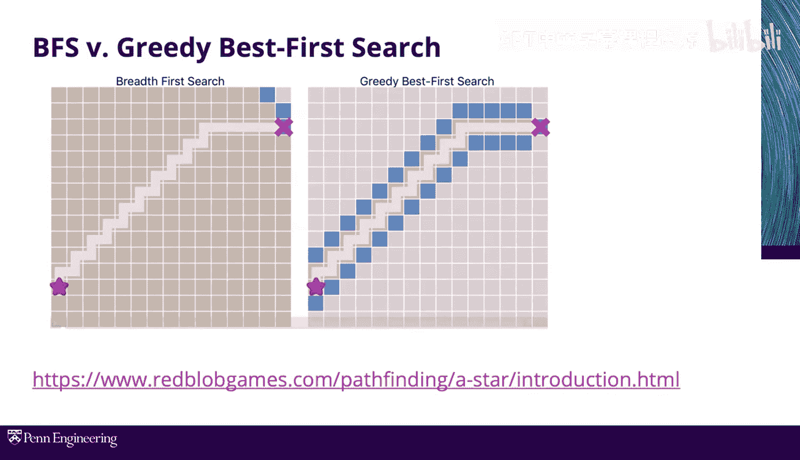
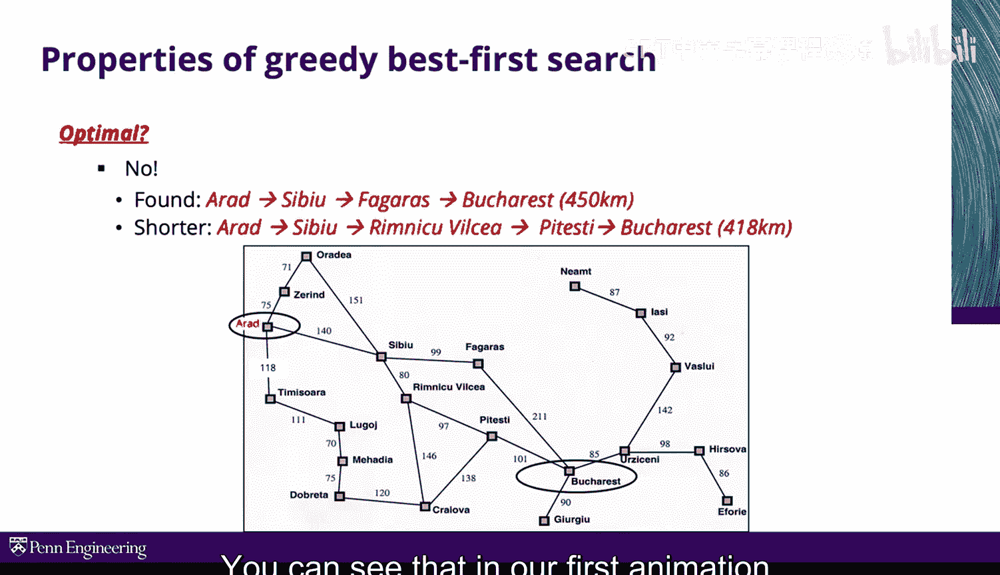
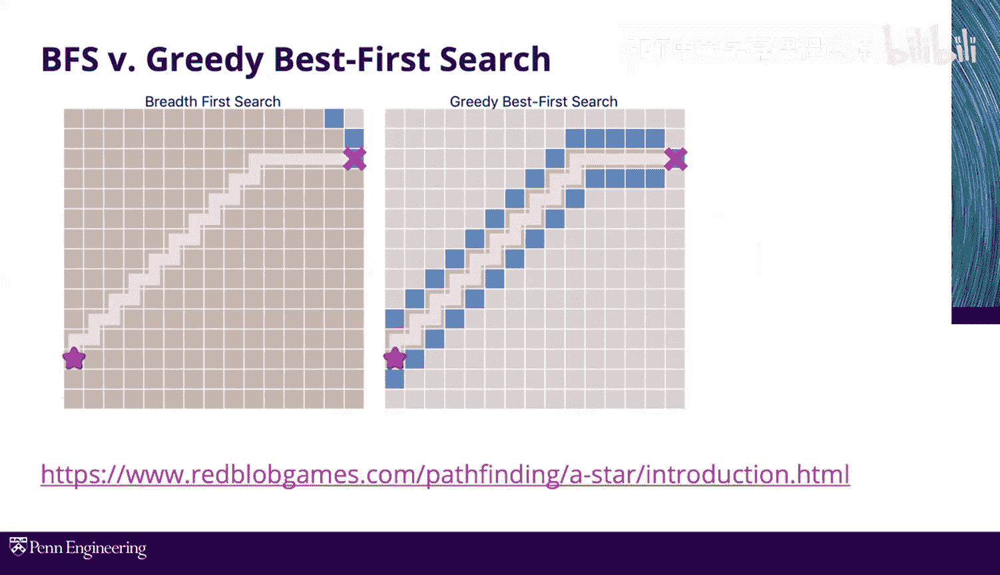
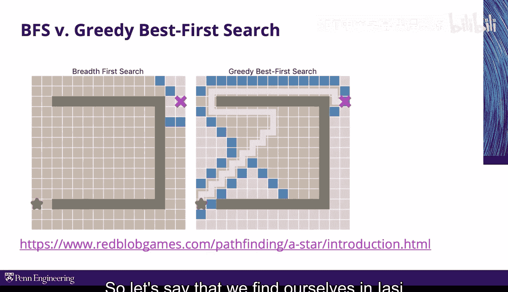
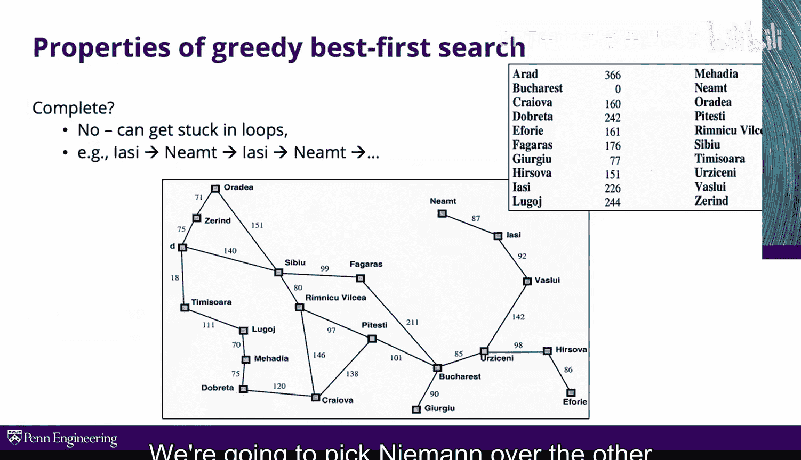
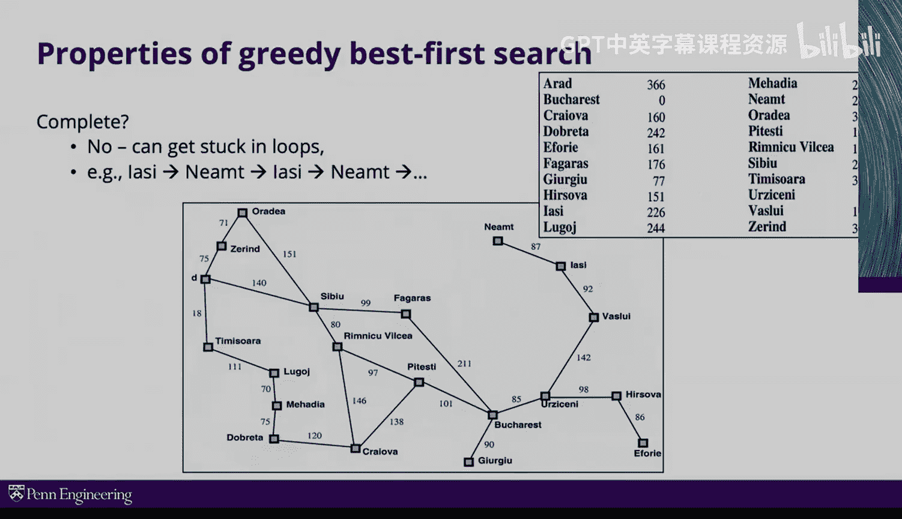

# 宾夕法尼亚大学《人工智能和机器学习基础（AI、数据科学、机器学习）AI and Machine Learning Essentials with Python》 p32 32_04_01_贪婪最佳优先搜索.zh_en -BV16f421Q72q_p32-

The first search algorithm that we're going to take a look at is called greedy。Best first search。

The idea of best for search is we're going to just pick a node for expansion。

 the one that has the lowest。Cost。We're going to have a function F of N that's going to incorporates some heuristic knowledge in our informed search algorithms。

 and that heuristic knowledge is our estimate of the remaining distance to the goal when we're doing a best first search。

 we're going to implement the frontier using a priority queue。

That priority queue is going to contain all the nodes that we can expand at the moment and sort them based on their cost with our uniform cost search。

F of N was simply replaced with the path cost， it was the total cost up until this point。

With our greedy best first search， we're going to expand the priority queued with F of n。

 not by saying f of n equals g of n。But we're going to say F of n equals pururistic estimate of the remaining distance to the goal。

But it's going to expand a node。Based on what it estimates is the closest node to the goal。

 So this is going to completely ignore the path cost and just use our heuristic estimates。

What if our estimate is wildly off that's actually mean that we're going to be in trouble the true cost can be lower than path cost that we incur if we use this greedy best for a search。

If we're doing our map navigation task， the heuristic estimate of the remaining distance from n to the Gulf state just be the straight line distance。

 a grid， we can compute the distance using Manhattan distance。

 absolute distance of these coordinates， along the X axis and a y axis。

The how do we implement greedy best first search here it is just a few lines of Python。

 we're going to create our frontier as a priority queue， we're going to stick our start state on it。

And keep track of where we came from as a way of keeping track of the path。

 while our frontier isn't empty， pop the first thing off of our priority queue。

If it's the goal state， we're done， if not。Then iterate through all of the adjacent things in the graph。

 expand the current node by looking at what actions we can take from it。

If it's not in ones that we already visited， set the priority of this next thing to be the heuristic estimate。

Of it to the goal。This will be the straight line distance highlighted in yellow here。

Now put this next node onto our frontier priority queue and we assign it priority equal to that heuristic estimate of the remaining distance to the goal。

 and then we're going to track where we came from how do we get from the current state to this next state and that's going to allow us to reconstruct the path。

This is the greedy best first search implemented in Python let's just take a look at how fast greedy best first search works compared to breath first search this is from tutorial and A star algorithm by someone who did his PhD in computer science in algorithms and has a very entertaining set of tutorials about how to implement games。

 the idea is you can use pathfinding for a lot of artificial intelligence within games。

I totally recommend checking out red blob games as a good resource for understanding algorithms in entertaining way on the left we will see breath first search and we'll see from the start state the blob well see these tiles get illuminated as it's expanding them and the goal is get to the X。

And on the right here we'll see the greedy best first search。

 the breadth first search is using just the path cost so far and choosing the minimum one to expand next greedy best first search is going to use the heuristic estimate to the goal Manhattan distance。

Greedy best first search was done， but you can see that it's just making a total B lime to the goal。

Boom。Go so fast we hardly even see the animation， the darker squares are the ones that BFS had to consider。

And the light gray ones are ones that it didn't consider because it reached the goal before it saw it。

 the blue ones were never expanded it expands things in order of closeness to the goal based on its heuristic estimate of the remaining distance So in this case with totally open field it's great it just goes zoom street to the goal。

Let's see how well it would work in our map navigation。

Let's say we start with start with Ar rod and then we're going to expand a rod and we're going to get the three adjacent cities that are connected to it on the graph we have Subbuu。

 timara and Zurin each of these is now going to have a cost associated with it These three are going to be the things on our frontier。

And we're going to sort it based on the heuristic cost of the straight line distance there。

 we just look them up on this chart， this gives us all straight line distances。

 so we look up subbu you。And that says the straight line distance is 253 Chimaura is going to be 329 and zeroend is going to be 374 we're going to stick those three cities on the frontier queue。

And sort them based on this distance and then pop the one with the lowest distance remaining based on our estimate is going to be closest to。

Buchcharest， explore that one first。We're going to pop the one with the lowest cost because it's our priority queue。

 we're going to expand Subbuu and then we're going to look up the straight line distances from each of these cities from Subbuu we could go back to a rod。

The distance from Arrad to Bucharest is 366 from Subbuya， we could also go to Fogarros。

 So Fogars has a straight line distance to Bucharest of 176， or we could go to Orandia。

 which has a straight line distance of 380 or we could go to。Which has a straight line distance of。

193 all these are on our frontier。And then we're going to sort that frontier again and pick the one with the lowest cost。

 So on the first step， we picked Subbuu because that was the lowest cost of the three。

Now we've got six things on our queue， the lowest Cus one here is Fogras we'll expand this node in the search tree and look at all the actions that we can take from Fogras。

 which will be all the adjacent cities and so from Fogras we could go back to Sibuu or we can hit Bucharest and so we stick Bucharest on the frontier queue and then we found our Gulf state now we have a path from Arrod to Bucharest so the path is Arrod to Sibuu to Bucharest is it optimal。

And the answer is no， the path that we found has a total path cost of 450。

 but there exists a shorter path， this greedy best first search algorithm isn't guaranteed to return the lowest cost path first。

 it's not optimal。You can see that in our first animation， it found a shortest path。

 but if there are obstacles in the way。

And we don't necessarily find the shortest a path。 This shows what path the greedy best first search would return to get from。

The red glloob to the Ga state of the X。You can see it like is trying to minimize the distance because here it's looking good。

And then it's going to go up， whereas the it would be more efficient just to go straight up and straight over。

But those things were never explored by this algorithm。

All these light gray things on the left hand side were never expanded by our greedy best first search algorithm。

 going straight up and straight over。Is a shorter path。

But it's never even considered by the G Best first search algorithm and because of that it's not optimal。

Is it complete， Is it guaranteed to find a solution。If one exists， we can get stuck in loops。

Let's say that we find ourselves in。Yasi and then from Yaassi， we could either go to。Leu。😔，Ornemic。

We're going to pick nement over。

The other one because it has a lower straight line distance。

