# 宾夕法尼亚大学《人工智能和机器学习基础（AI、数据科学、机器学习）AI and Machine Learning Essentials with Python》 p33 33_04_02_A搜索-I.zh_en -BV16f421Q72q_p33-

Here's a cool algorithm that is our a star algorithm。When I was an undergrad。

 I took a class on artificial intelligence from the inventor of this algorithm。Nils Nelson。

 he told us all why it's called a star。A， because it's an algorithm， star because it's neat。

It's a good one， Dick it's a star。 A star is probably the best known of the best first search algorithms。

 It's got some super cool properties that guarantees it can behave optimally。

 the key idea of a star is we want to frune out paths that are already known to be expensive but still keep expanding the most promising ones first。

 far we've only looked at best first search algorithms that where F of n equals either the path cost or the heuristic cost when F of n equals G of n。

Were implementing。Uniform cost search。 When F of n equals H of n。

 we're implementing greedy best first search。 When F of n equals G of n plus H of n， then。

We're implementing a star。But， we need。Something special about each of event in order for it to be a true A star search。

Again， implement the frontier as a priority queue and pull them off based on the minimum F the key concept in what we need to be true of H of n in order for a star to work is the heuristic has to be admissible The thing for the definition of admissible is H of n is never overestimate the cost to the true cost to reach the goal from any node another way of saying that is that's going to be optimistic it's going to always underestimate or be equal to the true distance to the goal。

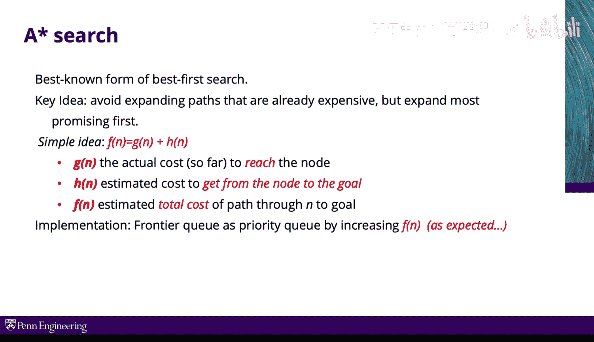

Formerly， we can say each star is gonna equals at true distance from n to the goal。

 An admissible heuristic is always going to be less than or equal to the true distance to the goal。

 When we're at the goal， the heuristic。Has to be。Equal to0。

 So one example of admissible heuristic is the straight line distance that we've already seen。

 It's never going to overestimate the actual road distance to the goal。

If we have an admissible heuristic。Then the A star search is going to be optimal。

 Let's take a look at another one of the animations from red Blo James。

 The numbers are the order in which each of these nodes got expanded。

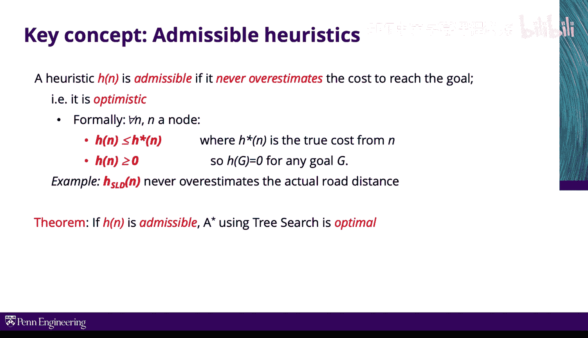

The greedy best first search is not optimal because it never explores the true lowest cost。

 On the rate， we have the true a star finding the true lowest cost。

It does expand more nodes than Green you best first search。

 but you're guaranteed to always find the shortest path to the goal first。

 So it's optimal if you've got an admissible heuristic。

The idea behind admissibility is it's going to be an optimistic amount remaining。

 It's going to slow down plans that are bad， but it's never going to outweigh。

The true cost to the goal。When we're talking about inadmissible heuristics。

 you might see a partial path to the goal。 and you look the remaining distance is too far。

 That'll question it too far down in the priority queue to ever be expanded。

As long as your true cost remaining is always less then you're guaranteed to get expanded in the correct order。

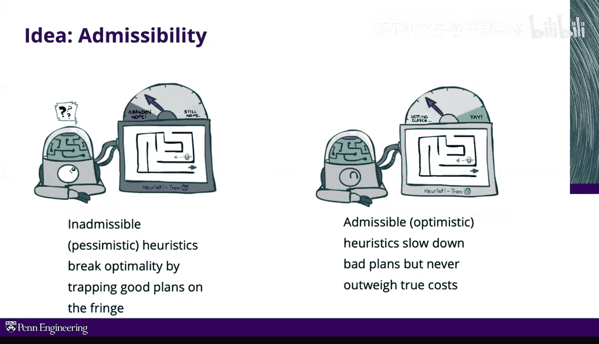

Let's take a a look at how it's working for our Romanian map example。 We've got our frontier ti here。

 We've got a rod。 Our priority is going to be assigned as。The path cost plus the heuristic cost。

 but path cost from a rod。Its going to be zero because we haven't traveled it any anywhere。

 and then the heuristic estimate from Ar rod to Bucharest is going to be the straight line distance。

We're going to add the three neighbors of a rod to our priority queue。 After we expand a rod。

 Each of those is now going to have this composite cost。 It's going to be。

The actual cost of having traveled down the road from the rod to Sebuu is going to be1 hundred and 40 km are underestimate or admissible heuristic of the straight line distance is going to say theres at least 253 km remaining。

 We've already traveled 140。 We add 253。 Then we get 393 as the F of N for Subbiu。

Similar for Timaora， like we've traveled 118 km， The straight line distance to Bucharest is 293。

 F of N is 447。Now we've got different values on our priority cube， and so we'll expand subbuu。

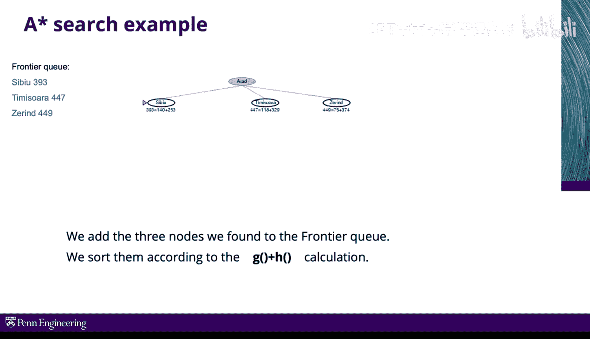

Again， we could add a rod in there。And one of the cool things is。

We don't explicitly have to throw it out of the grass。

 We don't have to remember that we've already been to arod， because we have a path cost。

 We know that expanding arod， in this instance。Is the path from Arrod to Sibuu to Arrod again。

 instead instead of just a hundred and 40 to get to arod to Subbuu。

 It's going to be another1 hundred and 40 to get back to Arrod。

 This one is going to get way down into the priority queue。So we'll never end up going back to it。

If we wanted， we could trim it from the priority queue， but we don't have to。

 it's going to get pushed down so far in the priority queue that we never do。

We're going to pop again the thing with the lowest F of x。

 the lowest combination of the path cost plus the heuristic cost。

 the path cost from arod to CbuU to RB here is 220 plus the straight line distance from RV to Bucharest。

 which is 193， thatll be our first thing to expand。Then we're going to have several other choices。

 The top one in our priority two is going to be fogs。 We're going to expand that one。And then。

We do see Bucharest in our lists， but it's not the top of our lists。Can we return this path？No。

 even though we see Bucharest and it's a goal state， we have to add it to the frontier Q。

 and we have to expand everything before it。In order to validate that this is indeed the shortest path。

To Bucharest， that was the mistake that we made earlier。 We found Ar rad Subbuu Fagos Bucharest。

 and we just returned it。Because greedy best for search， the remaining distance to our goal was 0。

 That's the top of ourque。 Now we have to expand these three nodes。

 at least before we determine whether this path， the Bucharest is the lowest cost one。

We'll start expanding Pteti and from Pteti， we reach Bucharest。

 we now have Bucharest as the lowest cost thing on our Frenchier queue。

 and now we know we've found the lowest cost path to Bucharest。That's going to be the optimal。

That's an example of how we use a star search for map typing with an example function。

Of the straight line distance， let's take at some ideas of other types of heuristic functions。

 a different type of problem that we're also going to still formulate as in search problem is the8 puzzle。

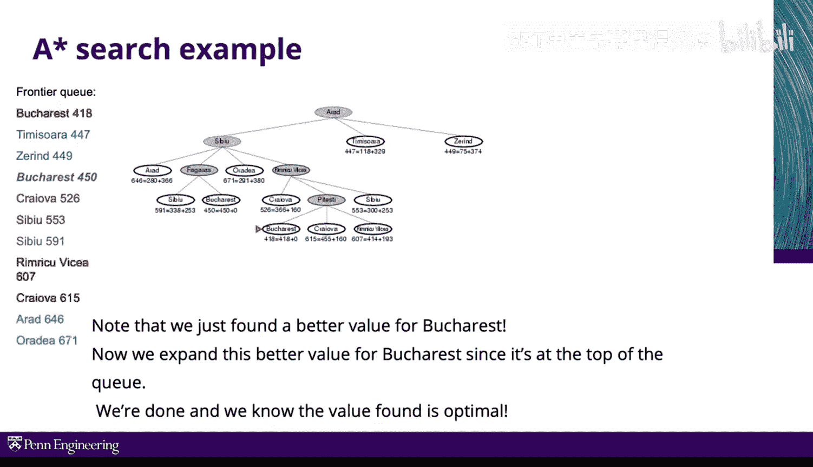

The branching factor here is going to be。Not too big， but the average solution costs about 22 steps。

How many steps does a good heuristic function reduce the search process？

We're going to look at two different ones that we could do one。

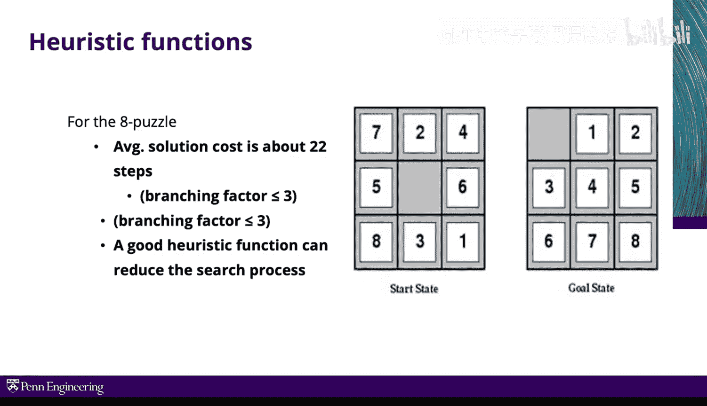

Is just the number of out of place tiles。 We have a total out of place costume 8。

We need at least8 moves because each of those tiles is going to have to move at least one square。

That's one out of place。And the Manhattan distance is how many moves would you have to actually apply to get it into place。

 We have two different ways of estimating。The number of moves that we would need to make are these。

Admissible heuristics。Are they underestimate？The number of movess that we would need to make。

These definitely will underestimate because we'll have to make more moves than us to move the tiles into position。

One way that we could come up with。Admissible heuristics in kind of a nice principle way is the idea of relaxing constraints。

 We're going to take a problem with some number of restrictions。

 and we're going to reduce one or more of those restrictions。

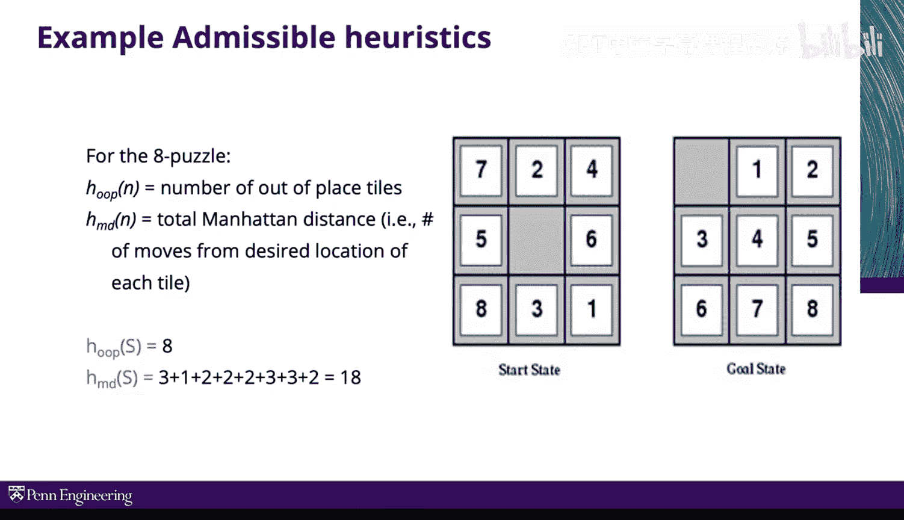

That compute the cost with that relaxed constraint。

And then thatll end up being an admissible heuristic for the original problem。

The rules of the tile game is you could only move where an adjacent one that's blank。

We can relax that to say you can move it to anyddy adjacent square that'll give us the Manhattan distance。

 We're ignoring the constraint that can only move a tile into a blank square。

We could also say you can move a tile anywhere， not just an adjacent square。

 and not just an adjacent plank square。That'll give us the out of place， heuristic estimate。

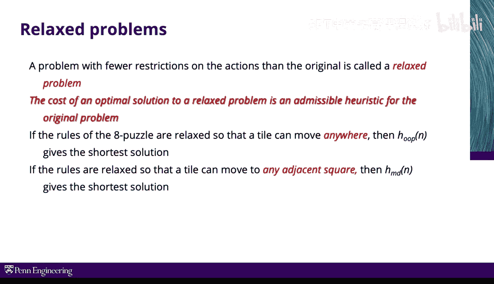

The cost of an exact solution to a relaxed problem。

The lower bound on the number of things that we would have to do or the full problem。

Here's all these different ones。 A tile can move from a square A to square B。

 If a is adjacent to B and B as blank。 Those are two constraints。 the relaxed problems are。

A tile can move from square A to square B， if A is adjacent to B， that's get bar。

 Manhattan distance or a tile can move from to square B if it's blank， that's not really useful。

And then a tide removed from square A to square B， were relaxing both those constraints。

To get our out of place one。We've got two ways of computing these heuristic costs at the remaining number of moves that we have to make。

How do we know which ones better， They both are admissible heuristics。 They both will help a star。

Ackeded in an optimal way， but。They're going to have different number of nodes that we have to expand in our search。

We can say that one heuristic is better than another。 define that using a term called dominance。

 This is going to be a way of measuring whether one heuristic is better than another。 So heuristic 2。

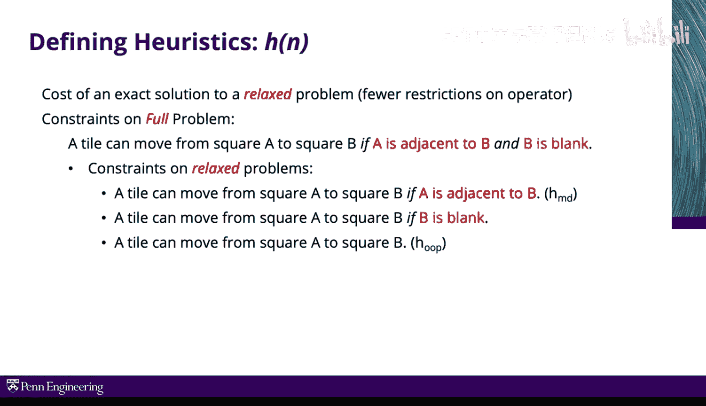

Is better than heuristic 1。 It dominates Heuristic 1。 If for every node in our search graph。

Has a higher estimate of the remaining cost， and are both still admissible。

 Under of the true distance of the goal。 But we want to be as close as possible to the actual estimate。

 if H2 is optimistic。But it returns a higher or equal to estimate than H1。

 then it's a more accurate estimate of the remaining cost of the afford feather first。

If the typical number of moves that we have to make for8 puzzle is 12。

 then one of our search methods would have to expand 3 million possible nodes。

If we do a star without a place here， we would only have to expand 227 nodes。

 if we use the Manhattan distance， we only would have to expand 73 nodes average。

For solutions with a depth of 24， one of our iterative deepening searches would be way too many to actually find a solution。

And the out of place one would explore 40，000 nodes。

 and the Manhattan distanceance one would explore 1。6，000， the better your heuristic estimate。

A smaller amount of nodes you have to expand， thus the faster you find a solution。

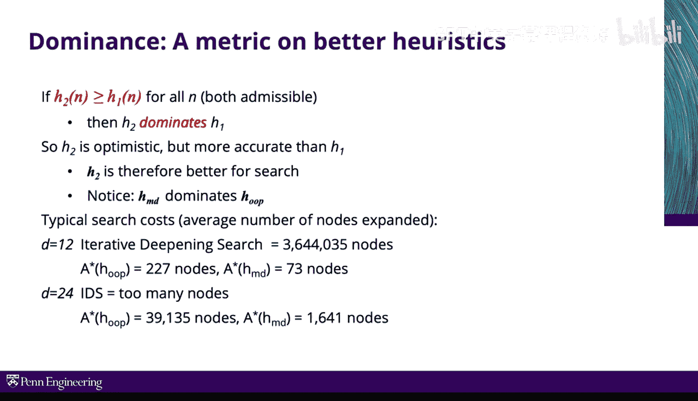

What are the best and worst。Of admissible heuristics。

The best admissable heuristic is just the truth is an actual estimate to the goal。

If we knew the truth， then we could just make a bee line to it。

 it would basically be a greedy vest first search but like we know exactly how much distance remains。

The worst admissible heuristic。Is always going to underestimate the true distance to the goal。

 We're here。There's zero remaining distance， that's going to be terrible because it's good to devolve into uniform cost search。

 they're both admissible。And we can say that each star， if the truth， dominates all other heuristics。

The teleportation one， where art is here is dominated by all other heuristics。

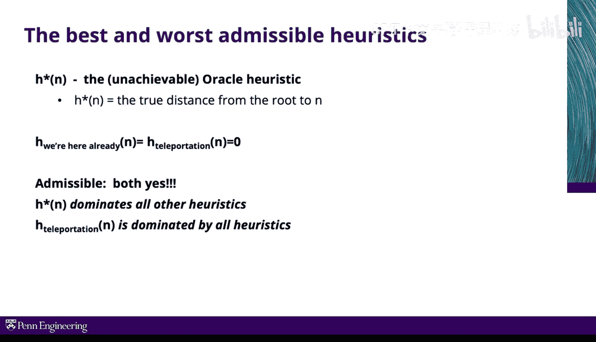