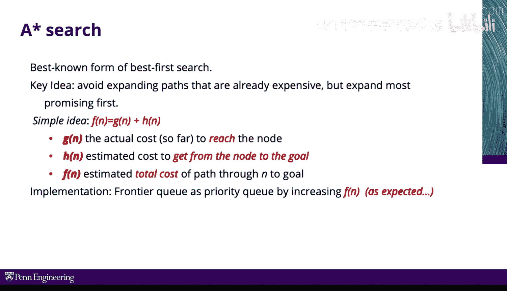
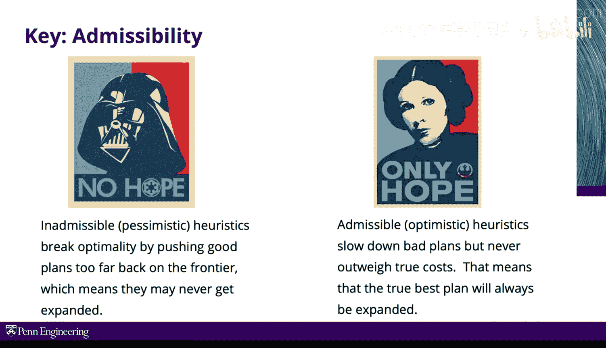
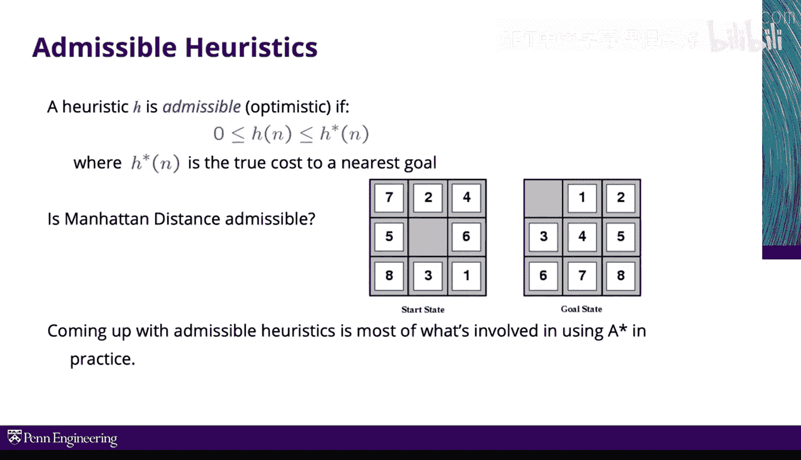
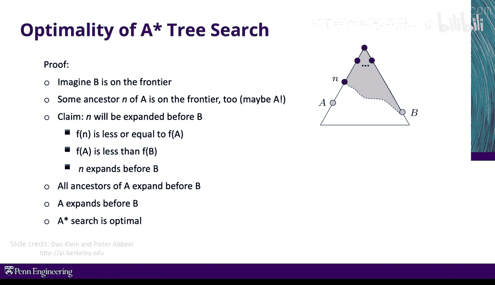

# 宾夕法尼亚大学《人工智能和机器学习基础（AI、数据科学、机器学习）AI and Machine Learning Essentials with Python》 p34 34_04_01_A搜索-II.zh_en -BV16f421Q72q_p34-

A star search is a form of best first search。 The idea is we're going to take a couple of different cost measures into account when we're populating by our priority queue that we use to decide which node to expand next We first saw this notion of adding a priority queue to our frontier with the uniform cost search algorithm。

 which allowed us to do something similar to breath first search。

 but in places where we have a cost associated with each next move or a weighted graph representing the space of possible in that case。

 we were just waiting each node in our frontier based on the actual cost so far to reach the current node that we're about to expand throughout this section on search algorithms。

 we're going to call that path cost to get to a certain node N G O N。

A thing that a star introduces is a new thing that gives us not only the cost from the initial state to the current state。

 but also a heuristic estimate of what it'll cost us to get from this current state N to the goal state。

That is going to be a heuristic because most of the time it's not going to be an exact estimate or else we would have already solved the search problem。

 but the heuristic cost is going to be called H of n。

 and we're going to talk shortly about the notion of admissibility。

 what makes a heuristic proper that will then give us the guarantee of optimality that we have for a star search with admissible heuristic。

Finally， the thing that we're actually sorting our frontier on。

 we're assigning the priority in our priority Q is F of n。

 which is simply the estimated total cost to get from the starting point to the goal via n。

 that's going to be G of n plus H of n。We can implement the frontier just with the priority queue and we'll pop off each element based on the lowest cost F of n value of any node on our frontier at the moment。

 the key idea behind a star search and how we can guarantee that it will be optimal。

 meaning it'll find the shortest path to the goal first， before it finds any other paths to the goal。

The key concept is admissibility and so admissibility means that when we estimate our heuristic remaining cost from the current node to the goal。

 we have to。Underestimate or exactly equal the remaining cost of the goal。

 we're going to say this is like a hopeful thing。 We're going to say， oh。

 I think that we're getting closer and we may be overly optimistic。

 We'll say we're closer than we actually are the remaining distance。

The nice thing is if we apply this optimistic heuristic to all nodes。

Then we're never going to overestimate the true remaining cost。

 The reason that the overestimate is bad is that may cause the true best path to look worse than it is if we're pessimistic。

 we say oh， from here it's going to take forever to get to the goal。

Then that's going to push that path through end。Further down in the frontier。

 and it may never get deed before a different past cycle。But if we're optimistic。

 we're never going to push anything further back in the queue than it needs to be。

That's the kind of intuitive explanation for a amissal heuristic。

 it should always be optimistic it should always underestimate the remaining distance from the current node to the goal state。

The formal definition of an admissible heuristic is that a heuristic H is admissible。

If each of in， for any node in our search tree。The the value is greater than or equal to 0 and less than or equal to the true remaining cost。

 Manhattan distance for our eat puzzle were admissible heuristics。

 We talked through different ways of creating admissible heuristics by relaxing some of the constraints that the problem places on us。

The most difficult thing about implementing a star is simply coming up with an appropriate admissible heuristic。

Last time we talked about how some admissible heuristics are better than others。

 we talked about the notion of dominance and if a particular admissible heuristic always assigns a higher or equal value for all N compared to another admissible heuristic。

 meaning it's a better estimate。Because although we want to。

Be optimistic and underestimate the true distance remaining to the goal。

 which is required for a star to be admissible。 We want to be under。

 but as close as we can to the true cost。Given that definition of admissible。

 let's see a sketch of proof。That a star is in fact optimal。

 meaning we're always going to arrive at the lowest cost。Half to a goal node。

First。😡，So here's the sketch， we're going to talk about this in terms of a search tree。

 recall that last time we talked about how you can represent a search through this search tree representation。

 we've got a root node which is our initial state and we expand that by taking actions or pulling a node off of the frontier and getting its successors that will be what causes the tree to expand。

Let's assume that we've got the search tree and we have two nodes in it。

 both of which are goal nodes， A is a goal node and B is a goal node。

 there will be some sequence of nodes that we expand in order to get to a and some other sequence of nodes that we expand in order to get to B。

 the key E for whether or not the search algorithm is optimal is not just that it will find a goal state。

 it wants to find the goal state with the lowest path cost here A is going to be the goal state with the lowest path cost and B is going to be a goal state with a higher path cost than a。

When we want to say that a star search will find a before B。

 that means that a will exit the frontier before B， we'll pop it off of our frontier。

 our priority queue and say， is this a goal node， yes。

We found it what we're going to show here is that a is guaranteed to leave the frontier before B leaves the frontier。

 and that'll be sufficient for us to show that a star search with a admissible heuristic is therefore optimal。

Let's imagine that B。Our goal state with a higher path cost is somewhere on the frontierer。

And then let's say that。Some ancestor of N is also on the frontier， which is true。

 either it's the root node or we could go all the way down to A itself。

My claim is going to be that the ancestor of a is always going to be expanded before B will the ancestors of a will always leave the fringe before B。

How are we going to do that， We're going to use a couple of things to show that The first is we're going to say the F of n。

 the cost of that ancestor node n is less than or equal to a。

 This is just the definition of the F cost it's going to be the path cost G of N the heuristic of the remaining distance to the goal。

The reason that F of n is going to be less than or equal to the path cost to a。

Because it's an ancestor。And it' will be equal to a in a case that n is a。

 and we know that H of n at the goal has to be equal to zero because we need to be less than or equal to the true paths。

To a goal， if we're at a goal state， the only way that we can do that is if the H of n equals 0 for the node。

 that means that the path cost G of a equals F of a because the h of。A term equals zero。

That means that S of n is going to be less than or equal to G of a。Next。

 we're going to talk about how the path cost to A relates to the path cost to B。

I'm also going to say。That F of a is going to be less than。F O B， B is subopti。

The path cost to a is going to be less than the path cost to B。

 that's just our definition of optimal if a is the goal node with the shortest path cost。

 that means it's optimal B is subop therefore it has a higher path。

Since H of a and H of B are both equal to0 because theyre both goal states。

 that means that F of a is going to be less than F of B。

 We've already shown that F of n is going to be less than F of a。

The F of n will therefore have to be expanded before F of B because we said F of n is less than or equal to f of A and f of a is less than F of B。

X says n once again is less than or equal to F of A is less than F of B。

 therefore n will have to get expanded before B because we take things off of our frontier。

Based on the lowest F score。That means that all ancestors of。

A are going to be expanded before B is expanded because we didn't say anything particular about what F of N was other than it was an ancestor of A or a itself。

That means that all。Ancestors of a， including a itself， are going to be expanded before B。 Therefore。

 we will have reached the lowest cost。Gal state before we reach a higher cost goal state。

 and that's the definition of optimalim。

